Esta página te lleva primero a una imagen, y después te ayuda a entender cómo se construye un flujo de trabajo.

Este tutorial usa ComfyUI en tu propia computadora: Comfy Desktop, ComfyUI Portable o una instalación manual. Instala ComfyUI y ábrelo antes de empezar.

<Tip>
  Para usar ComfyUI en tu navegador sin instalar nada, [abre la plantilla de texto a imagen Z-Image-Turbo en Comfy Cloud](https://cloud.comfy.org/?template=image_z_image_turbo&utm_source=docs&utm_medium=referral&utm_campaign=first_generation).
</Tip>

## Elige cómo empezar

Usa las pestañas para elegir el camino inicial. **Plantilla** es lo recomendado para una primera imagen moderna. **Armar el grafo** enseña nodos y conexiones con Stable Diffusion 1.5 en un lienzo vacío.

<Tabs>
<Tab title="Plantilla (recomendado)">
Las plantillas actuales de ComfyUI incluyen modelos abiertos modernos. **Z-Image-Turbo** es una buena primera imagen: pocos pasos de muestreo, buena calidad para su tamaño y una plantilla oficial mantenida. A diferencia de **Armar el grafo**, **no** montas nodos a mano: abres la plantilla, instalas sus modelos y ejecutas.

### 1. Abrir la plantilla Z-Image-Turbo

1. En ComfyUI, abre el explorador de plantillas (**Workflow → Browse Templates**, o la entrada Templates de la interfaz que uses).
2. Busca **Z-Image-Turbo** (texto a imagen).
3. Abre la plantilla para que se cargue en el lienzo.

<Tip>
  ¿Prefieres el navegador sin instalar nada? [Abre la misma plantilla en Comfy Cloud](https://cloud.comfy.org/?template=image_z_image_turbo&utm_source=docs&utm_medium=referral&utm_campaign=first_generation). Tarjetas de modelo y más flujos: [Z-Image-Turbo en ComfyUI](/tutorials/image/z-image/z-image-turbo).
</Tip>

### 2. Instalar los modelos

Z-Image-Turbo necesita **tres** archivos (codificador de texto + modelo de difusión + VAE), no un solo checkpoint de SD 1.5:

| Archivo | Carpeta |
| --- | --- |
| `qwen_3_4b.safetensors` | `ComfyUI/models/text_encoders/` |
| `z_image_turbo_bf16.safetensors` | `ComfyUI/models/diffusion_models/` |
| `ae.safetensors` | `ComfyUI/models/vae/` |

**Camino más fácil — UI de modelos faltantes**

1. Si tras cargar la plantilla aparece un aviso de modelo faltante, haz clic en **Ver detalles**.
2. En la pestaña **Problemas**, bajo **Modelos faltantes**, usa **Descargar** cuando Comfy Desktop lo ofrezca.
3. En **Portable** o instalación **manual**, abre el enlace de cada archivo (o copia la URL), descárgalo y muévelo a la carpeta indicada bajo el nombre — misma idea que [Corregir un modelo faltante](#fix-a-missing-model).
4. Pulsa `R` (o **Actualizar** en Modelos faltantes) para que ComfyUI vuelva a escanear.

**Descarga manual** — si el panel no muestra **Descargar**, usa las tarjetas y el árbol de carpetas en [descargas de modelos Z-Image-Turbo](/tutorials/image/z-image/z-image-turbo#z-image-turbo-model-downloads).

### 3. Ejecutar y ver la imagen

1. Si quieres, edita los widgets de prompt en el lienzo.
2. Haz clic en **Run**, o pulsa `Ctrl+Enter` (`Cmd+Enter` en macOS). La ejecución entra en la cola y ComfyUI genera la imagen.
3. Al terminar, abre el resultado en el nodo de guardado / vista previa de la plantilla.
4. O desde la **barra lateral izquierda**, abre **Activos → Generados**. En Portable e instalaciones manuales también se escriben PNG en `ComfyUI/output`.

Si aparece **Falta entrada requerida**, consulta [Falta entrada requerida](#required-input-missing). Si aún falta un modelo, vuelve al paso 2 o a [Corregir un modelo faltante](#fix-a-missing-model).

Ya tienes una primera imagen en una pila actual. Cambia a la pestaña **Armar el grafo** cuando quieras cablear Stable Diffusion 1.5 nodo a nodo.

</Tab>
<Tab title="Armar el grafo">
En este camino construyes un flujo de trabajo de texto a imagen en un **lienzo** vacío. Escribes la descripción de una imagen y ComfyUI genera una imagen de 512 × 512 con el modelo **Stable Diffusion 1.5**. Agregas y conectas cada nodo tú mismo. Cada paso indica qué hace el nodo y cómo saber que el paso funcionó.

SD 1.5 aquí es pequeño y simple a propósito: un checkpoint, un grafo corto y valor didáctico claro. **No** es el objetivo de calidad más reciente — cambia a la pestaña **Plantilla (recomendado)** (u otros tutoriales de modelos) cuando quieras valores predeterminados modernos.

## Aprende las partes de un flujo de trabajo

Un flujo de trabajo es un conjunto de nodos unidos por conexiones. Cada nodo cumple una tarea:

- **Entradas**: son los puntos del lado izquierdo de un nodo. Reciben datos de otros nodos.
- **Salidas**: son los puntos del lado derecho de un nodo. Envían datos a otros nodos.
- **Widgets**: son las configuraciones dentro de un nodo, como una caja de texto, un número o una lista.
- **Conexiones**: son las líneas que llevan datos desde una salida hasta una entrada del mismo tipo, como desde la salida `CLIP` hasta una entrada `clip`.

El flujo de trabajo del Camino B tiene siete nodos de seis tipos. La última columna indica dónde se encuentra cada nodo en el menú **Add Node**, que se explica en [Agrega un nodo](#agregar-un-nodo).

| Nodo | Qué hace | Ruta en **Add Node** |
| --- | --- | --- |
| `Load Checkpoint` | Carga el archivo del modelo. Sus salidas son el modelo (`MODEL`), el codificador de texto (`CLIP`) y el decodificador de imágenes (`VAE`). | **model** > **loaders** |
| `CLIP Text Encode (Prompt)` | Convierte tu prompt de texto en datos que guían el modelo. Agregas dos: uno para lo que quieres y otro para lo que no quieres. | **model** > **conditioning** |
| `Empty Latent Image` | Crea la imagen inicial en blanco y establece su ancho y alto. | **model** > **latent** |
| `KSampler` | Usa el modelo y ambos prompts para convertir la imagen inicial en blanco en tu imagen, paso a paso. | **model** > **sampling** |
| `VAE Decode` | Convierte el resultado de `KSampler` en una imagen normal. | **model** > **latent** |
| `Save Image` | Muestra la imagen y la guarda en la carpeta de salida. | **image** |

## Descargar el modelo

El nodo `Load Checkpoint` necesita un archivo de modelo. Este tutorial usa `v1-5-pruned-emaonly-fp16.safetensors`.

- Descarga [`v1-5-pruned-emaonly-fp16.safetensors`](https://huggingface.co/Comfy-Org/stable-diffusion-v1-5-archive/blob/main/v1-5-pruned-emaonly-fp16.safetensors) desde Hugging Face.

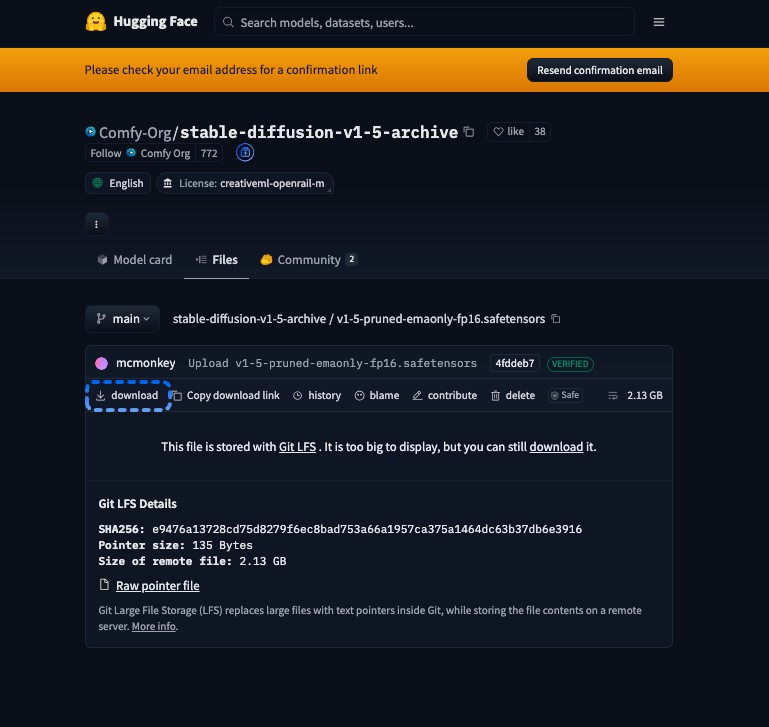

## Coloca el modelo en la carpeta `checkpoints`

ComfyUI muestra un checkpoint solo cuando el archivo está en una carpeta `checkpoints` que ComfyUI lee. Mueve el archivo que descargaste a la carpeta correspondiente a tu instalación.

<Tabs>
  <Tab title="Comfy Desktop">
    De forma predeterminada, cada instancia de Comfy Desktop lee las carpetas de modelos compartidas. Comfy Desktop guarda las descargas de modelos en la carpeta de modelos compartidos marcada como **Descargas**.

    1. En la **barra de título** de Comfy Desktop, haz clic en **Menú** y luego selecciona **Configuraciones de Escritorio**.
    2. Selecciona la pestaña **Almacenamiento**.
    3. En **Modelos compartidos**, haz clic en la ruta de carpeta marcada como **Descargas**. La carpeta se abre en tu administrador de archivos.
    4. Mueve `v1-5-pruned-emaonly-fp16.safetensors` a la carpeta `checkpoints` que está dentro. Si no hay una carpeta `checkpoints`, créala.
  </Tab>
  <Tab title="ComfyUI Portable">
    - Mueve `v1-5-pruned-emaonly-fp16.safetensors` a `ComfyUI_windows_portable\ComfyUI\models\checkpoints`.

    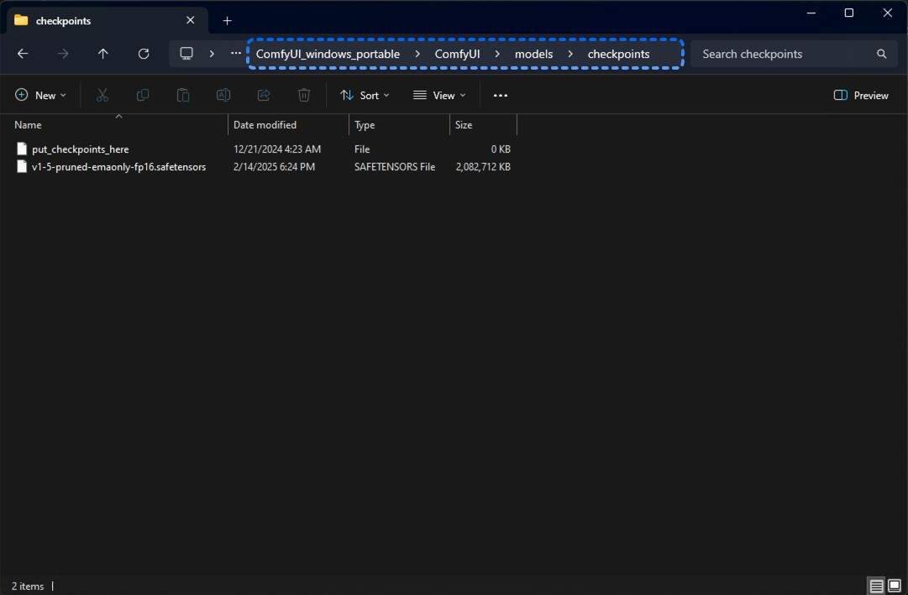
  </Tab>
  <Tab title="Instalación manual">
    1. Abre la carpeta donde instalaste ComfyUI, la que contiene `main.py`.
    2. Mueve `v1-5-pruned-emaonly-fp16.safetensors` a su carpeta `models/checkpoints`.
  </Tab>
</Tabs>

Si ComfyUI ya está abierto, presiona `R` para que vuelva a leer las carpetas de modelos.

## Abrir un flujo de trabajo en blanco

El **Lienzo** es el área grande donde colocas los Nodos. Si ya muestra un flujo de trabajo, abre uno vacío:

1. En la parte superior de la **barra lateral izquierda**, haz clic en el logo de ComfyUI (**Menú**).
2. Selecciona **Nuevo**.

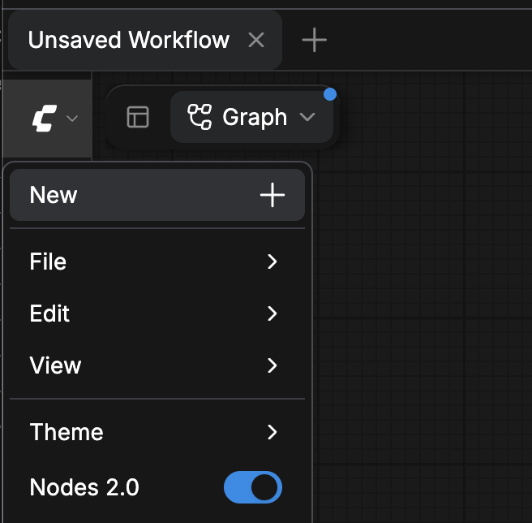

El **Lienzo** ahora está vacío.

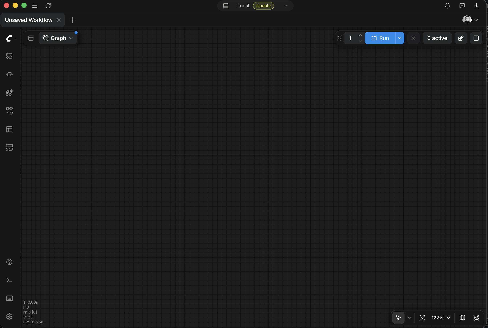

<Tip>
  En la **barra superior**, el botón más (**+**) junto a las pestañas de tus flujos de trabajo abiertos también abre un nuevo flujo de trabajo en blanco.

  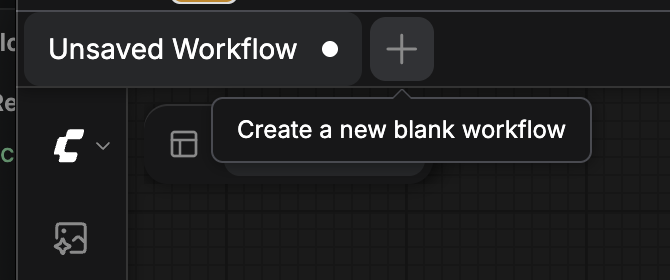
</Tip>

## Agregar un nodo

Hay tres formas de agregar un nodo. Los pasos posteriores indican qué forma usar.

### Usar el menú Add Node

1. Haz clic derecho en un espacio vacío del **lienzo**. Se abre un menú.
2. Selecciona **Add Node** y luego selecciona cada categoría en la ruta **Add Node** del nodo. La [tabla de nodos](#aprende-las-partes-de-un-flujo-de-trabajo) muestra la ruta de cada nodo en este tutorial.
3. Selecciona el nodo. Aparece donde hiciste clic derecho.

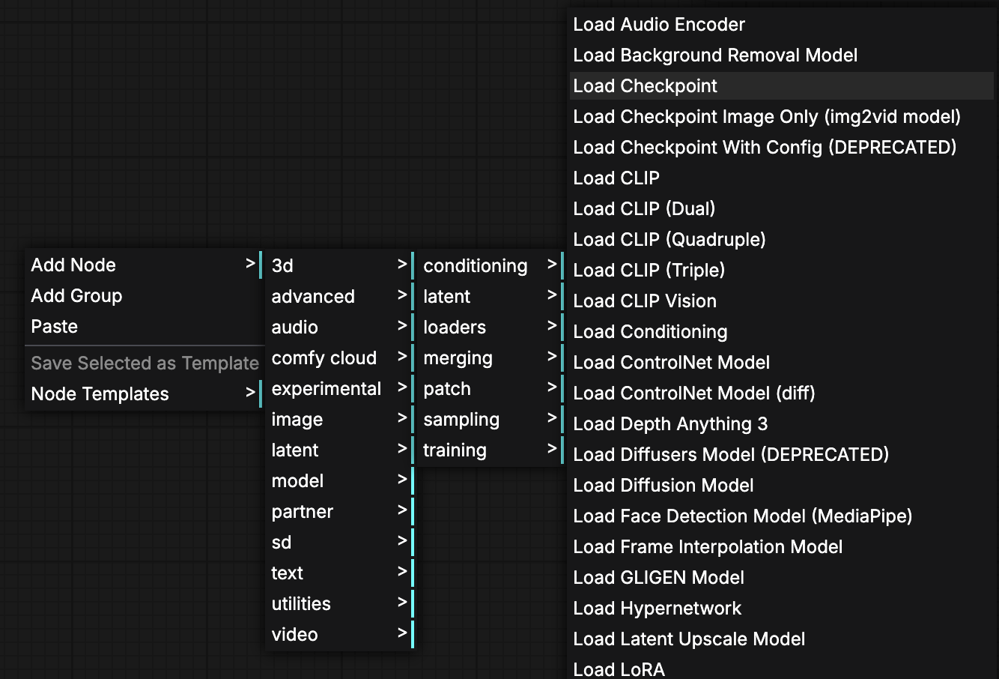

### Buscar en la Biblioteca de nodos

1. Presiona `N` o haz clic en **Nodos** en la **barra lateral izquierda**. Se abre la **Biblioteca de nodos**.
2. Si la **Biblioteca de nodos** muestra más de una pestaña, selecciona **Todos los nodos**.
3. Escribe el nombre del nodo en la caja **Buscar nodos...**.
4. Haz clic en el nodo en los resultados y luego haz clic en el **lienzo** donde lo quieras. El nodo aparece ahí.

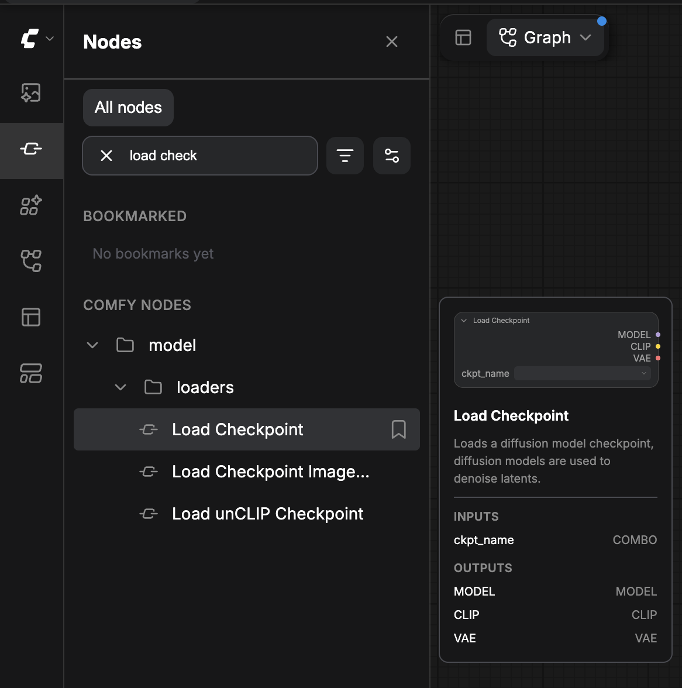

### Arrastrar una conexión a un lienzo vacío

Arrastrar una conexión a un lienzo vacío agrega un nodo y lo conecta en un solo movimiento.

1. Arrastra desde un punto de salida de un nodo que ya colocaste.
2. Suelta sobre un espacio vacío del **lienzo**. La caja de búsqueda de nodo se abre ahí de forma predeterminada.
3. Escribe el nombre del nodo y luego selecciónalo. ComfyUI agrega el nodo y lo conecta a la salida desde la que arrastraste.

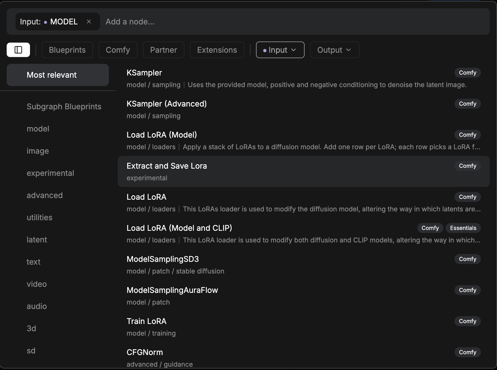

Para abrir un menú en lugar de la caja de búsqueda, mantén presionada `Shift` al soltar.

## Conectar dos nodos

Un enlace transporta datos desde una salida de un nodo hasta una entrada de otro nodo.

1. Arrastra desde un punto de salida de un nodo.
2. Suelta sobre un punto de entrada de otro nodo. Aparece un enlace entre los dos puntos.

Estas reglas se aplican a todos los enlaces:

- Una salida puede alimentar varias entradas.
- Una entrada admite un enlace. Un nuevo enlace hacia una entrada reemplaza el anterior.
- Un enlace une una salida y una entrada del mismo tipo. ComfyUI no dibuja un enlace entre tipos diferentes.

## Agregar el nodo `Load Checkpoint`

El nodo `Load Checkpoint` carga el archivo del modelo.

1. Agrega un nodo `Load Checkpoint` con el [menú **Add Node**](#usar-el-menú-add-node): **model** > **loaders** > `Load Checkpoint`.
2. En el nodo, haz clic en el widget `ckpt_name` y luego selecciona `v1-5-pruned-emaonly-fp16.safetensors`.

El nodo muestra tres salidas en su lado derecho: `MODEL`, `CLIP` y `VAE`.

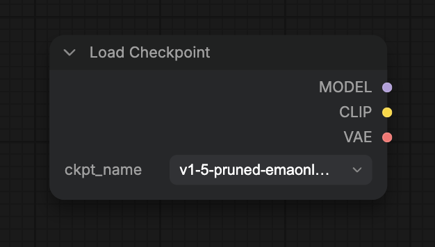

Si la lista `ckpt_name` no muestra el archivo, consulta [El modelo no está en la lista de checkpoints](#el-modelo-no-está-en-la-lista-de-checkpoints).

## Añadir el nodo `KSampler`

El nodo `KSampler` hace la generación. Necesita cuatro conexiones: el modelo, ambos prompts y la imagen en blanco de inicio.

1. Añade un nodo `KSampler` con la [**Biblioteca de nodos**](#buscar-en-la-biblioteca-de-nodos): busca `KSampler`.
2. [Conecta](#conectar-dos-nodos) la salida `MODEL` de `Load Checkpoint` a la entrada `model` de `KSampler`.

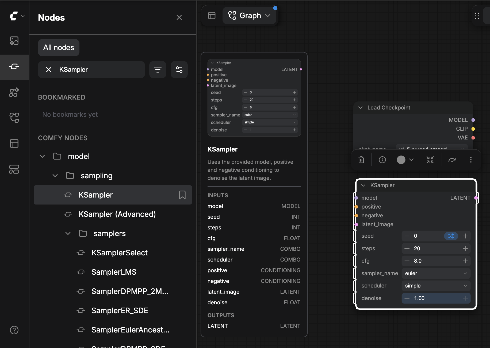

Las otras tres conexiones las dibujas en las dos secciones siguientes.

Deja los widgets de `KSampler` en sus valores predeterminados. Por ejemplo, `steps` es `20` y `cfg` es `8.0`.

## Agregar los nodos de prompt

Los prompts describen la imagen. El prompt positivo indica lo que quieres ver. El prompt negativo indica lo que no quieres.

1. Agrega un nodo `CLIP Text Encode (Prompt)` con el [menú **Add Node**](#usar-el-menú-add-node) (**model** > **conditioning**) o la [**Biblioteca de nodos**](#buscar-en-la-biblioteca-de-nodos).
2. Haz clic en su caja de texto y escribe tu prompt positivo, por ejemplo `beautiful scenery nature glass bottle landscape, purple galaxy bottle`.
3. Haz clic derecho en el nodo y luego selecciona **Duplicar**. Aparece un segundo nodo `CLIP Text Encode (Prompt)`.
4. Haz clic en la caja de texto del segundo nodo y escribe tu prompt negativo, por ejemplo `text, watermark`.

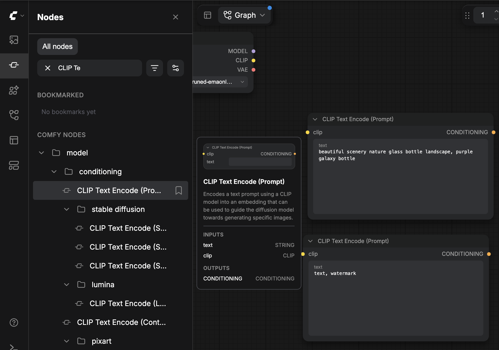

[Conecta](#conectar-dos-nodos) los prompts:

1. Conecta la salida `CLIP` de `Load Checkpoint` a la entrada `clip` de cada nodo `CLIP Text Encode (Prompt)`. Ambos nodos de prompt comparten la única salida `CLIP`.
2. Conecta la salida `CONDITIONING` del nodo de prompt positivo a la entrada `positive` de `KSampler`.
3. Conecta la salida `CONDITIONING` del nodo de prompt negativo a la entrada `negative` de `KSampler`.

## Establecer el tamaño de la imagen

El nodo `Empty Latent Image` establece el tamaño de la imagen. Sus campos `width` y `height` comienzan en `1024`. Este flujo de trabajo usa `512`, el tamaño del flujo de trabajo de ejemplo en [Cargar un flujo de trabajo desde una imagen](#cargar-un-flujo-de-trabajo-desde-una-imagen).

1. Agrega un nodo `Empty Latent Image` con el [menú **Add Node**](#usar-el-menú-add-node): **model** > **latent** > `Empty Latent Image`.
2. Establece `width` en `512`.
3. Establece `height` en `512`.
4. Deja `batch_size` en `1`.
5. [Conecta](#conectar-dos-nodos) su salida `LATENT` a la entrada `latent_image` de `KSampler`.

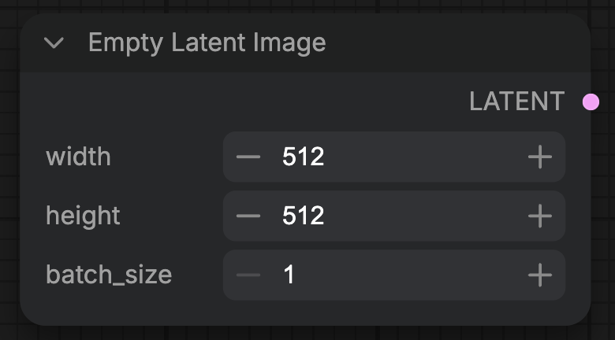

Las cuatro entradas de `KSampler` ahora tienen conexiones.

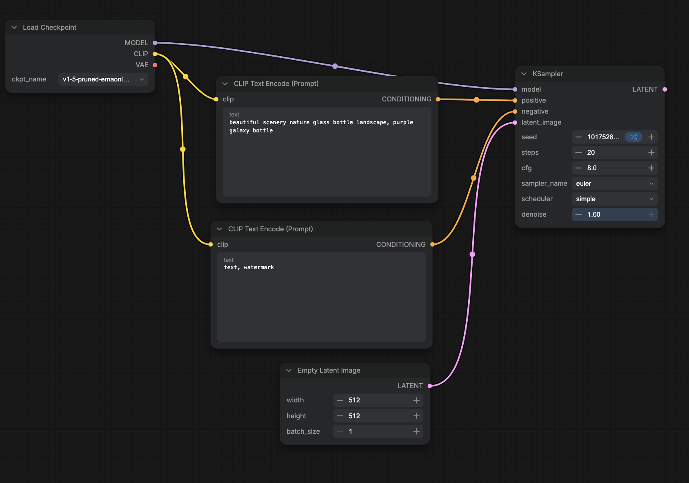

## Decodificar y guardar la imagen

`KSampler` produce un latente, no una imagen. `VAE Decode` lo convierte en una imagen y `Save Image` la guarda.

1. Agrega un nodo `VAE Decode` con la [**Biblioteca de nodos**](#buscar-en-la-biblioteca-de-nodos): busca `VAE Decode`.
2. [Conecta](#conectar-dos-nodos) la salida `LATENT` de `KSampler` con la entrada `samples` de `VAE Decode`.
3. Conecta la salida `VAE` de `Load Checkpoint` con la entrada `vae` de `VAE Decode`.
4. Agrega un nodo `Save Image` [arrastrando un enlace al lienzo vacío](#arrastrar-una-conexión-a-un-lienzo-vacío): arrastra desde la salida `IMAGE` de `VAE Decode`, suelta sobre el **Lienzo** vacío y selecciona `Save Image`. Su entrada `images` queda vinculada a `IMAGE`.

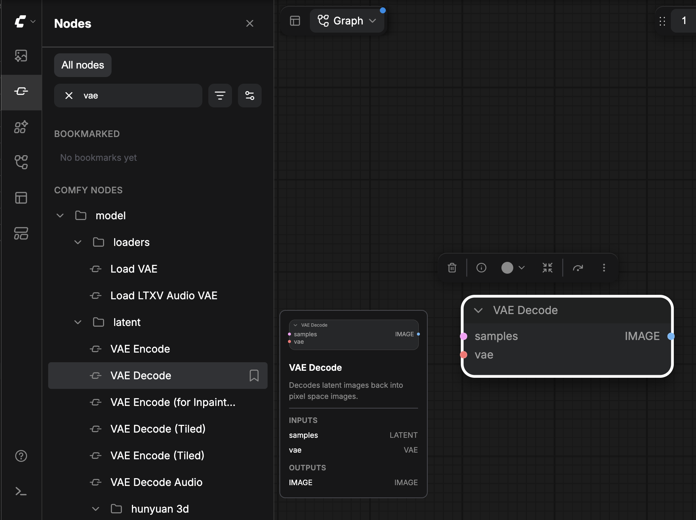

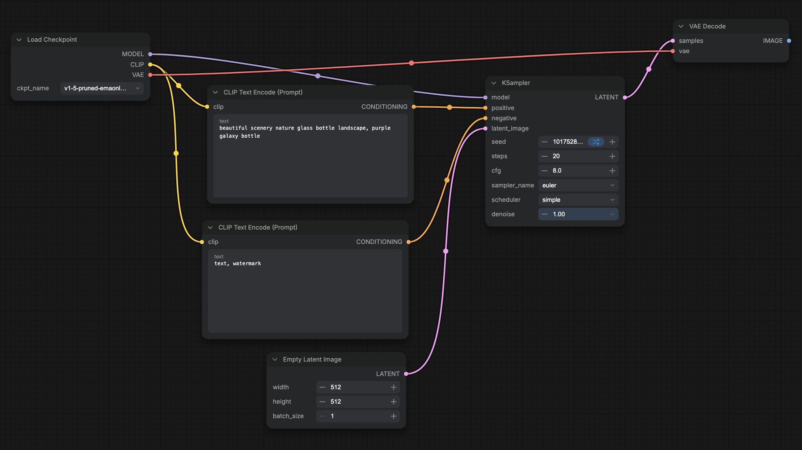

Tu flujo de trabajo tiene siete nodos y nueve enlaces.

<Tip>
  Con ningún nodo seleccionado, presiona `.` para ajustar todo el flujo de trabajo a la pantalla.
</Tip>

## Ejecutar el flujo de trabajo

Al ejecutar el flujo de trabajo, este se pone en cola y ComfyUI genera la imagen.

- Haz clic en **Run**, o presiona `Ctrl+Enter` (`Cmd+Enter` en macOS).

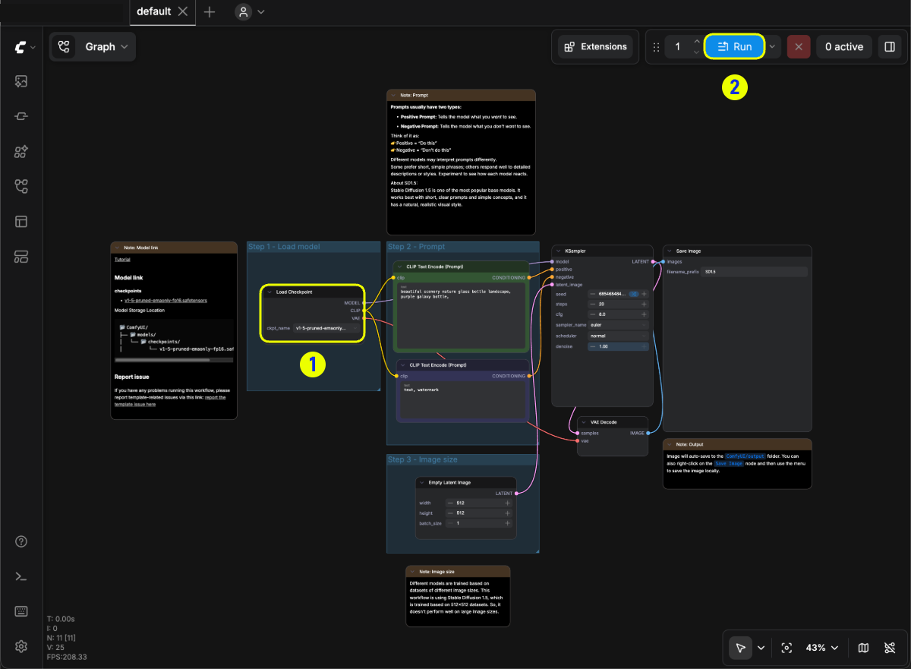

Si ComfyUI muestra **Falta entrada requerida**, consulta [Falta entrada requerida](#falta-entrada-requerida).

## Encontrar la imagen generada

Cuando termina la ejecución, la imagen aparece en el nodo `Save Image`. Para abrirla desde la **barra lateral izquierda**:

- Haz clic en **Recursos** y luego selecciona la pestaña **Generados**.

`Save Image` también escribe la imagen en la carpeta de salida como un archivo PNG llamado `ComfyUI_00001_.png`. El número aumenta con cada imagen nueva. En ComfyUI Portable y en las instalaciones manuales, la carpeta de salida es `ComfyUI/output`.

## Cargar un flujo de trabajo desde una imagen

De forma predeterminada, cada archivo PNG que escribe `Save Image` contiene el flujo de trabajo con el que se creó. Carga la imagen de ejemplo de abajo para comparar su flujo de trabajo con el que armaste en el Camino B.

1. Guarda esta imagen en tu computadora:

   

2. Arrastra el archivo PNG al **lienzo**. También puedes hacer clic en el **Logo de ComfyUI** (**Menú**) en la **barra lateral izquierda**, seleccionar **File** > **Open** y elegir el archivo.

Se abre el flujo de trabajo de la imagen. Si en su lugar aparece un nodo `Load Image`, significa que el archivo que arrastraste no tiene ningún flujo de trabajo guardado.

</Tab>
</Tabs>

## Corregir un modelo faltante {#fix-a-missing-model}

Cuando cargas un flujo de trabajo cuyo archivo de modelo no está en tus carpetas de modelos, ComfyUI muestra un aviso con el nombre del modelo faltante, como `v1-5-pruned-emaonly-fp16.safetensors is missing`.

1. Haz clic en **Ver detalles**. El **Panel del lado derecho** se abre en la pestaña **Problemas** y muestra el archivo en **Modelos faltantes**. La carpeta a la que pertenece el archivo, como `checkpoints`, aparece debajo del nombre del archivo.
2. Si la fila tiene un botón **Descargar**, haz clic en él.
   - **Comfy Desktop**: Comfy Desktop descarga el archivo en la carpeta `checkpoints` de tu carpeta de modelos **Descargas**.
   - **ComfyUI Portable e instalaciones manuales**: Tu navegador descarga el archivo. Muévelo a la carpeta `checkpoints`, como se indica en [Colocar el modelo en la carpeta checkpoints](#coloca-el-modelo-en-la-carpeta-checkpoints).
3. Si la fila no tiene un botón **Descargar**, obtén el archivo por tu cuenta:
   1. Haz clic en el icono de enlace junto al nombre del archivo. El icono de enlace copia el enlace de descarga (**Copiar URL**) o el nombre del archivo cuando el flujo de trabajo no tiene enlace (**Copiar nombre del modelo**).
   2. Descarga el archivo. Para el modelo del Camino B, sigue [Descargar el modelo](#descargar-el-modelo). Para el Camino A, usa los enlaces del [tutorial de Z-Image-Turbo](/tutorials/image/z-image/z-image-turbo).
   3. Mueve el archivo a la carpeta indicada debajo del nombre del archivo, como `checkpoints`, `diffusion_models`, `text_encoders` o `vae`.
4. Haz clic en **Actualizar** (la flecha circular) en el encabezado **Modelos faltantes**, o presiona `R`, para que ComfyUI revise las carpetas de modelos otra vez.

Una fila de modelo faltante no tiene botón **Descargar** cuando se cumple cualquiera de estas condiciones:

- El flujo de trabajo no tiene un enlace de descarga para el modelo. La imagen de ejemplo en [Cargar un flujo de trabajo desde una imagen](#cargar-un-flujo-de-trabajo-desde-una-imagen) es uno de estos flujos de trabajo.
- El enlace de descarga no es un enlace de Hugging Face o Civitai.
- El nombre del archivo no termina en `.safetensors`, `.sft`, `.ckpt`, `.pth` o `.pt`.
- El flujo de trabajo no indica en qué carpeta de modelos va el archivo.

<Note>
  Comfy Cloud nunca muestra **Descargar** para un modelo faltante. En su lugar muestra **Importar**, para que puedas importar el modelo a Comfy Cloud. Los modelos que usan los nodos que no admiten modelos importados se muestran en **Importación no soportada**.
</Note>

## Solucionar problemas

Usa estas entradas cuando una ejecución falle o el archivo del modelo no cargue.

### Falta entrada requerida

Una entrada no tiene enlace. El mensaje indica el nodo y la entrada, por ejemplo `KSampler is missing a required input: latent_image`. [Conecta](#conectar-dos-nodos) la entrada que indica el mensaje y vuelve a ejecutar el flujo de trabajo.

### El modelo no está en la lista de checkpoints

El archivo no está en una carpeta `checkpoints` que ComfyUI lea. Muévelo allí, como en [Colocar el modelo en la carpeta checkpoints](#coloca-el-modelo-en-la-carpeta-checkpoints), y luego presiona `R`.

## Próximos pasos {#next-steps}

- Sigue con modelos de imagen modernos: [Z-Image-Turbo](/tutorials/image/z-image/z-image-turbo), [FLUX.3 Klein](/tutorials/flux/flux-3-klein), [Qwen-Image-2.1](/tutorials/image/qwen/qwen-image-2-1)
- Más conceptos al estilo SD 1.5: [Tutorial de texto a imagen](/tutorials/basic/text-to-image)
- Mapa de la interfaz: [Descripción general de la interfaz](/interface/overview)
