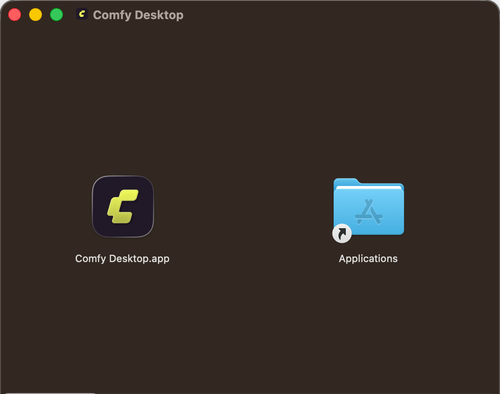
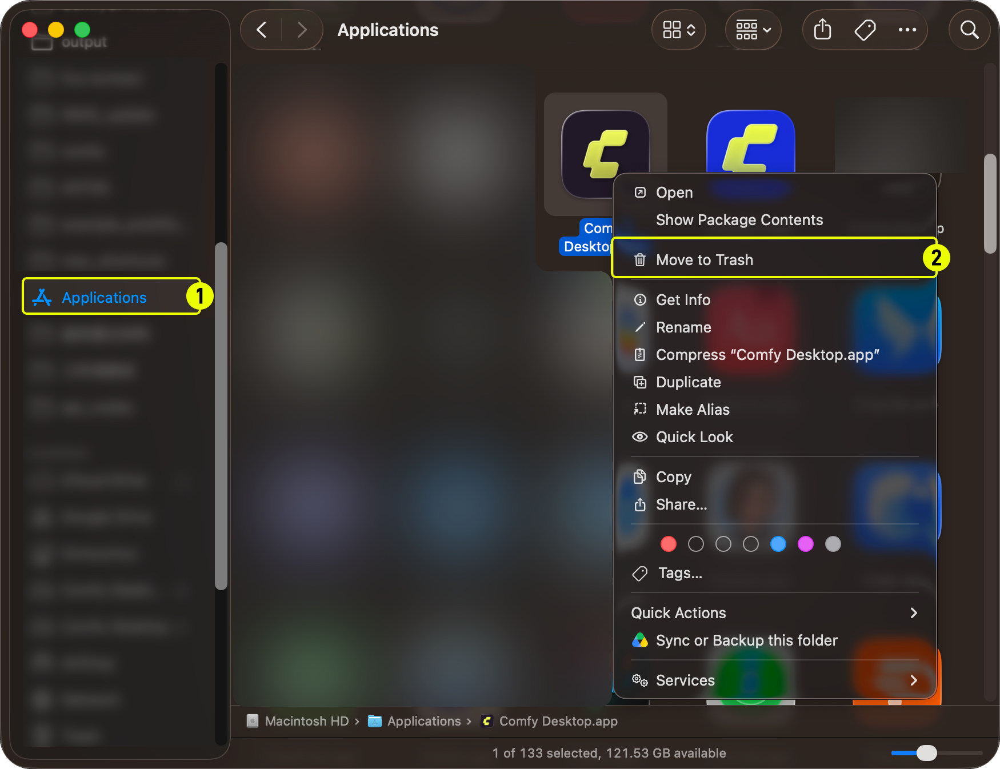

import MigrateTip from '/snippets/es/desktop/migrate.mdx'
import UpdateGuide from '/snippets/es/desktop/update.mdx'

**Comfy Desktop** es un administrador de instalaciones múltiples que te permite ejecutar varias instancias de ComfyUI desde un único lanzador. Esta guía explica cómo instalar y desinstalar Comfy Desktop en macOS.

## Requisitos del sistema

- **SO:** macOS 13 (Ventura) o posterior
- **Hardware:** Apple Silicon (M1 o posterior)
- **Espacio en disco:** al menos 4.85 GB recomendados por instalación

<Card title="Descargar Comfy Desktop" icon="download" href="https://comfy.org/download">
    Descarga el instalador más reciente para macOS. La página detectará tu plataforma automáticamente.
</Card>

## Instalación

1. Abre el archivo `.dmg` descargado
2. Arrastra **Comfy Desktop** a la carpeta **Aplicaciones**
3. Ábrelo desde Launchpad o Spotlight


La primera vez que lo abras, macOS podría mostrar una advertencia de seguridad. Ve a **Configuración del Sistema → Privacidad y seguridad** y haz clic en **Abrir de todos modos** para permitirlo.

<MigrateTip />

<Card title="Siguiente paso: usar Comfy Desktop" icon="book-open" href="/es/installation/desktop/usage/overview">
  Una vez instalado, aprende a crear instancias, administrar instalaciones y configurar los ajustes.
</Card>

## Actualizar Comfy Desktop

<UpdateGuide />

## Desinstalar

### Eliminar Comfy Desktop

1. Abre la carpeta **Aplicaciones** en Finder
2. Haz clic derecho en **Comfy Desktop** y selecciona **Mover a la papelera**



### Lo que la desinstalación de la app NO elimina

Desinstalar Comfy Desktop solo elimina la aplicación del lanzador. Los siguientes datos **no** se eliminan y debes borrarlos manualmente si quieres una limpieza completa:

| Datos | Ubicación predeterminada | Descripción |
|------|-----------------|-------------|
| Instalaciones | `~/ComfyUI-Installs` | Cada instalación de ComfyUI que creaste (también se puede eliminar desde la app). Las rutas de instalación personalizadas tampoco se eliminan. |
| Modelos y salidas compartidos | `~/ComfyUI-Shared` | Biblioteca de modelos compartida, directorios de entrada/salida |
| Configuraciones y registro de la app | `~/Library/Application Support/Comfy Desktop` | Configuraciones y registros de instalación |
| Registros | `~/Library/Logs/Comfy Desktop` | Registros de la app de escritorio (`app.log`) |

<Warning>Los directorios enumerados arriba contienen tus **datos personales de ComfyUI** (modelos, salidas, configuraciones e instalaciones). **No** son archivos de la aplicación Comfy Desktop. Si los eliminas, tus datos se borrarán de forma permanente.</Warning>

Para eliminar todo por completo:

1. **Elimina la carpeta de datos de la app**: `~/Library/Application Support/Comfy Desktop`
2. **Elimina la carpeta de registros**: `~/Library/Logs/Comfy Desktop`
3. **Elimina las instalaciones individuales** desde la app, o borra manualmente `~/ComfyUI-Installs` junto con los directorios de instalación personalizados que hayas configurado
4. **Elimina la biblioteca de modelos compartida** en `~/ComfyUI-Shared` (solo si ya no necesitas estos archivos)

## Si Comfy Desktop arranca con la interfaz rota

Tras una actualización manual, Comfy Desktop puede arrancar sin estilos, con traducciones ausentes o con botones y menús desplegables que no responden. La causa habitual es un perfil de Chromium o una actualización pendiente en caché que dejó la versión anterior.

Cierra Comfy Desktop primero y después ejecuta el script de restablecimiento del [repositorio Comfy-Desktop](https://github.com/Comfy-Org/Comfy-Desktop/blob/main/scripts/reset-mac.sh):

```bash
curl -fsSLO https://raw.githubusercontent.com/Comfy-Org/Comfy-Desktop/main/scripts/reset-mac.sh && bash reset-mac.sh
```

El script muestra cada ruta que va a borrar y pide confirmación antes de eliminar nada. Limpia las configuraciones, las cachés y el perfil de Chromium de la versión actual y de los nombres anteriores de la app, para que un perfil de una compilación antigua no vuelva a aplicarse. Se niega a ejecutarse mientras Comfy Desktop está abierto. La carpeta de registros también está entre las que borra, así que copia el registro antes si crees que vas a informar del problema, consulta [Dónde está el registro de la app](#dónde-está-el-registro-de-la-app).

Tus instalaciones de ComfyUI en `~/ComfyUI-Installs` y tus modelos compartidos en `~/ComfyUI-Shared` se conservan, pero el archivo que enumera las instalaciones se borra junto con el resto de los datos de la app, así que puede que tengas que volver a añadirlas con **Add Existing Instance** en el siguiente arranque. El script también enumera las copias adicionales de la app que encuentra en el Mac sin borrarlas, porque una segunda copia en el Dock suele ser la razón de que un restablecimiento parezca no cambiar nada.

### Dónde está el registro de la app

Si el restablecimiento no resuelve el problema y quieres informarlo en el [seguimiento de incidencias de Comfy-Desktop](https://github.com/Comfy-Org/Comfy-Desktop/issues), el archivo que hay que adjuntar es `app.log` en `~/Library/Logs/Comfy Desktop`. Esa carpeta también se borra con el restablecimiento, así que cópiala a otro sitio antes de ejecutar el script. Comfy Desktop escribe un `app.log` nuevo en cada arranque y conserva a su lado los 50 archivos anteriores más recientes como `app.log_<timestamp>.log`, así que elige el de la sesión que falló. Cada archivo rota al llegar a 5 MB, de modo que una sesión larga puede repartirse en varios archivos.
