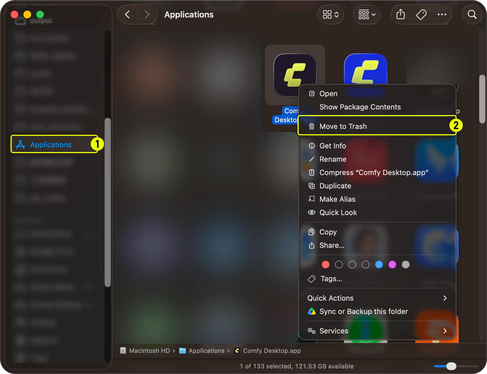

Comfy Desktop es la aplicación que usas para ejecutar ComfyUI, ya sea como una copia instalada en esta computadora (una build local) o en Comfy Cloud, que se ejecuta en GPUs en la nube y funciona en cualquier computadora. Descarga y configura todo lo que ComfyUI necesita, así que Comfy Desktop es la única aplicación que instalas. En esta página, descargas Comfy Desktop, confirmas la pantalla de configuración que se abre en el primer inicio y abres ComfyUI.


<Note>
  Comfy Desktop llama build a cada copia de ComfyUI. Si usaste una versión anterior de Comfy Desktop, tus instancias aparecen como builds, con los mismos modelos y configuraciones.
</Note>

## Elige dónde se ejecuta ComfyUI

Comfy Desktop ejecuta ComfyUI en dos lugares: en esta computadora como compilación local, o en [Comfy Cloud](https://comfy.org/cloud). Elige el que quieras antes de empezar, porque la pantalla de configuración del primer inicio instala una compilación local.

| | Compilación local | Comfy Cloud |
| --- | --- | --- |
| Se ejecuta en | Esta computadora | GPUs en la nube, así que funciona en cualquier computadora |
| Instalación | La pantalla de configuración la instala en el primer inicio | Ninguna. **Home** muestra una tarjeta de **Comfy Cloud** |
| Costo | Gratis | Créditos de Comfy, que se gastan solo mientras la GPU está en ejecución |
| Requisitos | Espacio libre en disco para la instalación (la pantalla de configuración muestra la cantidad) | Una cuenta de Comfy |

Para usar solo Comfy Cloud, salta la instalación cuando se abra la pantalla de configuración. [Abrir Comfy Cloud en Comfy Desktop](#abrir-comfy-cloud-en-comfy-desktop) muestra cómo.

## Descargar Comfy Desktop

La página de descarga ofrece un instalador para Windows, macOS y Linux.

1. Ve a [comfy.org/download](https://comfy.org/download).
2. Haz clic en **DOWNLOAD DESKTOP**. El botón descarga el instalador del sistema operativo que detecta la página. El nombre del instalador aparece debajo del texto del botón.
3. Para elegir otro instalador, haz clic en la flecha (**All installers**) junto al botón y, luego, selecciona un instalador. La lista ofrece **Windows x64**, **Windows ARM64 (NVIDIA only)**, **macOS (Apple Silicon)** y **Linux x64 (AppImage)**.

   

## Instalar Comfy Desktop para tu sistema operativo

Selecciona la pestaña de tu sistema operativo, revisa sus requisitos e instala el archivo que descargaste.

<Tabs>
  <Tab title="Windows">
    **Requisitos del sistema**

    - Windows 10 o posterior, en x64 o ARM64.
    - Se recomienda una GPU NVIDIA o AMD dedicada, pero no es obligatoria. En ARM64, las compilaciones locales necesitan una GPU NVIDIA.
    - Al menos 4.85 GB de espacio libre en disco para cada compilación.

    **Instalar**

    1. Ejecuta el instalador `.exe` que descargaste y sigue sus indicaciones.
    2. Abre Comfy Desktop desde el menú **Inicio** o desde el acceso directo del escritorio.

    
  </Tab>
  <Tab title="macOS">
    **Requisitos del sistema**

    - macOS 13 (Ventura) o posterior.
    - Un Mac con Apple silicon (M1 o posterior).
    - Al menos 4.85 GB de espacio libre en disco para cada compilación.

    **Instalar**

    1. Abre el archivo `.dmg` que descargaste.
    2. Arrastra **Comfy Desktop** a la carpeta **Aplicaciones**.
    3. Abre Comfy Desktop desde Launchpad o Spotlight.

    

    Si macOS muestra una advertencia de seguridad la primera vez que lo abres, ve a **Ajustes del Sistema** > **Privacidad y seguridad** y haz clic en **Abrir de todos modos**.
  </Tab>
  <Tab title="Linux">
    **Requisitos del sistema**

    - Linux en x64. Se recomienda Ubuntu 22.04 o posterior.
    - Se recomienda una GPU NVIDIA o AMD dedicada, pero no es obligatoria.
    - Al menos 4.85 GB de espacio libre en disco para cada compilación.

    La página de descarga ofrece el AppImage. También hay un paquete `.deb` para Debian y Ubuntu en el [enlace de descarga universal](https://dl.todesktop.com/241130tqe9q3y), que detecta tu plataforma.

    **Instalar el paquete .deb**

    ```bash
    sudo apt install ./*.deb
    ```

    El paquete instala Comfy Desktop en `/opt/Comfy Desktop` y agrega una fuente APT, de modo que las nuevas versiones llegan con las actualizaciones normales de tu sistema (`sudo apt update` y `sudo apt upgrade`). En Ubuntu 24.04 y posteriores, también instala un perfil de AppArmor para que funcione el sandbox de Electron. Si instalaste el paquete en Ubuntu 22.04 y luego actualizaste a 24.04, ejecuta `sudo apt reinstall comfyui-desktop-2` para agregar el perfil.

    **Ejecutar el AppImage**

    1. Instala FUSE 2, que el AppImage necesita. En Ubuntu 24.04 y posteriores, ejecuta `sudo apt install libfuse2t64`. En Ubuntu 22.04, ejecuta `sudo apt install libfuse2`.
    2. Haz que el archivo sea ejecutable y ejecútalo:

       ```bash
       chmod +x ./*.AppImage
       ./*.AppImage
       ```

    El AppImage se actualiza solo reemplazando el archivo que ejecutaste, así que mantenlo en una carpeta donde tu cuenta de usuario tenga permiso de escritura. Si no inicia porque tu distribución bloquea el sandbox de Electron, ejecútalo con `--no-sandbox`. Esa opción desactiva el sandbox para todos los procesos, así que úsala solo cuando el inicio normal falle.

    <Accordion title="Compilar y ejecutar desde el código fuente">
      Para desarrollo, ejecuta Comfy Desktop desde su [repositorio](https://github.com/Comfy-Org/Comfy-Desktop#development). Necesitas Node.js 24, pnpm 10 a través de Corepack, `build-essential` y `git`.

      ```bash
      sudo apt install build-essential git
      nvm install 24 && nvm use 24
      corepack enable
      git clone https://github.com/Comfy-Org/Comfy-Desktop.git
      cd Comfy-Desktop
      pnpm run init
      ./linux-dev.sh
      ```

      Una copia local del código fuente no se actualiza sola. Para actualizarla, ejecuta `git pull` y `pnpm run init`, y luego inicia `./linux-dev.sh` de nuevo.
    </Accordion>
  </Tab>
</Tabs>

Luego abre Comfy Desktop. La primera vez que lo inicies, aparece la pantalla de configuración.

<Tip>
  La página de descarga en chino, [comfy.org/zh-CN/download](https://comfy.org/zh-CN/download), ofrece los mismos instaladores. Su botón dice **下载桌面版**. Para descargar los archivos de ComfyUI desde espejos en China, consulta [Confirmar la pantalla de configuración](#confirmar-la-pantalla-de-configuración).
</Tip>

## Confirmar la pantalla de configuración

La primera vez que lo abras, Comfy Desktop abre la pantalla de configuración. Su título es **Install ComfyUI on this Mac** en macOS, **Install ComfyUI on this PC** en Windows y **Install ComfyUI on this computer** en Linux. No se descarga nada hasta que hagas clic en **Install**.


Comfy Desktop elige las configuraciones para tu computadora. Revísalas antes de instalar:

- **Detected**: el panel de arriba muestra la GPU o el procesador que encontró Comfy Desktop, y su memoria.
- **Hardware**: el hardware para el que está hecha la compilación. **No GPU acceleration** significa que ComfyUI se ejecuta en tu procesador.
- **Version**: la versión de ComfyUI y su canal de lanzamiento, como **Stable**.
- **Location**: la carpeta en la que se instala la compilación y el espacio libre de esa unidad.

Junto a **Install**, la pantalla de configuración muestra el tamaño de la descarga. Pasa el puntero por el icono de información que está junto a él para ver cuánto espacio en disco necesita la instalación.

Para elegir otras configuraciones, haz clic en **Change**, edítalas en la pantalla **Change setup** y haz clic en **Save changes**.

<Tip>
  Para tu primera instalación, mantén las configuraciones que eligió Comfy Desktop. [Compilaciones](/es/installation/desktop/usage/instance-management) explica cada configuración que puedes cambiar.
</Tip>

Para instalar:

1. Marca **I agree to the EULA and Terms of Service.** Haz clic en **EULA** o **Terms of Service** para leer cualquiera de los dos.
2. Haz clic en **Install**.

Las otras dos casillas son opcionales:

- **Help improve Comfy by sharing anonymous usage data**: envía datos de uso anónimos. **Learn more** abre la política de privacidad.
- **Opt in to beta features and help test what ships next**: permite que Comfy Desktop active funciones tempranas de ComfyUI en las compilaciones de esta computadora. Solo puedes activarla mientras el uso compartido de datos esté activado.

Si haces clic en **Install** antes de marcar la casilla de términos, aparece **Agree to install.** junto a ella.

<Note>
  Si Comfy Desktop se ejecuta en chino, te pregunta **Enable Chinese mirrors?** después de que hagas clic en **Install**. **Enable mirrors** descarga desde `gitcode.com`, `mirrors.aliyun.com` y `mirrors.cloud.tencent.com`. **Not now** mantiene `github.com` y `pypi.org`.
</Note>

#

### Conservar las compilaciones existentes o migrar

- **Use my builds**: aparece junto a **Install** cuando esta computadora ya tiene una compilación local distinta de Legacy Desktop. Marca la casilla de términos y haz clic en ella para saltar la instalación. **Home** se abre con tus compilaciones.
- **Migrate**: reemplaza **Install** cuando Comfy Desktop encuentra una instalación de Legacy Desktop. [Migrar desde Legacy Desktop](/es/installation/desktop/usage/migrate) enumera qué se traslada.

## Ver la instalación en Home

La pantalla de configuración se cierra y se abre **Home**. La tarjeta de tu compilación en la fila Builds muestra el progreso, por ejemplo **Installing ComfyUI · 60%**, y luego **Starting ComfyUI**.


Mientras se ejecuta la instalación, la tarjeta puede mostrar una versión anterior de ComfyUI. El último paso de la instalación actualiza la compilación a la versión que mostraba la pantalla de configuración.

De forma predeterminada, ComfyUI se abre en su propia ventana cuando está listo y la tarjeta muestra **Running**.

Si la instalación o el inicio falla, consulta [Solucionar problemas](#solucionar-problemas).

## Abrir Comfy Cloud en Comfy Desktop

**Home** muestra una tarjeta de **Comfy Cloud** en la fila Builds, junto a cualquier build local.


#

### Saltar la instalación local e ir a Home

La pantalla de configuración no tiene botón para saltar a menos que ya tengas builds. Para llegar a **Home** y usar solo Comfy Cloud:

1. En la pantalla de configuración, marca la casilla de términos.
2. En el panel **Detected**, haz clic en **Change**.
3. En la **barra de título**, haz clic en **Menu** y luego selecciona **Skip onboarding**.

**Home** se abre con la tarjeta de **Comfy Cloud** en la fila Builds.

#

### Iniciar sesión y abrir Comfy Cloud

Hasta que inicies sesión, la tarjeta de **Comfy Cloud** muestra **Log in to use**.

<Warning>
  Comfy Cloud consume créditos de Comfy mientras su GPU está en ejecución. Revisa tu saldo de **Credits** antes de abrirlo.
</Warning>

1. En la **barra lateral**, en la tarjeta **Log in to Comfy**, haz clic en **Log in**. La tarjeta muestra **Continue in your browser**.

   

2. Termina de iniciar sesión en tu navegador. La **barra lateral** muestra tu saldo de **Credits**, lo que confirma que tu cuenta funciona.
3. En **Home**, haz clic en la tarjeta de **Comfy Cloud**.

Comfy Cloud se abre en su propia ventana.

<Tip>
  Si prefieres usar Comfy Cloud en tu navegador, abre [cloud.comfy.org](https://cloud.comfy.org/).
</Tip>

## Abrir ComfyUI

Después de la primera instalación, inicias una compilación y abres ComfyUI desde **Home**:

- Haz clic en **Open ComfyUI** en la parte superior derecha. Abre tu compilación más reciente. Para abrir otra compilación, haz clic en la flecha del lado derecho del botón (**Choose the build to open**) y luego selecciona la compilación.
- O haz clic en la tarjeta de una compilación en la fila Builds.

También puedes hacer clic en el mosaico de una compilación en la página **Builds**, o en **Start** en la página de la compilación. Hacer clic en una compilación en la **barra lateral** abre su página y no la inicia.

Mientras ComfyUI se inicia, la compilación muestra **Starting…**. Cuando está lista, ComfyUI se abre en su propia ventana, la compilación muestra **Running** y tiene un punto verde en la **barra lateral**. Para volver a traer la ventana más tarde, haz clic de nuevo en la compilación en ejecución.

Si ComfyUI no se inicia, consulta [Solucionar una compilación que falla](/es/installation/desktop/usage/instance-management#fix-a-build-that-fails). Para conocer el resto de **Home** y la **barra lateral**, consulta [Navegar por Comfy Desktop](/es/installation/desktop/usage/overview). Para generar tu primera imagen, sigue [Tu primera imagen en ComfyUI](/es/get_started/first_generation).

## Desinstalar Comfy Desktop

Desinstalar Comfy Desktop elimina únicamente la aplicación. Tus builds, modelos y salidas compartidos, configuraciones y registros permanecen en tu computadora hasta que los elimines. Si quieres eliminar un solo build, consulta [Eliminar un build](/es/installation/desktop/usage/instance-management#remove-a-build).

<Warning>
  Las carpetas siguientes contienen tus propios datos: builds, modelos, salidas y configuraciones. Eliminarlas no se puede deshacer.
</Warning>

En macOS y Linux, primero puedes limpiar los registros, la caché y los archivos temporales de la aplicación con **Remove Comfy Desktop data** en [Configuraciones de Escritorio](/es/installation/desktop/usage/settings#storage).

<Tabs>
  <Tab title="Windows">
    1. Ve a **Settings** > **Apps** > **Installed apps**.
    2. Busca **Comfy Desktop** y haz clic en **Uninstall**.

    

    | Dato | Ubicación predeterminada |
    | --- | --- |
    | Builds | `%LOCALAPPDATA%\Comfy-Desktop\ComfyUI-Installs` (builds anteriores: `%USERPROFILE%\ComfyUI-Installs`), más cualquier carpeta que hayas elegido |
    | Modelos, entradas y salidas compartidos | `%LOCALAPPDATA%\Comfy-Desktop\ComfyUI-Shared` (anteriores: `%USERPROFILE%\ComfyUI-Shared`) |
    | Configuraciones y la lista de builds | `%APPDATA%\Comfy Desktop` |
    | Registros | `%APPDATA%\Comfy Desktop\logs` |

    Para eliminar todo, borra esas carpetas. Elimina la carpeta compartida solo si ya no necesitas sus modelos y salidas.
  </Tab>
  <Tab title="macOS">
    1. Abre la carpeta **Applications** en Finder.
    2. Haz clic derecho en **Comfy Desktop** y selecciona **Move to Trash**.

    

    | Dato | Ubicación predeterminada |
    | --- | --- |
    | Builds | `~/ComfyUI-Installs`, más cualquier carpeta que hayas elegido |
    | Modelos, entradas y salidas compartidos | `~/ComfyUI-Shared` |
    | Configuraciones y la lista de builds | `~/Library/Application Support/Comfy Desktop` |
    | Registros | `~/Library/Logs/Comfy Desktop` |

    Para eliminar todo, borra esas carpetas. Elimina la carpeta compartida solo si ya no necesitas sus modelos y salidas.
  </Tab>
  <Tab title="Linux">
    - **.deb**: ejecuta `sudo apt remove comfyui-desktop-2`. También elimina el perfil de AppArmor. Usa `sudo apt purge comfyui-desktop-2` para eliminar también la fuente de APT.
    - **AppImage**: elimina el archivo `.AppImage`.

    | Dato | Ubicación predeterminada |
    | --- | --- |
    | Builds | `~/ComfyUI-Installs`, más cualquier carpeta que hayas elegido |
    | Modelos, entradas y salidas compartidos | `~/ComfyUI-Shared` |
    | Configuraciones | `~/.config/comfyui-desktop-2` |
    | Datos de la aplicación, incluida la lista de builds | `~/.local/share/comfyui-desktop-2` |
    | Caché | `~/.cache/comfyui-desktop-2` |
    | Estado | `~/.local/state/comfyui-desktop-2` |
    | Registros | `~/.config/Comfy Desktop/logs` |

    Para eliminar todo, borra esas carpetas o ejecuta el script [reset-linux.sh](https://github.com/Comfy-Org/Comfy-Desktop/blob/main/scripts/reset-linux.sh) del repositorio, que limpia las carpetas de la aplicación y deja intactas `~/ComfyUI-Installs` y `~/ComfyUI-Shared`. Elimina la carpeta compartida solo si ya no necesitas sus modelos y salidas.
  </Tab>
</Tabs>

## Solucionar problemas

Usa estas entradas cuando la pantalla de configuración o la instalación no salgan como esperas.

<AccordionGroup>
  <Accordion title="Corregir un botón Instalar que no hace nada">
    - **Not supported** en la fila **Hardware**: usa Comfy Cloud. [Salta la instalación local y ve a Home](#saltar-la-instalación-local-e-ir-a-home), y luego [inicia sesión y abre Comfy Cloud](#iniciar-sesión-y-abrir-comfy-cloud).
    - **Couldn't reach the ComfyUI download server**: revisa tu conexión a internet y luego haz clic en **Try again**.
    - **Agree to install.** junto a la caja de términos: consulta [Confirmar la pantalla de configuración](#confirmar-la-pantalla-de-configuración).
  </Accordion>
  <Accordion title="Liberar espacio en disco">
    La fila **Location** muestra **Only … free, about … needed to install** cuando la unidad está demasiado llena. [Cambia la ubicación](#confirmar-la-pantalla-de-configuración) a una unidad con más espacio o libera espacio en esta.
  </Accordion>
  <Accordion title="Corregir una compilación que no se instaló">
    Cuando una instalación no finaliza, la tarjeta de compilación en **Home** muestra **Install failed**.

    <Warning>
      Desinstalar elimina permanentemente la compilación y todos sus archivos. Las demás compilaciones siguen intactas. Copia primero fuera de la carpeta de la compilación todo lo que quieras conservar.
    </Warning>

    1. Haz clic en la tarjeta de compilación. Se abre la página de la compilación.
    2. Haz clic en **More** y luego selecciona **Uninstall**. Confirma con **Uninstall**.
    3. En **Home**, haz clic en **New build** para instalar una compilación nueva.
  </Accordion>
  <Accordion title="Recuperarte después de cerrar la configuración">
    Si cierras Comfy Desktop durante la configuración, te pregunta **Quit setup?**. Haz clic en **Quit setup** y Comfy Desktop no guarda tus elecciones. La pantalla de configuración se abre de nuevo la próxima vez que inicies Comfy Desktop.
  </Accordion>
  <Accordion title="Corregir una compilación que no se inició">
    Cuando ComfyUI no se inicia, la tarjeta de compilación en **Home** muestra **Didn't start**.

    1. Haz clic en la tarjeta de compilación. Se abre un cuadro de diálogo titulado **ComfyUI didn't start**.
    2. Haz clic en **View logs** para leer qué salió mal.
    3. Haz clic en **Try again**.
  </Accordion>
  <Accordion title="Comfy Desktop se inicia con errores en macOS">
    Después de una actualización manual, Comfy Desktop puede abrirse sin estilos, con texto faltante o con botones que no hacen nada. Por lo general, lo causa un perfil o una actualización en caché de la versión anterior.

    1. Copia `app.log` fuera de `~/Library/Logs/Comfy Desktop` si vas a reportar el problema, porque el reinicio elimina esa carpeta.
    2. Sal de Comfy Desktop.
    3. Ejecuta el [script de reinicio](https://github.com/Comfy-Org/Comfy-Desktop/blob/main/scripts/reset-mac.sh). Enumera cada ruta que eliminará y pregunta antes de eliminar cualquier cosa:

       ```bash
       curl -fsSLO https://raw.githubusercontent.com/Comfy-Org/Comfy-Desktop/main/scripts/reset-mac.sh && bash reset-mac.sh
       ```

    Tus compilaciones en `~/ComfyUI-Installs` y tus modelos en `~/ComfyUI-Shared` se conservan, pero la lista de compilaciones se elimina. Vuelve a agregarlas con [Agregar una compilación existente](/es/installation/desktop/usage/instance-management#add-a-comfyui-you-already-have). Para reportar el problema, adjunta `app.log` en la [página de problemas de Comfy Desktop](https://github.com/Comfy-Org/Comfy-Desktop/issues).
  </Accordion>
</AccordionGroup>

## Ver el código fuente

El código fuente de Comfy Desktop está en [GitHub](https://github.com/Comfy-Org/Comfy-Desktop). Tiene licencia dual: AGPL-3.0-or-later, o una licencia comercial de Comfy Org.
