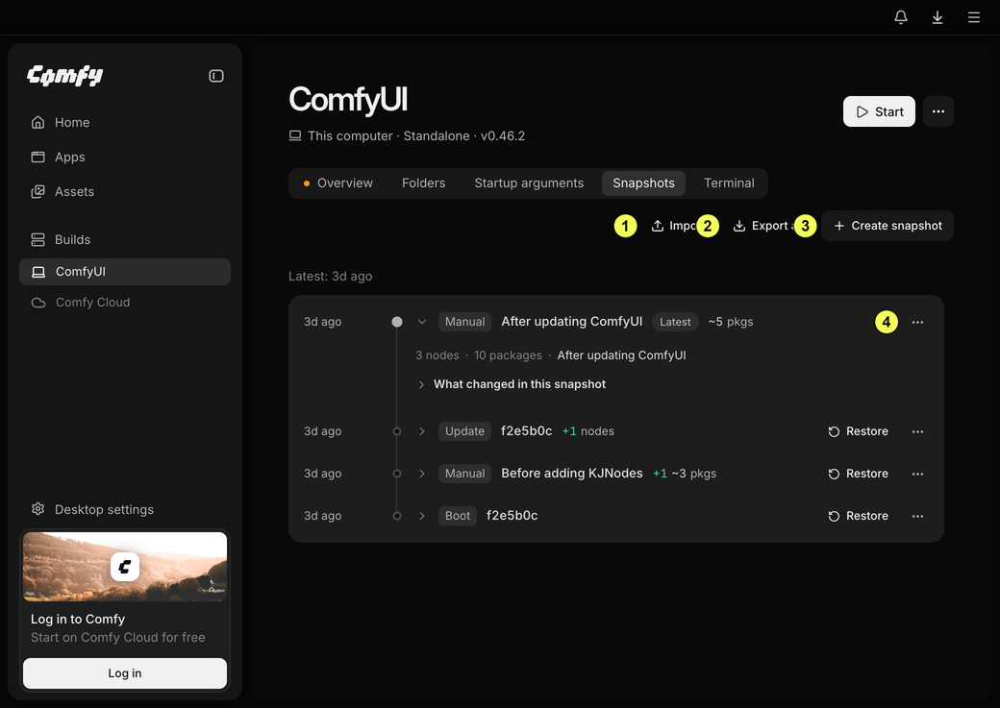

Esta página cubre la pestaña **Instantáneas** de la página de un build. Para instalar, agregar o conectar el build, consulta [Builds](/es/installation/desktop/usage/instance-management).

## Guardar y restaurar instantáneas

Una instantánea registra la versión de ComfyUI, los Nodos Personalizados y los paquetes de Python de una compilación, para que puedas devolver la compilación al estado que tenía después de una actualización o cuando un nodo personalizado la rompe. Los Modelos, las Entradas y las Salidas no forman parte de una instantánea. La pestaña **Snapshots** aparece en las compilaciones Standalone instaladas.

### Cuándo guarda Comfy Desktop una instantánea

Comfy Desktop guarda instantáneas por ti y etiqueta cada una con el motivo por el que se guardó:

| Etiqueta | Se guarda cuando |
| --- | --- |
| **Boot** | ComfyUI se inicia y la configuración cambió desde la última instantánea, y una vez después de la primera instalación |
| **Manager** | ComfyUI Manager reinicia ComfyUI |
| **Update**, **Updated** | Antes y después de actualizar ComfyUI o cambiar PyTorch |
| **Restored** | Después de que restaures una instantánea |
| **Manual** | Haces clic en **Create snapshot** |

Comfy Desktop conserva hasta 200 instantáneas **Boot** y **Manager** y elimina las más antiguas que superen ese límite. Nunca elimina una instantánea que tenga una etiqueta.

### Leer la línea de tiempo

La pestaña **Snapshots** enumera las instantáneas, más recientes primero, bajo **Latest:**, junto con cuánto tiempo hace que se guardó la última. La instantánea más reciente se abre automáticamente. Haz clic en cualquier otra instantánea para abrirla y haz clic en **What changed in this snapshot** para ver qué Nodos Personalizados y paquetes agregó, eliminó o cambió. Una instantánea muestra su etiqueta cuando tiene una, y el cambio de versión, como **v0.42.1 → v0.46.2**, después de una actualización.

### Crear una instantánea

Guarda una instantánea antes de probar algo riesgoso, como un nuevo nodo personalizado.

1. Haz clic en **Create snapshot**.
2. En **Create snapshot**, escribe una etiqueta si quieres una, como `before-experiment`. Una instantánea con etiqueta nunca se elimina para hacer espacio.
3. Haz clic en **Create snapshot**.

### Restaurar una instantánea

1. Haz clic en **Restore** en la instantánea. La instantánea más reciente no tiene **Restore**, porque la compilación ya coincide con ella.
2. En **Restore this snapshot?**, revisa qué cambios se aplicarán y luego confirma.

Comfy Desktop primero hace una copia de seguridad de la compilación. Si la compilación se está ejecutando, Comfy Desktop la detiene, restaura la instantánea y la inicia de nuevo. Cuando la instantánea usó un PyTorch diferente, la restauración también cambia PyTorch. Si ese PyTorch no está disponible, Comfy Desktop conserva el actual o se detiene sin cambiar nada.

Cuando termina la restauración, la compilación muestra **Snapshot restored**. Si falla, haz clic en **Try again** o en **Dismiss**.

También puedes abrir las instantáneas de una compilación desde el [menú de acciones rápidas](/es/installation/desktop/usage/instance-management#acciones-rápidas-desde-la-lista-de-compilaciones): selecciona **Restore snapshot**.

### Exportar, importar y eliminar instantáneas

- **Export one snapshot**: haz clic en **More actions** (**⋯**) en la instantánea y luego selecciona **Export**. Para exportar la instantánea más reciente sin abrir la pestaña, selecciona **Export snapshot** en el menú de acciones rápidas o en el [menú **More**](/es/installation/desktop/usage/build-management#usar-el-menú-más) de la página de la compilación.
- **Export all**: guarda todas las instantáneas de la compilación en un archivo.
- **Import**: elige un archivo de instantánea. **Import snapshot?** te pide que confirmes, y luego Comfy Desktop restaura la compilación a esa instantánea de inmediato. Si la instantánea usa un PyTorch diferente, el diálogo advierte **Snapshot uses a different PyTorch**.
- **Delete**: haz clic en **More actions** (**⋯**) en la instantánea, selecciona **Delete** y confirma. La compilación y sus otras instantáneas no cambian.

Comfy Desktop almacena las instantáneas de una compilación en la carpeta `.launcher/snapshots`, dentro de la carpeta de la compilación.

### Crear una compilación desde un archivo de instantánea

Un archivo de instantánea puede configurar una nueva compilación con la misma versión de ComfyUI, los mismos Nodos Personalizados y los mismos paquetes, como uno que exportó un compañero de equipo.

1. En la página **Builds**, haz clic en la flecha junto a **New build** (**More build options**) y luego selecciona **Load snapshot**. La página muestra **Load a snapshot file to install a build.**
2. Suelta el archivo `.json` en la página o haz clic en **Browse** y elígelo.
3. Revisa **Name**, **Release** y **Hardware**. La página te advierte cuando la instantánea se creó para un hardware diferente.
4. Haz clic en **Create build**.

La nueva compilación Standalone se instala y se inicia cuando termina la instalación.
