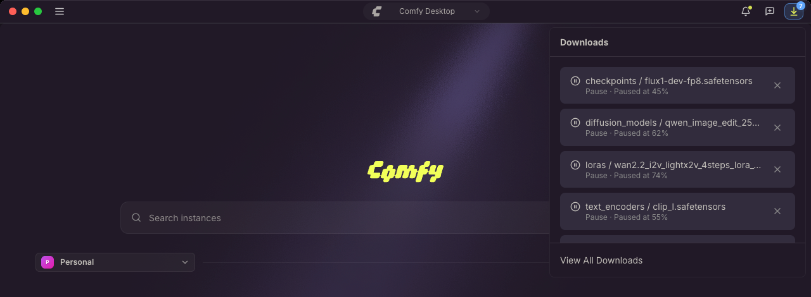
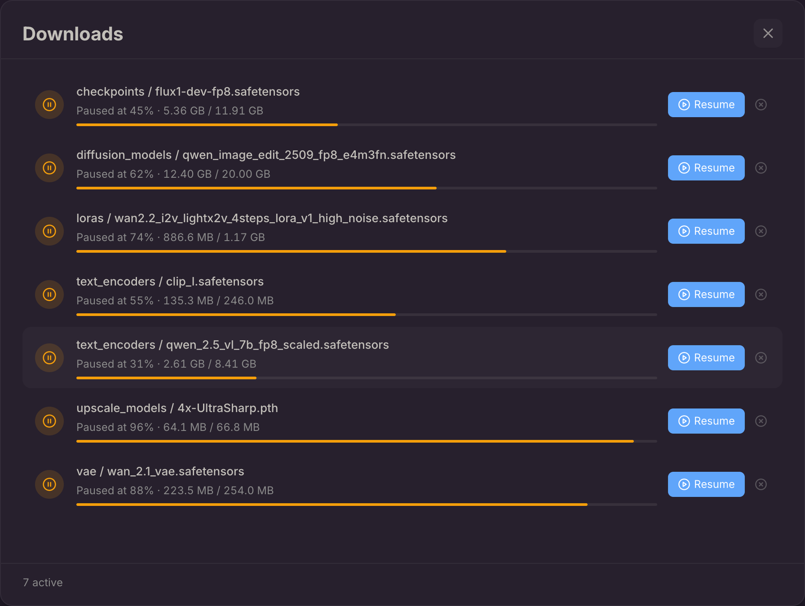

Comfy Desktop descarga los modelos para tus instancias y lleva el seguimiento de cada transferencia en un solo lugar, ya sea un modelo que la app descarga por ti o un recurso generado que descargas tú mismo. Cuando una instancia de ComfyUI solicita un modelo que todavía no está en el disco, Comfy Desktop se encarga de la descarga y guarda el archivo en el directorio de modelos de la instancia, así que no tienes que colocarlo a mano.

Abre la bandeja **Descargas** desde la barra de título para seguir las descargas activas, reintentar una descarga fallida o ir a la carpeta donde quedó un archivo finalizado.

## Lo que aparece en la lista de descargas

- **Modelos faltantes**: cuando ComfyUI reporta modelos faltantes en el diálogo de modelos faltantes o en la pestaña **Errores** del panel del lado derecho, la acción de descarga se gestiona a través de Comfy Desktop. Cada archivo se guarda en la carpeta de modelos correspondiente, como `checkpoints`, `diffusion_models`, `text_encoders`, `loras` o `vae`. Los tipos de archivo de modelo admitidos son `.safetensors`, `.sft`, `.ckpt`, `.pth` y `.pt`.
- **Modelos de plantilla**: cuando configuras una instancia a partir de una plantilla de inicio, los modelos que esa plantilla necesita se descargan en segundo plano y aparecen en la bandeja como cualquier otra descarga. La pantalla de progreso mantiene visible el paso de descarga de modelos hasta que finalicen. Si prefieres empezar de inmediato, **Saltar y abrir ComfyUI** en esa pantalla abre ComfyUI enseguida y las descargas siguen ejecutándose en la bandeja.
- **Salidas de instancias remotas**: cuando ejecutas un flujo de trabajo en una instancia remota o de Cloud, las salidas finalizadas se descargan automáticamente en tu directorio de salida local.
- **Recursos generados que descargas tú mismo**: imágenes, vídeo o audio que guardas desde el panel **Recursos**. Consulta [Descargar recursos generados](#descargar-recursos-generados).

## Descargar recursos generados

Las salidas se quedan dentro de la instancia, así que guardar una en una carpeta que elijas es una acción distinta de las descargas automáticas anteriores.

1. Abre **Recursos** en la barra lateral izquierda y selecciona el elemento que quieres guardar. Para guardar varios a la vez, selecciónalos primero.
2. Usa **Descargar**, o **Descargar todo** cuando hay más de un elemento seleccionado. La vista previa del recurso y el menú contextual ofrecen la misma acción.
3. Comfy Desktop abre un diálogo de guardado para el archivo, que empieza en la carpeta donde guardaste por última vez (la carpeta Descargas del sistema la primera vez). Confirma la carpeta y la transferencia comienza.
4. Síguela o cancélala en la bandeja **Descargas**. Para pausarla, abre **View All Downloads** y elige **Pause**.

Si ya existe un archivo con ese nombre en la carpeta, el diálogo de guardado pregunta antes de reemplazarlo. Cuando descargas varios recursos de una instancia de Cloud, llegan en un único archivo zip.

## La bandeja de Descargas

Haz clic en el botón **Descargas** de los controles finales de la barra de título para abrir la bandeja. Las descargas se listan con las más recientes primero, etiquetadas con su carpeta de modelo y su nombre de archivo, y las filas activas muestran el tamaño transferido, el porcentaje, la velocidad y el tiempo restante estimado.

El botón muestra una insignia con el número de descargas activas. Cuando no se está descargando nada, en su lugar señala las descargas que fallaron y no has revisado, o las que finalizaron y aún no has abierto.

Cada fila tiene estas acciones:

- **Haz clic en una fila finalizada** para abrir la carpeta que contiene el archivo (Mostrar en Finder, Mostrar en Explorer o Mostrar en carpeta, según tu sistema).
- **Reintentar** una descarga fallida o cancelada.
- **✕** para cancelar una descarga activa, o eliminar una finalizada de la lista.

**Ver todas las descargas**, en la parte inferior de la bandeja, abre la vista completa de descargas.

## La vista completa de Descargas

La vista completa conserva el historial de descargas de la aplicación y añade los controles que no caben en la bandeja:

- Filtra la lista por **Todas**, **Activas**, **Completadas** o **Fallidas**.
- **Pausar** una descarga activa y **Reanudar** una que esté en pausa.
- **Reintentar** una descarga fallida o cancelada.
- Abrir la carpeta del archivo o eliminar una sola fila.
- **Limpiar finalizadas** para eliminar todas las filas finalizadas a la vez.

El pie de página muestra el recuento de las descargas activas y completadas que aparecen en la lista.

## Salir con descargas en progreso

Las descargas de modelos se pueden reanudar. Si sales de Comfy Desktop mientras se está ejecutando una transferencia de modelo, los bytes ya recibidos se conservan y, en el siguiente inicio, la transferencia vuelve como una fila en pausa en la bandeja Descargas. Abre **Ver todas las descargas** para **Reanudarla** desde donde se detuvo, o cancélala para descartar el archivo parcial.

Las descargas de salida de instancias remotas se transfieren por una ruta separada y no se reanudan después de salir.

Cuando los modelos de una plantilla aún se están descargando, Comfy Desktop te pide que confirmes la salida, porque la configuración de la plantilla espera esos archivos:

- **Salir de todos modos**: pone las descargas en pausa y sale. Las filas siguen ahí en el siguiente inicio.
- **Seguir descargando**: cancela la salida y deja Comfy Desktop en ejecución. Esta es la opción predeterminada.

Las salidas que inicia Comfy Desktop por sí mismo, como instalar una actualización o reiniciar, omiten este aviso. También lo hace **Salir de Desktop** en el menú de la barra de título, que muestra su propia confirmación con las descargas activas. Las transferencias se ponen en pausa en cualquier caso y vuelven en el siguiente inicio.

## Dónde se guardan las descargas

Los archivos de modelo se escriben en el directorio de descargas de modelos de la instancia: el directorio de modelos compartido marcado como **DESCARGAS** (se configura con **Usar para descargas de modelos**) cuando la instancia incluye directorios de modelos compartidos; de lo contrario, en la carpeta `models` propia de la instancia. Los directorios compartidos se configuran en [Configuraciones de Escritorio](/es/installation/desktop/usage/settings#almacenamiento), y cada instancia puede excluirse de ellos en su panel **Administrar**, [pestaña Almacenamiento](/es/installation/desktop/usage/manage#pestaña-almacenamiento).

Las salidas descargadas desde una instancia remota se guardan en la carpeta de salidas compartida cuando la instancia la utiliza; de lo contrario, en la carpeta de salidas propia de la instancia. Una instancia remota puede desactivar la descarga automática de salidas con **Descarga automática de salidas** en sus configuraciones de almacenamiento.

Los recursos generados que descargas tú mismo son la excepción: se guardan donde indiques en el diálogo de guardado, así que pueden quedar fuera de la instancia.
