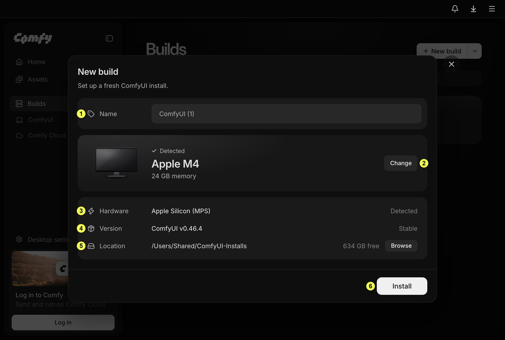

En Comfy Desktop puedes ejecutar ComfyUI en este equipo, en Comfy Cloud o en un servidor de ComfyUI en otra máquina. Cada una de estas opciones es una compilación. Comfy Desktop incluye Comfy Cloud en la lista, y tú instalas, agregas o conectas cualquier otra compilación antes de abrirla. En esta página preparas una compilación, la ejecutas, la actualizas y la configuras desde su página de compilación, y la eliminas cuando ya no la necesitas.

## Tipos de compilaciones de Comfy {#types-of-comfy-builds}

El lugar donde se ejecuta una compilación determina lo que puedes hacer con ella. La página **Builds** agrupa las compilaciones según dónde se ejecutan:

| Dónde se ejecuta | Qué es | Cómo obtenerla |
| --- | --- | --- |
| **This computer** | ComfyUI instalado en este equipo. Su tipo es **Standalone**, **Git clone**, **Portable**, **Legacy Desktop** o **Build** (una Developer Platform Build del espacio de trabajo de tu equipo). | [Instala una compilación nueva](#install-a-new-build) o [agrega un ComfyUI que ya tengas](#add-a-comfyui-you-already-have). |
| **Cloud** | Comfy Cloud. Se ejecuta en GPUs en la nube y necesita una cuenta de Comfy. | Comfy Desktop la incluye en la lista como **Comfy Cloud**. |
| **Remote** | Un servidor de ComfyUI que se ejecuta en otra máquina, al que se accede por su URL. | [Conéctate a un servidor de ComfyUI](#connect-a-comfyui-server). |

<Note>
  Comfy Cloud muestra **Log in to use** hasta que [inicies sesión](/es/installation/desktop/overview#iniciar-sesión-y-abrir-comfy-cloud). Su menú de acciones rápidas no tiene **Stop**, **Auto start** ni **Uninstall**, y conserva el nombre **Comfy Cloud**.
</Note>

## Encontrar tus compilaciones {#find-your-builds}

La página **Builds** enumera todas las compilaciones de tu espacio de trabajo. Para abrirla, haz clic en **Builds** en la **barra lateral**.

En la parte superior de la página:

- **New build**: inicia una compilación nueva. Haz clic en la flecha que está junto a él (**More build options**) para **Add existing build** y **Load snapshot**.
- **Where it runs**: filtra la lista. **All** y **This computer** siempre están ahí. **Cloud** y **Remote** aparecen cuando tienes una compilación de ese tipo.
- **Sort**: ordena las compilaciones por **Last used** o **Name**. Las compilaciones que se están instalando permanecen arriba.
- **Search builds**: encuentra una compilación por su nombre. Si no hay coincidencias, haz clic en **Clear filters**.

Cada compilación es un mosaico. El mosaico muestra el estado de la compilación, como **Running**, **Starting…**, **Auto start** o **Error**. Mantén el puntero sobre un mosaico para ver qué hace un clic: **Click to start**, **Click to open** o **Click to view logs**.

Cuando no tienes compilaciones, la página muestra **No builds yet** e **Install ComfyUI on this computer, or run it on Comfy Cloud.**

La **barra lateral** también enumera cada compilación debajo de **Builds**:

- Un indicador giratorio y un porcentaje significan que la compilación se está instalando.
- Un punto verde significa que la compilación se está ejecutando.
- Un punto rojo significa que la compilación falló o no se inició. Mantén el puntero sobre la compilación para leer el motivo.
- Haz clic en una compilación para abrir su [página de compilación](#manage-builds).
- Haz clic derecho en una compilación para abrir su [menú de acciones rápidas](#quick-actions-from-the-build-list).

Para **Home** y el resto de la **barra lateral**, consulta [Conocer Comfy Desktop](/es/installation/desktop/usage/overview).

### Acciones rápidas desde la lista de compilaciones {#quick-actions-from-the-build-list}

Haz clic derecho en una compilación de la **barra lateral**, o en su mosaico de la página **Builds** o en su tarjeta de **Home**, para abrir un menú corto de acciones. En un mosaico o una tarjeta también puedes mantener el puntero sobre él hasta que aparezca el botón **⋯** a su derecha y luego hacer clic en él.

El menú muestra solo las acciones que se aplican a la compilación en ese momento:

- **Start**, o **View logs**, **Restart** y **Stop** mientras la compilación se ejecuta. Mientras se instala o se inicia, **View logs** y **Cancel**. Después de un fallo, **View error**.
- **Auto start** o **Turn off auto start**. Consulta [Iniciar una compilación al abrir Comfy Desktop](#start-a-build-when-comfy-desktop-opens).
- **Manage**, que abre la [página de la compilación](#manage-builds).
- **Update**, cuando hay una actualización disponible, y **Migrate to Standalone**, cuando la compilación puede pasar a una compilación Standalone. Consulta [Migrar más adelante](/es/installation/desktop/usage/migrate#migrar-más-tarde).
- **Duplicate**, y **Show in Finder**, **Show in Explorer** o **Show in folder**.
- **Export snapshot** y **Restore snapshot**. Consulta [Instantáneas](#save-and-restore-snapshots).
- **Upload build**, cuando has iniciado sesión en un espacio de trabajo. Consulta [Compilaciones de equipo](/es/installation/desktop/usage/workspaces-and-builds).
- **Uninstall**. Consulta [Eliminar una compilación](#remove-a-build).

**Auto start**, **Restart**, **View logs** y **Upload build** solo están en este menú. Todo lo demás también está en la página de la compilación. Cuando un elemento está atenuado, mantén el puntero sobre él para leer el motivo, como **Stop the running build first.**

## Instalar una compilación nueva {#install-a-new-build}

Una compilación nueva es el ComfyUI que Comfy Desktop instala por ti: un lanzamiento oficial como compilación **Standalone**, o una Developer Platform Build del espacio de trabajo de tu equipo. El diálogo **New build** elige la configuración para este equipo. La instalación descarga ComfyUI y prepara su entorno de Python, así que revisa el resumen antes de hacer clic en **Install**.

<Steps>
  <Step title="Abrir el diálogo New build">
    Abre el diálogo de una de estas formas:

    - En la **barra lateral**, mantén el puntero sobre **Builds** y luego haz clic en el botón más (**+**) (**New build**).
    - En la página **Builds**, haz clic en **New build**.
    - En **Home**, haz clic en el mosaico **New build**, cuando **Home** lo muestra.

    El diálogo **New build** se abre con el texto principal **Set up a fresh ComfyUI install.**
  </Step>
  <Step title="Revisar el resumen">
    Cuando has iniciado sesión y tu espacio de trabajo tiene compilaciones, el diálogo se abre en **Your team's builds**. Su fila **Release** las enumera, con el marcador de posición **Select a build**. Para instalar un lanzamiento oficial en su lugar, establece **Source** en **Official release** en el siguiente paso.

    Para un lanzamiento oficial, el diálogo muestra lo que instala:

    

    - **Name**: el nombre que recibe la compilación en la **barra lateral** y en la página **Builds**. El cuadro muestra un nombre sugerido. Déjalo vacío para usar ese nombre, o escribe el tuyo.
    - **Detected**: el equipo o la GPU que Comfy Desktop encontró, con su memoria en GB. Haz clic en **Change** junto a ella para cambiar la configuración.
    - **Release**: **Stable** para lanzamientos probados, o **Latest on GitHub**.
    - **Hardware**: el tipo de GPU para el que se crea la compilación, como **NVIDIA**, **AMD**, **Intel Arc (XPU)**, **Apple Silicon (MPS)** o **CPU**. Su nota dice:
      - **Detected**: el tipo de GPU coincide con la GPU que Comfy Desktop encontró.
      - **No GPU acceleration**: la compilación es para **CPU**.
      - **Not supported**: este equipo no admite el tipo de GPU seleccionado.
    - **Version**: la versión de ComfyUI que se instala, con su lanzamiento, como **Stable**.
    - **Location**: la carpeta en la que se instala la compilación, con el espacio libre de esa unidad y el espacio que necesita la instalación. Haz clic en **Browse** para elegir otra carpeta.

    Cuando la nota de **Hardware** dice **Detected** y **Location** muestra espacio libre sin ninguna advertencia debajo, la configuración encaja en este equipo.

  </Step>
  <Step title="Cambiar la configuración (opcional)">
    Haz clic en **Change** para abrir **Change setup**. Dice **Everything here is already set to what fits this computer.**

    

    - **How to start**: mantén **Install a new build**.
    - **Source**: **Official release** instala ComfyUI. **Your team's builds** instala una Developer Platform Build de tu espacio de trabajo. Consulta [Compilaciones de equipo](/es/installation/desktop/usage/workspaces-and-builds).
    - **Release**: **Stable** instala lanzamientos probados. Elige la versión en la lista junto a **Stable**. **Latest on GitHub** instala los commits más recientes de la rama master.
    - **Location**: la carpeta de instalación. Elige una carpeta que no esté dentro de la carpeta de Comfy Desktop, OneDrive, una carpeta compartida de modelos, entrada o salida, ni otra compilación. Haz clic en **Browse** para elegir otra carpeta.
    - **Hardware**: el tipo de GPU para el que se crea la compilación. Cada opción enumera su versión de ComfyUI, su versión de Python y el tamaño de la descarga.

    Haz clic en **Save changes** para volver al resumen, o en **Discard** para descartar tus cambios.

  </Step>
  <Step title="Hacer clic en Install">
    Haz clic en **Install**. Antes de que comience la instalación, Comfy Desktop puede detenerte:

    - **Location** muestra un problema debajo e **Install** permanece atenuado cuando la carpeta no puede contener una compilación. Haz clic en **Browse** y elige otra carpeta.
    - **Low disk space** se abre cuando la unidad tiene menos espacio libre del que necesita la instalación, o menos de 1 GB. Haz clic en **Continue anyway** para instalar, o cierra el diálogo y elige otra carpeta.
    - **Update NVIDIA driver** se abre para una compilación **NVIDIA** cuando tu controlador es anterior a la versión 580. Muestra la versión de tu controlador y el mínimo recomendado. Haz clic en **Continue anyway** para instalar con tu controlador actual, o actualiza el controlador primero.
  </Step>
  <Step title="Seguir la instalación">
    Comfy Desktop vuelve a **Home** y la instalación se ejecuta en segundo plano. La compilación muestra **Installing ComfyUI** y el porcentaje en **Home** y en la página **Builds**, y un indicador giratorio y el porcentaje en la **barra lateral**.

    Para ver cada paso, haz clic en el mosaico de la compilación o selecciona **View logs** en el [menú de acciones rápidas](#quick-actions-from-the-build-list). El diálogo **Installing ComfyUI** enumera los pasos:

    1. **Download**
    2. **Extract**
    3. **Set up environment**
    4. **Get the latest ComfyUI**, o **Get ComfyUI** y la versión que elegiste

    Haz clic en **View logs** en el diálogo para ver la salida de la instalación.

    Para detener la instalación:

    1. En el menú de acciones rápidas, selecciona **Cancel**.
    2. Haz clic en **Cancel install**.

    La instalación se detiene y Comfy Desktop elimina los archivos que descargó.
  </Step>
</Steps>

Cuando la instalación termina, el indicador giratorio de la **barra lateral** desaparece y la compilación muestra su icono de laptop. Para **Auto start**, consulta [Iniciar una compilación al abrir Comfy Desktop](#start-a-build-when-comfy-desktop-opens). Si la instalación falla, consulta [Solucionar una compilación que falla](#fix-a-build-that-fails).

## Agregar un ComfyUI que ya tengas {#add-a-comfyui-you-already-have}

Si configuraste ComfyUI por tu cuenta, desde un clon de Git o una descarga portátil, puedes agregarlo a Comfy Desktop. Comfy Desktop lo ejecuta desde su carpeta y no mueve ni copia sus archivos.

1. En la página **Builds**, haz clic en la flecha junto a **New build** (**More build options**) y luego selecciona **Add existing build**. También puedes abrir **New build**, hacer clic en **Change**, establecer **How to start** en **Use an existing build** y establecer **Where it is** en **On this computer**. La hoja muestra **Point Desktop at the ComfyUI you already have.**

   

2. Junto a **Install location**, haz clic en **Browse** y luego selecciona la carpeta de ComfyUI.
3. Revisa **Detected type**. Muestra **Standalone**, **Portable**, **Git clone** o **Legacy Desktop**. Si muestra **Legacy Desktop**, detente y cierra el diálogo: agregarlo aquí impide que Comfy Desktop lo migre. En su lugar, sigue [Migrar desde Legacy Desktop](/es/installation/desktop/usage/migrate). Si muestra **No known install detected**, selecciona la carpeta que contiene ComfyUI en sí, no una carpeta superior.
4. En **Name**, conserva el nombre sugerido o escribe el tuyo.
5. Para un **Git clone**, revisa **Version**, **Repository** y **Branch**. **Virtual environment** muestra la carpeta `.venv`, `venv`, `.env` o `env` que encontró Comfy Desktop. Haz clic en **Browse** junto a ella para elegir otra.
6. Haz clic en **Add build**.

La compilación aparece en la **barra lateral** y en la página **Builds**. Si otra compilación tiene el nombre que escribiste, **Name** muestra **A build named "…" already exists. Please choose a different name.**

Para crear una compilación a partir de un archivo de instantánea, selecciona **Load snapshot** en **More build options**. Consulta [Crear una compilación a partir de un archivo de instantánea](#create-a-build-from-a-snapshot-file).

## Conectarse a un servidor de ComfyUI {#connect-a-comfyui-server}

Una compilación remota abre un servidor de ComfyUI que se ejecuta en otra máquina, como un servidor con GPU en tu red. Necesitas la URL del servidor.

1. Abre el diálogo **New build**, como en [Instalar una compilación nueva](#install-a-new-build), y luego haz clic en **Change**.
2. Establece **How to start** en **Use an existing build**.
3. Establece **Where it is** en **On a server**.

   

4. En **Name**, conserva el nombre sugerido o escribe el tuyo.
5. En **ComfyUI URL**, escribe la dirección del servidor. El cuadro muestra `http://localhost:8188` como ejemplo.
6. Haz clic en **Connect**.

La compilación aparece en la **barra lateral** y en la página **Builds**, y el filtro **Where it runs** incluye **Remote**. Si la dirección no es una URL, el diálogo muestra **Enter a valid URL (e.g. http://localhost:8188).** Para cambiar la dirección más adelante, consulta [Cambiar la URL de una compilación remota](#change-a-remote-builds-url).

## Iniciar, detener y reiniciar una compilación {#start-stop-and-restart-a-build}

Para iniciar una compilación y abrir ComfyUI, consulta [Abrir ComfyUI](/es/installation/desktop/overview#abrir-comfyui). Una compilación de Comfy Cloud se abre con **Open Cloud** en su página, y una compilación remota con **Open remote**.

### Ejecutar más de una compilación {#run-more-than-one-build}

Cuando inicias una compilación en este equipo mientras otra se está ejecutando o iniciando, Comfy Desktop abre **A build is already running**. En **Will be stopped** se enumeran las compilaciones que detendría.

<Warning>
  **Close and start** detiene las compilaciones enumeradas y pierde todo el trabajo sin guardar que haya en ellas. Guarda tus flujos de trabajo primero.
</Warning>

- **Close and start**: detiene las compilaciones enumeradas y luego inicia la que elegiste.
- **Run all**: inicia la compilación y mantiene las demás en ejecución.

Cierra el diálogo para cancelar el inicio. Para dejar de ver este diálogo, abre **Desktop settings** desde la **barra lateral** y, en **Preferences**, desactiva **Warn before running multiple builds**.

### Detener o reiniciar {#stop-or-restart}

Detén una compilación antes de desinstalarla. Reiníciala para aplicar cambios a sus argumentos de inicio.

<Warning>
  Detener o reiniciar una compilación pierde todo el trabajo sin guardar en ComfyUI. Guarda tu flujo de trabajo primero.
</Warning>

Para detener una compilación en ejecución:

1. En la [página de la compilación](#manage-builds), haz clic en **More** (**⋯**) y luego selecciona **Stop**. También puedes seleccionar **Stop** en las [acciones rápidas](#quick-actions-from-the-build-list).
2. En **Stop ComfyUI**, haz clic en **Stop**.

ComfyUI se detiene y su ventana se cierra.

Para reiniciar una compilación en ejecución:

1. En las [acciones rápidas](#quick-actions-from-the-build-list), selecciona **Restart**.
2. En **Restart ComfyUI**, haz clic en **Restart**.

El mosaico muestra **Starting…** y luego **Running**. Reiniciar nunca abre **A build is already running**.

## Iniciar una compilación al abrir Comfy Desktop {#start-a-build-when-comfy-desktop-opens}

**Auto start** inicia una compilación cada vez que abres Comfy Desktop. Solo una compilación a la vez tiene **Auto start**.

- En el [menú de acciones rápidas](#quick-actions-from-the-build-list) de una compilación de este equipo o de una compilación remota, selecciona **Auto start**.

El mosaico de la compilación muestra **Auto start**. Si otra compilación tenía **Auto start**, esa compilación lo pierde. Para desactivarlo, selecciona **Turn off auto start** en el mismo menú.

Cuando instalas tu primera compilación en este equipo y ninguna otra compilación tiene **Auto start**, la nueva compilación lo obtiene. Si esa compilación no se inicia la primera vez, Comfy Desktop desactiva su **Auto start**.

## Administrar compilaciones {#manage-builds}

Cada compilación tiene su propia página. Es donde administras una compilación: la inicias, actualizas ComfyUI, cambias PyTorch, eliges sus carpetas, estableces argumentos de inicio y la renombras, copias o eliminas. Ábrela de una de estas formas:

- En la **barra lateral**, haz clic en la compilación dentro de **Builds**.
- En las [acciones rápidas](#quick-actions-from-the-build-list), selecciona **Manage**.

El encabezado te dice qué es la compilación y si se ejecuta. De izquierda a derecha:

- **Name**: haz clic en él, o en el lápiz (**Edit build name**), para renombrar la compilación. Escribe el nombre nuevo y presiona `Enter`, o presiona `Esc` para conservar el anterior. Puedes renombrar compilaciones Standalone, Portable, git y remotas, pero no las de Comfy Cloud ni las de Legacy Desktop. Cada compilación necesita un nombre que no use ninguna otra.
- **Chip de estado**: **Running**, **Starting…** o **Stopping…**, o una etiqueta de fallo cuando la compilación se cayó o no se inició. Haz clic en una etiqueta de fallo para ver el error.
- **Línea de metadatos**: dónde se ejecuta la compilación (**This computer**, **Cloud** o **Remote**), su tipo y su versión, separados por puntos.
- **Botón principal**: **Start** cuando una compilación local está detenida, **Open** mientras se ejecuta, **Open Cloud** para Comfy Cloud y **Open remote** para una compilación remota.
- **More** (**⋯**): acciones para toda la compilación. Consulta [Usar el menú More](#use-the-more-menu).

Debajo del encabezado, cada pestaña contiene un tipo de configuración. Una pestaña aparece solo cuando la compilación tiene configuraciones para ella:

| Compilación | Pestañas |
| --- | --- |
| Standalone | **Overview**, **Folders**, **Startup arguments**, **Snapshots**, **Terminal** |
| Remote | **Overview**, **Startup arguments** |
| Comfy Cloud | **Overview**, **Storage** |

Otras compilaciones locales, como las Portable y las de git, muestran las pestañas para las que tienen configuraciones, además de **Terminal**. Cada pestaña tiene su propia sección en esta página:

| Pestaña | Qué haces ahí | Sección |
| --- | --- | --- |
| **Overview** | Ver qué ejecuta la compilación, actualizar ComfyUI, cambiar el canal de actualización, cambiar PyTorch, cambiar la URL de una compilación remota | [Actualizar ComfyUI](#update-comfyui) |
| **Folders** | Elegir las carpetas de modelos, entrada y salida | [Elegir qué carpetas usa la compilación](#choose-which-folders-the-build-uses) |
| **Startup arguments** | Establecer indicadores, la política de ComfyUI Manager, la ventana, el puerto y las variables de entorno | [Establecer argumentos de inicio](#set-startup-arguments) |
| **Snapshots** | Guardar y restaurar la configuración de la compilación | [Guardar y restaurar instantáneas](#save-and-restore-snapshots) |
| **Terminal** | Ejecutar comandos en el entorno de Python de la compilación | [Ejecutar comandos en la terminal](#run-commands-in-the-terminal) |
| **Storage** (Comfy Cloud) | Caché del navegador y descargas de salida | [Establecer opciones de salida](#set-output-options-for-remote-and-comfy-cloud-builds) |

### Usar el menú More {#use-the-more-menu}

El botón **More** (**⋯**) junto a **Start** o **Open** contiene acciones para toda la compilación. En una compilación Standalone, muestra:

- **Stop**, mientras la compilación se ejecuta.
- **Rename**, que selecciona el nombre en el encabezado.
- **Duplicate**. Consulta [Duplicar una compilación](#duplicate-a-build).
- **Show in Finder**, **Show in Explorer** o **Show in folder**, según tu sistema operativo.
- **Export snapshot**. Consulta [Instantáneas](#save-and-restore-snapshots).
- **Forget** y **Uninstall**. Consulta [Eliminar una compilación](#remove-a-build).

En una compilación remota, muestra **Rename** y **Forget**, además de **Stop** mientras se ejecuta. En una compilación de Comfy Cloud, el botón **More** aparece atenuado.

### Actualizar ComfyUI {#update-comfyui}

**Overview** muestra qué ejecuta la compilación y dónde actualizarla. En una compilación Standalone, muestra una tarjeta **ComfyUI** y una fila de mosaicos:

- **PyTorch**: la versión de PyTorch instalada, el hardware al que está destinada y un menú **Change**. Consulta [Cambiar PyTorch](#change-pytorch).
- **On disk**: el espacio que usa la compilación, con `{size} free` debajo.
- **Python**: la versión de Python y el tipo de compilación.
- Un mosaico de detalles: la **Location** de la compilación, con botones para abrir la carpeta y para **Copy path**, y el puerto mientras la compilación se ejecuta. Una compilación copiada de otra también muestra de dónde proviene, por ejemplo **Copied from**.

En otras compilaciones, **Overview** enumera los datos de la compilación en grupos: **Build details**, **Running details** (mientras la compilación se ejecuta), **Location & storage** (solo compilaciones locales) y **Lineage** (compilaciones copiadas de otra).

Actualizar lleva la compilación al ComfyUI más reciente de su canal. Un punto en la pestaña **Overview** indica que hay una actualización disponible. La fila de la parte inferior de la tarjeta **ComfyUI** muestra la situación de la compilación:

| Lo que dice la fila | Significado | Botón |
| --- | --- | --- |
| **{version} available**, con **Saves a snapshot first · Checked {time}** | Hay una versión más reciente en este canal. | **Update** |
| **Up to date**, con **Checked {time}** | La compilación tiene la versión más reciente de este canal. | **Check for updates** |
| **Not checked yet** | Comfy Desktop no tiene información de versión para este canal. | **Check for updates** |

Para actualizar la compilación:

1. En **Overview**, haz clic en **Update**. También puedes seleccionar **Update** en el [menú de acciones rápidas](#quick-actions-from-the-build-list).
2. En el diálogo **Update ComfyUI**, revisa las versiones entre las que se mueve la compilación y las **Release notes** que haya, y luego haz clic en **Update now**.

Mientras la actualización se ejecuta, una tarjeta de progreso sustituye a las pestañas. Si falla, la tarjeta ofrece **Try again** y **Dismiss**.

Comfy Desktop guarda una instantánea antes de actualizar. Si la actualización estropea un Nodo Personalizado, restaura esa instantánea desde la pestaña **Snapshots**. Consulta [Instantáneas](#save-and-restore-snapshots).

Para probar una versión nueva sin tocar esta compilación, actualiza una copia:

1. Haz clic en la flecha que está junto a **Update** (**More update options**) y selecciona **Copy & update**.
2. Escribe un nombre para la copia y haz clic en **Copy & update**.

#### Cambiar el canal de actualización {#switch-the-update-channel}

El canal decide de dónde vienen las actualizaciones.

<Warning>
  Si seleccionas **Stable** en una compilación que va por delante del lanzamiento estable, la compilación retrocede y se eliminan los commits más recientes.
</Warning>

En la tarjeta **ComfyUI**, haz clic en el nombre del canal para abrir el menú desplegable **Update channel** y selecciona uno:

- **Stable**: lanzamientos probados. Úsalo para la mayoría de las compilaciones. Las compilaciones usan este canal de forma predeterminada.
- **Latest on GitHub**: los commits más recientes de la rama master.

Cuando seleccionas un canal en el que no está la compilación, la fila dice **Switch to {channel}**:

- Si ese canal tiene una versión más reciente, haz clic en **Update** para mover la compilación a ese canal.
- Si no tiene nada más reciente, haz clic en **Switch channel** para mover la compilación sin actualizarla.
- Si Comfy Desktop no tiene información de versión para ese canal, la fila dice **Select this channel and check for updates to see version info.** Haz clic en **Check for updates**.

#### Cambiar PyTorch {#change-pytorch}

Cambiar PyTorch permite que la compilación use otra versión u otro backend de PyTorch, como una versión de CUDA más reciente. El menú **Change** aparece en el mosaico **PyTorch** en cuanto Comfy Desktop sabe qué versiones puede instalar para la compilación. Antes de cambiar PyTorch, asegúrate de que el disco tenga espacio libre para una copia completa del entorno de la compilación.

<Warning>
  Cambiar a una versión sin torchaudio elimina torchaudio, y los Nodos Personalizados que lo necesitan dejan de funcionar. El menú etiqueta estas versiones.
</Warning>

1. En **Overview**, haz clic en **Change** en el mosaico **PyTorch**.
2. Mantén el puntero sobre la versión que quieres.
3. Selecciona una de estas opciones:
   - **Change PyTorch**: cambia esta compilación. El diálogo **Change PyTorch** muestra el cambio y, en el caso de un paquete, su tamaño de descarga. Comfy Desktop hace una copia de seguridad del entorno actual durante el cambio y la restaura si algo falla.
   - **Copy & change PyTorch**: hace el cambio en una copia de esta compilación y deja la original tal como está. Escribe un nombre para la copia y haz clic en **Copy & change PyTorch**.

En el menú **Change**, las versiones se agrupan por backend y la versión instalada muestra **In use**. Las versiones nocturnas aparecen bajo un encabezado que termina en **Nightly (unstable)**, y las versiones nocturnas más antiguas desaparecen del menú.

#### Cambiar la URL de una compilación remota {#change-a-remote-builds-url}

Una compilación remota se conecta a un servidor de ComfyUI en una URL. Para apuntarla a otra dirección:

1. En **Overview**, dentro de **Build details**, haz clic en la **URL** o en el lápiz (**Edit connection URL**) que está junto a ella.
2. Escribe la nueva dirección y presiona `Enter` o haz clic en cualquier otro lugar.

Si omites el esquema, Comfy Desktop usa `http://`. Si Comfy Desktop no puede leer la dirección, mantiene la anterior. Mientras la compilación está conectada, la fila muestra **Restart to apply**, y la sesión en ejecución conserva la dirección antigua hasta que reinicies.

### Elegir qué carpetas usa la compilación {#choose-which-folders-the-build-uses}

La pestaña **Folders** de la página de la compilación define dónde encuentra sus modelos y dónde lee las entradas y guarda las salidas. Tiene tres secciones: **Models**, **Input** y **Output**. De forma predeterminada, las tres usan las carpetas compartidas de **Desktop settings**.

- **Models**: **Include shared directories** activa o desactiva las carpetas de modelos compartidas para esta compilación. La lista muestra:
  - Carpetas compartidas, etiquetadas como **Shared**.
  - La carpeta de modelos propia de la compilación, etiquetada como **Build**. La compilación siempre la usa.
  - Carpetas que agregas solo para esta compilación, con **Add models folder**.
  - Una fila etiquetada como **YAML** cuando la compilación tiene un archivo `extra_model_paths.yaml`.
- **Input**: con **Use shared input** activado, la compilación lee las entradas de la carpeta de entrada compartida. Desactívalo para usar la carpeta de entrada propia de la compilación.
- **Output**: con **Use shared output** activado, la compilación guarda las salidas en la carpeta de salida compartida. Desactívalo para usar la carpeta de salida propia de la compilación.

En la lista **Models**:

- La carpeta etiquetada como **Downloads** recibe las descargas de modelos nuevas.
- El menú de una carpeta contiene las acciones que permite, como **Use for model downloads**, **Change folder** o **Remove**.
- En una carpeta compartida, selecciona **Manage shared directories in Desktop settings** para cambiar las carpetas compartidas.

Si haces clic en la fila **YAML**, se abre **Custom model paths**, una lista de solo lectura de las carpetas que agrega `extra_model_paths.yaml`. Para cambiar esas carpetas:

1. En **Custom model paths**, haz clic en **Show extra_model_paths.yaml** para encontrar el archivo.
2. Edita y guarda el archivo.
3. Haz clic en **Refresh status**.

Después de un cambio, la pestaña muestra **Restart the application (or close and reopen) for these changes to take effect.**

#### Configurar opciones de salida para compilaciones remotas y de Comfy Cloud {#set-output-options-for-remote-and-comfy-cloud-builds}

La pestaña **Startup arguments** de una compilación remota y la pestaña **Storage** de una compilación de Comfy Cloud contienen estas configuraciones:

- **Browser cache**: **Shared** de forma predeterminada, o **Unique to this build**.
- **Auto-download outputs**: activado de forma predeterminada. Descarga en este equipo las salidas de cada ejecución.
- **Use shared output directory**: aparece mientras **Auto-download outputs** está activado y guarda las salidas en la carpeta de salida compartida. Para elegir una carpeta para esta compilación, desactívalo.

### Establecer argumentos de inicio {#set-startup-arguments}

La pestaña **Startup arguments** de la página de la compilación controla cómo se inicia ComfyUI para esta compilación: sus indicadores de línea de comandos, la política de ComfyUI Manager, la ventana y el entorno.

Cada cambio se aplica la próxima vez que se inicie la compilación. Si la compilación está en ejecución cuando cambias un campo, el campo muestra **Restart to apply** y el botón del encabezado dice **Restart to apply changes**. Haz clic en él para reiniciar la compilación con la nueva configuración.

#### Elegir indicadores de la lista {#pick-flags-from-the-list}

El campo **Startup arguments** contiene los argumentos de línea de comandos que se pasan a ComfyUI, como `--listen`. Puedes escribirlos o elegirlos de una lista ordenada por categoría. Si las funciones beta agregan argumentos, una etiqueta **+N beta** junto al campo los enumera. Para ver todos los indicadores, consulta la [referencia de indicadores de inicio](/es/development/comfyui-server/startup-flags).

1. Haz clic en el engranaje (**Configure arguments**) junto a **Startup arguments**.
2. Activa o desactiva indicadores en las categorías, o edita **Raw arguments**. Ambas opciones cambian los mismos argumentos para esta compilación.
3. Haz clic en **Back** para volver a la pestaña.

#### Controlar qué instala ComfyUI Manager {#control-what-comfyui-manager-installs}

Dos configuraciones deciden qué Paquetes de Nodos puede instalar ComfyUI Manager para esta compilación. Configura primero **Manager security level**:

- **Strict**: bloquea todas las instalaciones, actualizaciones y desinstalaciones de Paquetes de Nodos. ComfyUI Manager es de solo lectura.
- **Standard (recommended)**: permite Paquetes de Nodos registrados y bloquea las instalaciones desde fuentes no registradas, como URLs de git arbitrarias. Es el valor predeterminado.
- **Relaxed**: igual que Standard, pero también permite instalaciones desde fuentes no registradas mientras ComfyUI sea accesible solo desde este equipo. `--listen` las bloquea de nuevo.
- **Permissive**: permite todos los niveles de riesgo.

Luego configura **Manager network mode**, que decide cómo llega ComfyUI Manager al registro de nodos.

<Warning>
  **Personal cloud** elimina el bloqueo de instalación de `--listen`. Selecciónalo solo en un equipo que controles.
</Warning>

- **Public (default)**: usa el registro público. Con `--listen`, las instalaciones de Paquetes de Nodos se bloquean en todos los niveles de seguridad.
- **Private**: usa una base de datos de nodos privada que configures tú mismo.
- **Offline**: no realiza conexiones de red externas. Las instalaciones y actualizaciones que necesitan descargas no están disponibles.
- **Personal cloud**: trata este equipo como tu propia máquina remota de confianza y elimina el bloqueo de instalación de `--listen`. El nivel de seguridad sigue aplicándose.

#### Configurar la ventana, la caché y el puerto {#set-the-window-cache-and-port}

Estas configuraciones deciden cómo se abre la compilación y qué hace cuando su puerto está ocupado:

- **Launch mode**: **App window** (predeterminado) o **Console only**.
- **Browser cache**: **Unique to this build** o **Shared** con otras compilaciones. Una compilación Standalone nueva comienza con **Unique to this build**.
- **If port is busy**: **Ask what to do** o **Use next available port (asks if --port is set)**. Las compilaciones Standalone y Portable usan **Use next available port (asks if --port is set)** de forma predeterminada, y las de git usan **Ask what to do**.

#### Agregar variables de entorno {#add-environment-variables}

Las variables de entorno pasan configuraciones adicionales a ComfyUI cuando se inicia la compilación.

<Warning>
  Comfy Desktop almacena los valores de las variables de entorno sin cifrar en el disco. No agregues claves de API, tokens ni contraseñas.
</Warning>

- En **Environment variables**, haz clic en **Add variable** y luego ingresa el nombre y el valor.

Los valores de nombres que parecen credenciales, como `HF_TOKEN`, permanecen ocultos hasta que los reveles. Un nombre repetido muestra **Duplicate key**.

### Guardar y restaurar instantáneas {#save-and-restore-snapshots}

Una instantánea registra la versión de ComfyUI de una compilación, sus Nodos Personalizados y sus paquetes de Python, así puedes devolver la compilación a como estaba después de una actualización o de que un nodo personalizado la estropee. Los modelos, las entradas y las salidas no forman parte de una instantánea. La pestaña **Snapshots** aparece para las compilaciones Standalone instaladas.

#### Cuándo guarda una instantánea Comfy Desktop {#when-comfy-desktop-saves-a-snapshot}

Comfy Desktop guarda instantáneas por ti y etiqueta cada una con el motivo por el que se guardó:

| Etiqueta | Se guarda cuando |
| --- | --- |
| **Boot** | ComfyUI se inicia y la configuración cambió desde la última instantánea, y una vez después de la primera instalación |
| **Manager** | ComfyUI Manager reinicia ComfyUI |
| **Update**, **Updated** | Antes y después de actualizar ComfyUI o cambiar PyTorch |
| **Restored** | Después de restaurar una instantánea |
| **Manual** | Haces clic en **Create snapshot** |

Comfy Desktop conserva hasta 200 instantáneas **Boot** y **Manager** y elimina las más antiguas cuando supera esa cantidad. Nunca elimina una instantánea que tenga una etiqueta.

#### Leer la línea de tiempo {#read-the-timeline}

La pestaña **Snapshots** lista las instantáneas, más recientes primero, bajo **Latest:** y hace cuánto se guardó la última. La instantánea más reciente se abre automáticamente. Haz clic en cualquier otra instantánea para abrirla y haz clic en **What changed in this snapshot** para ver qué Nodos Personalizados y paquetes agregó, quitó o cambió. Una instantánea muestra su etiqueta cuando tiene una, y el cambio de versión, como **v0.42.1 → v0.46.2**, después de una actualización.

#### Crear una instantánea {#create-a-snapshot}

Guarda una instantánea antes de probar algo riesgoso, como un nuevo Nodo Personalizado.

1. Haz clic en **Create snapshot**.
2. En **Create snapshot**, escribe una etiqueta si quieres una, como `before-experiment`. Una instantánea con etiqueta nunca se elimina para hacer espacio.
3. Haz clic en **Create snapshot**.

#### Restaurar una instantánea {#restore-a-snapshot}

1. Haz clic en **Restore** en la instantánea. La instantánea más reciente no tiene **Restore**, porque la compilación ya coincide con ella.
2. En **Restore this snapshot?**, revisa qué cambios se aplicarán y luego confirma.

Comfy Desktop hace primero una copia de seguridad de la compilación. Si la compilación está en ejecución, Comfy Desktop la detiene, restaura la instantánea y la vuelve a iniciar. Cuando la instantánea usaba un PyTorch diferente, la restauración también cambia PyTorch. Si ese PyTorch no está disponible, Comfy Desktop conserva el actual o se detiene sin cambiar nada.

Cuando termina la restauración, la compilación muestra **Snapshot restored**. Si falla, haz clic en **Try again** o en **Dismiss**.

También puedes abrir las instantáneas de una compilación desde el [menú de acciones rápidas](#quick-actions-from-the-build-list): selecciona **Restore snapshot**.

#### Exportar, importar y eliminar instantáneas {#export-import-and-delete-snapshots}

- **Exportar una instantánea**: haz clic en **More actions** (**⋯**) en la instantánea y luego selecciona **Export**. Para exportar la instantánea más reciente sin abrir la pestaña, selecciona **Export snapshot** en el menú de acciones rápidas o en el [menú **More**](#use-the-more-menu) de la página de la compilación.
- **Export all**: guarda todas las instantáneas de la compilación en un archivo.
- **Import**: elige un archivo de instantánea. **Import snapshot?** te pide que confirmes y luego Comfy Desktop restaura la compilación a esa instantánea de inmediato. Si la instantánea usa un PyTorch diferente, el diálogo advierte **Snapshot uses a different PyTorch**.
- **Delete**: haz clic en **More actions** (**⋯**) en la instantánea, selecciona **Delete** y confirma. La compilación y sus otras instantáneas no cambian.

Comfy Desktop almacena las instantáneas de una compilación en la carpeta `.launcher/snapshots` dentro de la carpeta de la compilación.

#### Crear una compilación a partir de un archivo de instantánea {#create-a-build-from-a-snapshot-file}

Un archivo de instantánea puede configurar una compilación nueva con la misma versión de ComfyUI, los mismos Nodos Personalizados y los mismos paquetes, como una que exportó un compañero de equipo.

1. En la página **Builds**, haz clic en la flecha junto a **New build** (**More build options**) y luego selecciona **Load snapshot**. La página muestra **Load a snapshot file to install a build.**
2. Suelta el archivo `.json` en la página, o haz clic en **Browse** y elígelo.
3. Revisa **Name**, **Release** y **Hardware**. La página te advierte cuando la instantánea se creó para un hardware diferente.
4. Haz clic en **Create build**.

La nueva compilación Standalone se instala y se inicia cuando termina la instalación.

### Ejecutar comandos en la terminal {#run-commands-in-the-terminal}

La pestaña **Terminal** de la página de la compilación abre un shell en la carpeta `ComfyUI` dentro de la carpeta de la compilación. El entorno de Python de la compilación está activo, así que comandos como `pip` actúan sobre esta compilación.

- La terminal funciona tanto si ComfyUI está en ejecución como si está detenido.
- Haz clic derecho en la terminal para **Copy**, **Paste** o **Select all**.

### Duplicar una compilación {#duplicate-a-build}

Un duplicado es una copia de una compilación que puedes modificar sin tocar el original. Puedes duplicar una compilación **Standalone** o una Developer Platform Build del espacio de trabajo de tu equipo.

1. En el [menú de acciones rápidas](#quick-actions-from-the-build-list) o en el menú **More**, selecciona **Duplicate**.
2. En **Duplicate build**, escribe un nombre para la copia.
3. Haz clic en **Duplicate**.

Comfy Desktop crea la copia junto al original. Cuando la copia está lista, Comfy Desktop abre la página de compilación de la copia. Para copiar una compilación y modificarla en un solo paso, usa **Copy & update** en [Actualizar ComfyUI](#update-comfyui) o **Copy & change PyTorch** en [Cambiar PyTorch](#change-pytorch).

### Eliminar una compilación {#remove-a-build}

Dos acciones eliminan una compilación. **Forget** mantiene sus archivos en el disco. **Uninstall** los elimina.

**Forget** quita la compilación de Comfy Desktop. Su carpeta permanece en tu equipo y puedes volver a agregarla con [**Add existing build**](#add-a-comfyui-you-already-have).

1. Abre la [página de la compilación](#manage-builds) y luego haz clic en **More**.
2. Selecciona **Forget** y luego confirma en **Forget build**.

En una compilación remota, **Forget** elimina la conexión. El servidor no cambia. Una compilación **Standalone** que Comfy Desktop creó a partir de Legacy Desktop no tiene **Forget**.

**Uninstall** elimina una compilación de este equipo. En una compilación remota, la quita de Comfy Desktop y no modifica el servidor.

<Warning>
  **Uninstall** elimina de forma permanente la compilación y todos sus archivos, y no puedes deshacerlo. Otras compilaciones no se ven afectadas. Si cancelas una desinstalación, no puedes restaurar los archivos que Comfy Desktop ya haya eliminado.
</Warning>

1. Detén la compilación si está en ejecución.
2. En el [menú de acciones rápidas](#quick-actions-from-the-build-list) o en el menú **More**, selecciona **Uninstall**.
3. Revisa la carpeta que muestra el diálogo y luego haz clic en **Uninstall**.

La compilación muestra **Uninstalling** y el porcentaje. Cuando finaliza, la compilación desaparece de la **barra lateral** y de la página **Builds**.

Para detener la desinstalación:

1. En el menú de acciones rápidas, selecciona **Cancel**.
2. Haz clic en **Stop uninstalling**.

La compilación permanece en tu lista de compilaciones. No puedes restaurar los archivos que Comfy Desktop ya haya eliminado, así que vuelve a desinstalarla para finalizar. Si la desinstalación falla, consulta [Solucionar una compilación que falla](#fix-a-build-that-fails).

## Solucionar una compilación que falla {#fix-a-build-that-fails}

Cuando una compilación falla, Comfy Desktop la marca en varios lugares:

- **Barra lateral**: un punto rojo. Su descripción emergente dice, por ejemplo, **Crashed (exit code 1)** o **Didn't start:** y el motivo.
- **Página Builds**: un chip de estado en el mosaico, como **Didn't start**, **Crashed** o **Error**.
- **Menú de acciones rápidas**: **View error**, que abre los detalles.
- **Página de la compilación**: un chip rojo junto al nombre. Haz clic en él para abrir los detalles.
- **Home**: la tarjeta de la compilación dice **Didn't start** o nombra un problema con la compilación, como **Install failed** o **Folder not found**. Una caída repentina no aparece en la tarjeta.

Busca abajo el mensaje que ves.

<AccordionGroup>
  <Accordion title="ComfyUI no se instaló">
    La instalación se detuvo antes de terminar. El diálogo **Installing ComfyUI** dice **ComfyUI didn't install** y muestra el paso que falló. Haz clic en **View logs** en el diálogo para leer la salida.

    La compilación muestra entonces **Install failed**: **This build's installation did not finish. Uninstall it and reinstall.** [**Uninstall**](#remove-a-build) la compilación y luego [vuelve a instalarla](#install-a-new-build).
  </Accordion>
  <Accordion title="ComfyUI no se inició">
    La compilación no logró iniciarse. La página de la compilación muestra **ComfyUI didn't start** con el motivo.

    1. Haz clic en **View logs** en la página de la compilación, o selecciona **View error** en el menú de acciones rápidas, para leer qué falló.
    2. Corrige la causa. En el diálogo que se abre, haz clic en **Try again**.
  </Accordion>
  <Accordion title="ComfyUI se cerró inesperadamente">
    ComfyUI se detuvo mientras se ejecutaba. La descripción emergente de la **barra lateral** dice **Crashed** con el código de salida o la señal, y la página de la compilación muestra **ComfyUI exited unexpectedly**.

    - Selecciona **View error** en el menú de acciones rápidas para leer el mensaje y las últimas líneas que imprimió ComfyUI.
    - En la ventana de ComfyUI, haz clic en **Restart ComfyUI** para iniciarlo de nuevo, o en **Back to Home**.

    En Windows, una caída puede reportar una violación de acceso a la memoria. Si el mensaje también dice que parecen faltar algunos archivos de Microsoft Visual C++ Redistributable, repara o instala el redistributable más reciente y luego reinicia la compilación.
  </Accordion>
  <Accordion title="Folder not found o Folder access denied">
    Comfy Desktop no puede acceder a la carpeta de la compilación.

    - **Folder not found**: **Build folder not found. Reconnect the drive or restore the folder, then try again.**
    - **Folder access denied**: **Can't access the build folder. Check that you have permission to read it (or that the drive is online), then try again.**

    Selecciona **View error** en el menú de acciones rápidas para leer el mensaje y la ruta de la carpeta.
  </Accordion>
  <Accordion title="Uninstall no terminó">
    La página de la compilación muestra **Uninstall didn't finish** con el motivo. Cuando un archivo está en uso, el motivo nombra el programa que lo retiene, o dice que Comfy Desktop no pudo identificarlo. Cierra ese programa y luego haz clic en **Try again**. Haz clic en **Dismiss** para cerrar el mensaje.

    Si una desinstalación anterior se interrumpió, la compilación muestra **Uninstall interrupted**: **A previous uninstall of this build was interrupted. Open it to resume or retry the uninstall.** Abre la página de la compilación y luego [desinstálala](#remove-a-build) otra vez.
  </Accordion>
  <Accordion title="Port already in use">
    ComfyUI escucha en un puerto, `8188` a menos que los argumentos de inicio de la compilación establezcan `--port`. Cuando otro programa usa ese puerto, el ajuste **If port is busy** de [Configurar la ventana, la caché y el puerto](#set-the-window-cache-and-port) decide qué ocurre:

    - **Use next available port (asks if --port is set)**: el valor predeterminado para las compilaciones **Standalone** y **Portable**. Comfy Desktop inicia la compilación en el siguiente puerto libre, y el progreso del inicio indica el puerto ocupado y el puerto que usa en su lugar.
    - **Ask what to do**: el valor predeterminado para los demás tipos de compilación.

    Comfy Desktop abre **Port already in use** y nombra el programa que retiene el puerto cuando **If port is busy** es **Ask what to do**, cuando los argumentos de inicio establecen `--port`, o cuando Comfy Desktop no encuentra ningún puerto libre.

    <Warning>
      **Stop process and retry** detiene el otro ComfyUI y pierde su trabajo sin guardar.
    </Warning>

    - **Use next available port**: inicia esta compilación en el siguiente puerto libre.
    - **Stop process and retry**: detiene el programa que retiene el puerto y luego inicia la compilación otra vez. Solo aparece cuando ese programa parece un ComfyUI.

    Cierra el diálogo para cancelar el inicio.

    Cuando los argumentos de inicio de la compilación incluyen `--enable-assets`, Comfy Desktop también comprueba si el puerto lo retiene otro ComfyUI que ejecuta esta misma compilación. Si es así, Comfy Desktop no ofrece otro puerto, porque ambas copias de ComfyUI usarían la misma base de datos. Detén primero la otra copia, o cierra la aplicación que la inició.
  </Accordion>
  <Accordion title="Un ComfyUI anterior sigue en ejecución">
    Una sesión anterior de Comfy Desktop dejó un ComfyUI en ejecución para esta compilación. Ese ComfyUI mantiene la base de datos de la compilación, así que un ComfyUI nuevo para la compilación no puede iniciarse.

    <Warning>
      **Stop it and start this build** cancela los prompts que el ComfyUI anterior está procesando.
    </Warning>

    - **ComfyUI is still running a prompt**: haz clic en **Stop it and start this build** para detenerlo y cancelar sus prompts, o déjalo en ejecución y cancela este inicio.
    - **Processes from an earlier ComfyUI are still running**: el mensaje enumera sus identificadores de proceso. Haz clic en **Stop them and start this build**.
    - Cuando el ComfyUI anterior no se cierra, termina el proceso tú mismo y luego inicia la compilación otra vez.
  </Accordion>
  <Accordion title="Otro ComfyUI está usando la base de datos de esta compilación">
    Otro ComfyUI usa la base de datos de esta compilación, así que ComfyUI no puede iniciarse para esta compilación. Cierra el otro ComfyUI, o la aplicación que lo inició, y vuelve a iniciar la compilación. Para ejecutar ambos a la vez, dale a uno de ellos su propia ubicación de base de datos con el argumento de inicio `--database-url`.
  </Accordion>
</AccordionGroup>
