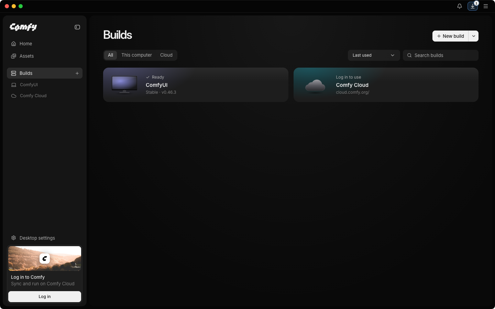

En Comfy Desktop puedes ejecutar ComfyUI en este equipo, en Comfy Cloud o en un servidor de ComfyUI en otra máquina. Cada uno de ellos es un build. Comfy Desktop te muestra Comfy Cloud, y cualquier otro build lo instalas, agregas o conectas antes de abrirlo. Esta página cubre la página **Builds**: los tipos de build, cómo encontrarlos, el menú de acciones rápidas, cómo instalar, agregar o conectar un build, y cómo iniciarlo, detenerlo, reiniciarlo y activar el inicio automático. Cada parte de la administración de un build tiene su propia página, listada en [Administrar builds](#administrar-builds).

## Tipos de compilaciones de Comfy

El lugar donde se ejecuta una compilación determina lo que puedes hacer con ella. La página **Builds** agrupa las compilaciones según dónde se ejecutan:

| Dónde se ejecuta | Qué es | Cómo obtener una |
| --- | --- | --- |
| **Esta computadora** | ComfyUI instalado en esta computadora. Su tipo es **Standalone**, **Git clone**, **Portable**, **Legacy Desktop** o **Build** (una compilación de Developer Platform del espacio de trabajo de tu equipo). | [Instala una compilación nueva](#instalar-una-compilación-nueva) o [agrega un ComfyUI que ya tengas](#agregar-un-comfyui-que-ya-tienes). |
| **Cloud** | Comfy Cloud. Se ejecuta en GPUs en la nube y necesita una cuenta de Comfy. | Comfy Desktop te la muestra como **Comfy Cloud**. |
| **Remoto** | Un servidor de ComfyUI que se ejecuta en otra máquina, al que accedes mediante su URL. | [Conéctate a un servidor de ComfyUI](#conectar-con-un-servidor-de-comfyui). |

<Note>
  Comfy Cloud muestra **Log in to use** hasta que [inicies sesión](/es/installation/desktop/overview#iniciar-sesión-y-abrir-comfy-cloud). Su menú de acciones rápidas no tiene **Stop**, **Auto start** ni **Uninstall**, y conserva el nombre **Comfy Cloud**.
</Note>

## Encontrar tus compilaciones

La página **Compilaciones** enumera todas las compilaciones de tu espacio de trabajo. Para abrirla, haz clic en **Compilaciones** en la **barra lateral**.

En la parte superior de la página:

- **Nueva compilación**: inicia una compilación nueva. Haz clic en la flecha que está a su lado (**Más opciones de compilación**) para **Agregar compilación existente** y **Cargar instantánea**.
- **Dónde se ejecuta**: filtra la lista. **Todos** y **Este equipo** siempre están ahí. **Cloud** y **Remoto** aparecen cuando tienes una compilación de ese tipo.
- **Ordenar**: ordena las compilaciones por **Última vez usado** o **Nombre**. Las compilaciones que se están instalando permanecen arriba.
- **Buscar compilaciones**: busca una compilación por su nombre. Si no hay coincidencias, haz clic en **Borrar filtros**.

Cada compilación es un mosaico. Un mosaico muestra el estado de la compilación, como **En ejecución**, **Iniciando…**, **Inicio automático** o **Error**. Mantén el puntero sobre un mosaico para ver qué hace un clic: **Haz clic para iniciar**, **Haz clic para abrir** o **Haz clic para ver los registros**.

Cuando no tienes compilaciones, la página muestra **Aún no hay compilaciones** e **Instala ComfyUI en este equipo o ejecútalo en Comfy Cloud.**

La **barra lateral** también enumera cada compilación debajo de **Compilaciones**:

- Un indicador giratorio y un porcentaje significan que la compilación se está instalando.
- Un punto verde significa que la compilación está en ejecución.
- Un punto rojo significa que la compilación falló o no se inició. Mantén el puntero sobre la compilación para leer el motivo.
- Haz clic en una compilación para abrir su [página de compilación](#administrar-builds).
- Haz clic derecho en una compilación para abrir su [menú de acciones rápidas](#acciones-rápidas-desde-la-lista-de-compilaciones).

Para ver **Inicio** y el resto de la **barra lateral**, consulta [Cómo moverte por Comfy Desktop](/es/installation/desktop/usage/overview).

### Acciones rápidas desde la lista de compilaciones

Haz clic derecho en una compilación de la **barra lateral**, o haz clic derecho en su mosaico de la página **Compilaciones** o en su tarjeta de **Inicio**, para abrir un menú corto de acciones. También puedes mantener el puntero sobre un mosaico o una tarjeta hasta que aparezca el botón **⋯** a su derecha y luego hacer clic en él.

El menú muestra solo las acciones que se aplican a la compilación en este momento. Los números de la captura de pantalla siguen el menú de esa compilación: 1 Iniciar, 2 Inicio automático, 3 Administrar, 4 Duplicar, 5 Mostrar en Finder, 6 Exportar instantánea, 7 Restaurar instantánea, 8 Desinstalar.

- **Iniciar**, o **Ver registros**, **Reiniciar** y **Detener** mientras la compilación está en ejecución. Mientras se instala o se inicia, **Ver registros** y **Cancelar**. Después de un bloqueo, **Ver error**.
- **Inicio automático** o **Desactivar inicio automático**. Consulta [Iniciar una compilación cuando se abre Comfy Desktop](#iniciar-una-compilación-cuando-se-abre-comfy-desktop).
- **Administrar**, que abre la [página de la compilación](#administrar-builds).
- **Actualizar**, cuando hay una actualización disponible, y **Migrar a Standalone**, cuando la compilación puede pasar a una compilación Standalone. Consulta [Migrar más tarde](/es/installation/desktop/usage/migrate#migrar-más-tarde).
- **Duplicar** y **Mostrar en Finder**, **Mostrar en Explorer** o **Mostrar en la carpeta**.
- **Exportar instantánea** y **Restaurar instantánea**. Consulta [Instantáneas](/es/installation/desktop/usage/build-snapshots#guardar-y-restaurar-instantáneas).
- **Subir compilación**, cuando has iniciado sesión en un espacio de trabajo. Consulta [Compilaciones de equipo](/es/installation/desktop/usage/workspaces-and-builds).
- **Desinstalar**. Consulta [Eliminar una compilación](/es/installation/desktop/usage/build-duplicate-and-remove#eliminar-una-compilación).

**Inicio automático**, **Reiniciar**, **Ver registros** y **Subir compilación** solo aparecen en este menú. Todo lo demás también está en la página de la compilación. Cuando un elemento está atenuado, mantén el puntero sobre él para leer el motivo, como **Detén primero la compilación en ejecución.**

## Instalar una compilación nueva

Una compilación nueva es una instalación de ComfyUI que Comfy Desktop hace por ti: una versión oficial como compilación **Standalone**, o una Developer Platform Build del espacio de trabajo de tu equipo. El diálogo **New build** selecciona la configuración para esta computadora. La instalación descarga ComfyUI y configura su entorno de Python, así que revisa el resumen antes de hacer clic en **Install**.

<Steps>
  <Step title="Abrir el diálogo New build">
    Abre el diálogo de una de estas formas:

    - En la **barra lateral**, mantén el puntero sobre **Builds** y luego haz clic en el botón de signo más (**+**) (**New build**).
    - En la página **Builds**, haz clic en **New build**.
    - En **Home**, haz clic en la tarjeta **New build**, cuando **Home** la muestra.

    El diálogo **New build** se abre con el mensaje principal **Set up a fresh ComfyUI install.**
  </Step>
  <Step title="Revisar el resumen">
    Cuando hayas iniciado sesión y tu espacio de trabajo tenga compilaciones, el diálogo se abre en **Your team's builds**. Su fila **Release** las enumera, con el marcador de posición **Select a build**. Para instalar una versión oficial en su lugar, selecciona **Official release** en **Source** en el siguiente paso.

    Para una versión oficial, el diálogo muestra lo que instala:

    

    - **Name**: el nombre que recibe la compilación en la **barra lateral** y en la página **Builds**. El cuadro muestra un nombre sugerido. Déjalo vacío para usar ese nombre, o escribe el tuyo.
    - **Detected**: la computadora o GPU que encontró Comfy Desktop, con su memoria en GB. Haz clic en **Change** junto a esa tarjeta para cambiar la configuración.
    - **Release**: **Stable** para versiones probadas, o **Latest on GitHub**.
    - **Hardware**: el tipo de GPU para el que se crea la compilación, como **NVIDIA**, **AMD**, **Intel Arc (XPU)**, **Apple Silicon (MPS)** o **CPU**. Su nota dice:
      - **Detected**: el tipo de GPU coincide con la GPU que encontró Comfy Desktop.
      - **No GPU acceleration**: la compilación es para **CPU**.
      - **Not supported**: esta computadora no admite el tipo de GPU seleccionado.
    - **Version**: la versión de ComfyUI que se instala, con su tipo de versión, como **Stable**.
    - **Location**: la carpeta en la que se instala la compilación, con el espacio libre de esa unidad y el espacio que necesita la instalación. Haz clic en **Browse** para elegir otra carpeta.

    Cuando la nota de **Hardware** indica **Detected** y **Location** muestra espacio libre sin ninguna advertencia debajo, la configuración es adecuada para esta computadora.

  </Step>
  <Step title="Cambiar la configuración (opcional)">
    Haz clic en **Change** para abrir **Change setup**. Muestra el mensaje **Everything here is already set to what fits this computer.**

    

    - **How to start**: mantén **Install a new build**.
    - **Source**: **Official release** instala ComfyUI. **Your team's builds** instala una Developer Platform Build de tu espacio de trabajo. Consulta [Compilaciones del equipo](/es/installation/desktop/usage/workspaces-and-builds).
    - **Release**: **Stable** instala versiones probadas. Elige la versión en la lista junto a **Stable**. **Latest on GitHub** instala los commits más recientes de la rama master.
    - **Location**: la carpeta de instalación. Elige una carpeta que no esté dentro de la carpeta de Comfy Desktop, de OneDrive, de una carpeta compartida de modelos, entrada o salida, ni de otra compilación. Haz clic en **Browse** para elegir otra carpeta.
    - **Hardware**: el tipo de GPU para el que se crea la compilación. Cada opción indica su versión de ComfyUI, versión de Python y tamaño de descarga.

    Haz clic en **Save changes** para volver al resumen, o en **Discard** para descartar los cambios.

  </Step>
  <Step title="Hacer clic en Install">
    Haz clic en **Install**. Antes de que empiece la instalación, Comfy Desktop puede detenerte:

    - **Location** muestra un problema debajo e **Install** permanece atenuado cuando la carpeta no puede alojar una compilación. Haz clic en **Browse** y elige otra carpeta.
    - **Low disk space** se abre cuando la unidad tiene menos espacio libre del que necesita la instalación, o menos de 1 GB. Haz clic en **Continue anyway** para instalar, o cierra el diálogo y elige otra carpeta.
    - **Update NVIDIA driver** se abre para una compilación **NVIDIA** cuando tu controlador es anterior a la versión 580. Muestra tu versión del controlador y el mínimo recomendado. Haz clic en **Continue anyway** para instalar con tu controlador actual, o actualiza el controlador primero.
  </Step>
  <Step title="Seguir la instalación">
    Comfy Desktop vuelve a **Home** y la instalación se ejecuta en segundo plano. La compilación muestra **Installing ComfyUI** y el porcentaje en **Home** y en la página **Builds**, y un indicador giratorio y el porcentaje en la **barra lateral**.

    Para ver cada paso, haz clic en la tarjeta de la compilación o selecciona **View logs** en el [menú de acciones rápidas](#acciones-rápidas-desde-la-lista-de-compilaciones). El diálogo **Installing ComfyUI** enumera los pasos:

    1. **Download**
    2. **Extract**
    3. **Set up environment**
    4. **Get the latest ComfyUI**, o **Get ComfyUI** y la versión que elegiste

    Haz clic en **View logs** en el diálogo para ver la salida de la instalación.

    Para detener la instalación:

    1. En el menú de acciones rápidas, selecciona **Cancel**.
    2. Haz clic en **Cancel install**.

    La instalación se detiene y Comfy Desktop elimina los archivos que descargó.
  </Step>
</Steps>

Cuando termina la instalación, el indicador giratorio de la **barra lateral** desaparece y la compilación muestra su ícono de laptop. Para **Auto start**, consulta [Iniciar una compilación cuando se abre Comfy Desktop](#iniciar-una-compilación-cuando-se-abre-comfy-desktop). Si la instalación falla, consulta [Solucionar una compilación que falla](/es/installation/desktop/usage/build-troubleshooting#corregir-un-build-que-falla).

## Agregar un ComfyUI que ya tienes

Si configuraste ComfyUI por tu cuenta, desde un clon de Git o una descarga portátil, puedes agregarlo a Comfy Desktop. Comfy Desktop lo ejecuta desde su carpeta y no mueve ni copia sus archivos.

1. En la página **Builds**, haz clic en la flecha junto a **New build** (**More build options**) y luego selecciona **Add existing build**. También puedes abrir **New build**, hacer clic en **Change**, establecer **How to start** en **Use an existing build** y establecer **Where it is** en **On this computer**. La hoja muestra **Point Desktop at the ComfyUI you already have.**

   

2. Junto a **Install location**, haz clic en **Browse** y luego selecciona la carpeta de ComfyUI.
3. Verifica **Detected type**. Muestra **Standalone**, **Portable**, **Git clone** o **Legacy Desktop**. Si muestra **Legacy Desktop**, detente y cierra el diálogo: agregarlo aquí evita que Comfy Desktop lo migre. En su lugar, sigue [Migrar desde Legacy Desktop](/es/installation/desktop/usage/migrate). Si muestra **No known install detected**, selecciona la carpeta que contiene ComfyUI en sí, no una carpeta por encima de ella.
4. En **Name**, conserva el nombre sugerido o escribe el tuyo.
5. Para un **Git clone**, verifica **Version**, **Repository** y **Branch**. **Virtual environment** muestra la carpeta `.venv`, `venv`, `.env` o `env` que encontró Comfy Desktop. Haz clic en **Browse** junto a ella para elegir otra.
6. Haz clic en **Add build**.

La compilación aparece en la **barra lateral** y en la página **Builds**. Si otra compilación tiene el nombre que escribiste, **Name** muestra **A build named "…" already exists. Please choose a different name.**

Para crear una compilación desde un archivo de instantánea, selecciona **Load snapshot** en **More build options**. Consulta [Crear una compilación desde un archivo de instantánea](/es/installation/desktop/usage/build-snapshots#crear-una-compilación-desde-un-archivo-de-instantánea).

## Conectar con un servidor de ComfyUI

Una compilación remota abre un servidor de ComfyUI que se ejecuta en otra máquina, como un servidor GPU en tu red. Necesitas la URL del servidor.

1. Abre el diálogo **New build**, como en [Install a new build](#instalar-una-compilación-nueva), y luego haz clic en **Change**.
2. Establece **How to start** en **Use an existing build**.
3. Establece **Where it is** en **On a server**.

   

4. En **Name**, mantén el nombre sugerido o escribe el tuyo.
5. En **ComfyUI URL**, escribe la dirección del servidor. El campo muestra `http://localhost:8188` como ejemplo.
6. Haz clic en **Connect**.

La compilación aparece en la **barra lateral** y en la página **Builds**, y el filtro **Where it runs** incluye **Remote**. Si la dirección no es una URL, el diálogo muestra **Enter a valid URL (e.g. http://localhost:8188).** Para cambiar la dirección más tarde, consulta [Change a remote build's URL](/es/installation/desktop/usage/build-management#cambiar-la-url-de-una-build-remota).

## Iniciar, detener y reiniciar una build

Para iniciar una instancia y abrir ComfyUI, consulta [Abrir ComfyUI](/es/installation/desktop/overview#abrir-comfyui). Una instancia de Comfy Cloud se abre con **Open Cloud** en su página, y una instancia remota con **Open remote**.

### Ejecutar más de una build

Cuando inicias una instancia en esta computadora mientras otra se está ejecutando o iniciando, Comfy Desktop abre **A build is already running**. En **Will be stopped**, enumera las instancias que detendría.

<Warning>
  **Close and start** detiene las instancias enumeradas y pierde cualquier trabajo sin guardar que haya en ellas. Guarda tus flujos de trabajo primero.
</Warning>

- **Close and start**: detiene las instancias enumeradas y luego inicia la que elegiste.
- **Run all**: inicia la instancia y mantiene las demás en ejecución.

Cierra el diálogo para cancelar el inicio. Para dejar de ver este diálogo, abre **Configuraciones de Escritorio** desde la **barra lateral** y, en **Preferences**, desactiva **Warn before running multiple builds**.

### Detener o reiniciar

Detén una instancia antes de desinstalarla. Reiníciala para aplicar cambios a sus argumentos de inicio.

<Warning>
  Detener o reiniciar una instancia pierde cualquier trabajo sin guardar en ComfyUI. Guarda tu flujo de trabajo primero.
</Warning>

Para detener una instancia en ejecución:

1. En la [página de la instancia](#administrar-builds), haz clic en **More** (**⋯**) y luego selecciona **Stop**. También puedes seleccionar **Stop** en las [acciones rápidas](#acciones-rápidas-desde-la-lista-de-compilaciones).
2. En **Stop ComfyUI**, haz clic en **Stop**.

ComfyUI se detiene y su ventana se cierra.

Para reiniciar una instancia en ejecución:

1. En las [acciones rápidas](#acciones-rápidas-desde-la-lista-de-compilaciones), selecciona **Restart**.
2. En **Restart ComfyUI**, haz clic en **Restart**.

La tarjeta muestra **Starting…** y luego **Running**. Reiniciar nunca abre **A build is already running**.

## Iniciar una compilación cuando se abre Comfy Desktop

**Auto start** inicia una compilación cada vez que se abre Comfy Desktop. Solo una compilación a la vez puede tener **Auto start**.

- En el [menú de acciones rápidas](#acciones-rápidas-desde-la-lista-de-compilaciones) de una compilación en esta computadora o de una compilación remota, selecciona **Auto start**.

La tarjeta de la compilación muestra **Auto start**. Si otra compilación tenía **Auto start**, esa compilación lo pierde. Para desactivarlo, selecciona **Turn off auto start** en el mismo menú.

Cuando instalas tu primera compilación en esta computadora y ninguna otra compilación tiene **Auto start**, la nueva compilación lo recibe. Si esa compilación no se inicia la primera vez, Comfy Desktop desactiva su **Auto start**.

## Administrar builds

La página de un build tiene una pestaña para cada tipo de ajuste. Elige la parte que necesitas:

<CardGroup cols={2}>
  <Card title="Administrar build" icon="sliders" href="/es/installation/desktop/usage/build-management">
    Abre la página del build, usa el menú Más y actualiza ComfyUI, PyTorch o la URL de un build remoto.
  </Card>
  <Card title="Carpetas" icon="folder-tree" href="/es/installation/desktop/usage/build-folders">
    Elige las carpetas de modelos, entrada y salida que usa un build.
  </Card>
  <Card title="Argumentos de inicio" icon="terminal" href="/es/installation/desktop/usage/build-startup-arguments">
    Define flags, la política de ComfyUI Manager, la ventana, el puerto y las variables de entorno.
  </Card>
  <Card title="Instantáneas" icon="clock-rotate-left" href="/es/installation/desktop/usage/build-snapshots">
    Guarda, restaura, exporta e importa la versión de ComfyUI, los nodos personalizados y los paquetes de un build.
  </Card>
  <Card title="Terminal" icon="code" href="/es/installation/desktop/usage/build-terminal">
    Ejecuta comandos en el entorno de Python del build.
  </Card>
  <Card title="Duplicar o eliminar" icon="copy" href="/es/installation/desktop/usage/build-duplicate-and-remove">
    Copia un build, olvídalo o desinstálalo junto con sus archivos.
  </Card>
  <Card title="Corregir un build" icon="triangle-exclamation" href="/es/installation/desktop/usage/build-troubleshooting">
    Resuelve una instalación que no terminó, un cierre inesperado, un problema de carpeta o un conflicto de puerto.
  </Card>
</CardGroup>
