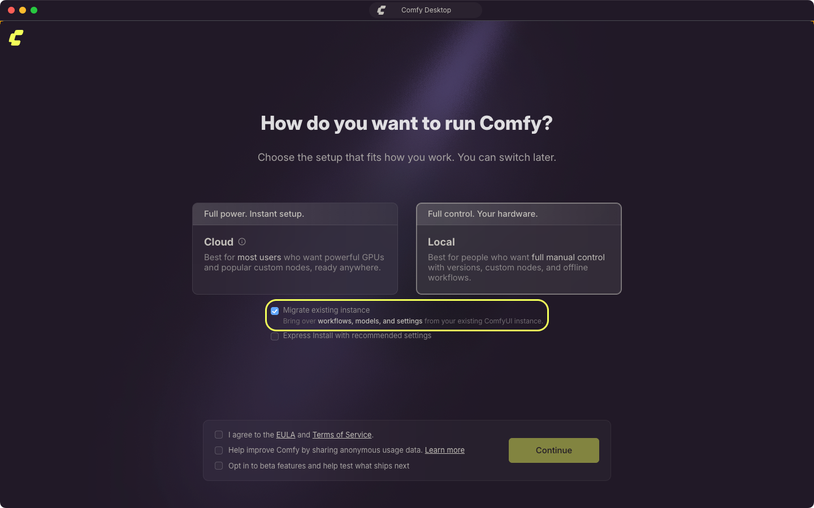
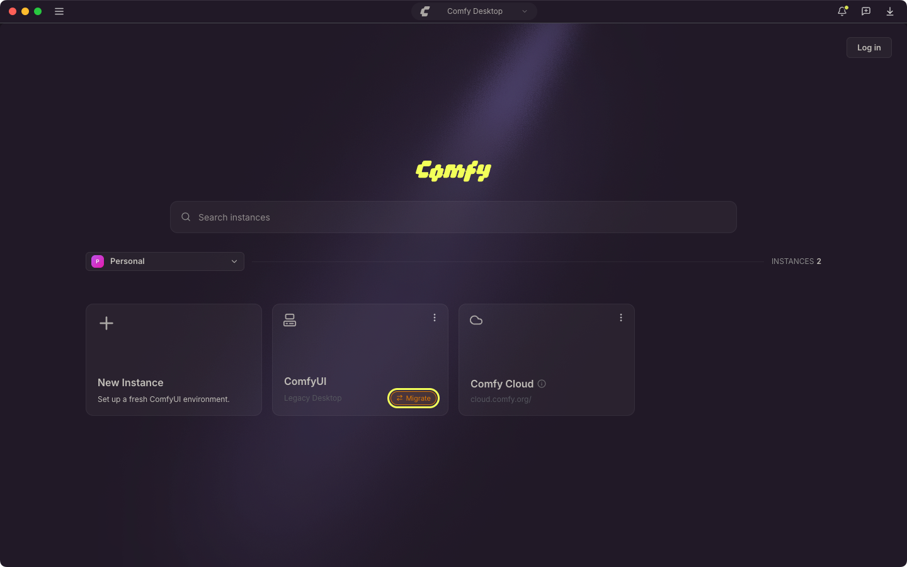
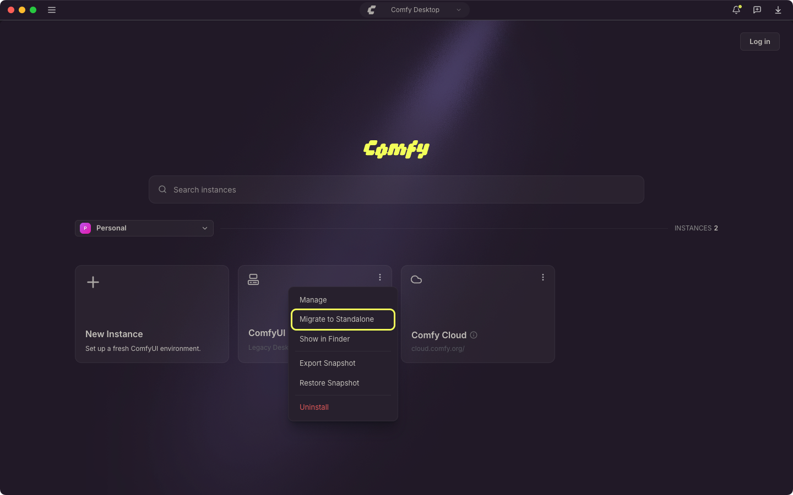
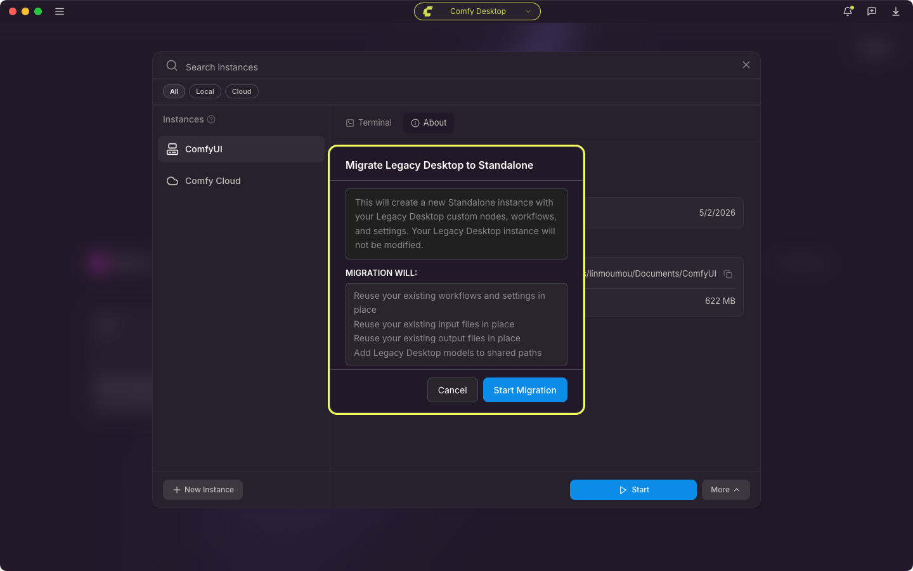

<Info>
Esta página cubre la migración desde **Legacy Desktop** (la aplicación de escritorio anterior de instalación única). Si es tu primera vez como usuario, puedes saltarte esta sección.
</Info>

<CardGroup cols={1}>
  <Card title="¿Buscas una instalación diferente?" icon="compass" href="/es/installation/desktop/usage/instance-management#seguimiento-de-una-instalación-existente">
    Si ya tienes una instalación de ComfyUI (portable, clon manual de git, etc.) y quieres agregarla a Comfy Desktop, consulta **Seguimiento de una instalación existente** en Gestión de instancias.
  </Card>
</CardGroup>

Si ya tienes Legacy Desktop instalado, Comfy Desktop puede detectarlo y migrarlo, creando una nueva instalación Standalone en la vista Selector.

## Qué se migra

Legacy Desktop era una aplicación de instalación única. Comfy Desktop es un administrador de múltiples instalaciones. Cuando migras:

- **Flujos de trabajo y configuraciones**: se reutilizan en el mismo lugar, por lo que la nueva instancia conserva los mismos datos de usuario.
- **Nodos personalizados**: se quedan en tu carpeta `custom_nodes` existente. La instalación migrada usa tu carpeta de datos de Legacy Desktop como directorio base, así que carga los mismos nodos, y sus paquetes permanecen en el entorno de Python que se reutiliza.
- **Modelos**: tu carpeta de modelos existente se agrega a los directorios de modelos compartidos, para que todas las instalaciones puedan leer esos archivos donde ya están.
- **Archivos de entrada y salidas**: se reutilizan en el mismo lugar desde las carpetas existentes.
- **Entorno de Python**: tu entorno existente se valida y luego se reutiliza. Comfy Desktop comprueba que puede importar torch y después instala en él los requisitos propios de ComfyUI sin reemplazar tus paquetes de PyTorch.
- **Versión de ComfyUI**: la fuente de ComfyUI se prepara en un nuevo directorio administrado, de modo que Comfy Desktop administra las actualizaciones a partir de entonces.

La migración reutiliza tu carpeta de datos y tu entorno de Python de Legacy Desktop en el mismo lugar en vez de copiarlos, así que acabas con un único entorno en uso y no con una segunda copia. Si necesitas una copia original sin modificar de tu configuración de Legacy Desktop, haz una copia de seguridad por tu cuenta antes de migrar.

## Qué se incluye en la copia de seguridad

Antes de cambiar nada, Comfy Desktop copia los archivos de configuración de Legacy Desktop en una carpeta con fecha dentro de la carpeta de configuración de Legacy Desktop:

- macOS: `~/Library/Application Support/ComfyUI/legacy-backup/<timestamp>/`
- Windows: `%APPDATA%\ComfyUI\legacy-backup\<timestamp>\`

Solo se copian los archivos que existen:

- `config.json`: la configuración de la aplicación Legacy Desktop, incluida la carpeta de datos que usaba.
- `comfy.settings.json`: la configuración del frontend de ComfyUI guardada en tu carpeta de usuario de Legacy Desktop.
- `extra_models_config.yaml`: las rutas de modelos adicionales que configuraste en Legacy Desktop.
- `window.json`: el tamaño y la posición de la ventana guardados.

La copia contiene solo configuración. Los modelos, flujos de trabajo, nodos personalizados, archivos de entrada y salidas no se copian en ella, porque la instalación migrada sigue usándolos donde están. La migración también escribe una instantánea del entorno de Legacy Desktop, con sus nodos personalizados y paquetes instalados, en `.snapshots/` dentro de tu carpeta de datos de Legacy Desktop.

Si un archivo no se puede copiar, la migración lo anota en el registro y continúa, así que un fallo de la copia no detiene la migración.

## Qué ocurre durante la migración

La migración muestra su propia pantalla de progreso y avanza por estos pasos:

1. **Back up legacy state**
2. **Check folder access** (solo macOS)
3. **Validate Python environment**
4. **Capture snapshot**
5. **Allocate install folder**
6. **Stage ComfyUI source code**
7. **Install requirements**
8. **Carry over settings**
9. **Register installation**

Algunos pasos se detienen a esperar una respuesta:

- **Folder access needed** (macOS): macOS bloqueó el acceso a la carpeta de Legacy Desktop. Concede a Comfy Desktop el acceso a todo el disco en Ajustes del Sistema → Privacidad y seguridad y vuelve a iniciar la migración.
- **Python environment looks broken**: el entorno de Legacy Desktop no pudo importar torch. Selecciona **Adopt anyway** para seguir con ese entorno o **Cancel** para detenerte.
- **ComfyUI source code unavailable**: no se pudo obtener el código fuente de ComfyUI para la nueva instalación. Selecciona **Retry**, o **Cancel** y crea una instalación nueva desde el panel.

La pantalla guarda la salida de cada paso en un panel **View logs** que se abre solo cuando un paso falla. Copia el texto con el botón de copiar del panel, o lee la misma salida en el registro de la aplicación de Desktop. Un fallo al instalar los requisitos se registra como aviso y no detiene la migración.

## Qué cambia después de la migración

Una vez que se completa la migración, tu nueva instalación Standalone funciona como cualquier otra instalación de Comfy Desktop:

- **Inicio**: haz clic en el botón Reproducir de la tarjeta de la nueva instalación en la vista Selector para iniciar ComfyUI.
- **Puerto**: el puerto y cualquier otro argumento de inicio personalizado de tu configuración de Legacy Desktop se conservan.
- **Administrar**: usa el panel Administrar para actualizar, tomar instantáneas y configurar la instalación.
- **Actualizaciones**: las instalaciones Standalone se pueden actualizar de forma independiente a través del panel Administrar. A diferencia de Legacy Desktop, ya no necesitas descargar una nueva compilación para cada actualización.
- **Varias instancias**: puedes tener varias instalaciones Standalone en paralelo, cada una con su propia versión de ComfyUI y su propia configuración.
- **Almacenamiento compartido**: los modelos se comparten entre todas las instalaciones Standalone de forma predeterminada. Los directorios de entrada y salida están fijados al espacio de trabajo de Legacy Desktop adoptado, para que tus archivos existentes permanezcan donde están.

Una instancia migrada no actualiza ComfyUI por su cuenta. Usa la [pestaña Actualizar](/es/installation/desktop/usage/manage#pestaña-actualizar) del panel Administrar cuando quieras una versión de ComfyUI más reciente.

## ¿Mi enlace anterior sigue funcionando?

Legacy Desktop se ejecutaba en el puerto `8000` de forma predeterminada. La nueva instalación **conserva el puerto** de tu configuración de Legacy Desktop, así que `http://localhost:8000` debería seguir funcionando. Si tenías argumentos de CLI personalizados configurados (por ejemplo, `--port 8188`), esos también se conservan.

Si usas un acortador de URL, un marcador o una integración externa que hace referencia a la aplicación Legacy Desktop mediante una dirección diferente, es posible que tengas que revisar la pestaña Argumentos de inicio de la nueva instalación y actualizar lo que corresponda.

## Migración paso a paso

<Steps>
<Step title="Instala Comfy Desktop">
Descarga e instala Comfy Desktop desde la [página de descarga oficial](https://comfy.org/download).
</Step>

<Step title="Inicia Comfy Desktop">
Cuando abras Comfy Desktop por primera vez, la configuración inicial detecta cualquier instalación de Legacy Desktop en tu sistema. Elige **Local**, y la configuración muestra **Migrar instancia existente**, ya seleccionada, de modo que tu instalación actual se traslada cuando continúas.

</Step>

<Step title="Confirma la migración">
Selecciona **Continuar** y luego confirma **Migrar a Standalone** con **Iniciar migración**. Comfy Desktop hará lo siguiente:

1. Reutilizar tus flujos de trabajo, configuraciones, nodos personalizados, entradas y salidas en su lugar
2. Reutilizar tu entorno de Python y preparar el código fuente de ComfyUI en un nuevo directorio gestionado para que las actualizaciones funcionen con normalidad
3. Agregar tu carpeta de modelos como directorio compartido e instalar los requisitos de ComfyUI en el entorno reutilizado

Al finalizar, la nueva tarjeta de instalación Standalone aparece en la vista del selector.
</Step>

<Step title="Verifica">
Inicia tu nueva instalación y confirma:
- Tus flujos de trabajo están disponibles
- Los nodos personalizados están instalados
- Los modelos son accesibles
- Tu servidor se ejecuta en la URL transferida (por defecto `http://localhost:8000`)
</Step>
</Steps>

## Migrar desde el Chooser

Si ya finalizaste la configuración inicial, o la instalación de Legacy Desktop ya aparece en el Chooser, inicia la migración desde la tarjeta de la instancia:

1. Busca la tarjeta de instancia de Legacy Desktop. Incluye un distintivo **Migrate**.

   

2. Haz clic en el distintivo o abre el menú **⋮** de la tarjeta y selecciona **Migrate to Standalone**.

   

3. Revisa la confirmación y luego selecciona **Start Migration**.

   

Una instalación de Legacy Desktop se adopta en su ubicación actual, por lo que la instancia que aparece es tu configuración existente bajo la gestión de Comfy Desktop. En cambio, migrar una instalación registrada de Git o portable crea una nueva instancia Standalone y deja la instalación registrada en su lugar.

Una actualización pendiente tiene prioridad en esas tarjetas: muestran el distintivo de actualización en lugar de **Migrate**.

## Solución de problemas

### Legacy Desktop no se detecta automáticamente

La fuente Legacy Desktop es solo para migración y no aparece en el selector de Nueva instancia, por lo que no se puede agregar a mano. Si Comfy Desktop no detectó tu instalación de Legacy Desktop:

1. Agrega la instalación como una instancia con seguimiento. Consulta [**Seguimiento de una instalación existente**](/es/installation/desktop/usage/instance-management#seguimiento-de-una-instalación-existente).
2. Una vez que aparezca en el Selector, migra con su botón **Migrar**, o con **Migrar a Standalone** en el menú **⋮**.

### La migración falla

- **Revisa el registro**: selecciona **View logs** en la pantalla de migración, o abre el registro de la aplicación de Desktop (`app.log`) en `~/Library/Logs/Comfy Desktop` (macOS) o `%APPDATA%\Comfy Desktop\logs` (Windows).
- **Comprueba que la instalación de Legacy Desktop está completa**: la migración lee modelos, flujos de trabajo y nodos personalizados de la carpeta existente, así que una carpeta movida o eliminada la detiene.
- **Inténtalo de nuevo**: un problema de red puede detener el paso de preparación del código fuente, y un segundo intento puede funcionar.

### La migración se detuvo antes de terminar

Si seleccionas **Cancel** en uno de los avisos, la ejecución se detiene, y lo mismo ocurre si un paso falla de forma clara. Un aviso de instalación de requisitos no la detiene. Una ejecución detenida no agrega una instancia al Selector, así que inicia la migración otra vez desde el distintivo **Migrate** de la tarjeta. Tu carpeta de Legacy Desktop no se elimina.

### Modelos faltantes después de la migración

Los modelos se agregan a los directorios de modelos compartidos, no se copian. Si los modelos no aparecen:

1. Abre [Desktop Settings → Storage](/es/installation/desktop/usage/settings#almacenamiento)
2. Comprueba que tu carpeta de modelos anterior y las rutas de modelos adicionales indicadas en el `extra_models_config.yaml` de Legacy Desktop están en los directorios compartidos. Si falta alguna, selecciona **+ Add Shared Directory** y elígela.
3. En el panel Administrar de la instancia migrada, abre la pestaña **Almacenamiento** y asegúrate de que **Include Shared Directories** está activado.
