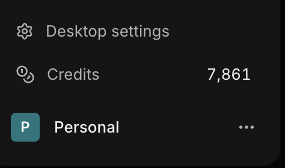

Esta página muestra las pantallas que usas en Comfy Desktop después del primer inicio: **Home**, el recorrido guiado, la **barra lateral**, la **barra de título**, tu espacio de trabajo y **Créditos**. Para instalar Comfy Desktop y tu primera compilación, consulta [Comfy Desktop](/es/installation/desktop/overview).

## Comenzar desde Home

**Home** es la página en la que se abre Comfy Desktop. Desde **Home**, abres ComfyUI con un solo clic. **Home** muestra, de arriba a abajo:

- **Open ComfyUI**: el botón de la esquina superior derecha. Abre ComfyUI en la compilación indicada en su tooltip. Cuando tienes más de una compilación, haz clic en la flecha que está junto al botón para elegir cuál abrir.
- **[Aplicaciones](/es/installation/desktop/usage/apps)**: una fila de herramientas listas para usar, cuando las **Aplicaciones** están activadas. Haz clic en **See all apps** para abrir la página **Aplicaciones**.
- **Flujos de trabajo de ejemplo**: cuando las **Aplicaciones** no están activadas, la fila muestra flujos de trabajo de ejemplo en su lugar. Haz clic en la tarjeta del centro para abrir su página en comfy.org en tu navegador.
- **[Compilaciones](/es/installation/desktop/usage/instance-management)**: hasta tres de tus compilaciones, cada una en una tarjeta. Haz clic en una tarjeta para iniciar la compilación o para abrirla cuando ya está en ejecución. Haz clic en **All builds** para ver todas tus compilaciones. Si todavía no tienes una compilación local, la fila termina con un mosaico **New build**. Haz clic en él para crear una.

Una tarjeta de Comfy Cloud muestra **Log in to use** hasta que [inicies sesión](/es/installation/desktop/overview#iniciar-sesión-y-abrir-comfy-cloud).

Estás en **Home** cuando el título de la página dice **Welcome. Let's create!**

## Hacer el recorrido guiado

La primera vez que aparece **Home**, un recorrido breve señala las partes de la página y la **barra lateral**. Explica qué es un build, las tarjetas de build de Comfy Cloud y las locales, dónde ver todos tus builds y comenzar uno nuevo, y **Recursos**. Si usaste Comfy Desktop antes, el recorrido comienza con **Las instancias ahora son builds**.

- Haz clic en **Next** para ir al siguiente paso, en **Back** para ir al paso anterior, o en **Skip** para cerrar el recorrido. También puedes presionar `Esc` para saltarlo.

El recorrido muestra su posición, como **1 de 6**, y omite cualquier parte que no esté en pantalla. El último paso solo tiene **Back** y **Done**. Haz clic en **Done** para cerrar el recorrido.

### Repetir el recorrido

Para ver el recorrido de nuevo:

1. En la **barra de título**, haz clic en la campana (**What's new**).
2. Selecciona **Take the tour**.

**Home** aparece y el recorrido comienza de nuevo.

## Conoce la barra lateral

La **barra lateral** a la izquierda de la ventana **Home** es la forma de moverte entre páginas.

Cada entrada abre una página:

| Entrada | Abre |
| --- | --- |
| **Home** | **Home**. Cuando la **barra lateral** está expandida, hacer clic en el logo de Comfy de la parte superior también la abre. |
| **Apps** | La página [**Apps**](/es/installation/desktop/usage/apps), donde buscas una aplicación con **Search apps** y la abres. Esta entrada solo aparece cuando **Apps** están activadas. |
| **Assets** | [**Assets**](/es/installation/desktop/usage/assets), donde exploras lo que generaron tus builds y Comfy Cloud. |
| **Builds** | Todos tus builds. |

Debajo de **Builds**, la **barra lateral** enumera cada build:

- Haz clic en un build para abrir su página de build.
- Haz clic derecho en un build para ver un menú de acciones.
- Para iniciar un build nuevo, mantén el puntero sobre **Builds** y haz clic en el botón más (**+**) (**New build**).

Un punto verde en un build significa que está en ejecución. Un punto rojo significa que falló o no se inició. Pasa el puntero sobre el build para ver por qué.

En la parte inferior de la **barra lateral**:

- **Desktop update**: aparece cuando hay una actualización de Comfy Desktop disponible. Haz clic en ella y luego haz clic en **Download**. Cuando diga **Desktop update ready**, haz clic en ella y luego haz clic en **Restart & update**.
- **Desktop settings**: abre las configuraciones de Comfy Desktop. Consulta [Comfy Desktop settings](/es/installation/desktop/usage/settings).
- **Credits**: tu saldo, una vez que inicias sesión. Consulta [Check your Credits](#revisa-tus-créditos).
- **Log in to Comfy**: la tarjeta que usas para iniciar sesión. Una vez que inicias sesión, tu espacio de trabajo ocupa su lugar. Consulta [Log in and open Comfy Cloud](/es/installation/desktop/overview#iniciar-sesión-y-abrir-comfy-cloud).

Para hacer espacio, haz clic en **Collapse sidebar** en la parte superior de la barra lateral. Las entradas conservan solo sus iconos, y la tarjeta **Log in to Comfy** se convierte en un icono **Log in**. Para abrir una página en su propia ventana, haz clic derecho en su entrada y selecciona **Open in new window**.

## Usar la barra de título

La **barra de título** recorre la parte superior de cada ventana de Comfy Desktop.

Sus botones a la derecha son, numerados como en la captura de pantalla:

- **1** **Novedades** (la campana): abre un menú con **Hacer el recorrido**. Consulta [Repetir el recorrido](#repetir-el-recorrido).
- **2** **Descargas**: abre la bandeja de descargas. Una insignia cuenta las descargas en progreso, las descargas fallidas y las descargas finalizadas que no has visto.
- **3** **Menú**: abre el menú de la barra de título.

En **Home**, **Menú** contiene **Pruebas de rendimiento** y **Benchmarks**. En una ventana que ejecuta ComfyUI, **Menú** también contiene:

- **Configuraciones de Escritorio**: abre las configuraciones de Comfy Desktop.
- **Reiniciar zoom (N%)**: aparece cuando acercas o alejas el zoom de ComfyUI. Selecciónalo para volver al 100%.
- **Cerrar ventana**: cierra esta ventana.
- **Salir de Escritorio**: sale de Comfy Desktop.

Una ventana que ejecuta ComfyUI también tiene un botón **Home** a la izquierda de la **barra de título**. Haz clic en él para volver a **Home**.

Durante la configuración del primer inicio, **Menú** solo contiene **Saltar el onboarding**.

## Usar el menú de tu espacio de trabajo

Iniciar sesión te permite usar Comfy Cloud y muestra tus créditos. Para iniciar sesión, sigue [Iniciar sesión y abrir Comfy Cloud](/es/installation/desktop/overview#iniciar-sesión-y-abrir-comfy-cloud).

Una vez que hayas iniciado sesión, tu espacio de trabajo reemplaza la tarjeta **Log in to Comfy** en la parte inferior de la **barra lateral**. Haz clic en ella para abrir un menú:

- Haz clic en el nombre del espacio de trabajo, en la parte superior, para cambiar a otro espacio de trabajo. **Home** y la **barra lateral** mostrarán entonces las builds de ese espacio de trabajo.
- **Configuración del espacio de trabajo** y **Administrar plan y créditos** se abren en tu navegador.
- El menú también muestra tu correo electrónico y **Cerrar sesión**.

## Revisa tus créditos

**Créditos**, en la parte inferior de la **barra lateral**, encima de tu espacio de trabajo, muestra tu saldo. Mantén el puntero sobre **Créditos** para actualizar el saldo.

- Para agregar créditos o cambiar tu plan, haz clic en **Créditos**. La página **Administrar plan y créditos** de tu espacio de trabajo se abre en tu navegador.

## Ve más allá

Estas páginas cubren builds, aplicaciones, recursos y configuraciones.

<CardGroup cols={2}>
  <Card title="Builds" icon="layer-group" href="/es/installation/desktop/usage/instance-management">
    Instala, inicia, actualiza y configura builds, y guarda instantáneas.
  </Card>
  <Card title="Aplicaciones" icon="shapes" href="/es/installation/desktop/usage/apps">
    Ejecuta herramientas listas en Comfy Cloud o en tu propia GPU.
  </Card>
  <Card title="Recursos" icon="images" href="/es/installation/desktop/usage/assets">
    Explora lo que generaron tus builds y Comfy Cloud.
  </Card>
  <Card title="Configuraciones" icon="cog" href="/es/installation/desktop/usage/settings">
    Cambia las actualizaciones, el almacenamiento y otras configuraciones de Comfy Desktop.
  </Card>
</CardGroup>

## Solucionar problemas

Usa estas entradas cuando una parte de **Inicio** o de la **barra lateral** no se carga.

<AccordionGroup>
  <Accordion title="Los flujos de trabajo de ejemplo no se cargan">
    **Inicio** muestra **No se pudieron cargar los flujos de trabajo de ejemplo. Revisa tu conexión e intenta de nuevo.** Revisa tu conexión a internet y luego haz clic en **Intentar de nuevo**.
  </Accordion>
  <Accordion title="Las aplicaciones no se cargan">
    **Inicio** muestra **No se pudieron cargar las aplicaciones. Revisa tu conexión e intenta de nuevo.** Revisa tu conexión a internet y luego haz clic en **Intentar de nuevo**.
  </Accordion>
  <Accordion title="Créditos muestra No se puede cargar el saldo">
    Comfy Desktop no puede leer tu saldo. Mantén el puntero sobre **Créditos** para cargarlo de nuevo.
  </Accordion>
</AccordionGroup>

Reporta un problema con Comfy Desktop en [GitHub](https://github.com/Comfy-Org/Comfy-Desktop/issues). Reporta un problema con esta documentación en el [repositorio de documentación](https://github.com/Comfy-Org/docs/issues).
