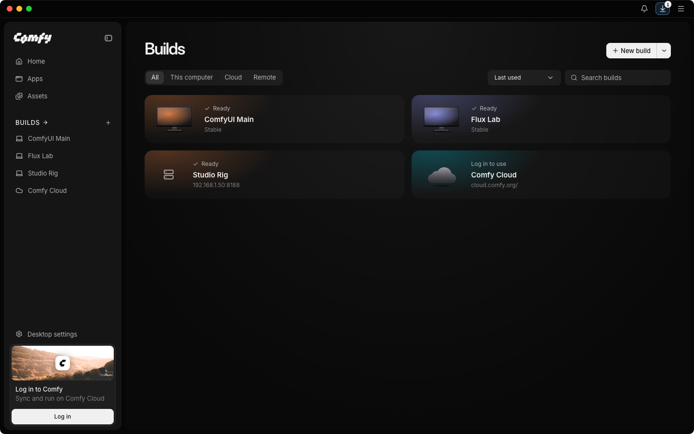

Comfy Desktop administra tus **builds** de ComfyUI. Un build es una instalación de ComfyUI con su propia versión, nodos personalizados y modelos. Puedes mantener varios builds en paralelo e iniciar cualquiera desde una sola ventana.

No instalas ComfyUI por tu cuenta. Comfy Desktop crea el entorno de Python, copia el código de ComfyUI y mantiene cada build actualizado.

La versión 1.2 llama **build** a cada instalación. Algunas páginas de esta sección todavía dicen **instancia**: son lo mismo.

### Funciones principales

- **[Varios builds](/es/installation/desktop/usage/instance-management)**: cada build conserva su versión de ComfyUI, sus nodos personalizados y su configuración.
- **[Instantáneas](/es/installation/desktop/usage/manage#pestaña-instantáneas)**: guardan y restauran el estado de un build, incluida su versión de ComfyUI, los nodos personalizados y los paquetes de Python.
- **[Modelos compartidos](/es/installation/desktop/usage/settings#almacenamiento)**: las carpetas de modelos se comparten por defecto, así que una copia de un modelo sirve a todos los builds.
- **Actualizaciones**: la barra de título actualiza Comfy Desktop. Cada build se actualiza desde su propia [pestaña Actualizar](/es/installation/desktop/usage/manage#pestaña-actualizar).
- **Comfy Cloud**: ejecuta los mismos flujos de trabajo en hardware de Cloud sin un build local.
- **[Instalaciones existentes](/es/installation/desktop/usage/instance-management)**: añade una carpeta de ComfyUI portable o clonada con git que ya tengas.

## La ventana

La ventana se divide en dos: la barra lateral a la izquierda y la página que abre a la derecha. Arriba, la barra de título contiene los controles de la ventana.

### Barra lateral

- **Home**: la página de inicio. Abre un build, consulta qué builds están listos y explora flujos de trabajo de ejemplo.
- **Apps**: apps de Comfy publicadas. La fila solo aparece cuando las apps están activadas.
- **Assets**: las imágenes, los vídeos y los flujos de trabajo que generaron tus builds, en una sola biblioteca.
- **Builds**: la lista completa de builds. El **+** junto al título crea uno nuevo y cada build ocupa una fila, con un punto de estado mientras se ejecuta o después de fallar.
- **Desktop settings** y tu cuenta de Comfy están abajo. Sin sesión, el área de cuenta muestra **Log in to Comfy**.

### Home

Home es la página con la que se abre Comfy Desktop. Bajo el saludo, cada build aparece como una tarjeta con su estado y basta un clic para iniciarlo. **All builds** lleva a la página Builds, y **Open ComfyUI**, en la esquina superior, abre tu build más reciente; su menú permite elegir otro. El carrusel sobre las tarjetas muestra flujos de trabajo de ejemplo o, si están activadas, apps.

### Builds

La página Builds muestra todos los builds como tarjetas con su nombre, su tipo y su estado.

- **New build** instala ComfyUI en este equipo. La flecha contigua abre **More build options**, que incluye **Add existing build** y **Load snapshot**.
- **Where it runs** filtra la lista entre All, This computer, Cloud y Remote. Las opciones Cloud y Remote solo aparecen si tienes un build de ese tipo.
- **Sort** ordena por **Last used** o **Name**, y el buscador filtra por nombre.
- Haz clic en una tarjeta para iniciar ese build. El botón **More actions** de la tarjeta o el clic derecho abre el menú del build. Con el build detenido empieza por **Start**; en ejecución empieza por **View logs**, **Restart** y **Stop**. Debajo vienen **Auto start**, **Manage**, **Update**, **Migrate to Standalone**, **Duplicate**, **Show in Finder** (**Show in Explorer** en Windows, **Show in folder** en Linux), **Export snapshot**, **Restore snapshot**, **Upload build** y **Uninstall**. Las entradas que no aplican a un build quedan ocultas.

<CardGroup cols={1}>
  <Card title="Administrar un build" icon="sliders" href="/es/installation/desktop/usage/manage">
    Inicia, actualiza, crea instantáneas y configura un build desde su panel de ajustes.
  </Card>
</CardGroup>

### Menú de la app

El botón **☰** del extremo derecho de la barra de título abre el menú de la app. Sus entradas dependen de la ventana:

- **Ventana Home o Builds**: Performance tests y Benchmarks.
- **Ventana de un build**: Performance tests, Benchmarks, Desktop settings, Reset zoom (N%) mientras la vista está ampliada, Close window y Quit Desktop.
- **Durante la configuración inicial**: Skip onboarding es la única entrada.

Cerrar la ventana de un build no detiene ese build. Al cerrar la última ventana, Comfy Desktop se cierra, salvo en macOS, donde sigue abierto mientras un build local esté en ejecución. **Quit Desktop** detiene los builds que sigan en ejecución.

En macOS la app mantiene además la barra de menús del sistema con los menús de la app, Edit y Window. Las versiones de Windows y Linux no tienen barra de menús del sistema.

### Barra de título

- **Home** vuelve a la página Home desde la ventana de un build.
- **Reset zoom (N%)** aparece cuando la vista de un build no está al 100%. Al pulsarlo vuelve a 100%.
- **Refresh** recarga la vista de ComfyUI.
- **What's new** abre un menú breve con **Take the tour**, que repite el recorrido de introducción.
- **Downloads** abre la bandeja de descargas. La insignia cuenta las descargas en curso y marca las fallidas o sin revisar. Consulta [Descargas](/es/installation/desktop/usage/downloads).

<CardGroup cols={2}>
  <Card title="Ajustes" icon="cog" href="/es/installation/desktop/usage/settings">
    Ajustes globales: actualizaciones, proxy y espejos, almacenamiento compartido y ubicaciones de datos.
  </Card>
  <Card title="Pruebas de rendimiento" icon="gauge" href="/es/installation/desktop/usage/performance-tests">
    Mide la velocidad de un flujo de trabajo en un build y compara ejecuciones entre hardware.
  </Card>
</CardGroup>

## Comentarios y problemas

¿Encontraste un error o tienes una sugerencia? Comfy Desktop es de código abierto:

- **Problemas de Comfy Desktop**: [github.com/Comfy-Org/Comfy-Desktop/issues](https://github.com/Comfy-Org/Comfy-Desktop/issues)
- **Problemas de la documentación**: [github.com/Comfy-Org/docs/issues](https://github.com/Comfy-Org/docs/issues)

Para preguntas generales sobre ComfyUI, usa [ComfyUI GitHub Discussions](https://github.com/Comfy-Org/ComfyUI/discussions) o únete al [ComfyUI Discord](https://www.comfy.org/discord).
