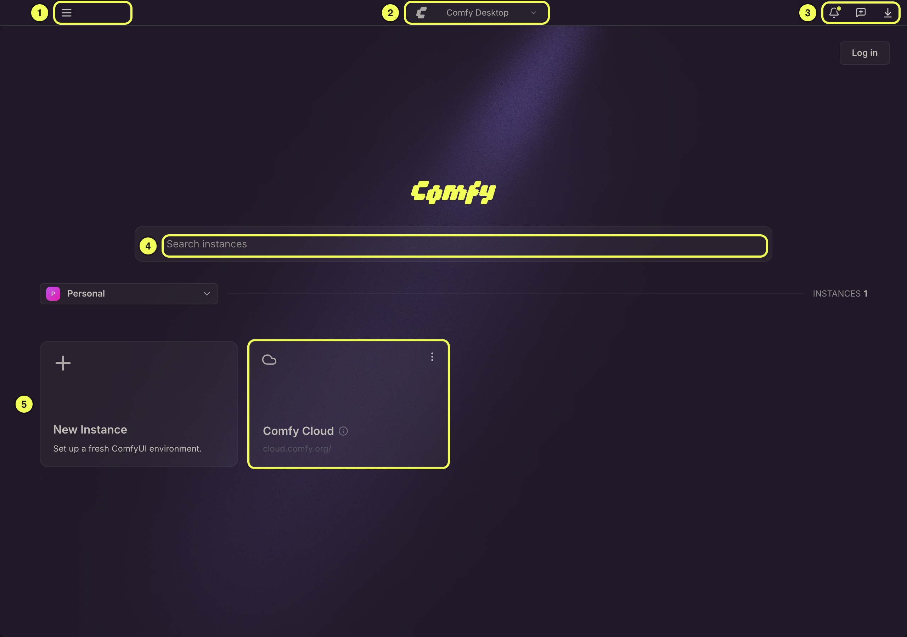
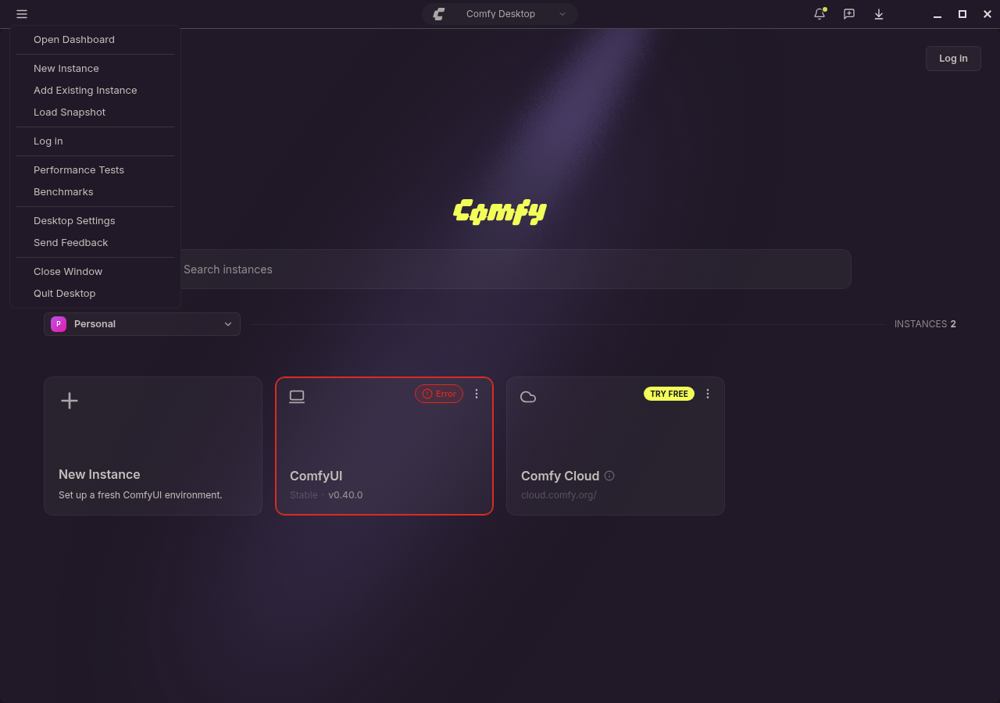
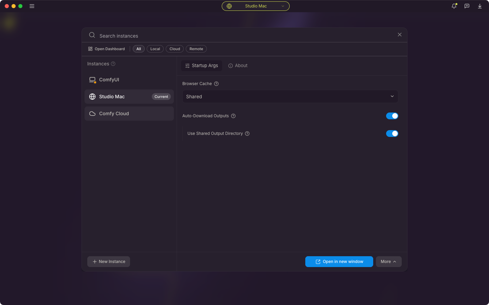

Comfy Desktop es la aplicación oficial de escritorio para **ComfyUI**. Gestiona todo por ti: instala ComfyUI, lo mantiene actualizado y te permite ejecutar varias configuraciones independientes en paralelo.

Para entender la relación: **Comfy Desktop** es la aplicación que administra e inicia instancias de **ComfyUI**. No instalas ComfyUI por separado: Comfy Desktop se encarga de la instalación, el entorno de Python y las dependencias de cada instancia de forma automática.

### Características principales

- **[Gestión de múltiples instancias](/es/installation/desktop/usage/instance-management)**: ejecuta varias instancias de ComfyUI en paralelo, cada una con su propia versión, nodos personalizados y configuración
- **[Snapshots](/es/installation/desktop/usage/manage#pestaña-instantáneas)**: guarda y restaura el estado completo de una instancia (versión de ComfyUI, nodos personalizados, paquetes de Python), lo que facilita revertir o reproducir un entorno
- **[Almacenamiento compartido](/es/installation/desktop/usage/settings#almacenamiento)**: los modelos se comparten entre todas las instancias de forma predeterminada, lo que ahorra espacio en disco. También puedes agregar carpetas de modelos externas
- **Actualizaciones automáticas**: el control **Desktop Update** de la barra de título actualiza Comfy Desktop. Usa la pestaña [Actualizar](/es/installation/desktop/usage/manage#pestaña-actualizar) del panel Administrar para actualizar cada instancia de ComfyUI.
- **Integración con la nube**: inicia o conéctate a instancias de Comfy Cloud directamente desde la vista Selector
- **[Rastrear instalaciones existentes](/es/installation/desktop/usage/instance-management#seguimiento-de-una-instalación-existente)**: agrega tus instalaciones existentes de ComfyUI, ya sean portables o clonadas con git, a Comfy Desktop para una gestión unificada

Esta guía explica cómo usar estas funciones.

## Descripción general del Panel

La ventana de Comfy Desktop se divide en varias áreas clave. La siguiente imagen señala las partes principales del Panel:

### Menú de la aplicación

El menú de hamburguesa (☰) de la esquina superior izquierda abre el menú de la aplicación, que contiene todas las acciones a nivel de aplicación:

- **Abrir el Panel**: abre el Panel en una nueva ventana. Las instancias que están en ejecución siguen ejecutándose.
- **Nueva instancia** y **Añadir instancia existente**: crea una nueva instancia, o da seguimiento a una instalación de ComfyUI que ya tengas.
- **Cargar instantánea**: crea una instancia a partir de un archivo de instantánea que alguien compartió contigo.
- **Iniciar sesión**: inicia sesión en tu cuenta de Comfy. Esta entrada solo aparece mientras no hayas iniciado sesión.
- **Pruebas de rendimiento**: ejecuta flujos de trabajo cronometrados contra una instancia. Consulta [Pruebas de rendimiento y Benchmarks](/es/installation/desktop/usage/performance-tests).
- **Benchmarks**: compara los resultados guardados de las pruebas de rendimiento entre hardware, flujos de trabajo e instancias.
- **Configuraciones de Escritorio**: configuración global para actualizaciones automáticas, proxy/espejo, almacenamiento compartido y ubicaciones de datos.
- **Send Feedback**: abre el panel de feedback.
- **Cerrar ventana** y **Salir de Desktop**: cierra la ventana actual o sale de la aplicación. Cerrar la ventana de una instancia detiene la instancia de ComfyUI que ejecuta, y cerrar la última ventana cierra Comfy Desktop.

Dos entradas aparecen solo en contexto: **Restablecer zoom (N%)** una vez que la vista de ComfyUI tiene zoom aplicado, y **Omitir la configuración inicial** durante la configuración de primer uso. Mientras la configuración de primer uso está en pantalla, **Omitir la configuración inicial** es la única entrada del menú.

En macOS, la app también mantiene una barra de menús del sistema con los menús estándar de la app, Editar y Ventana. Las compilaciones para Windows y Linux no tienen barra de menús del sistema.

<CardGroup cols={2}>
  <Card title="Configuraciones" icon="cog" href="/es/installation/desktop/usage/settings">
    Configuración global: actualizaciones automáticas, proxy/espejo, almacenamiento compartido y ubicaciones de datos.
  </Card>
  <Card title="Pruebas de rendimiento" icon="gauge" href="/es/installation/desktop/usage/performance-tests">
    Mide la velocidad de los flujos de trabajo en una instancia y luego compara las ejecuciones entre distintos hardware.
  </Card>
</CardGroup>

### Ventanas, cerrar y salir {#windows-closing-and-quitting}

Cada instancia de ComfyUI se ejecuta en su propia ventana, y el Panel es una ventana aparte.

- **Cerrar una ventana**: **Close Window** en el menú ☰, o el botón de cerrar de la propia ventana, cierra la ventana en primer plano. Cerrar una ventana de instancia detiene la instancia de ComfyUI que esa ventana ejecuta. Con **Confirm before closing a window** activado en [Configuraciones de Escritorio](/es/installation/desktop/usage/settings#preferences), Comfy Desktop pregunta antes de un cierre que detenga una instancia local de ComfyUI, y antes de cerrar la última ventana cuando esa ventana pertenece a una instancia. La ventana del Panel se cierra sin preguntar.
- **Cerrar la última ventana sale de Comfy Desktop.** No hay un modo que mantenga la app en segundo plano ni un icono en la bandeja al que volver. Volver al Panel es una acción aparte, no algo que haga el cierre de una ventana.
- **Quit Desktop** sale de la app. Cuando hay una ventana de instancia local abierta, Comfy Desktop pregunta primero: la confirmación lista las instancias que cierra, más las operaciones en curso y las descargas de modelos. Con solo el Panel abierto, sale sin preguntar.
- **Volver al Panel sin detener nada**: en una ventana de instancia, abre el [Selector de instancias](#instance-switcher) y selecciona **Open Dashboard**. El Panel se abre en una ventana nueva y la instancia en ejecución sigue ejecutándose.

{/* screenshot: close confirmation dialog, instance window with Confirm before closing a window on */}
{/* screenshot: Quit Desktop confirmation listing instances, in-progress operations and model downloads, with Quit Desktop and Close Window visible */}

### Selector de instancias {#instance-switcher}

La píldora central muestra el nombre de tu instancia de ComfyUI activa. Haz clic en ella para abrir el **Selector de instancias**, un popover que lista todas las instancias instaladas, muestra su estado de ejecución y te permite cambiar entre ellas o iniciar una nueva. Cuando hay una nueva versión de ComfyUI disponible para esa instancia, la píldora también incluye un chip de **Actualizar**; haz clic en el chip para actualizar la instancia sin abrir el selector.

En una ventana de instancia el selector empieza con **Open Dashboard**, que abre el Panel en una ventana nueva sin detener la instancia en ejecución. El cuadro de búsqueda filtra la lista por nombre.

<CardGroup cols={1}>
  <Card title="Administrar instalaciones" icon="sliders" href="/es/installation/desktop/usage/manage">
    Inicia, actualiza, crea instantáneas y configura tus instalaciones a través del panel Administrar.
  </Card>
</CardGroup>

### Botones del lado derecho

Los controles agrupados en el lado derecho de la barra de título dan acceso rápido a:

- **Actualización de Desktop**: cuando hay una nueva versión de Comfy Desktop disponible, aparece una píldora aquí. Haz clic para descargar y aplicar la actualización.
- **Restablecer zoom**: aparece una píldora con el porcentaje de zoom actual mientras la vista de ComfyUI tiene un zoom distinto de 100%. Haz clic en ella para volver al 100%.
- **Novedades**: abre el panel de anuncios. Los anuncios cubren nuevas funciones de ComfyUI y lanzamientos de productos de Comfy, con un video corto, lo más destacado y enlaces para ver los detalles. La campana muestra un punto mientras haya un anuncio que no hayas abierto, y el punto desaparece en cuanto abres el panel.
- **Feedback**: envía comentarios al equipo de Comfy Desktop.
- **Descargas**: abre la bandeja de descargas. La insignia muestra cuántas descargas están en curso y marca las descargas fallidas y las no abiertas. La bandeja te permite reintentar una descarga fallida o cancelar una que esté en curso; selecciona **Ver todas las descargas** para ver la lista completa, donde las descargas también se pueden pausar y reanudar.

### Buscar

La caja de búsqueda te permite filtrar tus instancias instaladas por nombre, lo que facilita encontrar una configuración específica cuando tienes muchas.

### Selector (Lista de instancias)

El área principal del Panel, llamada el **Selector**, muestra todas tus instancias de ComfyUI como tarjetas. **Haz clic en cualquier tarjeta de instancia para iniciar o cambiar a esa instancia.**

Desde aquí puedes:

- **＋ Nueva instancia**: crea una nueva instancia de ComfyUI independiente.
- **Comfy Cloud**: conéctate a una instancia en la nube o iníciala. La tarjeta puede mostrar una píldora **PRUEBA GRATIS** cuando hay ejecuciones gratuitas de Cloud disponibles.
- **Chip de cuenta** (arriba a la derecha): inicia sesión con tu cuenta de Comfy. Una vez que hayas iniciado sesión, el chip muestra tu avatar y tu correo electrónico, y aparece un selector de espacios de trabajo encima de la cuadrícula.
- **Compilaciones del espacio de trabajo**: con la sesión iniciada, las ComfyUI Builds publicadas en el espacio de trabajo seleccionado se pueden instalar desde el flujo de Nueva instancia. Consulta [Espacios de trabajo y ComfyUI Builds](/es/installation/desktop/usage/workspaces-and-builds).
- **Tarjetas de instancias existentes**: cada tarjeta muestra el nombre, el estado y el tipo de la instancia. Haz clic derecho (o haz clic en el ícono ⋮) para administrar, actualizar, crear una instantánea o eliminar la instancia.

<CardGroup cols={1}>
  <Card title="Administración de instancias" icon="layer-group" href="/es/installation/desktop/usage/instance-management">
    Crea, renombra, edita y elimina instancias de ComfyUI.
  </Card>
</CardGroup>

## Feedback y problemas

¿Encontraste un error o tienes una sugerencia? Comfy Desktop es de código abierto. Puedes reportar problemas y consultar las funciones planificadas aquí:

- **Problemas de Comfy Desktop**: [github.com/Comfy-Org/Comfy-Desktop/issues](https://github.com/Comfy-Org/Comfy-Desktop/issues)
- **Problemas de la documentación**: [github.com/Comfy-Org/docs/issues](https://github.com/Comfy-Org/docs/issues)

Para preguntas generales sobre ComfyUI, visita las [ComfyUI GitHub Discussions](https://github.com/Comfy-Org/ComfyUI/discussions) o únete al [ComfyUI Discord](https://www.comfy.org/discord).
