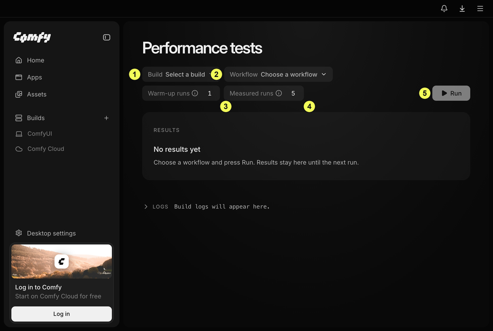

En Comfy Desktop, puedes cronometrar cuánto tarda un flujo de trabajo en una de tus compilaciones, como un flujo de trabajo de video de ejemplo o tu propio flujo de trabajo de imágenes, y comparar el resultado con ejecuciones en otra GPU o en otra compilación. Una medición solo tiene sentido cuando nada más compite por la GPU y sabes qué hardware la produjo, así que una prueba de rendimiento ejecuta el flujo de trabajo por sí solo en la compilación, lo repite y guarda cada resultado con la información del sistema. Realizas una prueba en **Performance tests**, consultas sus resultados y comparas las ejecuciones guardadas en **Benchmarks**.

## Abrir Performance tests o Benchmarks

Ambas páginas se abren desde el **Menú** de la **barra de título**. Consulta [Usar la barra de título](/es/installation/desktop/usage/overview#usar-la-barra-de-título) para ver los demás botones que hay ahí.

1. En **Home**, haz clic en **Menú**, en el extremo derecho de la **barra de título**.
2. Selecciona **Performance tests** o **Benchmarks**.

La página se abre en la ventana **Home**, junto a la **barra lateral**. En una ventana que ejecuta ComfyUI, los mismos elementos del **Menú** abren la página en una nueva ventana de Comfy Desktop.


1. **Select folder**: dónde se guardan los resultados de los benchmarks.
2. **Refresh sessions**: vuelve a leer las ejecuciones terminadas del disco.
3. **Open performance test**: inicia una ejecución nueva.

## Ejecutar una prueba de rendimiento

Una prueba de rendimiento inicia el build en una sesión propia, ejecuta tu flujo de trabajo varias veces y detiene el build cuando termina. La configuras de izquierda a derecha en la barra de herramientas de la parte superior de **Performance tests**: **Build**, **Workflow**, **Warm-up runs**, **Measured runs** y **Run**.

Antes de elegir nada, **Build** muestra **Select a build**, **Workflow** muestra **Choose a workflow** y **Results** muestra **No results yet**.



1. **Build**: el build que la prueba inicia y mide.
2. **Workflow**: el Workflow que ejecuta.
3. **Warm-up runs**: ejecuciones que cargan los modelos primero.
4. **Measured runs**: las ejecuciones que se cronometran.
5. **Run**: inicia la prueba.

### Elegir un build

El build que eliges es el que la prueba inicia y cronometra, y su nombre se guarda junto con los resultados.

- Haz clic en **Build** (muestra **Select a build** hasta que elijas uno) y luego selecciona un build.

Cada build de la lista muestra su nombre, con su tipo y versión debajo. La lista contiene los builds del espacio de trabajo seleccionado en la **barra lateral**. Para probar un build de otro espacio de trabajo, cambia primero de espacio de trabajo, como se describe en [Usar tu menú de espacio de trabajo](/es/installation/desktop/usage/overview#usar-el-menú-de-tu-espacio-de-trabajo). Cambiar de espacio de trabajo borra el build que elegiste.

<Note>
  Los builds de Comfy Cloud no aparecen en la lista, porque una prueba necesita un build que Comfy Desktop inicie. Cuando has cerrado sesión, la lista muestra solo los builds instalados.
</Note>

### Elegir un flujo de trabajo

Una vez que hayas elegido una compilación, elige el flujo de trabajo que quieres cronometrar. Usa un flujo de trabajo de ejemplo incluido con Comfy Desktop o importa el tuyo.

#### Usar un flujo de trabajo de ejemplo

Los flujos de trabajo de ejemplo están listos para ejecutarse: Comfy Desktop descarga los modelos que necesita cada uno.

1. Haz clic en **Flujo de trabajo** y, luego, selecciona **Elegir un flujo de trabajo de ejemplo**.
2. En **Elegir un flujo de trabajo de ejemplo**, selecciona la pestaña **Video**, **Image** o **Audio** y, luego, selecciona una tarjeta. Cada tarjeta muestra el nombre del flujo de trabajo, su tarea y el tamaño aproximado de los modelos que descarga. Un icono de disco duro en lugar de un tamaño significa que los modelos ya están en el disco. Mantén el puntero sobre él para ver **Descargado** y el tamaño.
3. Haz clic en **Usar flujo de trabajo**.

Comfy Desktop descarga los modelos que no están en el disco. Una línea de estado bajo la barra de herramientas dice **Preparando el flujo de trabajo y descargando los modelos requeridos…** y después muestra la descarga con una barra de progreso y **Cancelar descarga**. Las descargas también aparecen en la bandeja **Descargas** de la **barra de título**. Consulta [Descargas en Comfy Desktop](/es/installation/desktop/usage/downloads) para seguirlas allí. Cuando la descarga termina, **Flujo de trabajo** muestra el nombre del ejemplo con una etiqueta **Example**.

Si algo impide que el ejemplo se cargue, aparece una línea roja bajo la barra de herramientas o en el diálogo:

| Mensaje | Qué hacer |
| --- | --- |
| **Finaliza la instalación de esta compilación para usar flujos de trabajo de ejemplo.** | Elige una compilación instalada o termina de instalar esta. |
| **Debes estar conectado a internet para descargar flujos de trabajo de ejemplo.** | Conéctate a internet e inténtalo de nuevo. |
| **Necesitas ~X, solo hay Y libres. Libera espacio o elige un flujo de trabajo más ligero.** (en el diálogo, con **Usar flujo de trabajo** no disponible) | Libera espacio en disco o selecciona una tarjeta con modelos más pequeños. |
| **No se pudieron descargar todos los modelos requeridos por este flujo de trabajo.** | Elige el ejemplo de nuevo. Comfy Desktop elimina un ejemplo cuya descarga falla. |

Un ejemplo pertenece a la compilación para la que lo elegiste. Si eliges otra compilación, Comfy Desktop elimina el ejemplo de **Pruebas de rendimiento**. Sus archivos permanecen en el disco si una prueba ya lo usó.

#### Importar tu propio flujo de trabajo

Un flujo de trabajo que importes debe estar en [formato API](/es/development/api-development/workflow-api-format). Expórtalo primero desde ComfyUI en ese formato.

- Haz clic en **Flujo de trabajo**, selecciona **Importar flujo de trabajo de API** y, luego, selecciona el archivo `.json`. También puedes arrastrar el archivo `.json` sobre **Flujo de trabajo**.

**Flujo de trabajo** muestra el nombre del archivo con una etiqueta **API**. Si el archivo no está en formato API, la línea roja bajo la barra de herramientas dice **El archivo seleccionado no es un flujo de trabajo en formato API de ComfyUI.** Se rechaza un archivo llamado `jobs.json` o `results.json`, porque esos nombres están reservados para los resultados.

Comfy Desktop copia el archivo en una carpeta de sesión nueva (consulta [Dónde se almacenan los resultados](#dónde-se-almacenan-los-resultados)), así que la prueba ejecuta la copia incluso después de que muevas o edites el original.

#### Eliminar un flujo de trabajo

- Haz clic en **Flujo de trabajo**, selecciona **Eliminar flujo de trabajo** y, luego, haz clic en **Eliminar flujo de trabajo** para confirmar.

Esto elimina el flujo de trabajo de **Pruebas de rendimiento**. Comfy Desktop elimina su copia si ninguna ejecución lo ha usado todavía. Tu archivo original y los resultados de ejecuciones anteriores se conservan. Mientras se descarga un ejemplo, ese mismo elemento del menú muestra **Cancelar descarga**.

### Configurar el número de ejecuciones

Las ejecuciones de calentamiento cargan los modelos antes de que comience el cronometraje, para que la primera ejecución lenta no distorsione los resultados.

| Configuración | Alcance | Predeterminado | Qué hace |
| --- | --- | --- | --- |
| **Ejecuciones de calentamiento** | 0 a 5 | 1 | Se ejecutan primero para cargar los modelos y calentar las cachés. No se incluyen en los resultados. Establécelo en 0 para saltar el calentamiento. |
| **Ejecuciones medidas** | 1 a 100 | 5 | Se cronometran después de las ejecuciones de calentamiento. Sus duraciones conforman los resultados. |

Cuando haces clic en **Run**, un valor fuera del alcance cambia al límite más cercano. Cada ejecución suma uno a cada entrada de semilla del flujo de trabajo, para que ComfyUI no devuelva un resultado en caché.

### Iniciar la prueba

Otro trabajo que mantenga ocupada la GPU, como un juego o una exportación de video, también afecta los números, así que detenlo antes de ejecutar una prueba.

1. Haz clic en **Run**.

   Si **Run** no está disponible, mantén el puntero sobre él para ver el motivo: **Selecciona una compilación primero.**, **Elige un flujo de trabajo primero.**, **Espera a que el flujo de trabajo esté listo.** o **Espera a que la compilación termine de iniciarse.**

2. Sigue la prueba en **Results**. Muestra **Iniciando la compilación…** y luego **Ejecución N de M** con **ejecución de calentamiento** o **ejecución medida X de Y** debajo de una barra de progreso. **Registros** se abre para mostrar la salida de la compilación.

Mientras la prueba se ejecuta, **Detener** ocupa el lugar de **Run**. Haz clic en **Detener** para cancelar la prueba. Muestra **Deteniendo…** hasta que la compilación se detenga.

Cuando terminan todas las ejecuciones, Comfy Desktop detiene la compilación y muestra los resultados. Si las ejecuciones no han terminado 4 horas después de que Comfy Desktop las envíe, la prueba se detiene con **Se agotó el tiempo de espera para las tareas de la prueba de rendimiento.**

### Detener las instancias que bloquean una prueba

Una prueba se ejecuta sola, así que nada más compite por la GPU y la memoria. Si otra instancia en este equipo se está ejecutando, iniciando o deteniendo, la prueba no se inicia. Esto incluye la instancia que estás probando cuando está abierta en ComfyUI, y una prueba de rendimiento en otra instancia. Las instancias remotas y de Comfy Cloud se ejecutan en otro lugar y nunca bloquean una prueba.

En **Results** aparece **The performance test did not start** y se enumera cada instancia que está bloqueando. Una prueba de rendimiento en la lista aparece como **Performance test:** seguida del nombre de la instancia.

<Warning>
  Detener una instancia hace que se pierda el trabajo sin guardar en su ventana de ComfyUI. Guarda tus flujos de trabajo primero.
</Warning>

1. Haz clic en **Stop** junto a una instancia de la lista.
2. En **Stop ComfyUI**, haz clic en **Stop**. La fila muestra **Stopped**.
3. Repite esto para cada instancia de la lista y, luego, haz clic en **Run** de nuevo.

También puedes detener una instancia desde su página de instancia. Consulta [Detener o reiniciar](/es/installation/desktop/usage/instance-management#detener-o-reiniciar).

### Leer los resultados

Los resultados muestran cuánto tardó el flujo de trabajo en esta compilación, para que puedas compararla con otras compilaciones y GPUs.

- El encabezado indica el flujo de trabajo y la compilación en la que se ejecutó la prueba.
- El número grande es la ejecución mediana, en segundos. Debajo, **Ejecución mediana · N medidas · N fallidas** cuenta las ejecuciones que produjeron una duración y las que fallaron.
- **Duración de la ejecución** compara **Ejecución más rápida**, **Ejecución mediana**, **Ejecución promedio** y **Ejecución más lenta** como barras.
- **Información del sistema** enumera **Dispositivo de cómputo**, **VRAM**, **RAM**, **Versión de PyTorch**, **Versión de xFormers**, **CPU**, **Núcleos de CPU**, **Sistema operativo** y **Arquitectura**.

La duración de una ejecución es el tiempo que ComfyUI pasó ejecutando la tarea, desde el inicio hasta el final de la ejecución, no el tiempo que esperaste. Las ejecuciones fallidas no se incluyen en las duraciones.

Hay dos botones a la derecha del encabezado de resultados:

- **Show in Finder** en macOS, **Show in Explorer** en Windows o **Show in folder** en Linux abre la carpeta de la sesión.
- **Export results** te pide una carpeta. Haz clic en **Export here** para guardar los resultados como `performance-test-results-<timestamp>.png`.

Si la prueba falla, **Resultados** muestra **La prueba no finalizó** con el error, seguido de **Consulta los registros a continuación para ver los detalles.** Expande **Registros** para leer la salida de la compilación. Un flujo de trabajo que necesita un nodo o un modelo que la compilación no tiene falla de esta forma.

Los resultados permanecen en la página hasta tu siguiente ejecución. Para verlos de nuevo más tarde, abre **Benchmarks**.

## Comparar ejecuciones en Benchmarks

Benchmarks lee cada prueba guardada en la carpeta de resultados y las muestra en una sola tabla, para que veas cuánto más rápida es una GPU, un flujo de trabajo o una compilación que otra. Hasta que finaliza una prueba, muestra **No performance test results yet**. Haz clic en **Open performance test** para ejecutar una, o en **Refresh sessions** cuando finalice una prueba.


### Filtrar y ordenar las ejecuciones

Limita la tabla a las ejecuciones que quieras comparar con la barra de herramientas:

- **Workspace**, **Build**, **Hardware** y **Workflow**: muestran solo las ejecuciones que coinciden. Cada uno muestra **All** de forma predeterminada.
- **Compare by**: la duración que compara la tabla, **Fastest**, **Average**, **Median** o **Slowest**. El valor predeterminado es **Median**.
- **Refresh sessions** (la flecha circular): vuelve a cargar la carpeta de resultados cuando finaliza una prueba.
- **Search runs…**: busca coincidencias en la sesión, el flujo de trabajo, la compilación, el espacio de trabajo y el hardware.
- **Columns**: elige lo que muestra la tabla. **Measures** agrega columnas de duración, y **Columns to display** agrega columnas como **Workspace**, **Date / time**, **Runs** y **GPU / hardware**.

De forma predeterminada, la tabla muestra **Session**, **Workflow**, **Build**, **Median and range**, **Median** y **Compared to baseline**. Las dos columnas **Median** cambian según **Compare by**. Las ejecuciones se ordenan por la duración de **Compare by**, de la más rápida a la más lenta.

- Para ordenar por una columna, haz clic en su encabezado. Haz clic de nuevo para invertir el orden.
- Para mover una ejecución, arrastra el tirador situado a la izquierda de la fila, o enfoca el tirador y presiona `Alt+Up` o `Alt+Down`.
- Para mover una columna que agregaste, arrastra su encabezado o enfócalo y presiona `Alt+Left` o `Alt+Right`.

Si ninguna ejecución coincide, la página muestra **Nothing matches**. Haz clic en **Clear filters** para ver todas las ejecuciones.

### Comparar con una referencia

Cada ejecución se compara con una ejecución de referencia. De forma predeterminada, es la ejecución más rápida según la duración de **Compare by**, marcada como **Fastest**.

La columna **Compared to baseline** muestra, para cada una de las demás ejecuciones:

- **N× faster**: la ejecución tardó 1/N del tiempo de la referencia.
- **N× slower**: la ejecución tardó N veces más que la referencia.
- **Same speed**: la ejecución está dentro del 0.5% de la referencia.
- **Unavailable**: la ejecución no tiene una duración con la que comparar.

Para comparar con una ejecución de tu elección:

- Mantén el puntero sobre la fila y haz clic en la bandera (**Set as baseline**). También puedes hacer clic en **⋯** al final de la fila y seleccionar **Set as baseline**.

La ejecución se marca como **Baseline**. Para volver a la ejecución más rápida, haz clic de nuevo en la bandera (**Reset baseline**). Si los filtros ocultan la referencia, una nota debajo de la tabla muestra **Compared with session N, which the filters hide.**

### Exportar una comparación

Exporta una comparación para compartirla como imagen.

1. Marca la casilla de verificación a la izquierda de cada ejecución que quieras exportar. Una barra en la parte inferior muestra cuántas ejecuciones están seleccionadas.
2. Haz clic en **Export results** en la barra.
3. Selecciona una carpeta y, después, haz clic en **Export here**.

Comfy Desktop guarda `benchmark-comparison-<timestamp>.png` en esa carpeta. La imagen incluye un gráfico de velocidad relativa solo cuando has establecido una referencia. Puedes exportar hasta 20 ejecuciones. Si seleccionas más, **Export results** no está disponible y muestra **Up to 20 runs** al mantener el puntero sobre este. Para borrar la selección, haz clic en **Clear selection** (**✕**) en la barra.

### Renombrar o eliminar una sesión

Cada prueba se guarda como una sesión, nombrada de forma predeterminada con la hora en que agregaste su flujo de trabajo. Asigna a una sesión un nombre que reconozcas o elimina una que ya no necesites.

Para renombrar una sesión:

1. Haz clic en el nombre de la sesión en la columna **Session**. Aparece un icono de lápiz cuando mantienes el puntero sobre él. También puedes hacer clic en **⋯** al final de la fila y seleccionar **Rename session**.
2. Escribe el nuevo nombre y, después, presiona `Enter`. Presiona `Escape` para cancelar.

Renombrar una sesión cambia el nombre de su carpeta. Si otra sesión ya tiene ese nombre, la sesión no se renombra.

Para eliminar una sesión:

1. Haz clic en **⋯** al final de la fila y, después, selecciona **Delete files**.
2. Haz clic en **Delete files** para confirmar.

Eliminar borra todos los archivos de la carpeta de la sesión. No puedes deshacerlo.

### Comparar resultados de otra computadora

Benchmarks lee el archivo `results.json` de cada carpeta de sesión que encuentra. Para comparar ejecuciones de otra computadora, copia sus carpetas de sesión en una sola carpeta.

1. Haz clic en **Select folder** en la parte superior de **Benchmarks**.
2. Selecciona la carpeta que contiene las carpetas de sesión.

## Dónde se almacenan los resultados

Performance Tests crea una carpeta de sesión cuando agregas un flujo de trabajo, con el nombre basado en la marca de tiempo de ese momento (`YYYYMMDDHHMMSS`):

```text
ComfyUI-Shared/
└── benchmarks/
    ├── 20260930141522/
    │   ├── my_workflow.json
    │   ├── jobs.json
    │   ├── results.json
    │   └── logs.txt
    └── 20260930163005/
        └── ...
```

| Plataforma | Carpeta de resultados predeterminada |
| --- | --- |
| Windows | `%LOCALAPPDATA%\Comfy-Desktop\ComfyUI-Shared\benchmarks` |
| macOS y Linux | `~/ComfyUI-Shared/benchmarks` |

Cada carpeta de sesión contiene:

- `my_workflow.json` (el nombre de tu archivo): la copia del flujo de trabajo que ejecuta la prueba
- `jobs.json`: los detalles del trabajo que ComfyUI devolvió para las ejecuciones
- `results.json`: el resumen que lee Benchmarks
- `logs.txt`: la salida de la compilación durante la prueba

Si ejecutas el mismo flujo de trabajo otra vez, la prueba escribe en la misma carpeta de sesión y reemplaza los resultados almacenados allí. Para conservar un resultado y compararlo, elige o importa el flujo de trabajo de nuevo antes de la siguiente prueba. Eso crea una nueva carpeta de sesión.
