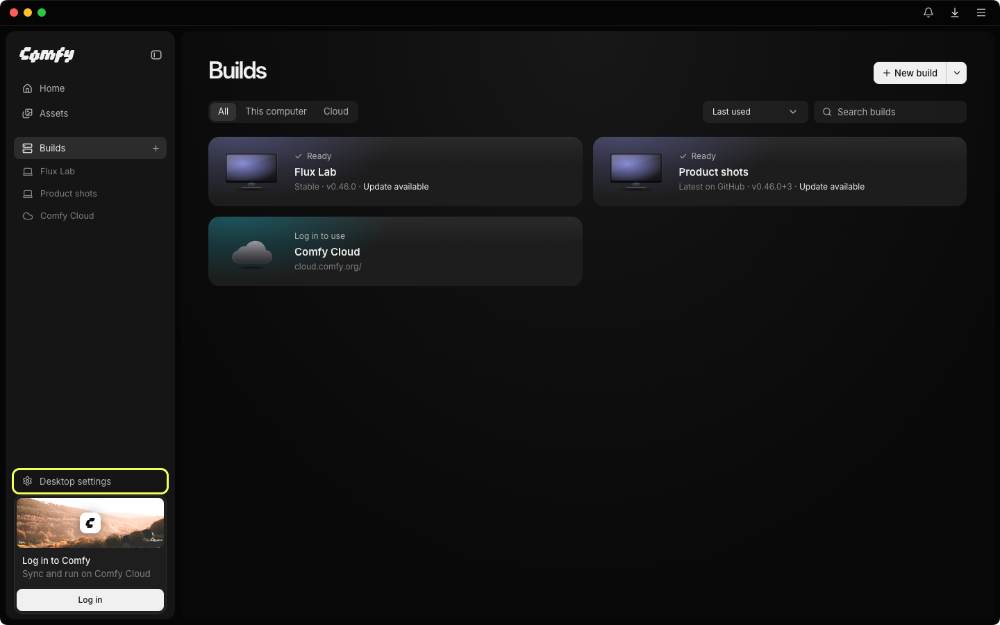

Comfy Desktop ejecuta tus builds de ComfyUI, y las **Configuraciones de Escritorio** reúnen las opciones que aplican a todos ellos a la vez, como las carpetas compartidas de modelos o el espejo que usan las descargas de paquetes. Las configuraciones de un build individual, como sus propias carpetas o sus Argumentos de inicio, están en la página de ese build. Usa **Configuraciones de Escritorio** para actualizar Comfy Desktop, elegir carpetas compartidas y la Ubicación de Instalación predeterminada, configurar espejos y la Caché de Descargas, activar funciones beta y encontrar el registro de la Aplicación.

## Abrir Configuraciones de Escritorio

- En la parte inferior de la **barra lateral**, haz clic en **Configuraciones de Escritorio**. En una ventana que ejecuta ComfyUI, también puedes abrir el **Menú** de la **barra de título** y seleccionar **Configuraciones de Escritorio**. Consulta [Desplázate por Comfy Desktop](/es/installation/desktop/usage/overview#conoce-la-barra-lateral) para la **barra lateral** y la **barra de título**.

La ventana **Configuraciones de Escritorio** tiene cinco pestañas a su izquierda: **Preferences**, **Updates**, **Folders**, **Advanced** y **Logs**. Haz clic en una pestaña para cambiar a ella.

## Configura tus preferencias {#preferences}

La pestaña **Preferences** establece el idioma de la aplicación y cómo se comporta Comfy Desktop al cerrar ventanas o al iniciar builds.

- **Language**: el idioma de Comfy Desktop. Selecciona **English** o **简体中文**.

En **App behavior**:

| Configuración | Predeterminado | Qué hace |
| --- | --- | --- |
| **Confirm before closing a window** | Desactivado | Pregunta antes de cerrar una ventana cuando eso detiene ComfyUI o cierra Comfy Desktop. |
| **Warn before running multiple builds** | Activado | Muestra una advertencia antes de que inicies otro build local de ComfyUI mientras uno está en ejecución o iniciándose. |
| **Hide Cloud from the build picker** | Desactivado | Oculta la fila de Comfy Cloud de **Home**. Comfy Cloud sigue funcionando y puedes desactivar el interruptor de nuevo en cualquier momento. |

En **Privacy**:

- **Share anonymous usage telemetry**: envía datos de uso anónimos. El interruptor aparece activado hasta que lo desactives.
- **Opt in to beta features**: permite que Comfy Desktop active funciones beta de ComfyUI en tus builds. Consulta [Activar las funciones beta](#activar-las-funciones-beta).

En **Community**, la tarjeta **Comfy Desktop** abre el [repositorio de Comfy Desktop en GitHub](https://github.com/Comfy-Org/Comfy-Desktop).

#

### Activar las funciones beta

Con **Opt in to beta features** activado, ayudas a probar funciones de ComfyUI antes de que se publiquen. Cuando el interruptor está activado, Comfy Desktop puede agregar uno de estos argumentos de inicio al iniciar un build en esta computadora: `--enable-asset-hashing`, `--disable-assets` o `--enable-agent`. Agrega un argumento solo cuando la versión de ComfyUI del build lo admite. Si ya estableciste ese argumento o su opuesto en los argumentos de inicio del build, Comfy Desktop deja los tuyos tal como están.

Si nunca cambiaste el interruptor, este sigue tu respuesta a **Help improve Comfy by sharing anonymous usage data.** durante la configuración. Para activarlo:

1. En la pestaña **Preferences**, activa **Opt in to beta features**.
2. Si el interruptor no se activa, confirma primero el uso compartido de datos: desactiva **Share anonymous usage telemetry** y vuelve a activarlo. Después activa **Opt in to beta features**.

Cuando un build se inicia con una función beta, un aviso en su **barra de título** dice **A beta feature is on** o **The {feature} beta is on**. Haz clic en **Got it** para cerrarlo, o en **Settings** para abrir esta pestaña en el interruptor de beta. Cuando una función beta está desactivada para un build, el aviso dice **A beta feature is off** o **The {feature} beta is off**.

Para ver qué argumentos agregó una función beta, abre la [pestaña **Startup arguments** del build](/es/installation/desktop/usage/instance-management#set-startup-arguments) y haz clic en la píldora **+N beta**. Enumera los argumentos en **Added for this session** o **Eligible for next launch**, y **Manage beta features** abre esta pestaña en el interruptor de beta.

## Actualizar Comfy Desktop {#updates}

Comfy Desktop busca actualizaciones de sí mismo 2 segundos después de iniciarse y luego cada 10 minutos. Comfy Desktop no tiene un canal de actualización que elegir. El canal de actualización en la página de una compilación corresponde a ComfyUI en esa compilación: consulta [Actualizar ComfyUI](/es/installation/desktop/usage/instance-management#update-comfyui).

<Note>
  En Linux, cómo se actualiza Comfy Desktop depende de si instalaste el paquete `.deb`, el AppImage o una copia del código fuente. Consulta [Actualizar en Linux](/es/installation/desktop/overview#instalar-comfy-desktop-para-tu-sistema-operativo).
</Note>

#

### Dejar que las actualizaciones se instalen solas

**Automatically install Desktop updates** en la pestaña **Updates** está activado de forma predeterminada. Cuando una búsqueda encuentra una actualización, Comfy Desktop la descarga y la instala:

- En macOS y Linux, cuando sales de Comfy Desktop.
- En Windows, la próxima vez que inicies Comfy Desktop.

Cuando el interruptor está desactivado, una actualización solo se instala cuando haces clic en **Restart & update**.

#

### Actualizar desde la barra lateral

Cuando hay una actualización disponible, una entrada en la parte inferior de la **barra lateral** muestra su estado:

| La entrada dice | Haz clic para |
| --- | --- |
| **Desktop update** | Abre el diálogo **Desktop update available**. Haz clic en **Download**. |
| **Downloading update…** | Abre **Desktop settings** en la pestaña **Updates**, donde se muestra el progreso de la descarga. |
| **Desktop update ready** | Abre el diálogo **Desktop update ready**. Haz clic en **Restart & update** para reiniciar y aplicar la actualización. |

#

### Buscar actualizaciones por tu cuenta

1. Abre **Desktop settings** y haz clic en la pestaña **Updates**.
2. Haz clic en **Check for updates**.
3. Si la pestaña dice **Update {version} available**, haz clic en **Download**.
4. Cuando la pestaña diga **Update {version} ready to install**, haz clic en **Restart & update**.

Comfy Desktop se reinicia con la actualización. La actualización se completó cuando la pestaña **Updates** dice **Comfy Desktop is up to date** y **Installed** muestra la versión que descargaste.

## Elegir carpetas compartidas y la ubicación de instalación {#storage}

Las carpetas compartidas permiten que cada instalación use los mismos modelos, entradas y salidas, así descargas un modelo una sola vez en lugar de una vez por cada instalación. La pestaña **Folders** establece estas carpetas y la carpeta donde Comfy Desktop sugiere colocar las instalaciones que creas.

En cada fila de carpeta, haz clic en la ruta para abrir la carpeta, o haz clic en el icono de carpeta para elegir otra carpeta.

- **Default install location**: la carpeta principal que Comfy Desktop sugiere cuando creas una instalación. Cambiarla no mueve las instalaciones existentes.
- **Carpetas compartidas**: una sola lista de carpetas **Models**, **Input** y **Output**. Cada instalación las usa de forma predeterminada. Para cambiar eso en una instalación concreta, consulta [Elegir qué carpetas usa la instalación](/es/installation/desktop/usage/instance-management#choose-which-folders-the-build-uses).

Para administrar las carpetas de modelos compartidas:

- **Agregar una carpeta de modelos**: haz clic en **Add models folder** y elige la carpeta.
- **Elegir dónde se descargan los modelos**: en una fila de **Models**, haz clic en **Use for downloads**. Esa fila pasa a llevar la etiqueta **Downloads**. Una instalación puede elegir su propia carpeta de descargas. Consulta [Dónde se guardan las descargas](/es/installation/desktop/usage/downloads#dónde-se-guardan-las-descargas).
- **Eliminar una carpeta de modelos**: haz clic en el menú **⋯** de la fila, selecciona **Remove** y confirma. Los archivos permanecen en el disco. La carpeta con la etiqueta **Downloads** no tiene menú **⋯**, así que primero elige otra carpeta de descargas. No puedes eliminar las filas **Input** y **Output**.

De forma predeterminada, las carpetas son:

| Carpeta | macOS y Linux | Windows |
| --- | --- | --- |
| **Default install location** | `~/ComfyUI-Installs` | `%LOCALAPPDATA%\Comfy-Desktop\ComfyUI-Installs` |
| Carpetas compartidas **Models**, **Input**, **Output** | `~/ComfyUI-Shared/models`, `input`, `output` | `%LOCALAPPDATA%\Comfy-Desktop\ComfyUI-Shared\models`, `input`, `output` |

<Note>
  En Windows, si tu carpeta de usuario ya tenía `ComfyUI-Installs` o `ComfyUI-Shared`, Comfy Desktop sigue usando esas. Si instalaste Comfy Desktop en una unidad distinta de la unidad del sistema, las carpetas están en `<drive>:\Comfy-Desktop`.
</Note>

En macOS y Linux, la pestaña **Folders** también tiene **Remove Comfy Desktop data**, que elimina los registros, las cachés y los archivos temporales de la aplicación antes de que la desinstales. Consulta [Desinstalar Comfy Desktop en macOS](/es/installation/desktop/overview#desinstalar-comfy-desktop) o [eliminar los datos restantes en Linux](/es/installation/desktop/overview#desinstalar-comfy-desktop).

## Configurar espejos y aceleración por hardware {#advanced}

Si las descargas desde pypi.org o github.com son lentas en tu región, configura Comfy Desktop para que use un espejo en la pestaña **Advanced**.

- **PyPI mirror URL**: un índice de paquetes de Python, como `https://mirrors.aliyun.com/pypi/simple/`. Comfy Desktop instala los paquetes de Python desde este índice y usa pypi.org como índice adicional. Está vacío de forma predeterminada.
- **Use Chinese mirrors (Git & PyPI)**: desactivado de forma predeterminada. Cuando está activado, los repositorios Git se clonan desde gitcode.com en lugar de github.com, y los paquetes de Python provienen de mirrors.aliyun.com y mirrors.cloud.tencent.com en lugar de pypi.org. Cuando el idioma de la aplicación es chino, este interruptor aparece en su lugar en la pestaña **Preferences**, dentro de **App behavior**. Si el idioma de tu sistema es chino, la configuración inicial también pregunta **Enable Chinese mirrors?**.
- **Use hardware acceleration**: activado de forma predeterminada. Usa la GPU para renderizar Comfy Desktop. Reinicia Comfy Desktop para que el cambio surta efecto.

#

### Mantener la caché de descargas

Cuando instalas una compilación Standalone, Comfy Desktop descarga un paquete de ComfyUI en la carpeta de caché que se muestra en **Cache**, en la pestaña **Advanced**. De forma predeterminada, la carpeta se llama `download-cache`. Si vuelves a instalar el mismo paquete, la instalación muestra **Using cached download** y omite la descarga.

Comfy Desktop conserva solo el paquete más reciente en esta carpeta. Cuando termina una descarga, elimina las demás subcarpetas dentro de la carpeta de caché, así que no guardes nada más ahí. Haz clic en el icono de carpeta para elegir otra carpeta.

## Encontrar el registro de la aplicación {#logs}

El registro de la aplicación recoge lo que hace Comfy Desktop, incluido el resultado que se genera al instalar o iniciar una compilación. Adjúntalo cuando reportes un problema en el [seguidor de problemas de Comfy Desktop](https://github.com/Comfy-Org/Comfy-Desktop/issues).

- En la pestaña **Registros**, dentro de **Diagnóstico**, haz clic en **Abrir carpeta de registros**.

La carpeta contiene `app.log` de la sesión actual. En cada inicio, y cuando `app.log` supera los 5 MB, Comfy Desktop renombra el archivo antiguo a `app.log_<timestamp>.log` y conserva hasta 50 de ellos. Elige el archivo de la sesión en la que ocurrió el problema.
