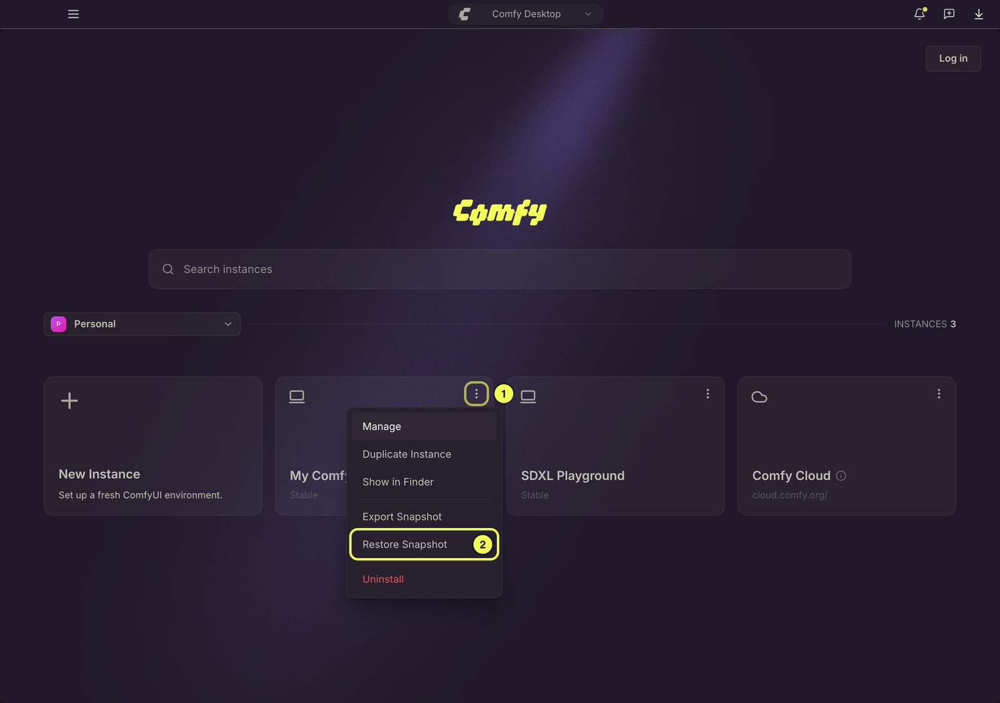
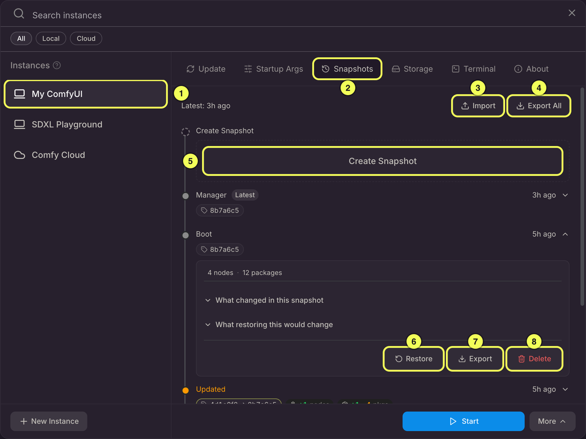
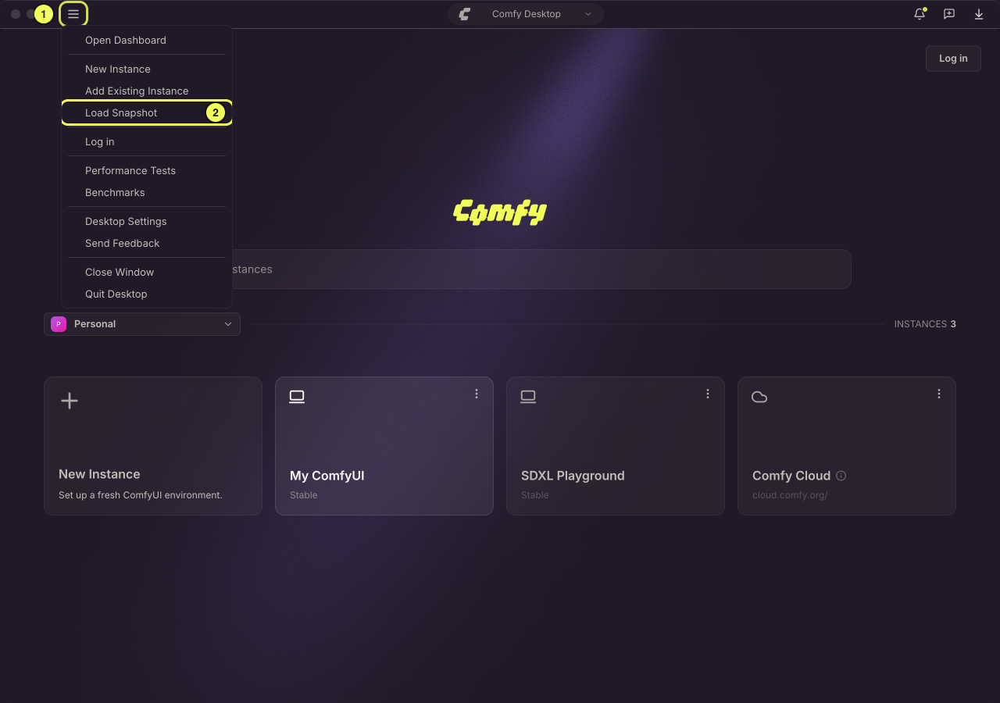
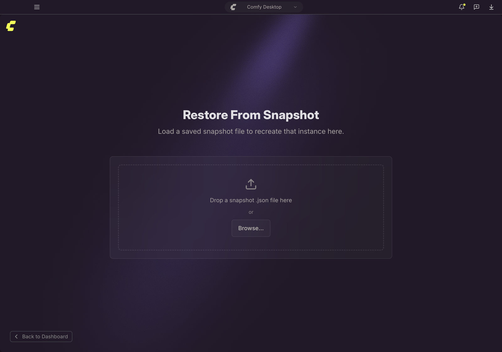
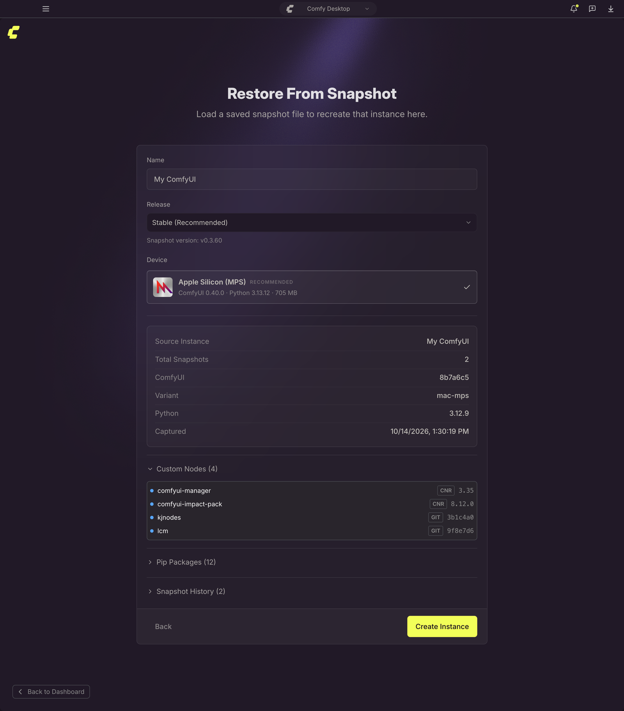

Una instantánea registra la configuración de software de una instancia, no sus archivos:

- **Versión de ComfyUI**: qué compilación de ComfyUI está instalada
- **Nodos personalizados**: cada nodo personalizado con su versión o hash de commit
- **Paquetes pip**: todos los paquetes de Python del entorno, según la salida de `pip freeze`
- **Python y PyTorch**: la versión de Python y, cuando se puede identificar, la configuración de PyTorch

Las instantáneas sirven como puntos de restauración: vuelve atrás después de una actualización problemática, clona una instalación o comparte una configuración funcional con un compañero de equipo.

Comfy Desktop crea instantáneas automáticamente para una instancia Standalone: en cada arranque y reinicio, antes y después de una actualización y después de una restauración. También puedes crear una manualmente en cualquier momento.

## Lo que una instantánea no incluye

Una instantánea no es una copia de seguridad de tus archivos. Los modelos, los flujos de trabajo, los resultados generados, los archivos de entrada y la configuración de ComfyUI no se registran, y una restauración no los recupera.

Una restauración reconstruye el software: cambia a la versión registrada de ComfyUI, devuelve los nodos personalizados al conjunto registrado, sincroniza los paquetes de Python y PyTorch y ejecuta los scripts de instalación de los nodos que cambia. Esos scripts pueden escribir su propia configuración de ComfyUI.

Esto tiene dos consecuencias prácticas:

- **Un modelo eliminado sigue eliminado.** Restaurar una instantánea anterior no recupera un modelo que hayas borrado. ComfyUI lo notifica como modelo faltante la próxima vez que abras un flujo de trabajo que lo use. Si el diálogo de modelos faltantes ofrece **Download** para ese modelo, Comfy Desktop lo descarga por ti (consulta [Descargas](/es/installation/desktop/usage/downloads)); si no, coloca el archivo en la carpeta de modelos correspondiente.
- **Las instantáneas viven dentro de la carpeta de la instancia.** Desinstalar una instancia borra también su historial de instantáneas. **Forget** solo quita la instancia de la lista y conserva la carpeta con sus instantáneas. En cualquier caso, exporta antes lo que quieras conservar con **Export All** en la pestaña Snapshots, consulta [Compartir una instantánea](#compartir-una-instantánea).

## Acceder a las Instantáneas

Desde cualquier tarjeta de instancia, haz clic en el **menú ⋮** (1) y selecciona **Restaurar instantánea** (2) para abrir la pestaña **Snapshots** directamente.

Como alternativa, abre el panel **Manage** en cualquier tarjeta de instancia y navega a la pestaña **Snapshots**.

## Descripción general de la pestaña Instantáneas

La pestaña **Snapshots** es tu centro para administrar todas las acciones relacionadas con instantáneas. La línea de tiempo muestra las instantáneas de la instancia, más recientes primero, y etiqueta cada entrada según cómo se creó: **Inicio**, **Administrador**, **Actualización**, **Actualizado**, **Restaurado** o **Manual**. Si la instancia se copió hacia o desde otra instancia, la línea de tiempo también incluye esa copia. Acciones principales disponibles:

1. **Instancia seleccionada**: la instancia cuyas instantáneas se muestran en la línea de tiempo.
2. **Pestaña Snapshots**: pestaña activa actualmente en el panel Manage.
3. **Importar**: importa un archivo de instantánea exportado por otro usuario u otra instancia.
4. **Exportar todo**: exporta todas las instantáneas de esta instancia como un único archivo `.json`.
5. **Crear instantánea**: crea una instantánea manual del estado actual de la instancia.
6. **Restaurar**: restaura la instancia al estado de una instantánea específica.
7. **Exportar**: exporta una sola instantánea desde la línea de tiempo.
8. **Eliminar**: elimina una sola instantánea de la línea de tiempo.

### Crear una instantánea manual

Haz clic en **Crear instantánea** (5) en el encabezado de la pestaña **Snapshots**. De forma opcional puedes agregar una etiqueta (por ejemplo, "Antes de agregar LCM LoRA") para identificarla más adelante. La instantánea capturará:

- El commit de Git actual de ComfyUI
- Todos los nodos personalizados habilitados (URL de `git clone` + commit, o ID de CNR + versión)
- Todos los paquetes pip de `pip freeze`

Las instantáneas manuales no cuentan para el límite de instantáneas automáticas y se pueden eliminar individualmente.

### Ver los detalles de una instantánea

Haz clic en cualquier fila para expandirla. Una fila contraída ya muestra cómo se creó la instantánea, cuándo se tomó, la versión de ComfyUI y pills que resumen cuántos nodos y paquetes se agregaron, quitaron o cambiaron respecto a la instantánea anterior. La instantánea más reciente también lleva una insignia **Última**.

La vista expandida muestra los totales de nodos y paquetes de la instantánea, su etiqueta si tiene una, y dos diferencias que se pueden contraer:

- **Qué cambió en esta instantánea**: compara esta instantánea con la inmediatamente anterior. Oculto para la instantánea más antigua de la línea de tiempo.
- **Qué cambiaría al restaurar esto**: compara esta instantánea con el estado actual de la instancia. Oculto para la instantánea más reciente de la línea de tiempo.

Los botones **Restaurar**, **Exportar** y **Eliminar** de esa instantánea también están en esta vista expandida. La instantánea más reciente de la línea de tiempo no tiene botón **Restaurar**.

### Restaurar desde una instantánea

1. En la pestaña Snapshots, busca la instantánea que quieres restaurar.
2. Haz clic en **Restore**: una vista previa muestra las diferencias (qué cambiará).
3. Revisa los cambios y haz clic en **Restore** en el diálogo de confirmación para comenzar.

La restauración requiere que la instancia esté detenida. Si ComfyUI se está ejecutando al iniciar la restauración, el diálogo avisa de que la instancia se detendrá primero. Comfy Desktop la detiene, espera a que termine, ejecuta la restauración y la vuelve a iniciar cuando la restauración se completa correctamente.

Durante la restauración, Comfy Desktop hará lo siguiente:

1. **Cambiar a la versión registrada de ComfyUI** (commit de Git)
2. **Instalar los nodos personalizados faltantes**, cambiar versiones y habilitar o deshabilitar nodos según sea necesario
3. **Restaurar los paquetes de pip**: instalar los paquetes faltantes, actualizar o degradar a la versión registrada y eliminar los sobrantes
4. **Ejecutar los scripts de posinstalación** de cualquier nodo personalizado recién instalado o al que se le haya cambiado la versión

Comfy Desktop restaura primero los nodos personalizados (instalar un nodo puede añadir paquetes de Python) y después sincroniza los paquetes de Python. Antes de la sincronización hace una copia de seguridad de los paquetes que va a sobrescribir o eliminar. Si cancelas después de ese punto, o si falla la instalación de un paquete, esos paquetes vuelven a su estado anterior y ComfyUI vuelve al commit en el que estaba antes de la restauración. Si algún paquete no se pudo devolver, la restauración lo indica en lugar de dar la reversión por completa. Si cancelas durante el paso de los nodos, el commit se revierte pero las carpetas de nodo ya instaladas y los paquetes que añadieron se quedan. Si el entorno ya coincide con la instantánea, la restauración informa **No changes needed** y deja el entorno como está.

Los nodos personalizados se tratan con un criterio de mejor esfuerzo. Un nodo que no se instala o no cambia de versión no detiene el resto de la restauración: la restauración termina mostrando los fallos y la entrada que escribe en la línea de tiempo lleva la etiqueta **Restore did not complete** junto a su etiqueta **Restored**. Corrige o elimina el nodo y vuelve a restaurar.

La tarjeta en la parte superior de la línea de tiempo indica cómo terminó la última restauración: **Snapshot restored** o **Restore failed**. Si cancelas la restauración, la tarjeta se cierra sin resultado. Una restauración correcta también añade una entrada con la etiqueta **Restored**, que registra el estado resultante.

### Importar una instantánea a una instancia

Usa **Importar** en la pestaña **Snapshots** para traer un archivo de instantánea al historial propio de la instancia. Solo se aplica la instantánea más reciente del archivo. Si el entorno se puede reproducir exactamente, esa instantánea se agrega a la línea de tiempo; de lo contrario, Comfy Desktop guarda una instantánea del estado resultante y las instantáneas más antiguas del archivo se ignoran. Si la compilación de PyTorch de la instantánea no se puede aplicar en esta máquina, Comfy Desktop te advierte antes de aplicarla.

### Eliminar una instantánea

Expande cualquier instantánea y haz clic en **Eliminar** para quitarla. Comfy Desktop conserva las 200 instantáneas más recientes sin etiqueta de tipo Inicio y Administrador por instalación y elimina las más antiguas automáticamente a medida que se escriben nuevas, así que nunca tendrás que limpiarlas a mano. Las instantáneas capturadas manualmente, antes o después de una actualización, o después de una restauración, nunca se eliminan automáticamente, así que elimínalas tú mismo cuando ya no las necesites.

## Compartir una instantánea

Los archivos de instantánea son portátiles: un solo archivo `.json` contiene toda la configuración, así que puedes pasárselo a un compañero de equipo o moverlo a otra máquina.

Dos atajos exportan la instantánea **más reciente** de una instancia sin abrir la pestaña **Snapshots**:

- En la tarjeta de la instancia en el Panel, abre el menú **⋮** y selecciona **Exportar instantánea**.
- En el selector de instancias, abre el menú **Más** en el pie de página y selecciona **Compartir**.

Ambos abren un cuadro de diálogo de guardado y escriben un único archivo `.json`. Si la instancia aún no tiene instantáneas, Comfy Desktop te indica que no hay nada que compartir. Para exportar una instantánea en concreto, o todas las instantáneas a la vez, usa **Exportar** y **Exportar todo** en la pestaña **Snapshots**.

Quien recibe el archivo puede crear una nueva instancia a partir de él o importarlo en una instancia que ya tenga.

## Crea una instancia a partir de un archivo de instantánea

Si alguien comparte un archivo de instantánea contigo, puedes usarlo para iniciar una nueva instancia de ComfyUI con exactamente la misma configuración.

1. Haz clic en el **menú ☰** (1) en la esquina superior izquierda de la vista del Selector y selecciona **Cargar instantánea** (2).

2. Explora tu sistema de archivos y selecciona el archivo de instantánea `.json`.

3. Una vista previa muestra el contenido de la instantánea: nombre de la instancia fuente, versión de ComfyUI, nodos personalizados y paquetes pip. Revisa los detalles y luego haz clic en **Crear instancia** para construir una nueva instancia a partir de la instantánea.

Esto crea una instancia independiente totalmente nueva, y la instancia original queda intacta. La verás aparecer en la vista del Selector junto a tus otras instancias.
