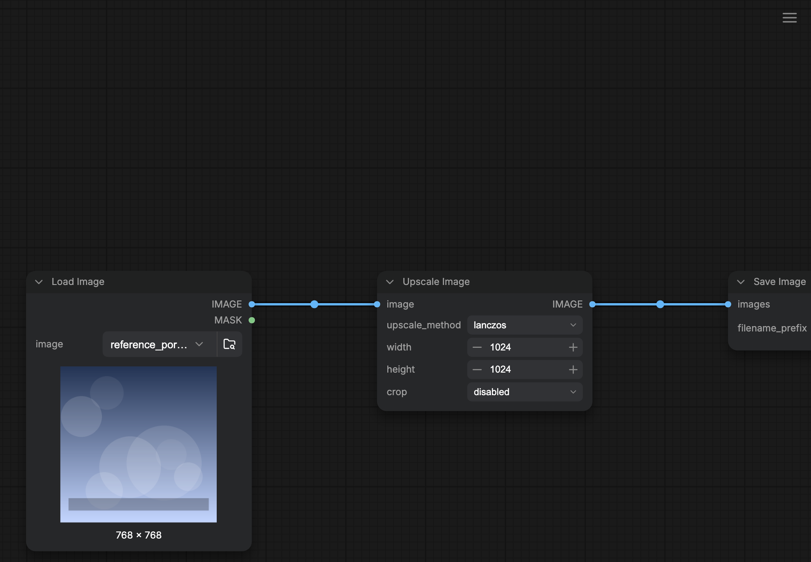

La barra de herramientas del lienzo, en la esquina inferior derecha, y el menú **Ver** controlan cómo te mueves por el gráfico. Los comandos principales del menú Ver incluyen Alternar panel inferior, Explorar plantillas, **Modo de Enfoque**, información de rendimiento del lienzo, minimapa, visibilidad de enlaces, acercar/alejar y ajustar vista.

## Barra de herramientas del lienzo

Cuando **Mostrar menú del lienzo del gráfico** (`Comfy.Graph.CanvasMenu`) está activado (predeterminado), una barra de herramientas flotante se ubica en la esquina inferior derecha del lienzo:

<Frame caption="La barra de herramientas del lienzo en la esquina inferior derecha, con el panel del minimapa abierto encima.">
  
</Frame>

| Control | Qué hace |
| --- | --- |
| **Modo lienzo** | Menú para cambiar entre **Seleccionar** (editar nodos) y **Mano** (solo desplazamiento / lienzo de solo lectura). Valores predeterminados: `v` desbloquea Seleccionar, `h` bloquea Mano. |
| **Ajustar vista** | Encuadra el gráfico en el área de visualización (`Comfy.Canvas.FitView`, predeterminado `.`). |
| **Zoom** | Abre un panel emergente con Acercar, Alejar, Ajustar zoom y un campo de porcentaje (1-1000%). Los atajos predeterminados incluyen `Alt` + `=` / `Alt` + `-` para acercar/alejar. |
| **Minimapa** | Activa o desactiva el mapa de vista general (`Comfy.Canvas.ToggleMinimap`, predeterminado `Alt` + `Shift` + `M`). Se conserva como `Comfy.Minimap.Visible`. |
| **Visibilidad de enlaces** | Oculta o muestra los cables de conexión al alternar el modo de renderizado de enlace oculto (`Comfy.Canvas.ToggleLinkVisibility`). |

Puedes ocultar toda la barra de herramientas con **Mostrar menú del lienzo del gráfico** en las configuraciones de Lite Graph / Lienzo.

## Menú Ver

El menú **Ver** registra los mismos comandos de navegación para que puedas ejecutarlos desde la barra de menú o la paleta de comandos:

- Alternar panel inferior
- Explorar plantillas
- Modo de enfoque
- Rendimiento del Lienzo (`Comfy.ToggleCanvasInfo`, alterna `Comfy.Graph.CanvasInfo`)
- Alternar minimapa
- Alternar visibilidad de enlace
- Acercar / Alejar / Ajustar vista

## Modo de enfoque

El **Modo de enfoque** (`Workspace.ToggleFocusMode`) oculta los elementos del espacio de trabajo para que puedas concentrarte en el gráfico. Mientras está activado:

- La sección del menú superior está oculta (menú nuevo).
- Los paneles de la barra lateral izquierda y derecha, y el panel inferior, no se renderizan en el diseño dividido.
- Aparece un control de tipo hamburguesa para que puedas salir del modo de enfoque (**Mostrar menú**).

<Frame caption="Modo de enfoque activado: sin barra de menú, barras laterales ni panel inferior, y un botón de hamburguesa en la esquina superior derecha que los restaura.">
  
</Frame>

Alterna el modo de enfoque de nuevo, o usa el control de hamburguesa, para restaurar el espacio de trabajo completo.

## Opciones del minimapa

Además de mostrar u ocultar, las Configuraciones de Minimapa controlan lo que dibuja el minimapa (colores de nodos, conexiones, grupos, estado de omisión, estado de error). Consulta [Configuraciones de Lite Graph](/es/interface/settings/lite-graph) y las entradas relacionadas de Apariencia cuando estén presentes.

## Enlaces y ajustes globales del lienzo

La forma del enlace y si se muestran los enlaces conectados también están disponibles como alternancias rápidas en **Configuración global** del [Right Side Panel](/es/interface/right-side-panel) cuando no hay nada seleccionado, y de forma completa en la configuración de Lite Graph (`Comfy.LinkRenderMode` y opciones relacionadas). El espaciado de la cuadrícula y el ajuste a la cuadrícula se encuentran en las mismas áreas de Configuración global / Lite Graph.

### Visibilidad de enlaces

**Visibilidad de enlaces** oculta todos los cables del lienzo a la vez. Usa el botón del ojo en la [barra de herramientas del lienzo](#barra-de-herramientas-del-lienzo) o **View** > **Toggle Link Visibility** (`Comfy.Canvas.ToggleLinkVisibility`). No se elimina ningún enlace y el gráfico sigue ejecutándose: los conectores conservan sus puntos y solo los cables dejan de dibujarse, lo que ayuda en un gráfico demasiado denso para leer.

El comando establece `Comfy.LinkRenderMode` en **Hidden** y restaura el modo anterior (Straight, Linear o Spline) la próxima vez que lo uses.

<Frame caption="Visibilidad de enlaces activada (arriba) y desactivada (abajo) en el mismo gráfico. Solo cambian los cables; los conectores conservan sus puntos.">
  
</Frame>

El resto de esta sección trata sobre cómo ocultar enlaces individuales. Eso mantiene una insignia en el conector para que puedas etiquetar la conexión y restaurarla por separado.

### Seleccionar enlaces

Requiere ComfyUI frontend 1.58.0 o posterior. Seleccionar enlaces con un marco es el comportamiento predeterminado del lienzo en el Modo de selección (no es una opción de configuración).

Arrastra un marco sobre los cables de conexión en los que quieras actuar. Un marco que no capture nodos, grupos ni nodos Reroute selecciona todos los enlaces visibles que cruza, y la caja de herramientas de selección reemplaza sus botones de nodo por dos acciones de enlace: **Ocultar**, que mantiene la conexión y oculta el cable, y **Eliminar**, que quita el enlace del gráfico. Cada acción es un paso de deshacer, y `Delete` o `Backspace` también eliminan una selección de enlaces.

Los marcos con `Shift` y `Alt` seleccionan solo nodos y grupos, y el Modo lienzo Mano nunca selecciona enlaces.

### Hacer clic en una entrada o salida de nodo para actuar sobre sus enlaces

Requiere ComfyUI frontend 1.60.0 o posterior. Haz clic en el punto de entrada o salida de un nodo en lugar de arrastrar desde él. El lienzo selecciona todos los enlaces unidos a ese punto, que es un enlace en una entrada y todos los enlaces en una salida, y la caja de herramientas de selección ofrece **Ocultar** y **Eliminar**, las mismas acciones que usa una selección con marco.

- Si todos los enlaces seleccionados ya están ocultos, la caja de herramientas muestra **Mostrar** en lugar de **Ocultar**.
- **Ocultar** actúa solo sobre los enlaces visibles y **Mostrar** solo sobre los ocultos, así que ninguno añade un paso de deshacer vacío.
- **Eliminar** quita todos los enlaces de ese punto, incluidos los ocultos.
- Mantén `Shift`, `Ctrl`, `Cmd` o `Alt` mientras haces clic para conservar la selección actual.
- `Ctrl` + `Alt` con clic rompe el enlace, igual que en el resto del lienzo.
- Un punto sin enlaces ignora el clic, y también lo ignora un lienzo con la visibilidad de enlaces desactivada, porque allí todos los cables están ocultos. Arrastrar desde un punto sigue creando un enlace nuevo.

### Ocultar un enlace y etiquetar su insignia

Hay dos maneras de ocultar un enlace:

- Selecciona enlaces con un marco y haz clic en el ojo tachado (**Ocultar**) de la caja de herramientas de selección. La selección con marco funciona en el Modo de selección con un arrastre simple o con `Ctrl` pulsado.
- Haz clic derecho en el centro de un cable y elige **Ocultar enlace**.

En cualquier caso, el cable deja de dibujarse y cada conector muestra una insignia con el tipo de dato del enlace o su etiqueta. Haz clic derecho en la insignia y elige **Renombrar**. El frontend 1.59.1 y versiones posteriores agrupan las etiquetas de un mismo conector en una sola insignia, como `IMAGE ×3`; las versiones anteriores dibujan una insignia por enlace. Para volver a dibujar un cable oculto, haz clic derecho en su insignia y elige **Mostrar enlace**.

La grabación siguiente oculta un enlace, renombra su insignia y luego vuelve a mostrar el enlace:

<video controls className="w-full">
  <source src="/images/interface/canvas-controls/hide-link.mp4" type="video/mp4" />
</video>

## Páginas relacionadas

- [Resumen de la interfaz](/es/interface/overview)
- [Atajos](/es/interface/shortcuts)
- [Configuraciones de Lite Graph](/es/interface/settings/lite-graph)
- [Panel del lado derecho](/es/interface/right-side-panel) (alternadores rápidos de Configuración global)
- [Panel inferior](/es/interface/bottom-panel)
