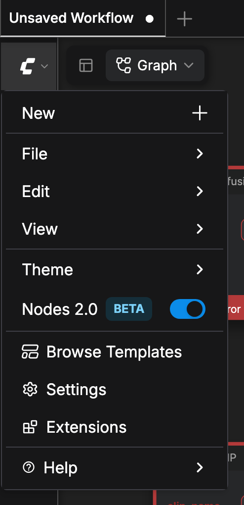
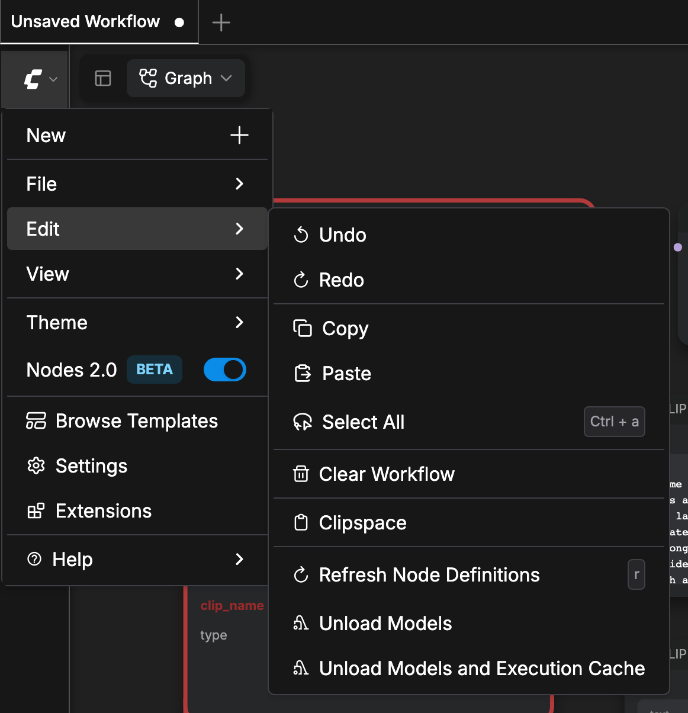

El menú Comfy se abre desde el logo de Comfy en la parte superior de la barra lateral izquierda. Contiene los comandos que no tienen un control en el lienzo: iniciar y guardar flujos de trabajo, ediciones del portapapeles, alternar vistas, liberar memoria de la GPU y enlaces de ayuda.

Haz clic en el logo o en el chevron que está junto a él para abrir el menú. Una entrada que tiene un chevron a su derecha tiene un submenú: pasa el cursor sobre ella para abrirlo.

## Entradas

| Entrada | Qué hace |
| --- | --- |
| **Nuevo** | Inicia un flujo de trabajo en blanco |
| **Archivo** | Abre, guarda y exporta el flujo de trabajo |
| **Editar** | Deshacer y rehacer, portapapeles, Espacio de clip, definiciones de nodos, memoria de GPU |
| **Ver** | Panel inferior, modo de enfoque, minimapa, enlaces de nodos, zoom |
| **Tema** | Submenú de temas integrados y personalizados, con el activo marcado |
| **Nodes 2.0** | Interruptor para el renderizador Nodes 2.0, consulta [Nodes 2.0](/es/interface/nodes-2) |
| **Explorar plantillas** | Abre el explorador de plantillas, consulta [Plantillas](/es/interface/features/template) |
| **Configuraciones** | Abre el diálogo de configuraciones, igual que `Ctrl + ,` |
| **Gestionar extensiones** | Abre el administrador de nodos personalizados y extensiones del frontend |
| **Ayuda** | Seguimiento de problemas, documentación, Discord, foro, Acerca de y soporte |

### Archivo

| Entrada | Atajo | Qué hace |
| --- | --- | --- |
| **Abrir** | `Ctrl + O` | Abre un flujo de trabajo desde el disco |
| **Guardar** | `Ctrl + S` | Guarda el flujo de trabajo actual |
| **Guardar como** | | Guarda con un nombre nuevo |
| **Exportar** | | Descarga el flujo de trabajo como JSON |
| **Exportar (API)** | | Descarga el prompt en formato API, consulta [Formato API de flujo de trabajo](/es/development/api-development/workflow-api-format) |
| **Exportar (imagen del flujo de trabajo)** | | Descarga un PNG del lienzo con el flujo de trabajo incrustado. Requiere el frontend 1.61.4 o posterior, consulta [Flujos de trabajo](/es/basic-concepts/workflow) |

### Editar

| Entrada | Atajo | Qué hace |
| --- | --- | --- |
| **Deshacer** / **Rehacer** | | Recorre los cambios del lienzo |
| **Copiar** / **Pegar** | | Duplica los nodos seleccionados |
| **Seleccionar todo** | `Ctrl + A` | Selecciona todos los nodos del lienzo |
| **Borrar flujo de trabajo** | | Vacía el lienzo. Los flujos de trabajo guardados no se eliminan |
| **Espacio de clip** | | Abre el espacio del portapapeles para imágenes y nodos copiados |
| **Actualizar definiciones de nodos** | `R` | Recarga las definiciones de nodos sin reiniciar ComfyUI |
| **Descargar modelos** | | Libera la memoria de GPU ocupada por los modelos cargados |
| **Descargar modelos y caché de ejecución** | | También descarta los resultados en caché, por lo que la siguiente ejecución los vuelve a calcular |

### Ver

| Entrada | Atajo | Qué hace |
| --- | --- | --- |
| **Panel inferior** | | Muestra u oculta el [panel inferior](/es/interface/bottom-panel) |
| **Explorar plantillas** | | Abre el explorador de plantillas |
| **Modo de Enfoque** | | Oculta todo excepto el lienzo, consulta [Controles del lienzo](/es/interface/canvas-controls) |
| **Rendimiento del Lienzo** | | Muestra u oculta el indicador de rendimiento del lienzo |
| **Minimapa** | `Alt + Shift + M` | Muestra u oculta el minimapa |
| **Enlaces de nodos** | | Muestra u oculta la representación de los enlaces |
| **Acercar** / **Alejar** | `Alt + =` / `Alt + -` | Acerca y aleja el lienzo |
| **Ajustar al tamaño** | `.` | Ajusta los nodos seleccionados o, si no hay selección, todo el flujo de trabajo |

### Ayuda

| Entrada | Abre |
| --- | --- |
| **Problemas de ComfyUI** | El seguimiento de problemas de ComfyUI en GitHub |
| **Documentos de ComfyUI** | docs.comfy.org |
| **Discord de Comfy-Org** | El servidor de Discord de la comunidad |
| **Foro de ComfyUI** | El foro de ComfyUI |
| **Acerca de ComfyUI** | Información de versión y sistema, consulta [Acerca de](/es/interface/settings/about) |
| **Contactar soporte** | El formulario de soporte |

## Liberar memoria sin reiniciar

Dos entradas del menú Editar liberan memoria durante una sesión:

- **Descargar modelos** quita de la memoria de la GPU todos los checkpoint, LoRA y VAE cargados.
- **Descargar modelos y caché de ejecución** también borra los resultados de ejecución en caché, por lo que la siguiente ejecución los vuelve a calcular en lugar de reutilizarlos.

Usa la primera cuando quieras cargar un modelo diferente, y la segunda después de cambiar un archivo de modelo en el disco. Ambas son de uso exclusivamente local: Comfy Cloud las oculta porque el servidor gestiona la memoria de los modelos.

## Dónde difiere el menú

- **Comfy Cloud** oculta las dos entradas de descarga. Todas las demás entradas se comportan como se describe aquí.
- **Comfy Desktop** agrega entradas al submenú **Ayuda**: Guía del usuario de escritorio, Open DevTools, un submenú Abrir carpeta, Buscar actualizaciones y Reinstalar.

## Páginas relacionadas

- [Resumen de la interfaz](/es/interface/overview)
- [Atajos de teclado](/es/interface/shortcuts)
- [Configuraciones de Comfy](/es/interface/settings/comfy)
