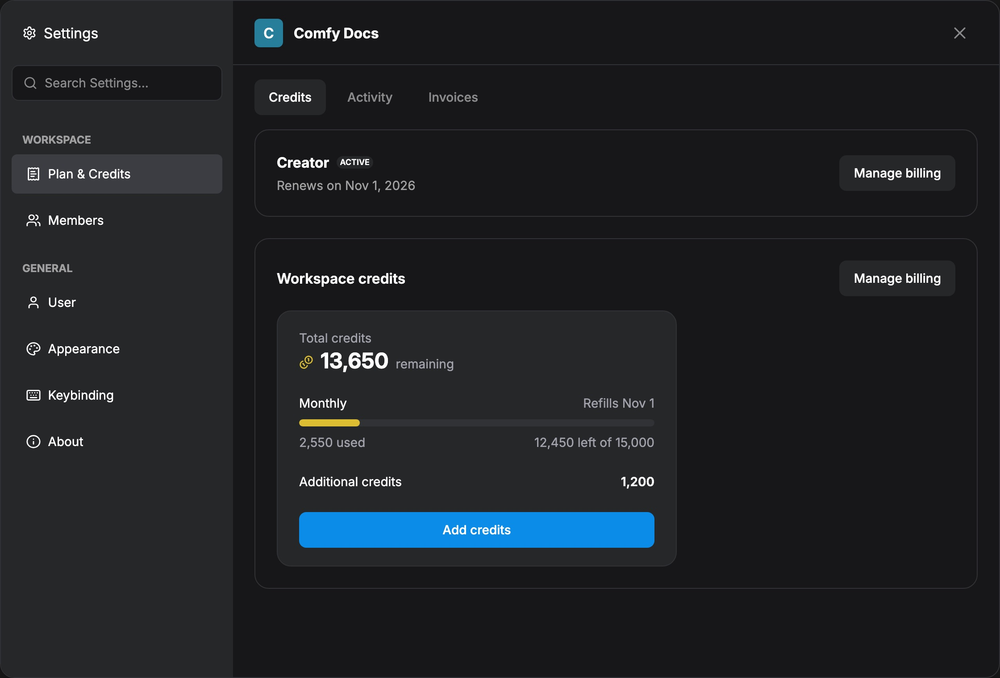
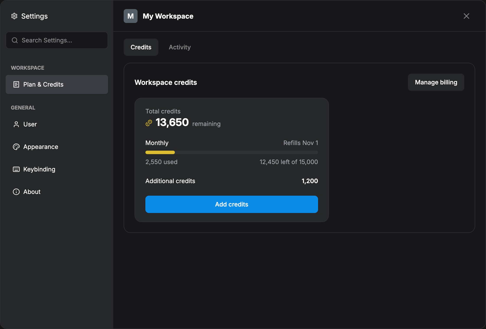
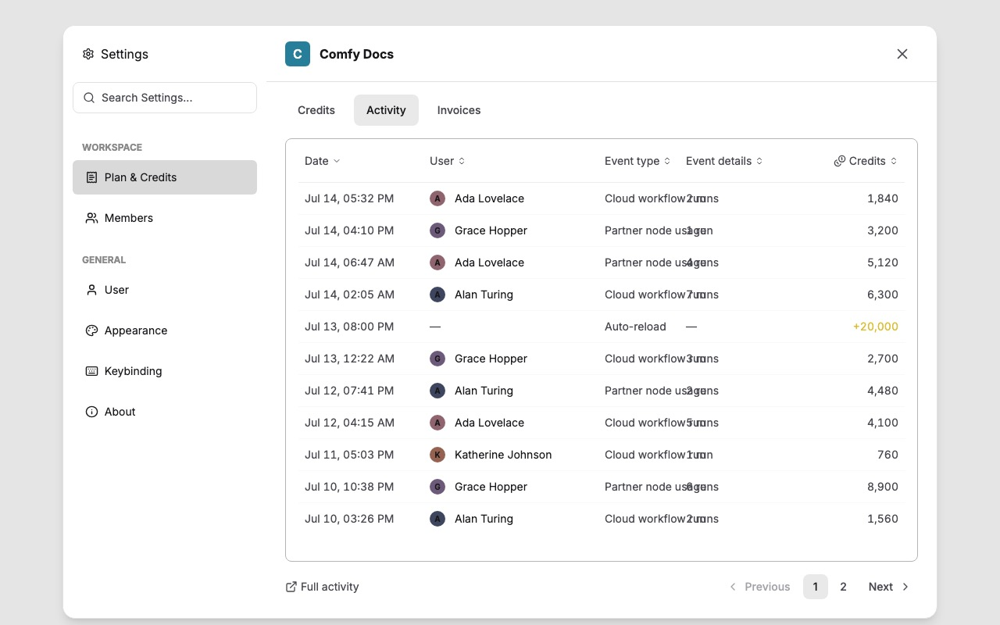
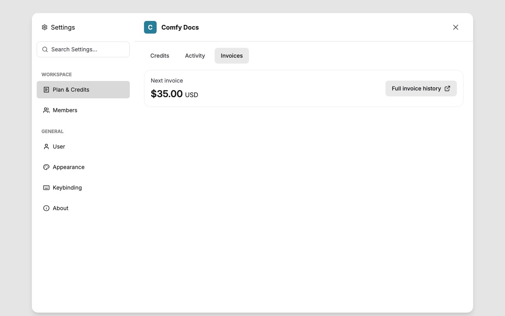
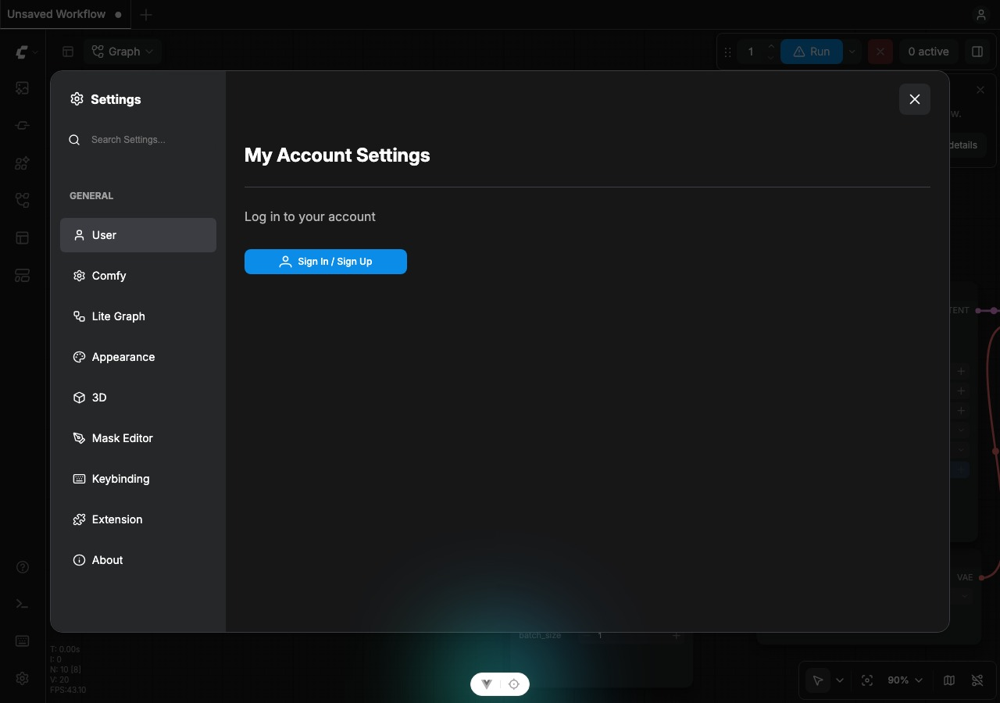
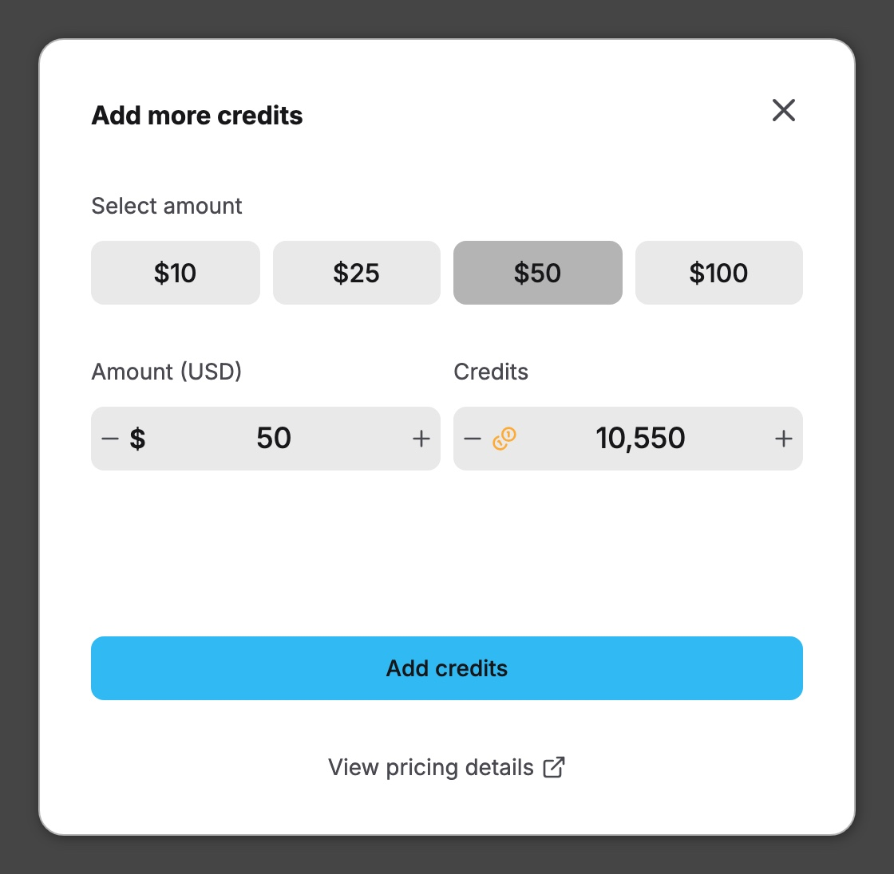
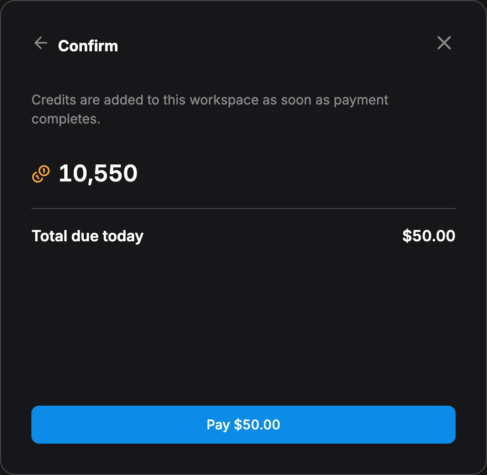
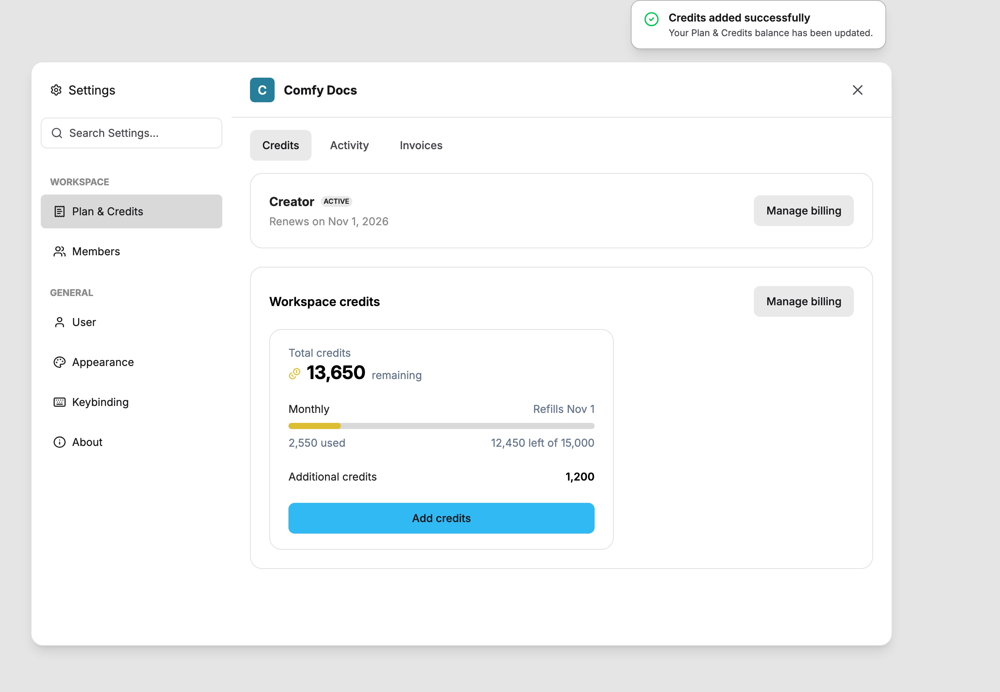

import SettingsMenuContext from "/snippets/es/interface/settings-menu-context.mdx"

<SettingsMenuContext />

Los créditos impulsan los **Nodos asociados** (llamadas a API de modelos de código cerrado). ComfyUI sigue siendo totalmente de código abierto y gratis para la ejecución local del gráfico; los créditos solo aplican cuando ejecutas Nodos asociados o usas las funciones de facturación de Cloud.

Después de iniciar sesión en **Configuraciones → Usuario**, abre **Configuraciones → Espacio de trabajo → Plan y créditos**. En Comfy Cloud también puedes abrir el mismo panel desde el menú de perfil con **Gestionar plan**.

Algunos espacios de trabajo de Cloud muestran los mismos datos de plan y créditos en un panel **Billing** en lugar de **Plan y créditos**. Está en el mismo grupo **Configuraciones → Espacio de trabajo** y añade la configuración de recarga automática. Consulta [Panel de facturación y recarga automática](#panel-de-facturación-y-recarga-automática).

<Note>
ComfyUI siempre seguirá siendo totalmente de código abierto y gratis para los usuarios locales. Los saldos de créditos en las capturas de pantalla son datos de ejemplo con fines ilustrativos.
</Note>

## Qué incluye Plan y créditos

Abre **Configuraciones → Espacio de trabajo → Plan y créditos**. En instalaciones locales, la barra lateral muestra Plan y créditos dentro de Espacio de trabajo después de que inicies sesión (sin Miembros ni Facturas). El panel tiene estas pestañas:

| Pestaña | Qué cubre |
| --- | --- |
| **Créditos** | Saldo, recarga y resumen del plan (la versión local integra el panel de créditos; Cloud muestra la vista de suscripción del espacio de trabajo) |
| **Actividad** | Historial de uso del gasto de créditos |
| **Facturas** | Solo Cloud, para usuarios que pueden administrar la suscripción del espacio de trabajo: próxima factura e historial de Stripe |

Para cambios de plan en Cloud, el portal de facturación y pagos fallidos, consulta las guías de soporte:

<CardGroup cols={2}>
  <Card title="Administrar suscripción de Cloud" icon="receipt" href="/es/support/subscription/managing">
    Cambia de plan, abre Facturación y facturas, Equipo vs Personal
  </Card>
  <Card title="Historial de pagos" icon="file-invoice" href="/es/support/payment/payment-history">
    Facturas y PDF en el portal de facturación de Stripe
  </Card>
</CardGroup>

## Cómo comprar créditos

<Steps>

<Step title="Inicia sesión en tu cuenta de ComfyUI">
Abre **Configuraciones → Usuario** e inicia sesión.

</Step>

<Step title="Abre Plan y créditos">
Después de iniciar sesión, abre **Configuraciones → Espacio de trabajo → Plan y créditos** (o el perfil de Cloud → **Gestionar plan**).

</Step>

<Step title="Establece la cantidad de créditos a comprar">

En la ventana emergente, establece la cantidad de la compra y haz clic en **Comprar**.
</Step>

<Step title="Confirma y completa el pago">

Revisa la cantidad y luego continúa al checkout de Stripe para finalizar el pago. Usa el mismo correo electrónico que tu cuenta de ComfyUI.
</Step>

<Step title="Confirma tu saldo">

Vuelve a **Plan y créditos** y verifica que el saldo se haya actualizado. Actualiza o reinicia si es necesario.
</Step>

</Steps>

En los espacios de trabajo que muestran el panel **Billing**, empieza en **Configuraciones → Espacio de trabajo → Billing**, haz clic en **Add credits** y comprueba el nuevo saldo en la tarjeta de créditos. El resto del flujo es el mismo.

## Panel de facturación y recarga automática

En los espacios de trabajo que usan el panel **Billing**, **Configuraciones → Espacio de trabajo → Billing** reúne el plan del espacio de trabajo, el saldo de créditos y la recarga automática en un solo panel. Los propietarios pueden cambiar el plan y agregar créditos ahí. Los miembros ven el mismo saldo y un enlace a su uso.

### Plan y créditos

La fila del plan muestra el plan actual, su intervalo de facturación y la fecha de la próxima factura. Un cambio de plan programado muestra la fecha en que se aplica, con un botón **Stay on** para cancelar ese cambio. Una suscripción cancelada muestra su fecha de finalización, con **Resume plan** para renovarla.

La cifra **Available** en la parte superior de la tarjeta de créditos es lo que el espacio de trabajo puede gastar ahora mismo. Cuando las ejecuciones gastaron de más, la tarjeta indica por cuántos créditos se excedió el saldo. Cuando el espacio de trabajo tiene un plan activo, la tarjeta divide el saldo en dos partes:

- **Plan**: la parte de la asignación del plan que le queda al espacio de trabajo en este periodo de facturación
- **Top-up**: los créditos que agregaste, que se gastan cuando se agota la asignación del plan. Muestra **In use now** cuando las ejecuciones ya están gastando créditos de recarga.

**Add credits** abre el flujo de recarga. Los propietarios también tienen un botón que lleva a la página de facturación alojada, para métodos de pago, facturas y uso.

### Recarga automática

La recarga automática repone el saldo cuando baja de un umbral, para que los trabajos largos sigan ejecutándose sin una recarga manual. Cobra al método de pago predeterminado del espacio de trabajo, así que primero debe haber uno registrado. Si un cobro falla o se alcanza el límite mensual, la recarga se pausa hasta que lo resuelvas.

Con la recarga automática activa, la tarjeta muestra la regla (por ejemplo, el importe y los créditos que se agregan) y el saldo que dispara la recarga. También muestra cuánto del límite mensual han usado los cobros automáticos. Solo los cobros automáticos cuentan para ese límite, y el contador se reinicia en cada ciclo de facturación.

Todos los botones de la tarjeta abren la página de facturación en una pestaña nueva, donde cambias la configuración. Cuando el espacio de trabajo admite recarga automática, la tarjeta la ven los propietarios y no los miembros.

| Estado | Qué significa |
| --- | --- |
| **On** | La recarga automática está activa. **Manage** abre la página de facturación para cambiar el importe, el umbral o el límite mensual. |
| **Off** | La recarga automática no está activa. **Turn on** abre la página de facturación para configurarla. |
| **On hold** | No hay método de pago predeterminado, así que la próxima recarga no se puede cobrar. **Update payment** abre la página de facturación para agregar una tarjeta. |
| **Paused** | Los cobros automáticos alcanzaron el límite mensual. La recarga se reanuda al inicio del próximo ciclo que muestra la tarjeta, o antes si elevas el límite en la página de facturación. |
| **Failed** | El último cobro automático no se completó. **Update payment** abre la página de facturación, o puedes agregar créditos manualmente. |

## Preguntas frecuentes

<AccordionGroup>
  <Accordion title="¿Los créditos pueden quedar en negativo?">
    Los créditos no están pensados como una línea de crédito. Los Nodos asociados a veces reportan el costo después de la ejecución, así que una ejecución puede dejar un saldo negativo temporal. Mientras el saldo esté en negativo, los Nodos asociados permanecen bloqueados hasta que recargues.
  </Accordion>

  <Accordion title="¿Puedo obtener un reembolso por los créditos no utilizados?">
  Actualmente no ofrecemos reembolsos por créditos no utilizados.
  </Accordion>

  <Accordion title="¿Cómo consulto mi saldo actual y mi uso?">
  Abre **Configuraciones → Espacio de trabajo → Plan y créditos**. Usa la pestaña **Créditos** para el saldo y la pestaña **Actividad** para el historial de uso. En los espacios de trabajo que muestran el panel **Billing**, el saldo está en la tarjeta de créditos y **View usage** abre el historial de uso.
  </Accordion>

  <Accordion title="¿Puedo compartir mis créditos con otros usuarios?">
  Puedes iniciar sesión en la misma cuenta en varios dispositivos. Compartir créditos con otras cuentas de usuario no es compatible. En los espacios de trabajo en equipo de Cloud, los miembros comparten un solo saldo del espacio de trabajo, y solo el propietario puede agregar créditos o cambiar el plan.
  </Accordion>

  <Accordion title="¿Cómo puedo saber cuánto costará el nodo?">
  Revisa la insignia de precio en el nodo de API / Nodo asociado antes de ejecutarlo. El costo real puede variar según el tamaño de la imagen, la cantidad de generaciones y otros parámetros.
  </Accordion>

  <Accordion title="¿Por qué no veo las opciones de pago WeChat o Alipay?">
  Elige el pago en Comfy Credits. WeChat y Alipay solo están disponibles para esa vía de moneda.
  </Accordion>

  <Accordion title="¿Los créditos vienen incluidos con un plan de Cloud?">
  No. Comprar créditos no inicia una suscripción ni desbloquea los flujos de trabajo de Cloud: ejecutar flujos de trabajo en Cloud requiere un plan. Los Nodos asociados en ComfyUI local y Desktop pueden usar créditos sin un plan.
  </Accordion>

  <Accordion title="¿Los créditos caducan?">
  Sí, la caducidad depende del tipo:
  - **Créditos mensuales**: caducan al final de tu periodo de facturación
  - **Créditos de recarga**: caducan 1 año a partir de la fecha de compra
  </Accordion>
</AccordionGroup>
