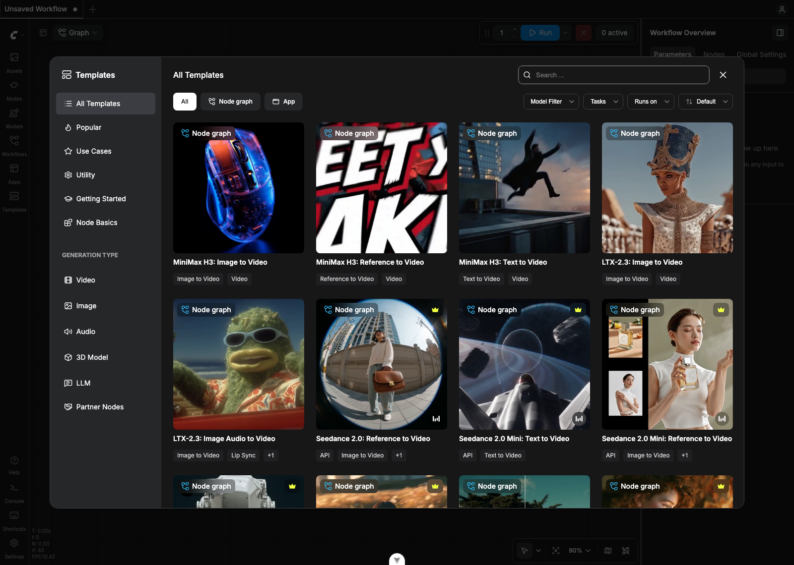
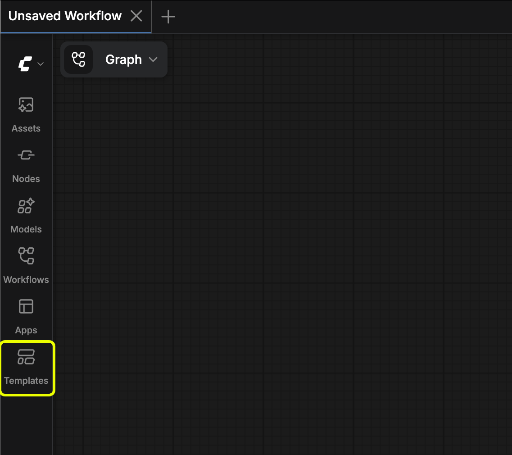
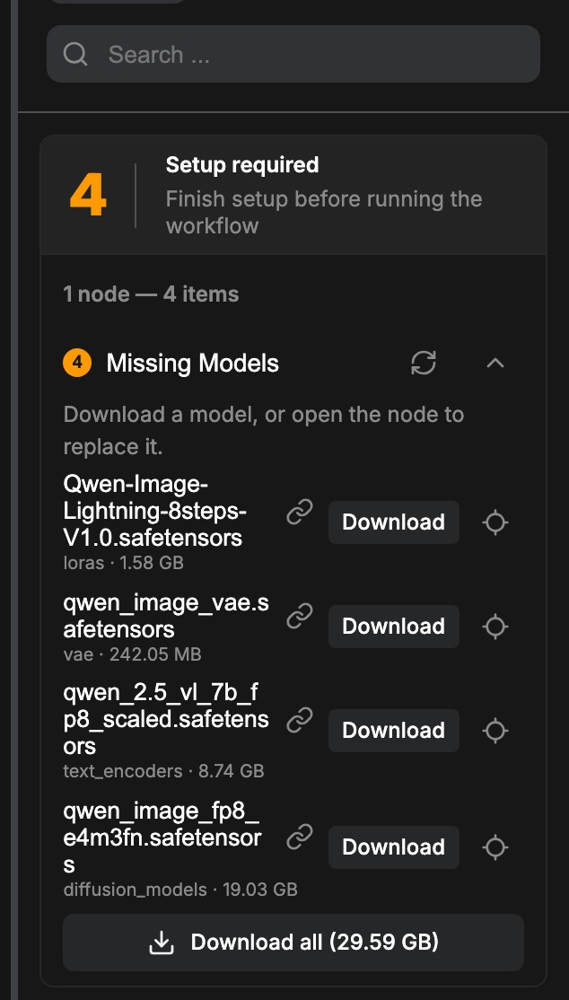

Workflow Templates es el navegador de los flujos de trabajo de modelos compatibles de forma nativa con ComfyUI, además de algunos flujos de trabajo de ejemplo de nodos personalizados.

En las Plantillas de flujos de trabajo de ComfyUI puedes encontrar:

- Flujos de trabajo de modelos compatibles de forma nativa
- Flujos de trabajo de ejemplo de nodos personalizados



## Abrir Plantillas en ComfyUI

Haz clic en el icono **Plantillas** de la barra lateral para abrir las plantillas de flujos de trabajo. También puedes abrirlas desde el menú **Flujo de trabajo** → **Explorar plantillas de flujos de trabajo**.


## Cómo usar las plantillas

1. Cargar una plantilla: Haz clic en cualquier plantilla para cargar su flujo de trabajo.
2. Descargar modelos: Al cargar una plantilla, ComfyUI comprueba automáticamente si existen todos los archivos de modelo requeridos. Si falta algo, te pedirá que descargues los modelos.
3. Ejecutar el flujo de trabajo: Cuando todos los requisitos, como los modelos, las imágenes de entrada y los prompts, estén listos, haz clic en el botón Run para empezar a usar el flujo de trabajo.

### Configuración de modelos en la aplicación de escritorio

Cada plantilla de flujo de trabajo incluye enlaces a los modelos requeridos. En la aplicación de escritorio, al cargar una plantilla cuyos modelos no están instalados se abre una vista de **Requisitos de la plantilla** antes de que se cargue el flujo de trabajo, así ves qué falta cuando todavía no se está ejecutando nada.

La vista se abre con una lista de **Modelos**: cada archivo de modelo que carga la plantilla, con su nombre del archivo, la carpeta de `ComfyUI/models` a la que pertenece, su tamaño y los nodos que lo usan. Cuando todos los archivos indican un tamaño, el encabezado de la lista muestra el total. Las plantillas que incluyen recursos multimedia de ejemplo también muestran una lista de **Recursos de entrada** con las imágenes, los videos o los audios de muestra, así ves qué espera el flujo de trabajo antes de ejecutarlo.

Cada fila de modelo muestra uno de estos estados:

| Estado de la fila | Qué significa | Qué haces |
| --- | --- | --- |
| **Instalado** | El archivo ya está en la carpeta correspondiente | Nada, la fila está completa |
| **Descargar modelo** | La plantilla incluye un enlace de Hugging Face o Civitai que ComfyUI puede descargar | Haz clic para descargar ese archivo en la carpeta indicada |
| **Obtenerlo manualmente** | El archivo está en un repositorio con acceso restringido | Abre el enlace del repositorio, acepta la licencia, descarga el archivo y colócalo en la carpeta indicada |
| **No disponible** | Falta el archivo y la plantilla no tiene ningún enlace que ComfyUI pueda descargar, por ejemplo un formato no compatible | Descarga el archivo por tu cuenta y colócalo en la carpeta indicada |
| **Desconocido** | ComfyUI todavía no ha terminado de analizar tus carpetas de modelos, o no se pudieron leer el tamaño y el origen del archivo | Abre la plantilla y revisa los nodos de carga, o vuelve cuando termine el análisis |

Los botones de la parte inferior de la vista controlan lo que ocurre a continuación:

- **Abrir ahora** carga el flujo de trabajo sin descargar nada. Los archivos faltantes quedan sin resolver.
- **Descargar modelos y abrir** inicia las descargas faltantes y abre el flujo de trabajo de inmediato, así las transferencias continúan en segundo plano mientras trabajas. Cuando todos los archivos pendientes indican un tamaño, el botón muestra lo que va a transferir, por ejemplo **Descargar modelos y abrir (6.46 GB)**. La cifra cuenta solo los archivos que inicia este clic, así que los modelos que ya tienes no se incluyen. El botón solo aparece cuando al menos un archivo faltante se puede descargar; si todos los archivos faltantes hay que obtenerlos a mano, solo se ofrece **Abrir ahora**.

Mientras se ejecuta una descarga, su fila muestra **En cola**, **Iniciando**, **Descargando**, **Pausado**, **Descargado**, **Error en la descarga** o **Descarga cancelada**. Una fila con error conserva el motivo y ofrece **Reintentar**. Los archivos descargados se guardan en las carpetas `ComfyUI/models/...` correspondientes.

Si los recursos multimedia de entrada de ejemplo no se pueden preparar, el flujo de trabajo se abre igualmente y puedes elegir tu propio archivo en el nodo de entrada.### Modelos faltantes en el navegador

En la versión de navegador autoalojada no hay una vista de configuración. Al cargar una plantilla con modelos faltantes, se abre el flujo de trabajo y, a continuación, ComfyUI:

1. Resalta en rojo los nodos de carga afectados en el lienzo.
2. Muestra un pequeño banner como **N problemas encontrados** con **View details**.
3. Abre los detalles en la pestaña **Issues** del [Panel lateral derecho](/es/interface/right-side-panel), en **Setup required** / **Missing Models**.



En esa lista puedes **Download** un archivo, **Download all**, **Refresh** o usar el control de ubicación para ir al nodo que necesita el modelo. Ese mismo grupo **Missing models** sigue disponible en la pestaña Issues mientras trabajas.

En un navegador autoalojado, **Download** inicia una descarga en el navegador cuando hay una URL disponible. Coloca cada archivo en la carpeta correspondiente. Ejemplo para la plantilla Qwen Image de la captura de pantalla:

```
📂 ComfyUI/
├── 📂 models/
│   ├── 📂 loras/
│   │   └── Qwen-Image-Lightning-8steps-V1.0.safetensors
│   ├── 📂 diffusion_models/
│   │   └── qwen_image_fp8_e4m3fn.safetensors
│   ├── 📂 vae/
│   │   └── qwen_image_vae.safetensors
│   └── 📂 text_encoders/
│       └── qwen_2.5_vl_7b_fp8_scaled.safetensors
```

La detección de archivos faltantes actualmente busca un archivo con el mismo nombre en el directorio de nivel superior correspondiente (por ejemplo, directamente en `ComfyUI/models/diffusion_models`).
Si el modelo ya está en una subcarpeta como `ComfyUI/models/diffusion_models/wan_video`, puedes descartar el aviso y seleccionar ese archivo en el nodo de carga en su lugar.

Si tienes curiosidad por saber cómo se incrustan los enlaces de modelos, agregamos un campo `models` bajo las `properties` del nodo. A continuación se muestra un fragmento completo de un nodo `DualCLIPLoader` con la información del modelo incrustada:
```json
    {
      "id": 40,
      "type": "DualCLIPLoader",
      "pos": [
        -320,
        290
      ],
      "size": [
        270,
        130
      ],
      "flags": {},
      "order": 0,
      "mode": 0,
      "inputs": [],
      "outputs": [
        {
          "name": "CLIP",
          "type": "CLIP",
          "links": [
            64
          ]
        }
      ],
      "properties": {
        "Node name for S&R": "DualCLIPLoader",
        "cnr_id": "comfy-core",
        "ver": "0.3.40",
        "models": [
          {
            "name": "clip_l.safetensors",
            "url": "https://huggingface.co/comfyanonymous/flux_text_encoders/resolve/main/clip_l.safetensors",
            "directory": "text_encoders"
          },
          {
            "name": "t5xxl_fp16.safetensors",
            "url": "https://huggingface.co/comfyanonymous/flux_text_encoders/resolve/main/t5xxl_fp16.safetensors",
            "directory": "text_encoders"
          }
        ]
      },
      "widgets_values": [
        "clip_l.safetensors",
        "t5xxl_fp16.safetensors",
        "flux",
        "default"
      ]
    }
```

El campo `models` dentro de `properties` incluye `name`, `url` y `directory`.

- `name`: el nombre del archivo del modelo
- `url`: un enlace de descarga directa al archivo (no a una página de repositorio)
- `directory`: en qué subcarpeta dentro de `ComfyUI/models` almacenar el archivo; por ejemplo, `vae` significa `ComfyUI/models/vae`

Actualmente, solo se admiten enlaces de Hugging Face y Civitai. El formato del modelo debe ser un formato seguro como `.safetensors` o `.sft`. Los formatos como `.gguf` se consideran inseguros; al incrustarse, se marcarán como inseguros y no se mostrará el enlace.

Puedes usar [esta herramienta](https://comfyui-wiki.github.io/ComfyUI-Workflow-JSON-Editor/) para editar la información del modelo en las plantillas de flujo de trabajo. Por el momento, [@ComfyUI-Wiki](https://github.com/ComfyUI-Wiki) solo agrega soporte para nodos nativos.

### Modelos faltantes en el navegador

En la versión autoalojada para navegador no hay una vista de configuración. Cargar una plantilla con modelos faltantes abre el flujo de trabajo y, a continuación, ComfyUI:

1. Resalta en rojo los nodos de carga afectados en el lienzo.
2. Muestra un pequeño banner como **N issues found** con **View details**.
3. Abre los detalles en la pestaña **Issues** del [Right Side Panel](/interface/right-side-panel), dentro de **Setup required** / **Missing Models**.


En esa lista puedes **Download** un archivo, **Download all**, **Refresh**, o usar el control de ubicación para ir al nodo que necesita el modelo. El mismo grupo **Missing models** permanece disponible en la pestaña Issues mientras trabajas.

En un navegador autoalojado, **Download** inicia una descarga del navegador cuando hay una URL disponible. Coloca cada archivo en la carpeta correspondiente. Ejemplo para la plantilla Qwen Image en la captura de pantalla:

```
📂 ComfyUI/
├── 📂 models/
│   ├── 📂 loras/
│   │   └── Qwen-Image-Lightning-8steps-V1.0.safetensors
│   ├── 📂 diffusion_models/
│   │   └── qwen_image_fp8_e4m3fn.safetensors
│   ├── 📂 vae/
│   │   └── qwen_image_vae.safetensors
│   └── 📂 text_encoders/
│       └── qwen_2.5_vl_7b_fp8_scaled.safetensors
```

La detección de archivos faltantes actualmente comprueba si existe un archivo con el mismo nombre en el directorio de nivel superior correspondiente (por ejemplo, directamente dentro de `ComfyUI/models/diffusion_models`).
Si el modelo ya está en una subcarpeta como `ComfyUI/models/diffusion_models/wan_video`, puedes descartar el aviso y seleccionar ese archivo en el nodo de carga en su lugar.

Si tienes curiosidad sobre cómo se incrustan los enlaces de modelos, agregamos un campo `models` bajo las `properties` del nodo. A continuación se muestra un fragmento completo de un nodo `DualCLIPLoader` con la información de modelos incrustada:
```json
    {
      "id": 40,
      "type": "DualCLIPLoader",
      "pos": [
        -320,
        290
      ],
      "size": [
        270,
        130
      ],
      "flags": {},
      "order": 0,
      "mode": 0,
      "inputs": [],
      "outputs": [
        {
          "name": "CLIP",
          "type": "CLIP",
          "links": [
            64
          ]
        }
      ],
      "properties": {
        "Node name for S&R": "DualCLIPLoader",
        "cnr_id": "comfy-core",
        "ver": "0.3.40",
        "models": [
          {
            "name": "clip_l.safetensors",
            "url": "https://huggingface.co/comfyanonymous/flux_text_encoders/resolve/main/clip_l.safetensors",
            "directory": "text_encoders"
          },
          {
            "name": "t5xxl_fp16.safetensors",
            "url": "https://huggingface.co/comfyanonymous/flux_text_encoders/resolve/main/t5xxl_fp16.safetensors",
            "directory": "text_encoders"
          }
        ]
      },
      "widgets_values": [
        "clip_l.safetensors",
        "t5xxl_fp16.safetensors",
        "flux",
        "default"
      ]
    }
```

El campo `models` dentro de `properties` incluye `name`, `url` y `directory`.

- `name`: el nombre del archivo del modelo
- `url`: un enlace de descarga directa al archivo (no una página de repositorio)
- `directory`: en qué subcarpeta dentro de `ComfyUI/models` guardar el archivo; por ejemplo, `vae` significa `ComfyUI/models/vae`

Actualmente, solo se admiten enlaces de Hugging Face y Civitai. El formato del modelo debe ser un formato seguro como `.safetensors` o `.sft`. Los formatos como `.gguf` se consideran no seguros; al incrustarse, se marcarán como no seguros y no se mostrará el enlace.

Puedes usar [esta herramienta](https://comfyui-wiki.github.io/ComfyUI-Workflow-JSON-Editor/) para editar la información de modelos en las plantillas de flujo de trabajo. Por el momento, [@ComfyUI-Wiki](https://github.com/ComfyUI-Wiki) solo agrega compatibilidad con nodos nativos.

## Cómo actualizar las plantillas

Las plantillas se gestionan y actualizan como una dependencia independiente: [`comfyui-workflow-templates`](https://pypi.org/project/comfyui-workflow-templates/).

Si, después de actualizar ComfyUI, no ves la documentación ni las plantillas anunciadas recientemente, es posible que necesites actualizar la dependencia correspondiente. Puedes consultar las versiones en [`ComfyUI/requirements.txt`](https://github.com/Comfy-Org/ComfyUI/blob/master/requirements.txt).

Por lo general, al actualizar ComfyUI se actualizan juntas las tres dependencias siguientes:

```
comfyui-frontend-package==1.24.4
comfyui-workflow-templates==0.1.52
comfyui-embedded-docs==0.2.4
```

Si no estás seguro de cómo actualizar correctamente, consulta [Actualizar ComfyUI](/es/installation/update_comfyui) para saber cómo actualizar ComfyUI y sus dependencias.

## Cómo contribuir plantillas al repositorio de ComfyUI

Todas las plantillas se alojan en el repositorio [workflow_templates](https://github.com/Comfy-Org/workflow_templates/). Puedes contribuir plantillas enviando un PR. Para las plantillas oficiales, pedimos lo siguiente:

1. No uses nodos de terceros (para evitar instalaciones adicionales a los usuarios que no tienen esos nodos).
2. La plantilla no debe duplicar las existentes y debe apuntar a las capacidades de modelo compatibles.
3. Puedes abrir un issue en el repositorio para hacer preguntas.

## Plantillas de nodos personalizados

Si un autor de nodos personalizados proporciona plantillas y flujos de trabajo de ejemplo, también puedes encontrarlos en el navegador de Plantillas. Por lo general, puedes encontrar todas las plantillas buscando la categoría que lleva el nombre del nodo.

Si eres autor de nodos personalizados, ten en cuenta que actualmente solo admitimos un único nivel de directorio dentro de la carpeta `templates` (sin subdirectorios anidados) y que solo se admiten plantillas en formato JSON.

## ¿Cómo agregar plantillas para nodos personalizados?

Consulta [Plantillas de Nodos Personalizados](/es/custom-nodes/workflow_templates) para saber cómo agregar plantillas de flujo de trabajo para tus nodos personalizados.
