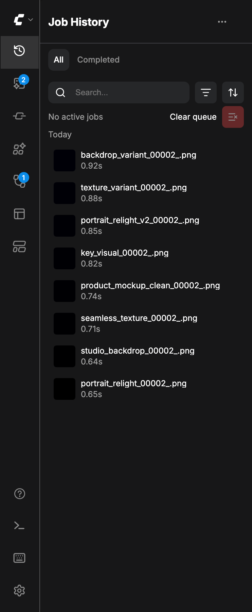
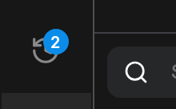

**Historial de trabajos** es una pestaña de la barra lateral izquierda que aparece cuando está activada la opción **Panel acoplado de historial/cola de trabajos** (`Comfy.Queue.QPOV2`). El frontend la registra en la parte **superior** de la barra lateral (`prepend`) para que puedas ver los trabajos activos y explorar ejecuciones anteriores sin usar la superposición flotante de la cola.

Cuando la opción está desactivada, la pestaña se elimina y, en su lugar, queda disponible la superposición flotante del historial de trabajos (`Comfy.Queue.ToggleOverlay`). Los controles de ejecución y cola del encabezado superior siguen iniciando trabajos en ambos casos. Esta página trata sobre la superficie del Historial de trabajos en la **barra lateral**.

## Activar el Historial de trabajos

1. Abre **Configuraciones**.
2. En `Comfy` → `Queue` → `Layout`, habilita **Panel acoplado de historial/cola de trabajos** (`Comfy.Queue.QPOV2`).
3. El icono **Historial de trabajos** aparece en la parte superior de la barra lateral izquierda.

La configuración es experimental. En las compilaciones nocturnas está activada de forma predeterminada; en otras compilaciones, revisa la configuración si no ves la pestaña.

## Abrir el panel

Haz clic en el icono **Historial de trabajos**. Mientras hay tareas en ejecución o en cola y esta pestaña **no** está activa, el icono muestra una insignia numérica con la cantidad de tareas activas. Al abrir la pestaña, la insignia deja de mostrarse en esa vista.

## Pestañas: Todas, Completadas, Fallidas

El encabezado del panel tiene pestañas de estado:

- **Todas**: todas las tareas del historial según los filtros actuales.
- **Completadas**: ejecuciones finalizadas.
- **Fallidas**: solo aparece cuando existe al menos una tarea fallida en la lista.

Debajo de las pestañas, una línea de resumen muestra cuántas tareas se están ejecutando y cuántas están en cola (o que no hay trabajos activos). El control **Limpiar cola** cancela todas las tareas pendientes (en cola, aún sin ejecutarse).

## Buscar, filtrar y ordenar

Usa las herramientas del encabezado para acotar la lista:

- **Buscar**: filtra los trabajos por texto.
- **Filtrar**: **Todos los flujos de trabajo** o **Flujo de trabajo actual**.
- **Ordenar**: **Más reciente** o **Tiempo total de generación**.

## Lista de tareas y acciones

Las tareas se muestran con su estado, el progreso cuando están en ejecución y miniaturas de vista previa cuando existen salidas. Desde la fila de una tarea o su menú contextual puedes:

**En ejecución o en cola**

- Abrir como flujo de trabajo en una pestaña nueva
- Copiar ID de trabajo
- Cancelar trabajo

**Completadas**

- Inspeccionar recurso (cuando existe una vista previa)
- Agregar la salida al flujo de trabajo actual como nodo de carga
- Descargar el recurso de vista previa
- Abrir como flujo de trabajo en una pestaña nueva
- Exportar flujo de trabajo
- Copiar ID de trabajo

**Fallidas**

- Abrir flujo de trabajo en una pestaña nueva
- Copiar ID de trabajo
- Copiar mensaje de error
- Reportar error
- Quitar trabajo de la lista del historial

El menú de acciones del encabezado incluye **Limpiar historial**, que abre un cuadro de diálogo de confirmación. Limpiar el historial elimina las entradas del historial de la cola; lee la nota del diálogo sobre cómo se relaciona eso con los recursos almacenados en tu instalación.

## Varios flujos de trabajo a la vez

Los planes de Comfy Cloud permiten ejecutar más de un flujo de trabajo a la vez. Cuando hay varias tareas en ejecución, cada una de la lista muestra su propio progreso y su nodo actual, así puedes seguirlas todas.

Solo una tarea controla el lienzo a la vez: la tarea **enfocada**. Su fila lleva un anillo de resaltado, y las vistas previas de los nodos, las salidas de imágenes y la línea de progreso de la barra superior la siguen. Haz clic en otra tarea en ejecución para mover el enfoque. Eso cambia lo que ves, nunca lo que se ejecuta ni el orden de la cola.

Solo puedes enfocar una tarea en ejecución mientras su flujo de trabajo esté abierto en una pestaña. Si esa pestaña está cerrada, primero abre el flujo de trabajo.

## Cómo se relaciona con Recursos y Errores

Las salidas de las ejecuciones completadas también aparecen en [Recursos](/es/interface/assets) cuando el sistema de recursos está habilitado. Los fallos del flujo de trabajo y los recursos faltantes se muestran en la pestaña **Errores** del [panel lateral derecho](/es/interface/right-side-panel) mientras corriges el gráfico.

## Páginas relacionadas

- [Resumen de la interfaz](/es/interface/overview)
- [Recursos](/es/interface/assets)
- [Panel lateral derecho](/es/interface/right-side-panel)
- [Configuraciones de Comfy](/es/interface/settings/comfy)
