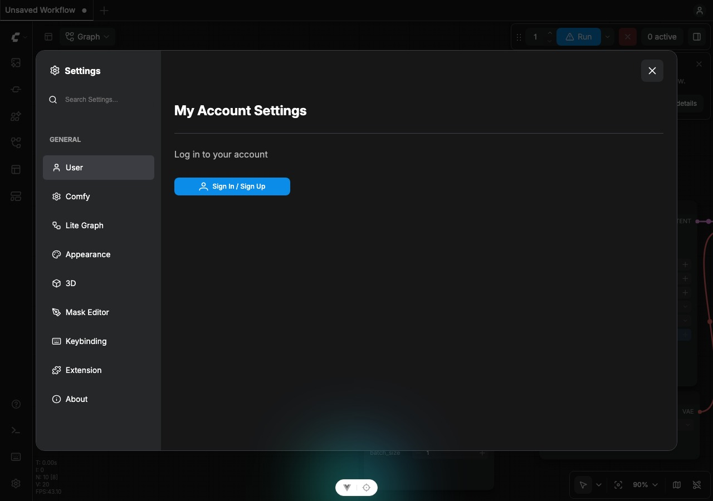
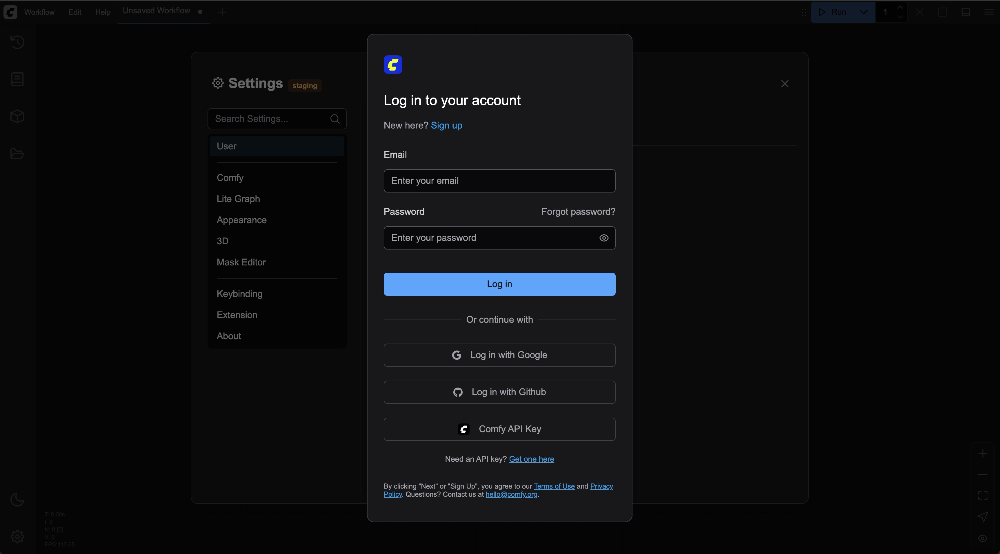
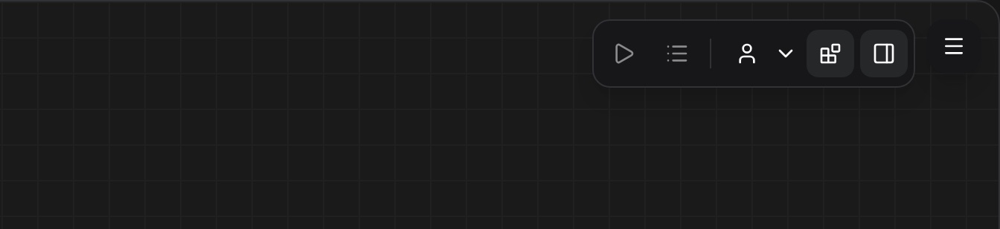
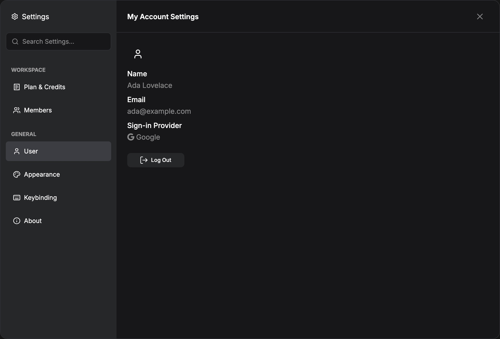

import SettingsMenuContext from "/snippets/es/interface/settings-menu-context.mdx"

<SettingsMenuContext />

Los Nodos asociados y la facturación de Comfy Cloud necesitan una cuenta de ComfyUI con sesión iniciada. Inicia sesión desde **Configuraciones → Usuario** (dentro del grupo **General**). Después de iniciar sesión, aparece **Configuraciones → Espacio de trabajo → Plan y créditos** para consultar el saldo y recargar créditos; consulta [Plan y créditos](/es/interface/credits).

Actualmente, admitimos los siguientes métodos de inicio de sesión:

- Inicio de sesión con correo electrónico
- Inicio de sesión con Google
- Inicio de sesión con GitHub
- Inicio de sesión con Clave API (para autorización de sitios que no están en la lista blanca)

Proporcionaremos los requisitos y las explicaciones correspondientes al inicio de sesión en este documento.

## Requisitos de la versión de ComfyUI

Es posible que necesites al menos [ComfyUI v0.3.0](https://github.com/Comfy-Org/ComfyUI/releases/tag/v0.3.30) para usar el sistema de cuentas. Asegúrate de que la versión del frontend correspondiente sea al menos `1.17.11`. A veces el frontend puede fallar al instalarse y volver a una versión anterior, así que revisa si la versión del frontend es mayor que `1.17.11` en `Settings` -> `About`.

En algunas regiones, las restricciones de red pueden impedir el acceso normal a la API de inicio de sesión, provocando tiempos de espera agotados o fallos. ANTES de iniciar sesión, **asegúrate de que tu entorno de red no restrinja el acceso a la API correspondiente** y verifica que puedes acceder a sitios como Google o GitHub.

<Tip>
Como todavía estamos en una etapa de actualizaciones iterativas rápidas, las funciones relacionadas pueden cambiar. Si no hay circunstancias especiales, intenta actualizar a la última versión para obtener soporte de las funciones correspondientes.
</Tip>

## Requisitos de red

Para iniciar sesión en la cuenta de ComfyUI, debes estar en un entorno de red seguro:

- Solo se permite el acceso desde `127.0.0.1` o `localhost`.
- No se admite el uso del parámetro `--listen` para acceder al nodo asociado a través de una red local.
- Si usas un certificado que no sea SSL o un sitio que no comience por `https`, es posible que no puedas iniciar sesión correctamente.
- Es posible que no puedas iniciar sesión en un sitio que no esté en nuestra lista blanca (pero ahora puedes iniciar sesión con una Clave API).
- Asegúrate de poder conectarte a nuestro servicio con normalidad (algunas regiones pueden requerir un proxy).

## Cómo iniciar sesión

Inicia sesión desde **Configuraciones → Usuario**:

## Métodos de inicio de sesión

Si es tu primer inicio de sesión, primero crea una cuenta.

<Card title="Iniciar sesión con una Clave API" icon="key" href="/es/account/login#iniciar-sesión-con-una-clave-api">
  Para sitios que no están en la lista blanca o entornos de LAN, puedes usar el inicio de sesión con Clave API. Consulta la guía detallada en la documentación de inicio de sesión de la cuenta.
</Card>

## Estado después de iniciar sesión

Después de iniciar sesión, el menú superior muestra el control de tu cuenta. Desde allí puedes volver a abrir el panel de usuario, cerrar sesión y, en Cloud, abrir **Gestionar plan** (el mismo panel **Plan y créditos** que en **Configuraciones → Espacio de trabajo → Plan y créditos**).

## Preguntas frecuentes

<AccordionGroup>
  <Accordion title="¿Cómo cambio mi nombre visible o mi correo electrónico?">
  Las filas **Nombre**, **Correo electrónico** y **Método de inicio de sesión** en **Configuraciones → Usuario** son de solo lectura. Muestran lo que devuelve la cuenta con la que iniciaste sesión, y el panel no tiene ningún campo para editarlas.

  - **Inicio de sesión con Google o GitHub**: el nombre y el correo provienen del perfil de ese proveedor. Cámbialos allí y luego cierra sesión y vuelve a iniciarla aquí para que el panel muestre los nuevos valores.
  - **Registro con correo electrónico**: la cuenta no tiene ningún nombre guardado, así que **Nombre** muestra **No establecido**. El panel todavía no ofrece una forma de añadirlo ni cambiarlo.
  - **Correo electrónico**: se mantiene el que usaste al registrarte o el que devuelve el proveedor, y no se puede cambiar dentro de la aplicación.
  </Accordion>

  <Accordion title="¿Existe alguna restricción de dispositivos para iniciar sesión?">
   No restringimos los dispositivos de inicio de sesión. Puedes iniciar sesión en tu cuenta desde cualquier dispositivo, pero ten en cuenta que otros dispositivos podrían acceder a la información de tu cuenta, así que no inicies sesión en tu cuenta en dispositivos públicos.
  </Accordion>

  <Accordion title="¿Cómo iniciar sesión en un entorno de LAN?">
  Actualmente, en un entorno de LAN solo se admite el inicio de sesión con Clave API. Si accedes a los servicios de ComfyUI a través de una LAN, usa una Clave API para iniciar sesión.
  </Accordion>
   <Accordion title="¿Por qué no puedo iniciar sesión en algunos sitios web?">
  Nuestro servicio de inicio de sesión tiene una lista blanca, por lo que es posible que no puedas iniciar sesión en el ComfyUI desplegado en algunos servidores. En ese caso, puedes resolverlo usando el inicio de sesión con Clave API.
  </Accordion>
</AccordionGroup>
