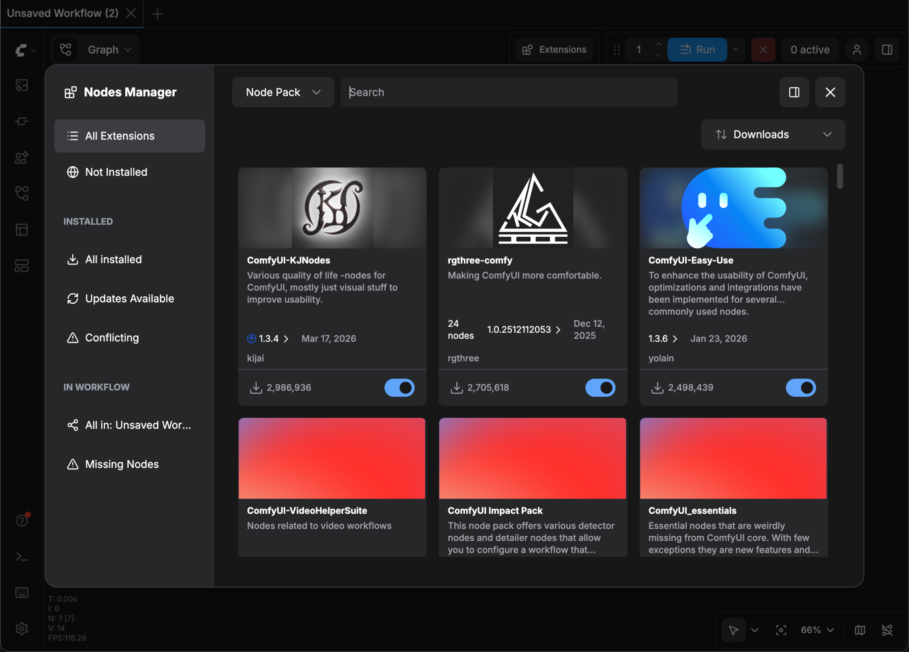

**ComfyUI-Manager** es una extensión pensada para facilitar el uso de [ComfyUI](https://github.com/Comfy-Org/ComfyUI). Te permite **instalar, eliminar, desactivar y activar** nodos personalizados, y también actúa como hub con utilidades para consultar mucha información desde dentro de ComfyUI.

## Características principales

- **Gestión de nodos personalizados**: Instala, actualiza, elimina y desactiva nodos personalizados
- **Gestión de modelos**: Descarga y administra modelos de varias fuentes
- **Gestión de instantáneas (Snapshots)**: Guarda y restaura el estado de la instalación
- **Detección de nodos faltantes**: Detecta e instala automáticamente los nodos que falten en un flujo de trabajo

## Siguientes pasos

<CardGroup cols={2}>
  <Card title="Instalación" icon="download" href="/es/manager/install">
    Instala ComfyUI-Manager en tu entorno de ComfyUI
  </Card>
  <Card title="Nueva interfaz" icon="puzzle-piece" href="/es/manager/pack-management">
    Administra nodos personalizados y modelos con la nueva interfaz
  </Card>
  <Card title="Interfaz clásica" icon="puzzle-piece" href="/es/manager/legacy-ui">
    Administra nodos personalizados y modelos con la interfaz clásica
  </Card>
  <Card title="Configuración" icon="gear" href="/es/manager/configuration">
    Configura los ajustes y las opciones
  </Card>
  <Card title="Solución de problemas" icon="bug" href="/es/manager/troubleshooting">
    Resuelve problemas comunes
  </Card>
</CardGroup>