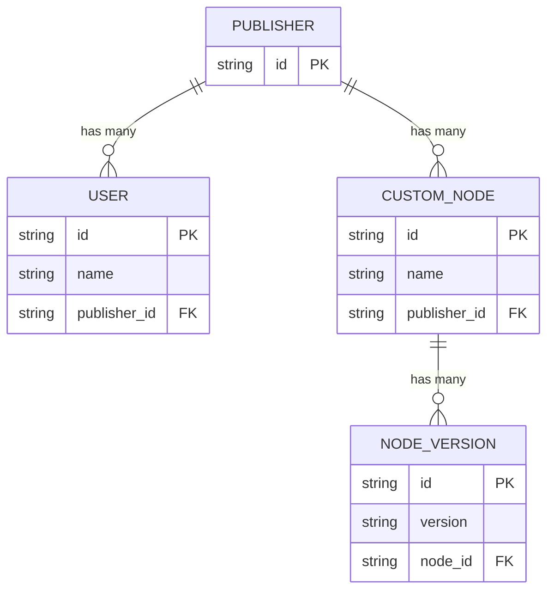

## Descripción general

El Registro de Nodos Personalizados sigue esta estructura:

## API de uso común

- **Listar todos los nodos** [API](/registry/api-reference/nodes/retrieves-a-list-of-nodes)
- **Instalar un nodo** [API](/registry/api-reference/nodes/returns-a-node-version-to-be-installed)