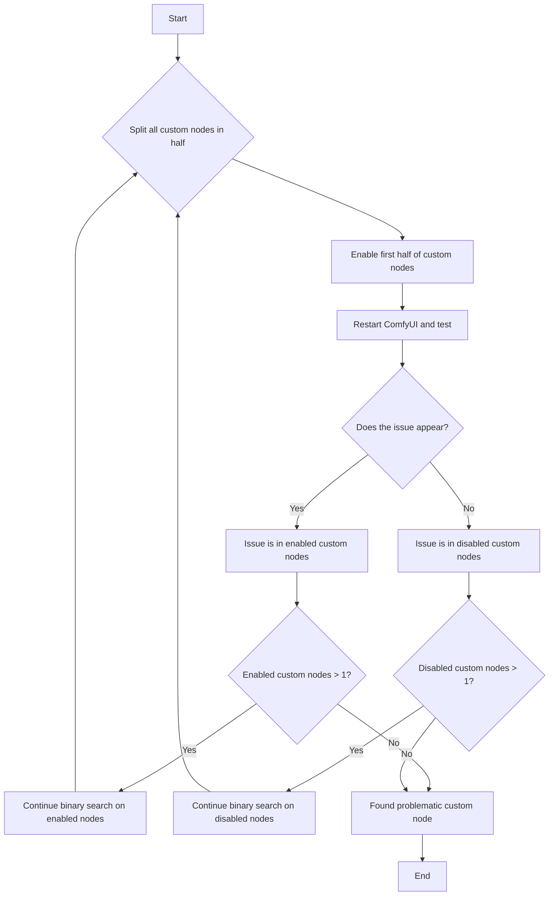

Here is the overall approach for troubleshooting custom node issues:

 ```mermaid
 flowchart TD
    A[Issue Encountered] --> B{Does the issue disappear after <a href="#how-to-disable-all-custom-nodes%3F">disabling all custom nodes</a>?}
    B -- Yes --> C[Issue caused by custom nodes]
    B -- No --> D[Issue not caused by custom nodes, refer to other troubleshooting docs]
    C --> E{<a href="#1-troubleshooting-the-custom-nodes’-frontend-extensions">Check frontend extensions first</a>?}
    E -- Yes --> F[<a href="#1-troubleshooting-the-custom-nodes’-frontend-extensions">Troubleshoot in ComfyUI frontend</a><br/><li>Only need reload the frontend</li>]
    E -- No --> G[<a href="#2-general-custom-node-troubleshooting">Use general binary search method</a><li>Need to restart ComfyUI multiple times</li>]
    F --> H[Use binary search to locate problematic node]
    G --> H
    H --> I[<a href="#how-to-fix-the-issue">Fix, replace, report or remove problematic node</a>]
    I --> J[Issue solved]
```

## ¿Cómo desactivar todos los nodos personalizados?

<Tabs>
<Tab title="Usuarios de Desktop">
Inicia Comfy Desktop con los nodos personalizados desactivados desde el menú de configuraciones

o ejecuta el servidor manualmente:
```bash
cd path/to/your/comfyui
python main.py --disable-all-custom-nodes
```
</Tab>
<Tab title="Instalación manual">
```bash
cd ComfyUI
python main.py --disable-all-custom-nodes
```
</Tab>
<Tab title="Portable">
<Tabs>
   <Tab title="Modificar el archivo `.bat`">
   Abre la carpeta donde se encuentra la versión portable y busca el archivo `run_nvidia_gpu.bat` o `run_cpu.bat`
   
   1. Copia el archivo `run_nvidia_gpu.bat` o `run_cpu.bat` y renómbralo a `run_nvidia_gpu_disable_custom_nodes.bat`
   2. Abre el archivo copiado con el Bloc de notas
   3. Agrega el parámetro `--disable-all-custom-nodes` al archivo, o copia los parámetros de abajo en un archivo `.txt` y renombra el archivo a `run_nvidia_gpu_disable_custom_nodes.bat`
   ```bash
   .\python_embeded\python.exe -s ComfyUI\main.py --disable-all-custom-nodes  --windows-standalone-build
   pause
   ```
   4. Guarda el archivo y ciérralo
   5. Haz doble clic en el archivo para ejecutarlo. Si todo es normal, deberías ver ComfyUI iniciar y los nodos personalizados desactivados
   </Tab>
   <Tab title="A través de la línea de comandos">
   
   1. Entra a la carpeta donde se encuentra la versión portable
   2. Abre la terminal haciendo clic derecho en el menú → Abrir terminal
   
   3. Asegúrate de que el nombre de la carpeta sea el directorio actual de la versión portable
   4. Introduce el siguiente comando para iniciar ComfyUI a través del python de la versión portable y desactivar los nodos personalizados
   ```
   .\python_embeded\python.exe -s ComfyUI\main.py --disable-all-custom-nodes
   ```
   </Tab>
</Tabs>
</Tab>
</Tabs>

**Resultados:**
- ✅ **El problema desaparece**: Un nodo personalizado está causando el problema → Continúa con el paso 2
- ❌ **El problema persiste**: No es un problema de nodos personalizados → [Reporta el problema](#reporting-issues)

## What is Binary Search?

In this document, we will introduce the binary search approach for troubleshooting custom node issues, which involves checking half of the custom nodes at a time until we locate the problematic node.

Please refer to the flowchart below for the specific approach - enable half of the currently disabled nodes each time and check if the issue appears, until we identify which custom node is causing the issue



## Dos métodos de diagnóstico de problemas

En este documento, clasificamos los nodos personalizados en dos tipos para el diagnóstico de problemas:


- A: Nodos personalizados con extensiones del frontend
- B: Nodos personalizados regulares

Primero, conozcamos los posibles problemas y causas de los diferentes tipos de nodos personalizados:

<Tabs>
   <Tab title="Nodos personalizados con extensiones del frontend">
   Para los nodos personalizados, podemos priorizar el diagnóstico de aquellos con extensiones del frontend, ya que son los que más problemas causan. Sus principales conflictos surgen de incompatibilidades con las actualizaciones de la versión del frontend de ComfyUI.
   
   Los problemas comunes incluyen:
   - Flujos de trabajo que no se ejecutan
   - Algunos nodos no pueden mostrar imágenes de vista previa (como el nodo Save Image)
   - Elementos de la interfaz desalineados
   - No se puede acceder al frontend de ComfyUI
   - Interfaz completamente rota o pantalla en blanco
   - No se puede comunicar normalmente con el backend de ComfyUI
   - Las conexiones entre nodos no funcionan correctamente
   - Y más
   
   Causas comunes de estos problemas:
   - Modificaciones del frontend durante las actualizaciones a las que los nodos personalizados aún no se han adaptado
   - Usuarios que actualizan ComfyUI sin actualizar los nodos personalizados de forma sincronizada, aunque los autores hayan publicado versiones compatibles
   - Autores que dejan de dar mantenimiento, lo que genera incompatibilidad entre las extensiones de los nodos personalizados y el frontend de ComfyUI
      
   </Tab>
   <Tab title="Nodos personalizados regulares">
   Si el problema no lo causan las extensiones del frontend de los nodos personalizados, los problemas suelen estar relacionados con las dependencias. Los problemas comunes incluyen:
   - Errores de «Failed to import» en la consola o en los registros
   - Los nodos faltantes siguen apareciendo como faltantes después de la instalación y el reinicio
   - ComfyUI se bloquea o no se inicia
   - Y más

   Causas comunes de estos errores:
   - Nodos personalizados que requieren wheels adicionales como ComfyUI-Nunchaku
   - Nodos personalizados que usan versiones estrictas de dependencias (p. ej., `torch==2.4.1`) mientras que otros plugins usan versiones diferentes (p. ej., `torch>=2.4.2`), lo que causa conflictos después de la instalación
   - Problemas de red que impiden que las dependencias se instalen correctamente

   Cuando los problemas involucran las interdependencias y versiones del entorno de Python, el diagnóstico se vuelve más complejo y requiere conocimientos sobre la gestión del entorno de Python, incluido cómo instalar y desinstalar dependencias.
   </Tab>
</Tabs>

## Using Binary Search for Troubleshooting

Among these two different types of custom node issues, conflicts between custom node frontend extensions and ComfyUI are more common. We'll prioritize troubleshooting these nodes first. Here's the overall troubleshooting approach:

### 1. Troubleshooting the Custom Nodes' Frontend Extensions

<Steps>
   <Step title="Disable All Third-Party Frontend Extensions">
   
   After starting ComfyUI, find the `Extensions` menu in settings and follow the steps shown in the image to disable all third-party extensions
   <Tip>
      If you can't enter ComfyUI frontend, just skip the frontend extensions troubleshooting section and continue to [General Custom Node Troubleshooting Approach](#2-general-custom-node-troubleshooting)
   </Tip>
   </Step>
   <Step title="Restart ComfyUI">
   After disabling frontend extensions for the first time, it's recommended to restart ComfyUI to ensure all frontend extensions are properly disabled
   - If the problem disappears, then it was caused by custom node frontend extensions, and we can proceed with binary search troubleshooting
   - If the problem persists, then it's not caused by frontend extensions - please refer to the other troubleshooting approaches in this document
   </Step>
   <Step title="Use Binary Search to Locate Problem Nodes">
   Use the method mentioned at the beginning of this document to troubleshoot, enabling half of the custom nodes at a time until you find the problematic node
   
   Refer to the image to enable half of the frontend extensions. Note that if extension names are similar, they likely come from the same custom node's frontend extensions
   </Step>
   <Step title="Follow-up Actions">
   If you find the problematic custom node, please refer to the problem fixing section of this document to resolve the custom node issues
   </Step>
</Steps>

Using this method, you don't need to restart ComfyUI multiple times - just reload ComfyUI after enabling/disabling custom node frontend extensions. Plus, your troubleshooting scope is limited to nodes with frontend extensions, which greatly narrows down the search range.

### 2. General Custom Node Troubleshooting


<Steps>
  <Step title="Use Binary Search to Locate Custom Nodes">
      For the binary search localization method, in addition to manual search, we also have automated binary search using comfy-cli, as detailed below:

      <Tabs>
         <Tab title="Using Comfy CLI (Recommended)">
         Using Comfy CLI requires some command line experience. If you're not comfortable with it, use manual binary search instead.
         
         If you have [Comfy CLI](/es/comfy-cli/getting-started) installed, you can use the automated bisect tool to find the problematic node:

         ```bash
         # Start a bisect session
         comfy-cli node bisect start

         # Follow the prompts:
         # - Test ComfyUI with the current set of enabled nodes
         # - Mark as 'good' if the issue is gone: comfy-cli node bisect good
         # - Mark as 'bad' if the issue persists: comfy-cli node bisect bad
         # - Repeat until the problematic node is identified

         # Reset when done
         comfy-cli node bisect reset
         ```

         The bisect tool will automatically enable/disable nodes and guide you through the process.

         </Tab>
         <Tab title="Manual Binary Search">
            <Warning>
            Before starting, please **create a backup** of your custom_nodes folder in case something goes wrong.
            </Warning>

         If you prefer to do the process manually or don't have Comfy CLI installed, follow the steps below:

         <Steps>
            <Step title="Create Temporary Folders">
            Before starting, enter the `<YOUR_COMFYUI_FOLDER>\ComfyUI\` folder
                  <Tabs>
                     <Tab title="Windows">
                     - **Backup all custom nodes**: Copy and rename `custom_nodes` to `custom_nodes_backup`
                     - **Create a temporary folder**: Create a folder named `custom_nodes_temp`
                     
                     Or use the following command line to backup:
      
                     ```bash
                     # Create backup and temporary folder
                     mkdir "%USERPROFILE%\custom_nodes_backup"
                     mkdir "%USERPROFILE%\custom_nodes_temp"

                     # Backup all content
                     xcopy "custom_nodes\*" "%USERPROFILE%\custom_nodes_backup\" /E /H /Y
                     ```
                     </Tab>
                     <Tab title="macOS/Linux">
                     Manually backup custom_nodes folder
                     Or use the following command line to backup:
                     ```bash
                     # Create backup and temporary folder
                     mkdir ~/custom_nodes_backup
                     mkdir ~/custom_nodes_temp

                     # Backup all content
                     cp -r custom_nodes/* ~/custom_nodes_backup/
                     ```
                     </Tab>
                     <Tab title="Cloud/Colab">
                     ```bash
                     # Create backup and temporary folder
                     mkdir /content/custom_nodes_backup
                     mkdir /content/custom_nodes_temp

                     # Backup all content
                     cp -r /content/ComfyUI/custom_nodes/* /content/custom_nodes_backup/
                     ```
                     </Tab>
                  </Tabs>
               </Step>
               <Step title="List all custom nodes">
                   <Tabs>
                     <Tab title="Windows">
                     Since Windows has a visual interface, you can skip this step unless you're only using the command line
                     ```bash
                     dir custom_nodes
                     ```
                     </Tab>
                     <Tab title="macOS/Linux">
                     ```bash
                     ls custom_nodes/
                     ```
                     </Tab>
                     <Tab title="Cloud/Colab">
                     ```bash
                     ls /content/ComfyUI/custom_nodes/
                     ```
                     </Tab>
                  </Tabs>
               </Step>
               <Step title="Split nodes in half">
               Let's assume that you have 8 custom nodes. Move the first half to temporary storage:
                  <Tabs>
                  <Tab title="Windows">
                  ```bash
                  # Move first half (nodes 1-4) to temp
                  move "custom_nodes\node1" "%USERPROFILE%\custom_nodes_temp\"
                  move "custom_nodes\node2" "%USERPROFILE%\custom_nodes_temp\"
                  move "custom_nodes\node3" "%USERPROFILE%\custom_nodes_temp\"
                  move "custom_nodes\node4" "%USERPROFILE%\custom_nodes_temp\"
                  ```
                  </Tab>
                  <Tab title="macOS/Linux">
                  ```bash
                  # Move first half (nodes 1-4) to temp
                  mv custom_nodes/node1 ~/custom_nodes_temp/
                  mv custom_nodes/node2 ~/custom_nodes_temp/
                  mv custom_nodes/node3 ~/custom_nodes_temp/
                  mv custom_nodes/node4 ~/custom_nodes_temp/
                  ```
                  </Tab>
                  <Tab title="Cloud/Colab">
                  ```bash
                  # Move first half (nodes 1-4) to temp
                  mv /content/ComfyUI/custom_nodes/node1 /content/custom_nodes_temp/
                  mv /content/ComfyUI/custom_nodes/node2 /content/custom_nodes_temp/
                  mv /content/ComfyUI/custom_nodes/node3 /content/custom_nodes_temp/
                  mv /content/ComfyUI/custom_nodes/node4 /content/custom_nodes_temp/
                  ```
                  </Tab>
                  </Tabs>
               </Step>
               <Step title="Test ComfyUI">
               Start ComfyUI normally
                  ```bash
                  python main.py
                  ```
               </Step>
               <Step title="Interpret results">
                  - **Issue persists**: Problem is in the remaining nodes (5-8)
                  - **Issue disappears**: Problem was in the moved nodes (1-4)
               </Step>
               <Step title="Narrow it down">
                  - If issue persists: Move half of remaining nodes (e.g., nodes 7-8) to temp
                  - If issue gone: Move half of temp nodes (e.g., nodes 3-4) back to custom_nodes
               </Step>
               <Step title="Repeat until you find the single problematic node">
                  - Repeat until you find the single problematic node
               </Step>
            </Steps>
         </Tab>
      </Tabs>
   </Step>
</Steps>

## Cómo solucionar el problema

Una vez que hayas identificado el nodo personalizado problemático:

### Opción 1: Actualizar el nodo
1. Comprueba si hay una actualización disponible en ComfyUI Manager
2. Actualiza el nodo y vuelve a probar

### Opción 2: Reemplazar el nodo
1. Busca nodos personalizados alternativos con funcionalidad similar
2. Consulta el [ComfyUI Registry](https://registry.comfy.org) para encontrar alternativas

### Opción 3: Reportar el problema
Contacta con el desarrollador del nodo personalizado:
1. Encuentra el repositorio de GitHub del nodo
2. Crea una incidencia con:
   - Tu versión de ComfyUI
   - Mensajes de error/registros
   - Pasos para reproducir el problema
   - Tu sistema operativo

### Opción 4: Eliminar o deshabilitar el nodo
Si no hay una solución disponible y no necesitas la funcionalidad:
1. Elimina el nodo problemático de `custom_nodes/` o deshabilítalo en la interfaz de ComfyUI Manager
2. Reinicia ComfyUI

## Informar problemas {#reporting-issues}

Si el problema no es causado por nodos personalizados, consulta la [descripción general de solución de problemas](/es/troubleshooting/overview) para otros problemas comunes.

### Para problemas específicos de nodos personalizados
Contacta al desarrollador del nodo personalizado:
- Busca el repositorio de GitHub del nodo
- Crea un issue con tu versión de ComfyUI, los mensajes de error, los pasos para reproducirlo y tu sistema operativo
- Revisa la documentación del nodo y su página de Issues para ver problemas conocidos

### Para problemas del núcleo de ComfyUI
- **GitHub**: [Problemas de ComfyUI](https://github.com/Comfy-Org/ComfyUI/issues)
- **Foro**: [Foro de ComfyUI](https://forum.comfy.org/)

### Para problemas de la aplicación de escritorio
- **GitHub**: [Problemas de Comfy Desktop](https://github.com/Comfy-Org/Comfy-Desktop/issues)

### Para problemas del frontend
- **GitHub**: [Problemas del frontend de ComfyUI](https://github.com/Comfy-Org/ComfyUI_frontend/issues)

<Note>
Para problemas generales de instalación, modelos o rendimiento, consulta nuestras páginas de [descripción general de solución de problemas](/es/troubleshooting/overview) y [problemas con modelos](/es/troubleshooting/model-issues).
</Note>
