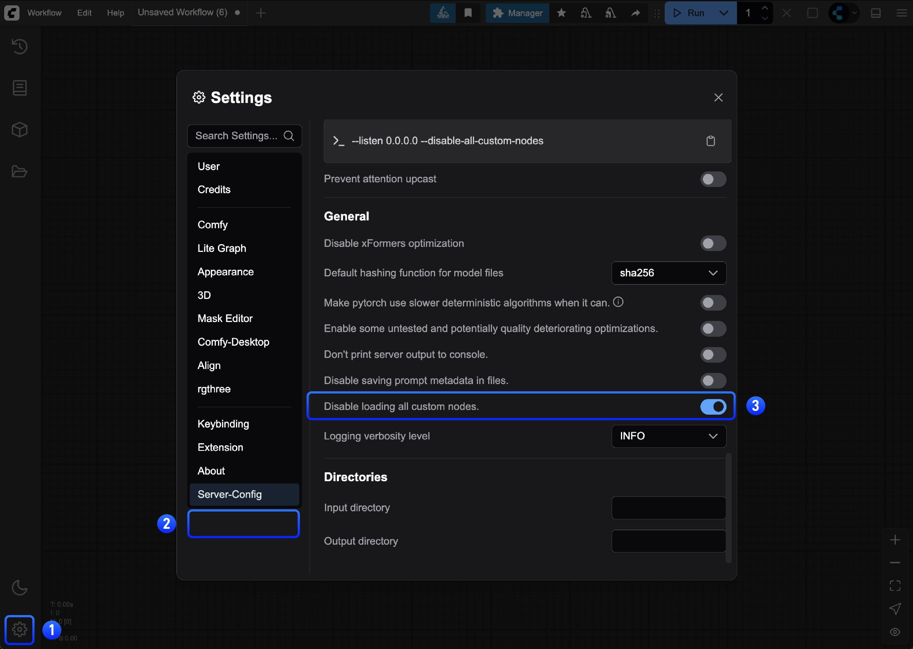
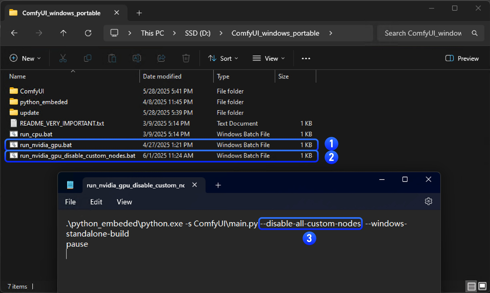
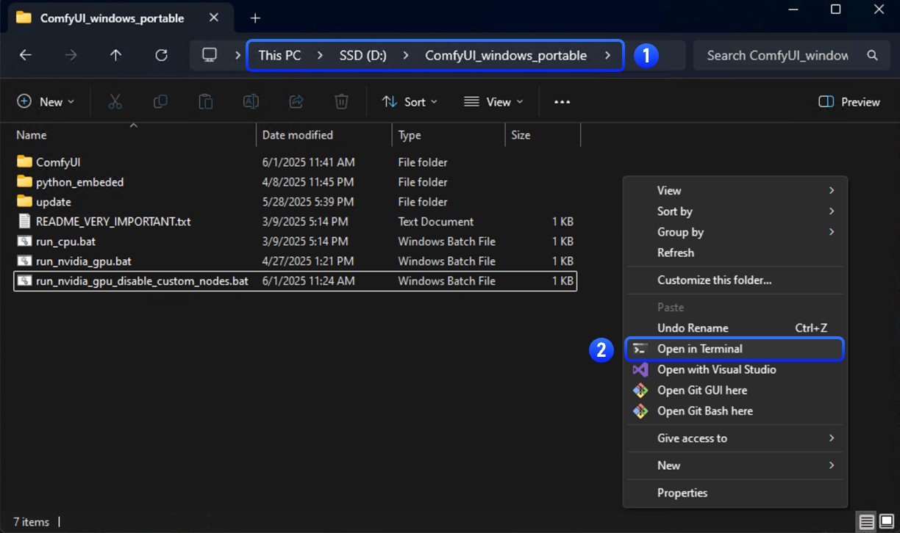
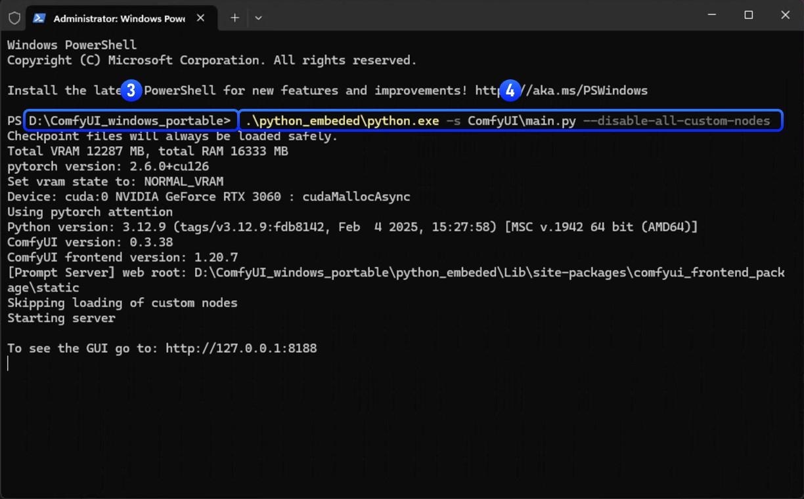
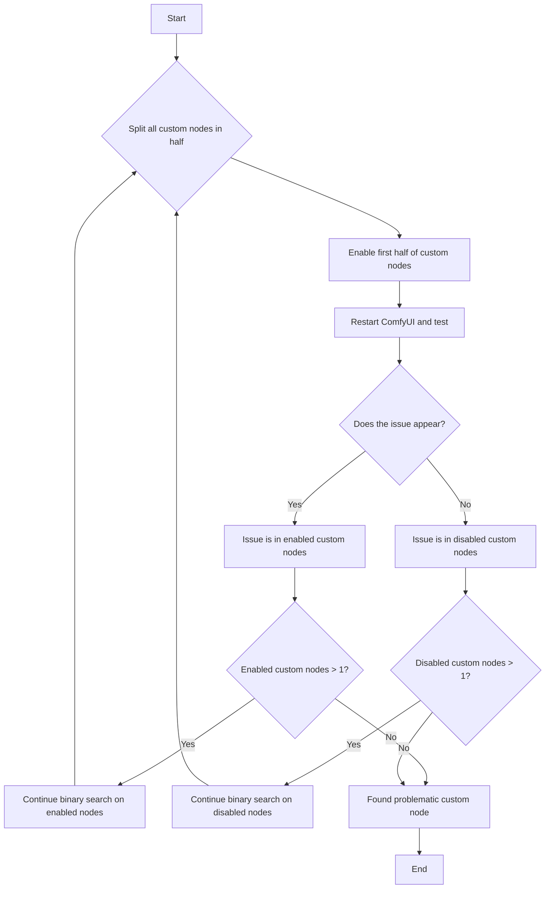
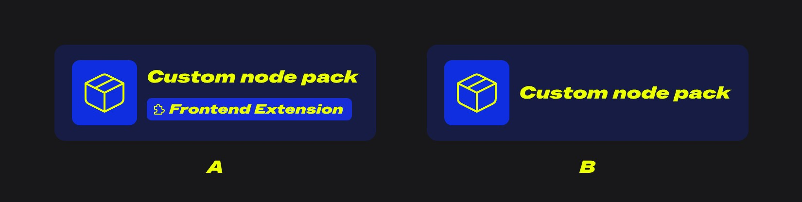
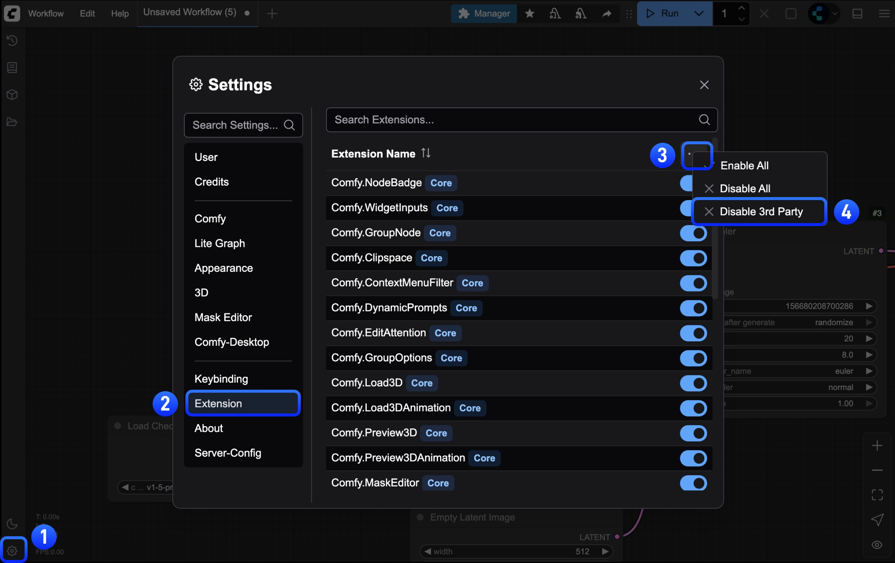
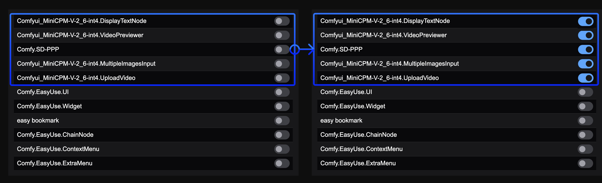

Este es el enfoque general para solucionar problemas de nodos personalizados:

 ```mermaid
 flowchart TD
    A[Issue Encountered] --> B{Does the issue disappear after <a href="#how-to-disable-all-custom-nodes%3F">disabling all custom nodes</a>?}
    B -- Yes --> C[Issue caused by custom nodes]
    B -- No --> D[Issue not caused by custom nodes, refer to other troubleshooting docs]
    C --> E{<a href="#1-troubleshooting-the-custom-nodes’-frontend-extensions">Check frontend extensions first</a>?}
    E -- Yes --> F[<a href="#1-troubleshooting-the-custom-nodes’-frontend-extensions">Troubleshoot in ComfyUI frontend</a><br/><li>Only need reload the frontend</li>]
    E -- No --> G[<a href="#2-general-custom-node-troubleshooting">Use general binary search method</a><li>Need to restart ComfyUI multiple times</li>]
    F --> H[Use binary search to locate problematic node]
    G --> H
    H --> I[<a href="#how-to-fix-the-issue">Fix, replace, report or remove problematic node</a>]
    I --> J[Issue solved]
```

## ¿Cómo desactivar todos los nodos personalizados?

<Tabs>
<Tab title="Usuarios de Desktop">
Inicia Comfy Desktop con los nodos personalizados desactivados desde el menú de configuraciones

o ejecuta el servidor manualmente:
```bash
cd path/to/your/comfyui
python main.py --disable-all-custom-nodes
```
</Tab>
<Tab title="Instalación manual">
```bash
cd ComfyUI
python main.py --disable-all-custom-nodes
```
</Tab>
<Tab title="Portable">
<Tabs>
   <Tab title="Modificar el archivo `.bat`">
   Abre la carpeta donde se encuentra la versión portable y busca el archivo `run_nvidia_gpu.bat` o `run_cpu.bat`
   
   1. Copia el archivo `run_nvidia_gpu.bat` o `run_cpu.bat` y renómbralo a `run_nvidia_gpu_disable_custom_nodes.bat`
   2. Abre el archivo copiado con el Bloc de notas
   3. Agrega el parámetro `--disable-all-custom-nodes` al archivo, o copia los siguientes parámetros en un archivo `.txt` y renombra el archivo a `run_nvidia_gpu_disable_custom_nodes.bat`
   ```bash
   .\python_embeded\python.exe -s ComfyUI\main.py --disable-all-custom-nodes  --windows-standalone-build
   pause
   ```
   4. Guarda el archivo y ciérralo
   5. Haz doble clic en el archivo para ejecutarlo. Si todo es normal, deberías ver que ComfyUI se inicia con los nodos personalizados desactivados
   </Tab>
   <Tab title="Desde la línea de comandos">
   
   1. Entra en la carpeta donde se encuentra la versión portable
   2. Abre la terminal con clic derecho en el menú → Abrir terminal
   
   3. Asegúrate de que el nombre de la carpeta sea el directorio actual de la versión portable
   4. Introduce el siguiente comando para iniciar ComfyUI mediante el python portable y desactivar los nodos personalizados
   ```
   .\python_embeded\python.exe -s ComfyUI\main.py --disable-all-custom-nodes
   ```
   </Tab>
</Tabs>
</Tab>
</Tabs>

**Resultados:**
- ✅ **El problema desaparece**: Un nodo personalizado está causando el problema → Continúa al paso 2
- ❌ **El problema persiste**: No es un problema de nodos personalizados → [Reporta el problema](#reportar-problemas)

## ¿Qué es la búsqueda binaria?

En este documento presentamos el enfoque de búsqueda binaria para solucionar problemas con nodos personalizados, que consiste en revisar la mitad de los nodos personalizados a la vez hasta localizar el nodo que causa el problema.

Consulta el siguiente diagrama de flujo para ver el procedimiento específico: habilita la mitad de los nodos deshabilitados cada vez y comprueba si el problema aparece, hasta identificar qué nodo personalizado lo está causando.



## Dos métodos de solución de problemas

En este documento, clasificamos los nodos personalizados en dos tipos para la solución de problemas:


- A: Nodos personalizados con extensiones de frontend
- B: Nodos personalizados normales

Primero, conozcamos los problemas y causas potenciales de los distintos tipos de nodos personalizados:

<Tabs>
   <Tab title="Nodos personalizados con extensiones de frontend">
   En el caso de los nodos personalizados, podemos priorizar la solución de problemas de aquellos con extensiones de frontend, ya que son los que más problemas causan. Sus principales conflictos surgen de incompatibilidades con las actualizaciones de la versión del frontend de ComfyUI.
   
   Los problemas comunes incluyen:
   - Flujos de trabajo que no se ejecutan
   - Algunos nodos no pueden mostrar imágenes de vista previa (como el nodo Guardar Imagen)
   - Elementos de la interfaz desalineados
   - No se puede acceder al frontend de ComfyUI
   - Interfaz completamente rota o pantalla en blanco
   - No se puede comunicar normalmente con el backend de ComfyUI
   - Las conexiones entre nodos no funcionan correctamente
   - Y más
   
   Causas comunes de estos problemas:
   - Modificaciones en el frontend durante las actualizaciones a las que los nodos personalizados aún no se han adaptado
   - Usuarios que actualizan ComfyUI sin actualizar al mismo tiempo los nodos personalizados, aunque los autores ya hayan publicado versiones compatibles
   - Autores que dejan de dar mantenimiento, lo que provoca incompatibilidad entre las extensiones de los nodos personalizados y el frontend de ComfyUI
      
   </Tab>
   <Tab title="Nodos personalizados normales">
   Si el problema no lo causan las extensiones de frontend de los nodos personalizados, a menudo está relacionado con las dependencias. Los problemas comunes incluyen:
   - Errores de "Failed to import" en la consola o los registros
   - Nodos faltantes que siguen apareciendo como faltantes después de instalarlos y reiniciar
   - ComfyUI se bloquea o no logra iniciar
   - Y más

   Causas comunes de estos errores:
   - Nodos personalizados que requieren wheels adicionales como ComfyUI-Nunchaku
   - Nodos personalizados que usan versiones estrictas de dependencias (por ejemplo, `torch==2.4.1`) mientras otros plugins usan versiones diferentes (por ejemplo, `torch>=2.4.2`), lo que genera conflictos después de la instalación
   - Problemas de red que impiden que las dependencias se instalen correctamente

   Cuando los problemas involucran interdependencias y versiones del entorno de Python, la solución de problemas se vuelve más compleja y requiere conocimientos de gestión de entornos de Python, incluido cómo instalar y desinstalar dependencias
   </Tab>
</Tabs>

## Usar la búsqueda binaria para solucionar problemas

Entre estos dos tipos distintos de problemas de nodos personalizados, los conflictos entre las extensiones frontend de los nodos personalizados y ComfyUI son los más comunes. Vamos a priorizar la solución de problemas de estos nodos primero. Este es el enfoque general para solucionar problemas:

### 1. Solucionar problemas de las extensiones frontend de los nodos personalizados

<Steps>
   <Step title="Desactivar todas las extensiones frontend de terceros">
   
   Después de iniciar ComfyUI, busca el menú `Extensions` en las configuraciones y sigue los pasos que se muestran en la imagen para desactivar todas las extensiones de terceros
   <Tip>
      Si no puedes entrar al frontend de ComfyUI, simplemente salta la sección de solución de problemas de extensiones frontend y continúa con el [Enfoque general para solucionar problemas de nodos personalizados](#2-solución-general-de-problemas-de-nodos-personalizados)
   </Tip>
   </Step>
   <Step title="Reiniciar ComfyUI">
   Después de desactivar las extensiones frontend por primera vez, se recomienda reiniciar ComfyUI para asegurarte de que todas las extensiones frontend estén correctamente desactivadas
   - Si el problema desaparece, entonces fue causado por las extensiones frontend de nodos personalizados, y podemos continuar con la solución de problemas mediante búsqueda binaria
   - Si el problema persiste, entonces no fue causado por las extensiones frontend: consulta los otros enfoques de solución de problemas en este documento.
   </Step>
   <Step title="Usar la búsqueda binaria para localizar los nodos problemáticos">
   Usa el método mencionado al inicio de este documento para solucionar el problema, habilitando la mitad de los nodos personalizados a la vez hasta que encuentres el nodo problemático
   
   Consulta la imagen para habilitar la mitad de las extensiones frontend. Ten en cuenta que si los nombres de las extensiones son similares, probablemente provienen de las extensiones frontend del mismo nodo personalizado
   </Step>
   <Step title="Acciones de seguimiento">
   Si encuentras el nodo personalizado problemático, consulta la sección de corrección de problemas de este documento para resolver los problemas del nodo personalizado
   </Step>
</Steps>

Con este método, no necesitas reiniciar ComfyUI varias veces: basta con recargar ComfyUI después de habilitar o deshabilitar las extensiones frontend de los nodos personalizados. Además, tu alcance de solución de problemas se limita a los nodos con extensiones frontend, lo que reduce enormemente el rango de búsqueda.

### 2. Solución general de problemas de nodos personalizados


<Steps>
  <Step title="Usar la búsqueda binaria para localizar nodos personalizados">
      Para el método de localización por búsqueda binaria, además de la búsqueda manual, también contamos con una búsqueda binaria automatizada usando comfy-cli, como se detalla a continuación:

      <Tabs><Tab title="Usar Comfy CLI (RECOMENDADO)">
         Usar Comfy CLI requiere algo de experiencia con la línea de comandos. Si no te sientes cómodo con ella, usa la búsqueda binaria manual en su lugar.
         
         Si tienes [Comfy CLI](/es/comfy-cli/getting-started) instalado, puedes usar la herramienta automatizada de bisección para encontrar el nodo problemático:

         ```bash
         # Inicia una sesión de bisección
         comfy-cli node bisect start

         # Sigue las indicaciones:
         # - Prueba ComfyUI con el conjunto actual de nodos habilitados
         # - Márcalo como 'good' si el problema desaparece: comfy-cli node bisect good
         # - Márcalo como 'bad' si el problema persiste: comfy-cli node bisect bad
         # - Repite hasta identificar el nodo problemático

         # Reinicia cuando termines
         comfy-cli node bisect reset
         ```

         La herramienta de bisección activa y desactiva nodos automáticamente y te guía por el proceso.

         </Tab><Tab title="Búsqueda binaria manual">
            <Warning>
            Antes de comenzar, **crea una copia de seguridad** de tu carpeta custom_nodes por si algo sale mal.
            </Warning>

         Si prefieres hacer el proceso manualmente o no tienes Comfy CLI instalado, sigue los pasos a continuación:

         <Steps>
            <Step title="Crear carpetas temporales">
            Antes de comenzar, entra en la carpeta `<YOUR_COMFYUI_FOLDER>\ComfyUI\`
                  <Tabs>
                     <Tab title="Windows">
                     - **Haz una copia de seguridad de todos los nodos personalizados**: Copia y renombra `custom_nodes` a `custom_nodes_backup`
                     - **Crea una carpeta temporal**: Crea una carpeta llamada `custom_nodes_temp`
                     
                     O usa la siguiente línea de comandos para hacer la copia de seguridad:
      
                     ```bash
                     # Crear la copia de seguridad y la carpeta temporal
                     mkdir "%USERPROFILE%\custom_nodes_backup"
                     mkdir "%USERPROFILE%\custom_nodes_temp"

                     # Copiar todo el contenido
                     xcopy "custom_nodes\*" "%USERPROFILE%\custom_nodes_backup\" /E /H /Y
                     ```
                     </Tab><Tab title="macOS/Linux">
                     Respalda manualmente la carpeta custom_nodes
                     O usa la siguiente línea de comandos para hacer el respaldo:
                     ```bash
                     # Crear respaldo y carpeta temporal
                     mkdir ~/custom_nodes_backup
                     mkdir ~/custom_nodes_temp

                     # Respaldar todo el contenido
                     cp -r custom_nodes/* ~/custom_nodes_backup/
                     ```
                     </Tab>
<Tab title="Cloud/Colab">
                     ```bash
                     # Crea una carpeta de respaldo y una temporal
                     mkdir /content/custom_nodes_backup
                     mkdir /content/custom_nodes_temp

                     # Respalda todo el contenido
                     cp -r /content/ComfyUI/custom_nodes/* /content/custom_nodes_backup/
                     ```
                     </Tab>
                  </Tabs>
               </Step>
               <Step title="Enumera todos los nodos personalizados">
                   <Tabs>
                     <Tab title="Windows">
                     Como Windows tiene una interfaz visual, puedes saltarte este paso a menos que solo uses la línea de comandos
                     ```bash
                     dir custom_nodes
                     ```
                     </Tab>
                     <Tab title="macOS/Linux">
                     ```bash
                     ls custom_nodes/
                     ```
                     </Tab>
                     <Tab title="Cloud/Colab">
                     ```bash
                     ls /content/ComfyUI/custom_nodes/
                     ```
                     </Tab>
                  </Tabs>
               </Step>
               <Step title="Divide los nodos por la mitad">
               Supongamos que tienes 8 nodos personalizados. Mueve la primera mitad al almacenamiento temporal:
                  <Tabs>
                  <Tab title="Windows">
                  ```bash
                  # Mueve la primera mitad (nodos 1-4) a temp
                  move "custom_nodes\node1" "%USERPROFILE%\custom_nodes_temp\"
                  move "custom_nodes\node2" "%USERPROFILE%\custom_nodes_temp\"
                  move "custom_nodes\node3" "%USERPROFILE%\custom_nodes_temp\"
                  move "custom_nodes\node4" "%USERPROFILE%\custom_nodes_temp\"
                  ```
                  </Tab>
                  <Tab title="macOS/Linux">
                  ```bash
                  # Mueve la primera mitad (nodos 1-4) a temp
                  mv custom_nodes/node1 ~/custom_nodes_temp/
                  mv custom_nodes/node2 ~/custom_nodes_temp/
                  mv custom_nodes/node3 ~/custom_nodes_temp/
                  mv custom_nodes/node4 ~/custom_nodes_temp/
                  ```
                  </Tab>
                  <Tab title="Cloud/Colab">
                  ```bash
                  # Mueve la primera mitad (nodos 1-4) a temp
                  mv /content/ComfyUI/custom_nodes/node1 /content/custom_nodes_temp/
                  mv /content/ComfyUI/custom_nodes/node2 /content/custom_nodes_temp/
                  mv /content/ComfyUI/custom_nodes/node3 /content/custom_nodes_temp/
                  mv /content/ComfyUI/custom_nodes/node4 /content/custom_nodes_temp/
                  ```
                  </Tab>
                  </Tabs>
               </Step>
               <Step title="Prueba ComfyUI">
               Inicia ComfyUI con normalidad
                  ```bash
                  python main.py
                  ```
               </Step>
               <Step title="Interpreta los resultados">
                  - **El problema persiste**: El problema está en los nodos restantes (5-8)
                  - **El problema desaparece**: El problema estaba en los nodos movidos (1-4)
               </Step>
               <Step title="Acota el problema">
                  - Si el problema persiste: mueve la mitad de los nodos restantes (por ejemplo, los nodos 7-8) a temp
                  - Si el problema desapareció: mueve la mitad de los nodos de temp (por ejemplo, los nodos 3-4) de vuelta a custom_nodes
               </Step>
               <Step title="Repite hasta encontrar el único nodo problemático">
                  - Repite hasta encontrar el único nodo problemático
               </Step>
            </Steps>
         </Tab>
      </Tabs>
   </Step>
</Steps>

## Cómo solucionar el problema

Una vez que hayas identificado el nodo personalizado problemático:

### Opción 1: Actualizar el nodo
1. Comprueba si hay una actualización disponible en ComfyUI Manager
2. Actualiza el nodo y vuelve a probar

### Opción 2: Reemplazar el nodo
1. Busca nodos personalizados alternativos con una funcionalidad similar
2. Consulta el [ComfyUI Registry](https://registry.comfy.org) para encontrar alternativas

### Opción 3: Reportar el problema
Contacta con el desarrollador del nodo personalizado:
1. Encuentra el repositorio de GitHub del nodo
2. Crea una incidencia con:
   - Tu versión de ComfyUI
   - Mensajes de error y registros
   - Pasos para reproducir el problema
   - Tu sistema operativo

### Opción 4: Eliminar o deshabilitar el nodo
Si no hay una solución disponible y no necesitas esa funcionalidad:
1. Elimina el nodo problemático de `custom_nodes/` o deshabilítalo en la interfaz de ComfyUI Manager
2. Reinicia ComfyUI

## Reportar problemas

Si el problema no lo causan los nodos personalizados, consulta la [descripción general de solución de problemas](/es/troubleshooting/overview) para ver otros problemas comunes.

### Para problemas específicos de nodos personalizados

Contacta al desarrollador del nodo personalizado:
- Busca el repositorio de GitHub del nodo
- Crea un reporte de problema con tu versión de ComfyUI, los mensajes de error, los pasos para reproducirlo y tu sistema operativo
- Revisa la documentación del nodo y su página de Issues para comprobar si hay problemas conocidos

### Para problemas del núcleo de ComfyUI

- **GitHub**: [Problemas de ComfyUI](https://github.com/Comfy-Org/ComfyUI/issues)
- **Foro**: [Foro oficial de ComfyUI](https://forum.comfy.org/)

### Para problemas de la aplicación de escritorio

- **GitHub**: [Problemas de Comfy Desktop](https://github.com/Comfy-Org/Comfy-Desktop/issues)

### Para problemas del frontend

- **GitHub**: [Problemas del frontend de ComfyUI](https://github.com/Comfy-Org/ComfyUI_frontend/issues)

<Note>
Para problemas generales de instalación, modelos o rendimiento, consulta las páginas de [descripción general de solución de problemas](/es/troubleshooting/overview) y [problemas de modelos](/es/troubleshooting/model-issues).
</Note>
