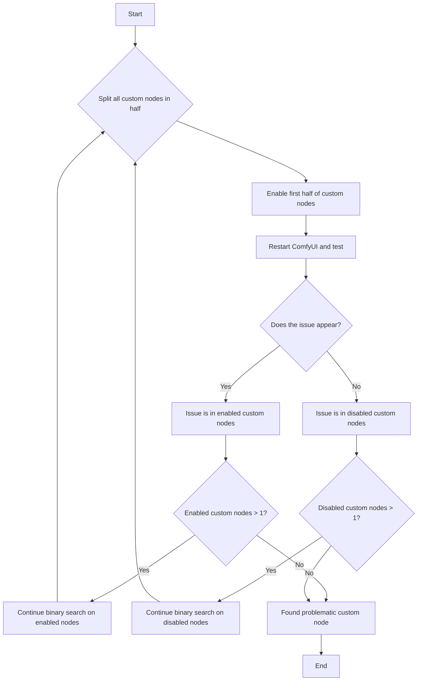

Aquí tienes el enfoque general para solucionar problemas de nodos personalizados:

 ```mermaid
 flowchart TD
    A[Issue Encountered] --> B{Does the issue disappear after <a href="#how-to-disable-all-custom-nodes%3F">disabling all custom nodes</a>?}
    B -- Yes --> C[Issue caused by custom nodes]
    B -- No --> D[Issue not caused by custom nodes, refer to other troubleshooting docs]
    C --> E{<a href="#1-troubleshooting-the-custom-nodes’-frontend-extensions">Check frontend extensions first</a>?}
    E -- Yes --> F[<a href="#1-troubleshooting-the-custom-nodes’-frontend-extensions">Troubleshoot in ComfyUI frontend</a><br/><li>Only need reload the frontend</li>]
    E -- No --> G[<a href="#2-general-custom-node-troubleshooting">Use general binary search method</a><li>Need to restart ComfyUI multiple times</li>]
    F --> H[Use binary search to locate problematic node]
    G --> H
    H --> I[<a href="#how-to-fix-the-issue">Fix, replace, report or remove problematic node</a>]
    I --> J[Issue solved]
```

## ¿Cómo desactivar todos los nodos personalizados?

<Tabs>
<Tab title="Usuarios de Desktop">
Inicia Comfy Desktop con los nodos personalizados desactivados desde el menú de configuraciones

o ejecuta el servidor manualmente:
```bash
cd path/to/your/comfyui
python main.py --disable-all-custom-nodes
```
</Tab>
<Tab title="Instalación manual">
```bash
cd ComfyUI
python main.py --disable-all-custom-nodes
```
</Tab>
<Tab title="Portable">
<Tabs>
   <Tab title="Modificar el archivo `.bat`">
   Abre la carpeta donde se encuentra la versión portable y busca el archivo `run_nvidia_gpu.bat` o `run_cpu.bat`
   
   1. Copia el archivo `run_nvidia_gpu.bat` o `run_cpu.bat` y renómbralo a `run_nvidia_gpu_disable_custom_nodes.bat`
   2. Abre el archivo copiado con el Bloc de notas
   3. Agrega el parámetro `--disable-all-custom-nodes` al archivo, o copia los parámetros de abajo en un archivo `.txt` y renombra el archivo a `run_nvidia_gpu_disable_custom_nodes.bat`
   ```bash
   .\python_embeded\python.exe -s ComfyUI\main.py --disable-all-custom-nodes  --windows-standalone-build
   pause
   ```
   4. Guarda el archivo y ciérralo
   5. Haz doble clic en el archivo para ejecutarlo. Si todo es normal, deberías ver ComfyUI iniciar y los nodos personalizados desactivados
   </Tab>
   <Tab title="A través de la línea de comandos">
   
   1. Entra a la carpeta donde se encuentra la versión portable
   2. Abre la terminal haciendo clic derecho en el menú → Abrir terminal
   
   3. Asegúrate de que el nombre de la carpeta sea el directorio actual de la versión portable
   4. Introduce el siguiente comando para iniciar ComfyUI a través del python de la versión portable y desactivar los nodos personalizados
   ```
   .\python_embeded\python.exe -s ComfyUI\main.py --disable-all-custom-nodes
   ```
   </Tab>
</Tabs>
</Tab>
</Tabs>

**Resultados:**
- ✅ **El problema desaparece**: Un nodo personalizado está causando el problema → Continúa con el paso 2
- ❌ **El problema persiste**: No es un problema de nodos personalizados → [Reporta el problema](#reporting-issues)

## ¿Qué es la búsqueda binaria?

En este documento presentamos el método de búsqueda binaria para solucionar problemas de nodos personalizados, que consiste en comprobar la mitad de los nodos personalizados a la vez hasta localizar el nodo problemático.

Consulta el diagrama de flujo de abajo para ver el método concreto: habilita cada vez la mitad de los nodos que están deshabilitados y comprueba si aparece el problema, hasta identificar qué nodo personalizado lo está causando.



## Dos métodos de diagnóstico de problemas

En este documento, clasificamos los nodos personalizados en dos tipos para el diagnóstico de problemas:


- A: Nodos personalizados con extensiones del frontend
- B: Nodos personalizados regulares

Primero, conozcamos los posibles problemas y causas de los diferentes tipos de nodos personalizados:

<Tabs>
   <Tab title="Nodos personalizados con extensiones del frontend">
   Para los nodos personalizados, podemos priorizar el diagnóstico de aquellos con extensiones del frontend, ya que son los que más problemas causan. Sus principales conflictos surgen de incompatibilidades con las actualizaciones de la versión del frontend de ComfyUI.
   
   Los problemas comunes incluyen:
   - Flujos de trabajo que no se ejecutan
   - Algunos nodos no pueden mostrar imágenes de vista previa (como el nodo Save Image)
   - Elementos de la interfaz desalineados
   - No se puede acceder al frontend de ComfyUI
   - Interfaz completamente rota o pantalla en blanco
   - No se puede comunicar normalmente con el backend de ComfyUI
   - Las conexiones entre nodos no funcionan correctamente
   - Y más
   
   Causas comunes de estos problemas:
   - Modificaciones del frontend durante las actualizaciones a las que los nodos personalizados aún no se han adaptado
   - Usuarios que actualizan ComfyUI sin actualizar los nodos personalizados de forma sincronizada, aunque los autores hayan publicado versiones compatibles
   - Autores que dejan de dar mantenimiento, lo que genera incompatibilidad entre las extensiones de los nodos personalizados y el frontend de ComfyUI
      
   </Tab>
   <Tab title="Nodos personalizados regulares">
   Si el problema no lo causan las extensiones del frontend de los nodos personalizados, los problemas suelen estar relacionados con las dependencias. Los problemas comunes incluyen:
   - Errores de «Failed to import» en la consola o en los registros
   - Los nodos faltantes siguen apareciendo como faltantes después de la instalación y el reinicio
   - ComfyUI se bloquea o no se inicia
   - Y más

   Causas comunes de estos errores:
   - Nodos personalizados que requieren wheels adicionales como ComfyUI-Nunchaku
   - Nodos personalizados que usan versiones estrictas de dependencias (p. ej., `torch==2.4.1`) mientras que otros plugins usan versiones diferentes (p. ej., `torch>=2.4.2`), lo que causa conflictos después de la instalación
   - Problemas de red que impiden que las dependencias se instalen correctamente

   Cuando los problemas involucran las interdependencias y versiones del entorno de Python, el diagnóstico se vuelve más complejo y requiere conocimientos sobre la gestión del entorno de Python, incluido cómo instalar y desinstalar dependencias.
   </Tab>
</Tabs>

## Uso de la búsqueda binaria para la solución de problemas

De estos dos tipos de problemas de nodos personalizados, los conflictos entre las extensiones del frontend de los nodos personalizados y ComfyUI son los más frecuentes. Daremos prioridad a la solución de problemas de estos nodos. Este es el enfoque general para solucionar problemas:

### 1. Solución de problemas de las extensiones del frontend de los nodos personalizados

<Steps>
   <Step title="Deshabilitar todas las extensiones del frontend de terceros">
   
   Después de iniciar ComfyUI, busca el menú `Extensions` en las configuraciones y sigue los pasos que se muestran en la imagen para deshabilitar todas las extensiones de terceros
   <Tip>
      Si no puedes entrar al frontend de ComfyUI, omite la sección de solución de problemas de las extensiones del frontend y continúa con el [Enfoque general para solucionar problemas de nodos personalizados](#2-solución-de-problemas-general-de-nodos-personalizados)
   </Tip>
   </Step>
   <Step title="Reiniciar ComfyUI">
   Después de deshabilitar las extensiones del frontend por primera vez, se recomienda reiniciar ComfyUI para asegurarte de que todas las extensiones del frontend queden deshabilitadas correctamente
   - Si el problema desaparece, lo causaban las extensiones del frontend de los nodos personalizados y podemos continuar con la solución de problemas mediante búsqueda binaria
   - Si el problema persiste, no lo causan las extensiones del frontend: consulta los otros enfoques de solución de problemas de este documento
   </Step>
   <Step title="Usar la búsqueda binaria para localizar los nodos problemáticos">
   Usa el método mencionado al principio de este documento: habilita la mitad de los nodos personalizados a la vez hasta encontrar el nodo problemático
   
   Consulta la imagen para habilitar la mitad de las extensiones del frontend. Ten en cuenta que, si los nombres de las extensiones son similares, probablemente vienen de las extensiones del frontend del mismo nodo personalizado
   </Step>
   <Step title="Acciones de seguimiento">
   Si encuentras el nodo personalizado problemático, consulta la sección de solución de problemas de este documento para resolver los problemas del nodo personalizado
   </Step>
</Steps>

Con este método no necesitas reiniciar ComfyUI varias veces: solo tienes que recargar ComfyUI después de habilitar o deshabilitar las extensiones del frontend de los nodos personalizados. Además, tu ámbito de diagnóstico se limita a los nodos con extensiones del frontend, lo que reduce mucho el rango de búsqueda.

### 2. Solución de problemas general de nodos personalizados


<Steps>
  <Step title="Usar la búsqueda binaria para localizar los nodos personalizados">
      Para el método de localización por búsqueda binaria, además de la búsqueda manual, también disponemos de la búsqueda binaria automatizada con comfy-cli, como se detalla abajo:

      <Tabs>
         <Tab title="Usar Comfy CLI (recomendado)">
         Usar Comfy CLI requiere algo de experiencia con la línea de comandos. Si no te sientes cómodo con ella, usa la búsqueda binaria manual.
         
         Si tienes [Comfy CLI](/es/comfy-cli/getting-started) instalado, puedes usar la herramienta de bisección automatizada para encontrar el nodo problemático:

         ```bash
         # Start a bisect session
         comfy-cli node bisect start

         # Follow the prompts:
         # - Test ComfyUI with the current set of enabled nodes
         # - Mark as 'good' if the issue is gone: comfy-cli node bisect good
         # - Mark as 'bad' if the issue persists: comfy-cli node bisect bad
         # - Repeat until the problematic node is identified

         # Reset when done
         comfy-cli node bisect reset
         ```

         La herramienta de bisección habilitará y deshabilitará los nodos automáticamente y te guiará durante el proceso.

         </Tab>
         <Tab title="Búsqueda binaria manual">
            <Warning>
            Antes de empezar, **crea una copia de seguridad** de tu carpeta custom_nodes por si algo sale mal.
            </Warning>

         Si prefieres hacer el proceso manualmente o no tienes Comfy CLI instalado, sigue los pasos de abajo:

         <Steps>
            <Step title="Crear carpetas temporales">
            Antes de empezar, entra en la carpeta `<YOUR_COMFYUI_FOLDER>\ComfyUI\`
                  <Tabs>
                     <Tab title="Windows">
                     - **Copia de seguridad de todos los nodos personalizados**: copia la carpeta `custom_nodes` y renómbrala a `custom_nodes_backup`
                     - **Crear una carpeta temporal**: crea una carpeta llamada `custom_nodes_temp`
                     
                     O usa la siguiente línea de comandos para hacer la copia de seguridad:
      
                     ```bash
                     # Create backup and temporary folder
                     mkdir "%USERPROFILE%\custom_nodes_backup"
                     mkdir "%USERPROFILE%\custom_nodes_temp"

                     # Backup all content
                     xcopy "custom_nodes\*" "%USERPROFILE%\custom_nodes_backup\" /E /H /Y
                     ```
                     </Tab>
                     <Tab title="macOS/Linux">
                     Haz una copia de seguridad manual de la carpeta custom_nodes
                     O usa la siguiente línea de comandos para hacer la copia de seguridad:
                     ```bash
                     # Create backup and temporary folder
                     mkdir ~/custom_nodes_backup
                     mkdir ~/custom_nodes_temp

                     # Backup all content
                     cp -r custom_nodes/* ~/custom_nodes_backup/
                     ```
                     </Tab>
                     <Tab title="Cloud/Colab">
                     ```bash
                     # Create backup and temporary folder
                     mkdir /content/custom_nodes_backup
                     mkdir /content/custom_nodes_temp

                     # Backup all content
                     cp -r /content/ComfyUI/custom_nodes/* /content/custom_nodes_backup/
                     ```
                     </Tab>
                  </Tabs>
               </Step>
               <Step title="Listar todos los nodos personalizados">
                   <Tabs>
                     <Tab title="Windows">
                     Como Windows tiene interfaz gráfica, puedes omitir este paso a menos que solo uses la línea de comandos
                     ```bash
                     dir custom_nodes
                     ```
                     </Tab>
                     <Tab title="macOS/Linux">
                     ```bash
                     ls custom_nodes/
                     ```
                     </Tab>
                     <Tab title="Cloud/Colab">
                     ```bash
                     ls /content/ComfyUI/custom_nodes/
                     ```
                     </Tab>
                  </Tabs>
               </Step>
               <Step title="Dividir los nodos por la mitad">
               Supongamos que tienes 8 nodos personalizados. Mueve la primera mitad al almacenamiento temporal:
                  <Tabs>
                  <Tab title="Windows">
                  ```bash
                  # Move first half (nodes 1-4) to temp
                  move "custom_nodes\node1" "%USERPROFILE%\custom_nodes_temp\"
                  move "custom_nodes\node2" "%USERPROFILE%\custom_nodes_temp\"
                  move "custom_nodes\node3" "%USERPROFILE%\custom_nodes_temp\"
                  move "custom_nodes\node4" "%USERPROFILE%\custom_nodes_temp\"
                  ```
                  </Tab>
                  <Tab title="macOS/Linux">
                  ```bash
                  # Move first half (nodes 1-4) to temp
                  mv custom_nodes/node1 ~/custom_nodes_temp/
                  mv custom_nodes/node2 ~/custom_nodes_temp/
                  mv custom_nodes/node3 ~/custom_nodes_temp/
                  mv custom_nodes/node4 ~/custom_nodes_temp/
                  ```
                  </Tab>
                  <Tab title="Cloud/Colab">
                  ```bash
                  # Move first half (nodes 1-4) to temp
                  mv /content/ComfyUI/custom_nodes/node1 /content/custom_nodes_temp/
                  mv /content/ComfyUI/custom_nodes/node2 /content/custom_nodes_temp/
                  mv /content/ComfyUI/custom_nodes/node3 /content/custom_nodes_temp/
                  mv /content/ComfyUI/custom_nodes/node4 /content/custom_nodes_temp/
                  ```
                  </Tab>
                  </Tabs>
               </Step>
               <Step title="Probar ComfyUI">
               Inicia ComfyUI con normalidad
                  ```bash
                  python main.py
                  ```
               </Step>
               <Step title="Interpretar los resultados">
                  - **El problema persiste**: el problema está en los nodos restantes (5-8)
                  - **El problema desaparece**: el problema estaba en los nodos movidos (1-4)
               </Step>
               <Step title="Acotar la búsqueda">
                  - Si el problema persiste: mueve la mitad de los nodos restantes (p. ej., los nodos 7-8) a la carpeta temporal
                  - Si el problema había desaparecido: devuelve la mitad de los nodos temporales (p. ej., los nodos 3-4) a custom_nodes
               </Step>
               <Step title="Repite hasta encontrar el único nodo problemático">
                  - Repite hasta encontrar el único nodo problemático
               </Step>
            </Steps>
         </Tab>
      </Tabs>
   </Step>
</Steps>

## Cómo solucionar el problema

Una vez que hayas identificado el nodo personalizado problemático:

### Opción 1: Actualizar el nodo
1. Comprueba si hay una actualización disponible en ComfyUI Manager
2. Actualiza el nodo y vuelve a probar

### Opción 2: Reemplazar el nodo
1. Busca nodos personalizados alternativos con funcionalidad similar
2. Consulta el [ComfyUI Registry](https://registry.comfy.org) para encontrar alternativas

### Opción 3: Reportar el problema
Contacta con el desarrollador del nodo personalizado:
1. Encuentra el repositorio de GitHub del nodo
2. Crea una incidencia con:
   - Tu versión de ComfyUI
   - Mensajes de error/registros
   - Pasos para reproducir el problema
   - Tu sistema operativo

### Opción 4: Eliminar o deshabilitar el nodo
Si no hay una solución disponible y no necesitas la funcionalidad:
1. Elimina el nodo problemático de `custom_nodes/` o deshabilítalo en la interfaz de ComfyUI Manager
2. Reinicia ComfyUI

## Informar problemas {#reporting-issues}

Si el problema no es causado por nodos personalizados, consulta la [descripción general de solución de problemas](/es/troubleshooting/overview) para otros problemas comunes.

### Para problemas específicos de nodos personalizados
Contacta al desarrollador del nodo personalizado:
- Busca el repositorio de GitHub del nodo
- Crea un issue con tu versión de ComfyUI, los mensajes de error, los pasos para reproducirlo y tu sistema operativo
- Revisa la documentación del nodo y su página de Issues para ver problemas conocidos

### Para problemas del núcleo de ComfyUI
- **GitHub**: [Problemas de ComfyUI](https://github.com/Comfy-Org/ComfyUI/issues)
- **Foro**: [Foro de ComfyUI](https://forum.comfy.org/)

### Para problemas de la aplicación de escritorio
- **GitHub**: [Problemas de Comfy Desktop](https://github.com/Comfy-Org/Comfy-Desktop/issues)

### Para problemas del frontend
- **GitHub**: [Problemas del frontend de ComfyUI](https://github.com/Comfy-Org/ComfyUI_frontend/issues)

<Note>
Para problemas generales de instalación, modelos o rendimiento, consulta nuestras páginas de [descripción general de solución de problemas](/es/troubleshooting/overview) y [problemas con modelos](/es/troubleshooting/model-issues).
</Note>
