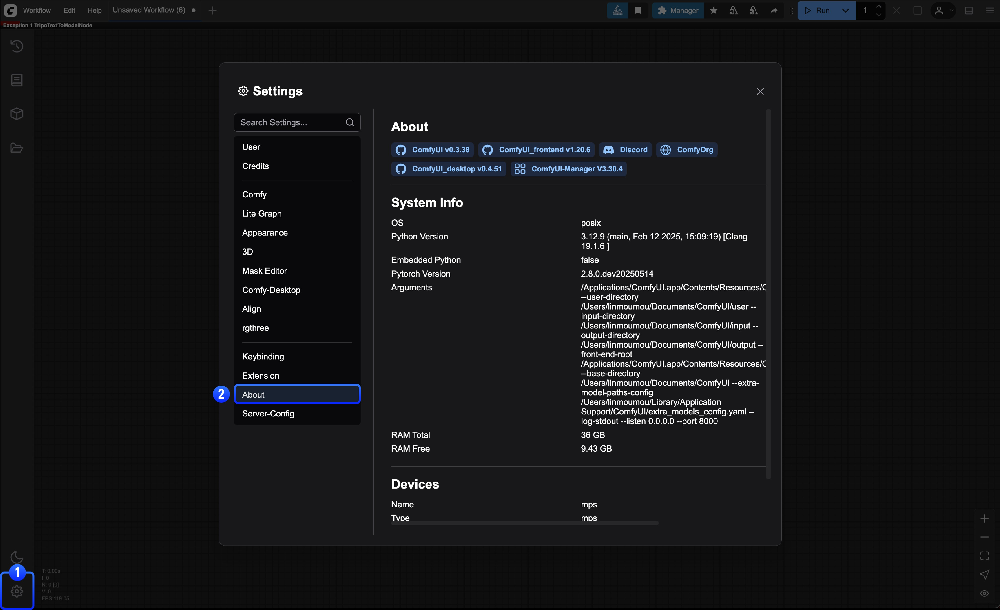

import DockerNotice from "/snippets/es/install/docker-notice.mdx"

<Tip>
   Recibimos muchos comentarios sobre problemas y hemos notado que la mayoría de los que se envían están relacionados con nodos personalizados. Por eso, asegúrate de haber leído la [guía de solución de problemas de nodos personalizados](/es/troubleshooting/custom-node-issues) antes de enviar un reporte de error, para confirmar que el problema no se debe a fallas del núcleo de ComfyUI.
</Tip>

<Card title="Guía de solución de problemas de nodos personalizados" icon="puzzle-piece" href="/es/troubleshooting/custom-node-issues">
  Consulta cómo solucionar los problemas causados por nodos personalizados.
</Card>

## Problemas comunes y soluciones rápidas

Antes de entrar en la solución de problemas detallada, prueba estas soluciones habituales:

### ComfyUI no inicia

**Síntomas:** la aplicación se cierra al iniciar, muestra una pantalla negra o no carga

**Soluciones rápidas:**
1. **Revisa los requisitos del sistema** - Asegúrate de que tu sistema cumpla los [requisitos mínimos](/es/installation/system_requirements)
2. **Actualiza los controladores de la GPU** - Descarga los controladores más recientes de NVIDIA/AMD/Intel

### La generación falla o produce errores

**Síntomas:** aparece el diálogo "La ejecución del prompt falló" con el botón "Mostrar informe" y el flujo de trabajo deja de ejecutarse

**Soluciones rápidas:**
1. **Haz clic en "Mostrar informe"** - Lee el mensaje de error detallado para identificar el problema concreto
2. **Comprueba si es un problema de un nodo personalizado** - [Sigue nuestra guía de solución de problemas de nodos personalizados](/es/troubleshooting/custom-node-issues)
3. **Verifica los archivos de modelo** - Consulta la [documentación de modelos](/es/basic-concepts/models) para configurar los modelos
4. **Revisa el uso de VRAM** - Cierra otras aplicaciones que estén usando memoria de la GPU

### Rendimiento lento

**Síntomas:** tiempos de generación muy lentos, el sistema se congela, errores de memoria insuficiente

**Soluciones rápidas:**
1. **Reduce la resolución o el tamaño del lote** - Disminuye el tamaño de la imagen o la cantidad de imágenes
2. **Usa las opciones de optimización de memoria** - Consulta la sección de optimización del rendimiento más abajo
3. **Cierra las aplicaciones innecesarias** - Libera RAM y VRAM
4. **Revisa el uso de CPU/GPU** - Usa el Administrador de tareas para identificar los cuellos de botella

**Comandos de optimización del rendimiento:**

Para sistemas con poca VRAM:
```bash
# Low VRAM mode (uses cpu for text encoder)
python main.py --lowvram

# CPU mode (very slow but works with any hardware, only use as absolute last resort)
python main.py --cpu
```

Para obtener mejor rendimiento:
```bash
# Disable previews (saves VRAM and processing)
python main.py --preview-method none

# Use optimized attention mechanisms
python main.py --use-pytorch-cross-attention
python main.py --use-flash-attention

# Async weight offloading
python main.py --async-offload
```

Para la gestión de memoria:
```bash
# Reserve specific VRAM amount for OS (in GB)
python main.py --reserve-vram 2

# Disable smart memory management
python main.py --disable-smart-memory

# Use different caching strategies
python main.py --cache-none      # Less RAM usage, but slower
python main.py --cache-lru 10    # Cache 10 results, faster
python main.py --cache-classic   # Use the old style (aggressive) caching. 
```
## Problemas específicos de instalación

### Problemas de la aplicación de escritorio

Para una guía completa de solución de problemas de instalación en escritorio, consulta la [Guía de instalación de escritorio](/es/installation/desktop/windows).

<Tabs>
<Tab title="Windows">
- **Dispositivo no compatible**: Comfy Desktop para Windows solo admite GPU NVIDIA con CUDA. Usa [ComfyUI Portable](/es/installation/comfyui_portable_windows) o la [instalación manual](/es/installation/manual_install) para otras GPU
- **La instalación falla**: Ejecuta el instalador como administrador y asegúrate de tener al menos 15 GB de espacio en disco
- **Página de Mantenimiento**: Revisa las [Configuraciones de Espejo](/es/installation/desktop/usage/settings#avanzado) si fallan las descargas
- **Modelos faltantes**: Los modelos no se copian durante la migración, solo se vinculan. Verifica las rutas de los modelos
</Tab>
<Tab title="macOS">
- **"La aplicación está dañada"**: Permite la aplicación en las configuraciones de Seguridad y Privacidad
- **Problemas de rendimiento**: Otorga Acceso total al disco en las configuraciones de Privacidad
- **Cierres inesperados**: Revisa la aplicación Consola para ver los informes de fallos
</Tab>
<Tab title="Linux">
- **Librerías faltantes**: Instala las dependencias con el gestor de paquetes
- **Errores de LD_LIBRARY_PATH**: Problemas con la ruta de las librerías de PyTorch (ver abajo)
</Tab>
</Tabs>

### Problemas de la instalación manual

<Note>
Es posible que la documentación esté un poco desactualizada. Si surge un problema, verifica manualmente si existe una versión estable más reciente de pytorch o de cualquiera de las librerías mencionadas. Consulta recursos como la [matriz de instalación de pytorch](https://pytorch.org/get-started/locally/) o el [sitio web de ROCm](https://rocm.docs.amd.com/projects/install-on-linux/en/develop/install/3rd-party/pytorch-install.html#using-a-wheels-package).
</Note>

**Conflictos de versión de Python:**
```bash
# Check Python version (3.9+ required, 3.12 recommended)
python --version

# Use virtual environment (recommended)
python -m venv comfyui_env
source comfyui_env/bin/activate  # Linux/Mac
comfyui_env\Scripts\activate     # Windows
```

**Fallos en la instalación de paquetes:**
```bash
# Update pip first
python -m pip install --upgrade pip

# Install dependencies
pip install -r requirements.txt

# For NVIDIA GPUs (CUDA 13.0)
pip install torch torchvision torchaudio --extra-index-url https://download.pytorch.org/whl/cu130

# For AMD GPUs (Linux only - ROCm 7.2)
pip install torch torchvision torchaudio --index-url https://download.pytorch.org/whl/rocm7.2
```

### Problemas específicos de Linux

**Errores de LD_LIBRARY_PATH:**

Síntomas comunes:
- "libcuda.so.1: cannot open shared object file"
- "libnccl.so: cannot open shared object file" 
- "ImportError: libnvinfer.so.X: cannot open shared object file"

**Soluciones:**

1. **Instalaciones modernas de PyTorch (lo más común):**
```bash
# For virtual environments with NVIDIA packages
export LD_LIBRARY_PATH=$VIRTUAL_ENV/lib/python3.12/site-packages/nvidia/nvjitlink/lib:$LD_LIBRARY_PATH

# For conda environments
export LD_LIBRARY_PATH=$CONDA_PREFIX/lib/python3.12/site-packages/nvidia/nvjitlink/lib:$LD_LIBRARY_PATH

# Or find your Python site-packages automatically
PYTHON_PATH=$(python -c "import site; print(site.getsitepackages()[0])")
export LD_LIBRARY_PATH=$PYTHON_PATH/nvidia/nvjitlink/lib:$LD_LIBRARY_PATH

# You may also need other NVIDIA libraries
export LD_LIBRARY_PATH=$PYTHON_PATH/nvidia/cuda_runtime/lib:$LD_LIBRARY_PATH
export LD_LIBRARY_PATH=$PYTHON_PATH/nvidia/cublas/lib:$LD_LIBRARY_PATH
```

2. **Averigua qué librerías tienes:**
```bash
# Check installed NVIDIA packages
python -c "import site; import os; nvidia_path=os.path.join(site.getsitepackages()[0], 'nvidia'); print('NVIDIA libs:', [d for d in os.listdir(nvidia_path) if os.path.isdir(os.path.join(nvidia_path, d))] if os.path.exists(nvidia_path) else 'Not found')"

# Find missing libraries that PyTorch needs
python -c "import torch; print(torch.__file__)"
ldd $(python -c "import torch; print(torch.__file__.replace('__init__.py', 'lib/libtorch_cuda.so'))")
```

3. **Configúralo de forma permanente para tu entorno:**
```bash
# For virtual environments, add to activation script
echo 'export LD_LIBRARY_PATH=$VIRTUAL_ENV/lib/python*/site-packages/nvidia/nvjitlink/lib:$LD_LIBRARY_PATH' >> $VIRTUAL_ENV/bin/activate

# For conda environments
conda env config vars set LD_LIBRARY_PATH=$CONDA_PREFIX/lib/python*/site-packages/nvidia/nvjitlink/lib:$LD_LIBRARY_PATH

# For global bashrc (adjust Python version as needed)
echo 'export LD_LIBRARY_PATH=$(python -c "import site; print(site.getsitepackages()[0])")/nvidia/nvjitlink/lib:$LD_LIBRARY_PATH' >> ~/.bashrc
```

4. **Alternativa: usa ldconfig:**
```bash
# Check current library cache
ldconfig -p | grep cuda
ldconfig -p | grep nccl

# If missing, add library paths (requires root)
sudo echo "/usr/local/cuda/lib64" > /etc/ld.so.conf.d/cuda.conf
sudo ldconfig
```

5. **Depura la carga de librerías:**
```bash
# Verbose library loading to see what's missing
LD_DEBUG=libs python main.py 2>&1 | grep "looking for"

# Check PyTorch CUDA availability
python -c "import torch; print('CUDA available:', torch.cuda.is_available()); print('CUDA version:', torch.version.cuda)"
```
## Problemas relacionados con los modelos

Para un diagnóstico completo de problemas con modelos, incluidas las incompatibilidades de arquitectura, los modelos faltantes y los errores de carga, consulta la página dedicada [Problemas de modelos](/es/troubleshooting/model-issues).

## Problemas de red y API

### Los nodos asociados no funcionan

**Síntomas:** fallos en las llamadas a la API, errores de tiempo de espera, cuota excedida

**Soluciones:**
1. **Verifica la validez de la clave API**: revisa las claves en [configuraciones de usuario](/es/interface/user)
2. **Verifica los créditos de la cuenta**: asegúrate de tener suficientes [créditos de API](/es/interface/credits)
3. **Verifica la conexión a internet**: prueba con otros servicios en línea
4. **Verifica el estado del servicio**: es posible que el proveedor tenga una interrupción del servicio

### Problemas de conexión

**Síntomas:** "No se pudo conectar al servidor", errores de tiempo de espera

**Soluciones:**
1. **Verifica la configuración del firewall**: permite que ComfyUI pase por el firewall
2. **Prueba con un puerto diferente**: el predeterminado es 8188; prueba 8189 o 8190
3. **Desactiva la VPN temporalmente**: es posible que la VPN esté bloqueando las conexiones
4. **Verifica la configuración del proxy**: desactiva el proxy si no es necesario

### Problemas del frontend

**"El paquete de frontend o de plantillas no está actualizado":**
```bash
# Después de actualizar ComfyUI mediante Git, actualiza las dependencias del frontend
pip install -r requirements.txt
```

**"No se puede encontrar el nodo personalizado":**
- Desactiva la validación de nodos en las configuraciones de ComfyUI

**"Notificación de error sobre un flujo de trabajo que no supera la validación":**
- Desactiva temporalmente la validación del flujo de trabajo en las configuraciones
- Reporta el problema al equipo de ComfyUI

**Problemas de inicio de sesión cuando no estás en localhost:**
- El inicio de sesión normal solo funciona cuando accedes desde localhost
- Para acceso por LAN o remoto: genera una clave API en [platform.comfy.org/login](https://platform.comfy.org/login)
- Usa la clave API en el diálogo de inicio de sesión o con el argumento de línea de comandos `--api-key`

## Problemas específicos de hardware

### Problemas con GPU NVIDIA

**Error "Torch not compiled with CUDA enabled":**
```bash
# First uninstall torch
pip uninstall torch

# Install stable PyTorch with CUDA 13.0
pip install torch torchvision torchaudio --extra-index-url https://download.pytorch.org/whl/cu130

# For nightly builds (might have performance improvements)
pip install --pre torch torchvision torchaudio --index-url https://download.pytorch.org/whl/nightly/cu132

# Verify CUDA support
python -c "import torch; print(torch.cuda.is_available())"
```

**GPU no detectada:**
```bash
# Check if GPU is visible
nvidia-smi

# Check driver version and CUDA compatibility
nvidia-smi --query-gpu=driver_version --format=csv
```

**GPU Blackwell (`sm_103`): la generación falla en la primera capa de atención:**

En las GPU NVIDIA de generación Blackwell, la atención de producto escalar escalado (SDPA) predeterminada de PyTorch puede
seleccionar el backend cuDNN, que no tiene un plan válido para esta arquitectura:

```
cuDNN Frontend error: No valid execution plans built
```

Con FLUX, esto afecta al primer bloque de atención de la UNet, por lo que nunca se genera una imagen.

```bash
# Use a hand-written attention implementation that bypasses SDPA and cuDNN
python main.py --use-split-cross-attention

# Blackwell also requires a CUDA 12.8 or newer PyTorch build;
# builds compiled against cu121 will not run on these cards at all
```

<Note>
Deshabilitar el backend SDPA de cuDNN mediante programación antes del inicio, por ejemplo llamando a
`torch.backends.cuda.enable_cudnn_sdp(False)` desde un `sitecustomize.py`, no funciona, porque
el indicador no se conserva durante la inicialización de CUDA. La opción de inicio es la solución fiable.
</Note>

*Esta entrada se añadió en [PR #1491](https://github.com/Comfy-Org/docs/pull/1491).*

### Problemas con GPU AMD

**Soporte de ROCm (solo Linux):**
```bash
# Install stable ROCm PyTorch (7.2 at the time of writing)
pip install torch torchvision torchaudio --index-url https://download.pytorch.org/whl/rocm7.2

# For nightly builds (ROCm 7.2 at the time of writing, which might have performance improvements)
pip install --pre torch torchvision torchaudio --index-url https://download.pytorch.org/whl/nightly/rocm7.2
```

**GPU AMD no compatibles:**
```bash
# For RDNA2 or older (6700, 6600)
HSA_OVERRIDE_GFX_VERSION=10.3.0 python main.py

# For RDNA3 cards (7600)
HSA_OVERRIDE_GFX_VERSION=11.0.0 python main.py
```

**Optimización del rendimiento:**
```bash
# Enable experimental memory efficient attention (no longer necessary with PyTorch 2.4)
TORCH_ROCM_AOTRITON_ENABLE_EXPERIMENTAL=1 python main.py --use-pytorch-cross-attention

# Enable tunable operations (slow first run, but faster subsequent runs)
PYTORCH_TUNABLEOP_ENABLED=1 python main.py
```


### Problemas con Apple Silicon (M1/M2/M3)

<Note>
Los pasos de esta sección se aplican a una instalación manual o desde el código fuente, donde ComfyUI se ejecuta en un entorno de Python que configuras tú mismo. Consulta [Requisitos del sistema](/es/installation/system_requirements) para conocer las versiones de Python compatibles y [Instalación manual](/es/installation/manual_install) para los pasos de configuración.

**Comfy Desktop** en Apple Silicon no necesita una instalación separada de Python: la aplicación gestiona su propio entorno de Python para cada instancia. Consulta [Comfy Desktop para macOS](/es/installation/desktop/macos).
</Note>

**Configuración del backend MPS:**
```bash
# Install PyTorch nightly for Apple Silicon
# Follow Apple's guide: https://developer.apple.com/metal/pytorch/

# Check MPS availability
python -c "import torch; print(torch.backends.mps.is_available())"

# Launch ComfyUI
python main.py
```

**Si MPS causa problemas:**
```bash
# Force CPU mode
python main.py --cpu

# With memory optimization
python main.py --force-fp16 --cpu
```

### Problemas con GPU Intel

**Error "Torch not compiled with CUDA enabled":**

En las GPU Intel, este error significa que ComfyUI intentó usar CUDA porque el backend XPU no estaba disponible. No sigas los pasos de reinstalación de CUDA para NVIDIA indicados arriba. Las GPU Intel usan XPU, no CUDA.

Comprueba si PyTorch puede detectar la GPU Intel:

```bash
python -c "import torch; print('XPU available:', hasattr(torch, 'xpu') and torch.xpu.is_available())"
```

Si imprime `True`, ComfyUI usa el backend XPU automáticamente.

Si imprime `False`:

1. Confirma que tienes una GPU Intel Arc compatible (Arc serie A, Arc serie B o un procesador Core Ultra con gráficos Arc).
2. Instala o actualiza el [controlador de GPU Intel](https://www.intel.com/content/www/us/en/developer/articles/tool/pytorch-prerequisites-for-intel-gpu.html).
3. Instala una compilación de PyTorch habilitada para XPU usando una de las opciones siguientes. No instales un wheel de CUDA.

**Opción 1: Soporte nativo de XPU en PyTorch (Windows/Linux):**
```bash
# Stable XPU wheels (recommended)
pip install torch torchvision torchaudio --index-url https://download.pytorch.org/whl/xpu

# Nightly XPU wheels (may include performance improvements)
pip install --pre torch torchvision torchaudio --index-url https://download.pytorch.org/whl/nightly/xpu

# Launch ComfyUI
python main.py
```

**Opción 2: Intel Extension for PyTorch (IPEX):**
```bash
# For Intel Arc A-Series Graphics
conda install libuv
pip install torch==2.3.1.post0+cxx11.abi torchvision==0.18.1.post0+cxx11.abi torchaudio==2.3.1.post0+cxx11.abi intel-extension-for-pytorch==2.3.110.post0+xpu --extra-index-url https://pytorch-extension.intel.com/release-whl/stable/xpu/us/
```
## Preguntas frecuentes

### ¿Cómo ejecuto ComfyUI con Docker?

<DockerNotice />

Para instalar localmente en Linux, sigue la [Guía de instalación manual](/es/installation/manual_install). Para usarlo en la nube, consulta [Comfy Cloud](/es/get_started/cloud).

## Obtener ayuda y reportar errores {#getting-help--reporting-bugs}

### Antes de reportar un error

1. **Comprueba si es un problema conocido:**
   - Busca en los [Problemas de GitHub](https://github.com/Comfy-Org/ComfyUI/issues)
   - Revisa el [Foro de ComfyUI](https://forum.comfy.org/)
   - Consulta las [discusiones en Discord](https://discord.com/invite/comfyorg)

2. **Prueba la solución de problemas básica:**
   - Prueba con el [flujo de trabajo predeterminado](/es/get_started/first_generation)
   - Desactiva todos los nodos personalizados (consulta [solución de problemas de nodos personalizados](/es/troubleshooting/custom-node-issues))
   - Revisa la consola/terminal para ver los mensajes de error
   - Si usas comfy-cli, intenta actualizar: `comfy node update all`

### Cómo reportar errores de forma eficaz

#### Para problemas del núcleo de ComfyUI
**Dónde reportar:** [Problemas de GitHub](https://github.com/Comfy-Org/ComfyUI/issues)

#### Para problemas de la aplicación de escritorio
**Dónde reportar:** [Problemas de GitHub de Desktop](https://github.com/Comfy-Org/Comfy-Desktop/issues)

#### Para problemas del frontend
**Dónde reportar:** [Problemas de GitHub del frontend](https://github.com/Comfy-Org/ComfyUI_frontend/issues)

#### Para problemas de nodos personalizados
**Dónde reportar:** Contacta al desarrollador específico del nodo personalizado

### Información requerida

Al reportar cualquier problema, incluye:

<Steps>
<Step title="Información del sistema">

<Tabs>
<Tab title="Desde la interfaz de ComfyUI">
**Información del sistema (se encuentra en la página Acerca de en las configuraciones):**
- Sistema operativo (Windows 11, macOS 14.1, Ubuntu 22.04, etc.)
- Versión de ComfyUI (consulta la página Acerca de en las configuraciones)
- Versión de Python: `python --version`
- Versión de PyTorch: `python -c "import torch; print(torch.__version__)"`
- Modelo de GPU y versión del controlador
- Método de instalación (Desktop, Portable, Manual, comfy-cli)


</Tab>
<Tab title="Desde la línea de comandos">
   <Tabs>
      <Tab title="Windows">
      ```bash
      # Información del sistema
      systeminfo | findstr /C:"OS Name" /C:"OS Version"

      # Información de la GPU
      wmic path win32_VideoController get name

      # Información de Python y PyTorch
      python --version
      python -c "import torch; print(f'PyTorch: {torch.__version__}')"
      python -c "import torch; print(f'CUDA Available: {torch.cuda.is_available()}')"
      ```
      </Tab>
      <Tab title="macOS/Linux">
      ```bash
      # Información del sistema
      uname -a

      # Información de la GPU (Linux)
      lspci | grep VGA

      # Información de Python y PyTorch
      python --version
      python -c "import torch; print(f'PyTorch: {torch.__version__}')"
      python -c "import torch; print(f'CUDA Available: {torch.cuda.is_available()}')"
      ```
      </Tab>
   </Tabs>
</Tab>
</Tabs>
</Step>

<Step title="Problemas de la aplicación de escritorio">
**Para problemas de la aplicación de escritorio, incluye también:**
- Archivos de registro de: `C:\Users\<username>\AppData\Roaming\ComfyUI\logs` (Windows)
- Archivos de configuración de: `C:\Users\<username>\AppData\Roaming\ComfyUI` (Windows)
</Step>

<Step title="Detalles del problema">
**Detalles del problema:**
- Descripción clara del problema
- Pasos para reproducir el problema
- Comportamiento esperado frente al real
- Capturas de pantalla o videos si corresponde

**Mensajes de error:**
- Texto completo del error de la consola/terminal
- Errores de la consola del navegador (F12 → pestaña Console)
- Cualquier registro de fallos o diálogo de error
</Step>

<Step title="Contexto adicional">
**Contexto adicional:**
- Lista de nodos personalizados instalados
- Archivo de flujo de trabajo (.json) que reproduce el problema
- Cambios recientes (nuevas instalaciones, actualizaciones, etc.)
</Step>
</Steps>

## Recursos de la comunidad

- **Foro oficial:** [forum.comfy.org](https://forum.comfy.org/)
- **Discord:** [Servidor de Discord de ComfyUI](https://discord.com/invite/comfyorg)
- **Reddit:** [r/comfyui](https://reddit.com/r/comfyui)
- **YouTube:** [Tutoriales de ComfyUI](https://www.youtube.com/@comfyorg)
