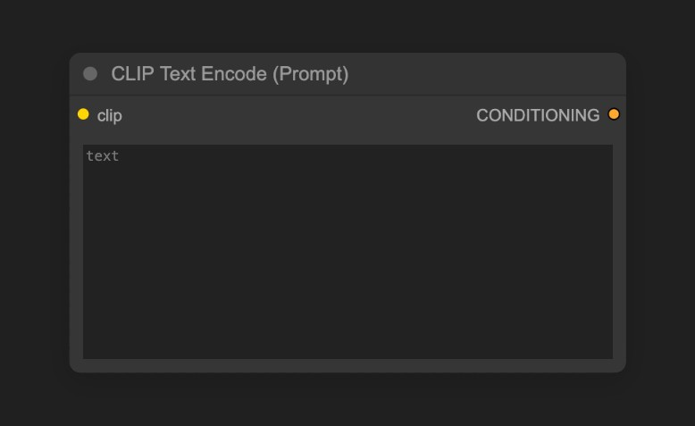
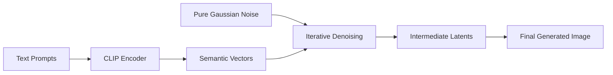
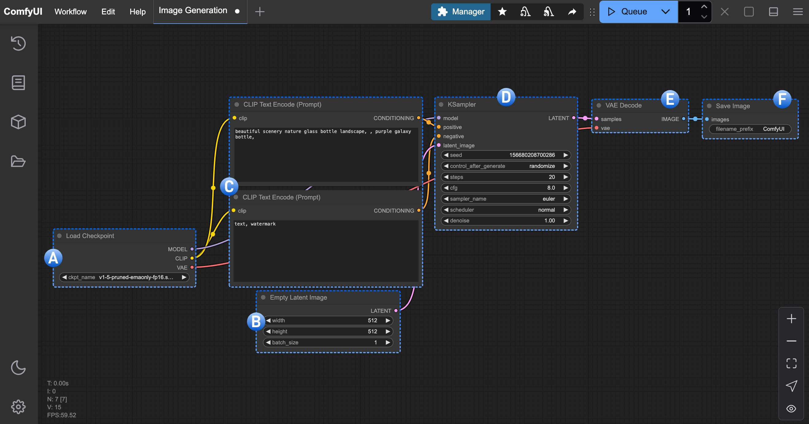
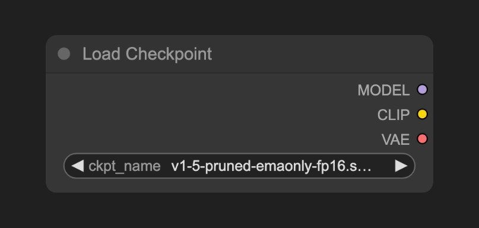
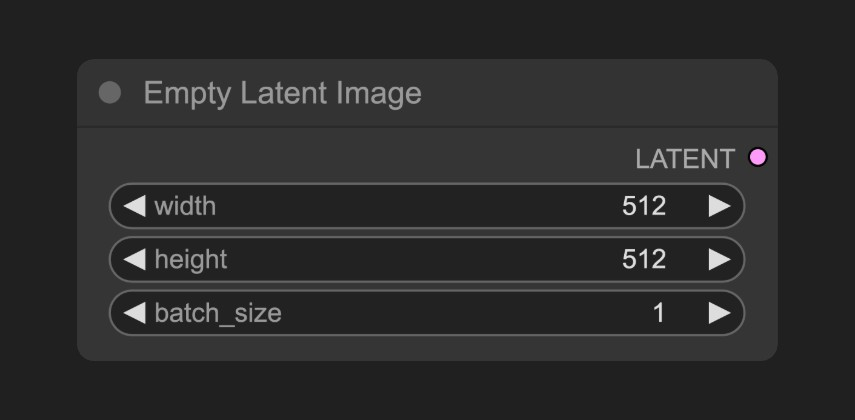
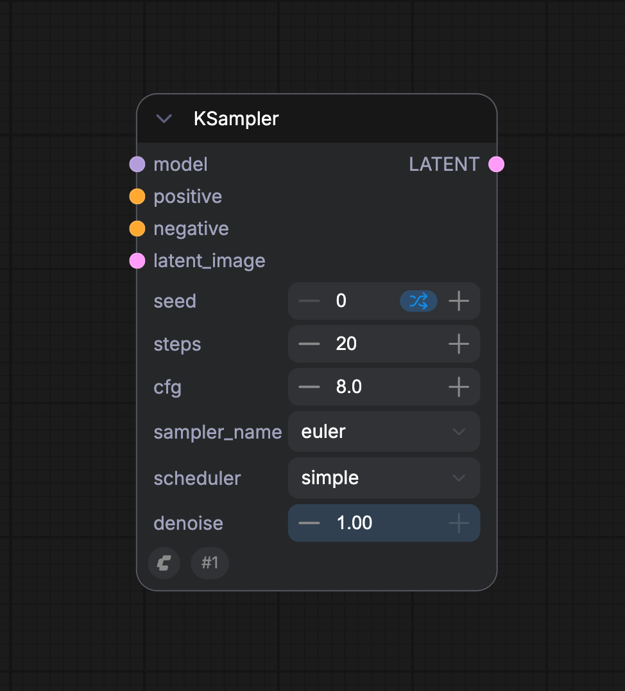
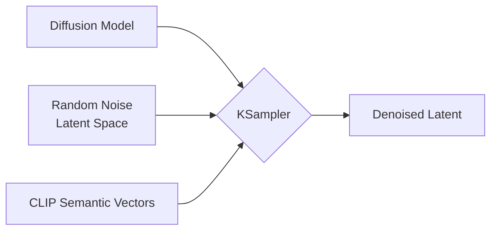
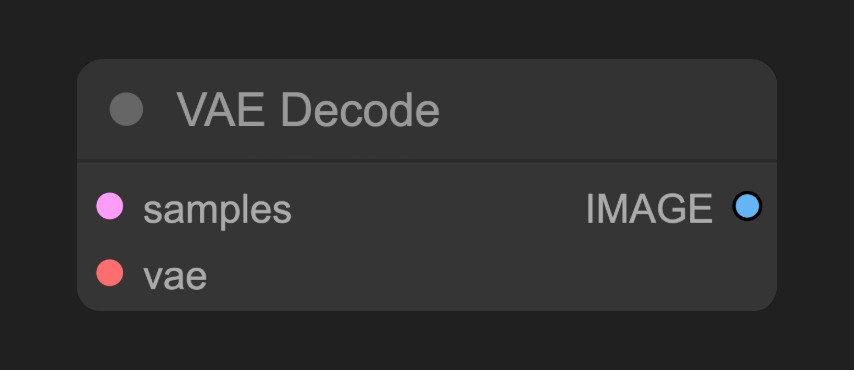
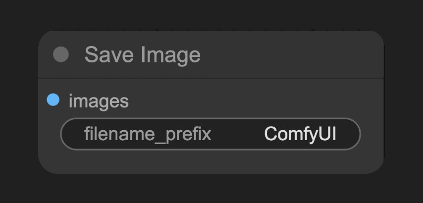

Esta guía tiene como objetivo presentarte el flujo de trabajo de texto a imagen de ComfyUI y ayudarte a comprender la funcionalidad y el uso de los distintos nodos de ComfyUI.

En este documento, vamos a:
- Completar un flujo de trabajo de texto a imagen
- Obtener una comprensión básica de los principios de los modelos de difusión
- Conocer las funciones y el papel de los nodos del flujo de trabajo
- Obtener una comprensión inicial del modelo SD1.5

Comenzaremos ejecutando un flujo de trabajo de texto a imagen y, a continuación, explicaremos los conceptos relacionados. Elige las secciones que necesites.

## ¿Qué es texto a imagen en ComfyUI? {#about-text-to-image}

**Texto a imagen** es un proceso fundamental en la generación de arte con IA que crea imágenes a partir de descripciones de texto, con los **modelos de difusión** como núcleo.

El proceso de texto a imagen requiere los siguientes elementos:
- **Artista:** el modelo de generación de imágenes
- **Lienzo:** el espacio latente
- **Requisitos de la imagen (prompts):** incluye los prompts positivos (elementos que quieres en la imagen) y los prompts negativos (elementos que no quieres)

Puedes entender este proceso de generación de texto a imagen simplemente como decirle tus requisitos (prompts positivos y negativos) a un **artista (el modelo de imagen)**, que luego crea lo que quieres a partir de esos requisitos.

## Guía de ejemplo del flujo de trabajo Texto a imagen de ComfyUI

### 1. Preparación

Asegúrate de tener al menos un archivo de modelo SD1.5 en tu carpeta `ComfyUI/models/checkpoints`, por ejemplo [v1-5-pruned-emaonly-fp16.safetensors](https://huggingface.co/Comfy-Org/stable-diffusion-v1-5-archive/blob/main/v1-5-pruned-emaonly-fp16.safetensors)

Si aún no lo has instalado, consulta la sección de instalación de modelos en [Primeros pasos con la generación de arte con IA de ComfyUI](/es/get_started/first_generation).

### 2. Cargar el flujo de trabajo Texto a imagen

Descarga la imagen que aparece a continuación y **arrástrala a ComfyUI** para cargar el flujo de trabajo:


<Tip>
Puedes arrastrar directamente a ComfyUI las imágenes que contengan el JSON del flujo de trabajo en sus metadatos, o cargarlas con el menú `Workflows` -> `Open (ctrl+o)`.
</Tip>

### 3. Cargar el modelo y generar tu primera imagen

Después de instalar el modelo de imagen, sigue los pasos de la imagen a continuación para cargar el modelo y generar tu primera imagen


Sigue estos pasos según los números de la imagen:
1. En el nodo **Load Checkpoint**, usa las flechas o haz clic en el área de texto para asegurarte de que **v1-5-pruned-emaonly-fp16.safetensors** esté seleccionado y de que las flechas izquierda/derecha no muestren el texto **null**
2. Haz clic en el botón `Queue` o usa el atajo `Ctrl + Enter` para ejecutar la generación de la imagen

Cuando el proceso termine, deberías ver la imagen resultante en la interfaz del nodo **Save Image**, y puedes hacer clic derecho sobre ella para guardarla localmente


<Tip>Si no estás satisfecho con el resultado, prueba a ejecutar la generación varias veces. Cada vez que la ejecutes, **KSampler** usará una semilla aleatoria diferente según el parámetro `seed`, así que cada generación producirá resultados distintos</Tip>

### 4. Comenzar a experimentar

Intenta modificar el texto en el **CLIP Text Encoder**



La conexión `Positive` al nodo KSampler representa los prompts positivos, mientras que la conexión `Negative` representa los prompts negativos

Estos son algunos principios básicos para escribir prompts con el modelo SD1.5:
- Usa inglés siempre que sea posible
- Separa los prompts con comas en inglés `,`
- Usa frases en lugar de oraciones largas
- Usa descripciones específicas
- Usa expresiones como `(golden hour:1.2)` para aumentar el peso de palabras clave concretas y lograr que aparezcan con más probabilidad en la imagen. `1.2` es el peso y `golden hour` es la palabra clave
- Usa palabras clave como `masterpiece, best quality, 4k` para mejorar la calidad de la generación

Aquí tienes varios ejemplos de prompts que puedes probar, o puedes usar tus propios prompts para generar:

**1. Estilo anime**

Prompts positivos:
```
anime style, 1girl with long pink hair, cherry blossom background, studio ghibli aesthetic, soft lighting, intricate details

masterpiece, best quality, 4k
```

Prompts negativos:
```
low quality, blurry, deformed hands, extra fingers
```

**2. Estilo realista**

Prompts positivos:
```
(ultra realistic portrait:1.3), (elegant woman in crimson silk dress:1.2), 
full body, soft cinematic lighting, (golden hour:1.2), 
(fujifilm XT4:1.1), shallow depth of field, 
(skin texture details:1.3), (film grain:1.1), 
gentle wind flow, warm color grading, (perfect facial symmetry:1.3)
```

Prompts negativos:
```
(deformed, cartoon, anime, doll, plastic skin, overexposed, blurry, extra fingers)
```

**3. Estilo de un artista específico**

Prompts positivos:
```
fantasy elf, detailed character, glowing magic, vibrant colors, long flowing hair, elegant armor, ethereal beauty, mystical forest, magical aura, high detail, soft lighting, fantasy portrait, Artgerm style
```

Prompts negativos:
```
blurry, low detail, cartoonish, unrealistic anatomy, out of focus, cluttered, flat lighting
```

## ¿Cómo funciona el texto a imagen? {#text-to-image-working-principles}

Todo el proceso de texto a imagen se puede entender como un **proceso de difusión inversa**. El [v1-5-pruned-emaonly-fp16.safetensors](https://huggingface.co/Comfy-Org/stable-diffusion-v1-5-archive/blob/main/v1-5-pruned-emaonly-fp16.safetensors) que descargamos es un modelo preentrenado que puede **generar imágenes objetivo a partir de ruido gaussiano puro**. Solo tenemos que introducir nuestros prompts y puede generar imágenes objetivo eliminando el ruido aleatorio.



Necesitamos entender dos conceptos:
1. **Espacio latente:** el espacio latente es un método abstracto de representación de datos en los modelos de difusión. Convertir las imágenes del espacio de píxeles al espacio latente reduce el espacio de almacenamiento y facilita el entrenamiento de los modelos de difusión, además de reducir la complejidad del denoising. Es como los arquitectos que usan planos (espacio latente) para diseñar en lugar de diseñar directamente sobre el edificio (espacio de píxeles): mantienen las características estructurales y reducen significativamente los costos de modificación.
2. **Espacio de píxeles:** el espacio de píxeles es el espacio de almacenamiento de las imágenes, es decir, la imagen final que vemos, y se usa para almacenar los valores de los píxeles.

Si quieres aprender más acerca de los modelos de difusión, puedes leer estos artículos:
- [Denoising Diffusion Probabilistic Models (DDPM)](https://arxiv.org/pdf/2006.11239)
- [Denoising Diffusion Implicit Models (DDIM)](https://arxiv.org/pdf/2010.02502)
- [High-Resolution Image Synthesis with Latent Diffusion Models](https://arxiv.org/pdf/2112.10752)

## Explicación de los nodos del flujo de trabajo Texto a imagen de ComfyUI



### A. Nodo Load Checkpoint



Este nodo se usa normalmente para cargar el modelo de generación de imágenes. Un `checkpoint` suele contener tres componentes: `MODEL (UNet)`, `CLIP` y `VAE`

- `MODEL (UNet)`: el modelo UNet responsable de la predicción del ruido y de la generación de la imagen durante el proceso de difusión
- `CLIP`: el codificador de texto que convierte nuestros prompts en vectores que el modelo puede entender, ya que el modelo no puede comprender directamente los prompts de texto
- `VAE`: el Variational AutoEncoder que convierte las imágenes entre el espacio de píxeles y el espacio latente, ya que los modelos de difusión trabajan en el espacio latente mientras que nuestras imágenes están en el espacio de píxeles

### B. Nodo Empty Latent Image



Define un espacio latente que se envía al nodo KSampler. El nodo Empty Latent Image construye un **espacio latente de ruido puro**

Puedes pensar en su función como la de definir el tamaño del lienzo, que determina las dimensiones de la imagen final generada

### C. Nodo CLIP Text Encoder


Se usa para codificar los prompts, que son tus requisitos para la imagen
- La entrada de condición `Positive` conectada al nodo KSampler representa los prompts positivos (los elementos que quieres en la imagen)
- La entrada de condición `Negative` conectada al nodo KSampler representa los prompts negativos (los elementos que no quieres en la imagen)

El componente `CLIP` del nodo `Load Checkpoint` codifica los prompts en vectores semánticos y los envía como condiciones al nodo KSampler

### D. Nodo KSampler



El **KSampler** es el núcleo de todo el flujo de trabajo: en él ocurre todo el proceso de eliminación de ruido y al final genera una imagen en el espacio latente



A continuación, se explican los parámetros del nodo KSampler:

| Nombre del parámetro        | Descripción                                        | Función                                                                                                                        |
|-----------------------------|----------------------------------------------------|--------------------------------------------------------------------------------------------------------------------------------|
| **model**                   | Modelo de difusión usado para eliminar el ruido    | Determina el estilo y la calidad de las imágenes generadas                                                                     |
| **positive**                | Codificación de la condición del prompt positivo   | Guía la generación para incluir los elementos especificados                                                                    |
| **negative**                | Codificación de la condición del prompt negativo   | Suprime el contenido no deseado                                                                                                |
| **latent_image**            | Imagen del espacio latente a la que se quitará el ruido | Sirve como soporte de entrada para la inicialización del ruido                                                            |
| **seed**                    | Semilla aleatoria para generar el ruido            | Controla la aleatoriedad de la generación                                                                                      |
| **control_after_generate**  | Modo de control de la semilla después de generar   | Determina el patrón de variación de la semilla en la generación por lotes                                                       |
| **steps**                   | Número de iteraciones de eliminación de ruido      | Más pasos implican detalles más finos, pero mayor tiempo de procesamiento                                                      |
| **cfg**                     | Escala de orientación sin clasificador             | Controla la fuerza de la restricción del prompt (un valor demasiado alto provoca sobreajuste)                                  |
| **sampler_name**            | Nombre del algoritmo de muestreo                   | Determina el método matemático de la trayectoria de eliminación de ruido                                                       |
| **scheduler**               | Tipo de planificador                               | Controla la tasa de decaimiento del ruido y la asignación del tamaño de paso                                                    |
| **denoise**                 | Coeficiente de fuerza de la eliminación de ruido   | Controla la fuerza del ruido que se añade al espacio latente: 0.0 conserva las características de la entrada original y 1.0 es ruido completo |

En el nodo KSampler, el espacio latente usa `seed` como parámetro de inicialización para construir ruido aleatorio, y los vectores semánticos `Positive` y `Negative` entran como condiciones al modelo de difusión

Después, el nodo elimina ruido durante el número de pasos que indica el parámetro `steps`. Cada paso de eliminación de ruido usa el coeficiente de fuerza que especifica el parámetro `denoise` para eliminar el ruido del espacio latente y generar una nueva imagen en el espacio latente

### E. Nodo VAE Decode



Convierte la imagen del espacio latente que genera el **KSampler** en una imagen del espacio de píxeles

### F. Nodo Save Image



Previsualiza y guarda en la carpeta local `ComfyUI/output` la imagen decodificada desde el espacio latente

## Introducción al modelo SD1.5

**SD1.5 (Stable Diffusion 1.5)** es un modelo de generación de imágenes con IA desarrollado por [Stability AI](https://stability.ai/). Es la versión fundacional de la serie Stable Diffusion, entrenada con imágenes de **512×512** de resolución, lo que la hace especialmente buena para generar imágenes a esa resolución. Con un tamaño de unos 4GB, funciona sin problemas en **GPUs de consumo (por ejemplo, 6GB de VRAM)**. Actualmente, SD1.5 cuenta con un ecosistema rico que admite varios plugins (como ControlNet, LoRA) y herramientas de optimización.

Como modelo hito en la generación de arte con IA, SD1.5 sigue siendo la mejor opción de entrada gracias a su naturaleza de código abierto, su arquitectura ligera y su rico ecosistema. Aunque se han lanzado versiones más recientes como SDXL/SD3, su valor para el hardware de consumo sigue siendo inigualable.

### Información básica
- **Fecha de lanzamiento**: octubre de 2022
- **Arquitectura principal**: basada en el modelo de difusión latente (LDM)
- **Datos de entrenamiento**: conjunto de datos LAION-Aesthetics v2.5 (aproximadamente 590M pasos de entrenamiento)
- **Características de código abierto**: modelo, código y datos de entrenamiento totalmente abiertos

### Ventajas y limitaciones
Ventajas del modelo:
- Ligero: tamaño pequeño, solo unos 4GB, funciona sin problemas en GPUs de consumo
- Barrera de entrada baja: admite una amplia gama de plugins y herramientas de optimización
- Ecosistema maduro: amplio soporte de plugins y herramientas
- Generación rápida: funcionamiento fluido en GPUs de consumo

Limitaciones del modelo:
- Manejo de detalles: las manos y la iluminación compleja tienden a distorsionarse
- Límites de resolución: la calidad se degrada al generar directamente a 1024x1024
- Dependencia del prompt: requiere descripciones precisas en inglés para mantener el control
