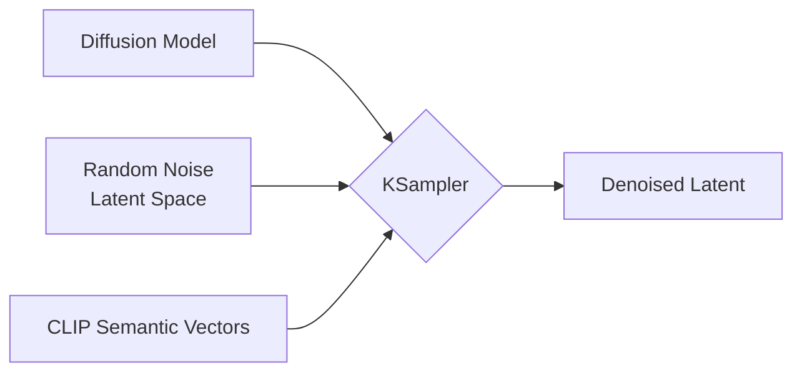

Esta guía tiene como objetivo presentarte el flujo de trabajo de texto a imagen de ComfyUI y ayudarte a comprender la funcionalidad y el uso de los distintos nodos de ComfyUI.

En este documento, vamos a:
- Completar un flujo de trabajo de texto a imagen
- Obtener una comprensión básica de los principios de los modelos de difusión
- Conocer las funciones y los roles de los nodos del flujo de trabajo
- Obtener una comprensión inicial del modelo SD1.5

Comenzaremos ejecutando un flujo de trabajo de texto a imagen y, a continuación, explicaremos los conceptos relacionados. Elige las secciones relevantes según tus necesidades.

## ¿Qué es texto a imagen en ComfyUI? {#about-text-to-image}

**Texto a imagen** es un proceso fundamental en la generación de arte con IA que crea imágenes a partir de descripciones de texto, con los **modelos de difusión** como núcleo.

El proceso de texto a imagen requiere los siguientes elementos:
- **Artista:** el modelo de generación de imágenes
- **Lienzo:** el espacio latente
- **Requisitos de la imagen (prompts):** incluye los prompts positivos (elementos que quieres en la imagen) y los prompts negativos (elementos que no quieres)

Puedes entender este proceso de generación de texto a imagen simplemente como decirle tus requisitos (prompts positivos y negativos) a un **artista (el modelo de imagen)**, que luego crea lo que quieres a partir de esos requisitos.

## ComfyUI Text to Image Workflow Example Guide

### 1. Preparation

Ensure you have at least one SD1.5 model file in your `ComfyUI/models/checkpoints` folder, such as [v1-5-pruned-emaonly-fp16.safetensors](https://huggingface.co/Comfy-Org/stable-diffusion-v1-5-archive/blob/main/v1-5-pruned-emaonly-fp16.safetensors)

If you haven't installed it yet, please refer to the model installation section in [Getting Started with ComfyUI AI Art Generation](/get_started/first_generation).

### 2. Loading the Text to Image Workflow

Download the image below and **drag it into ComfyUI** to load the workflow:


<Tip>
Images containing workflow JSON in their metadata can be directly dragged into ComfyUI or loaded using the menu `Workflows` -> `Open (ctrl+o)`.
</Tip>

### 3. Loading the Model and Generating Your First Image

After installing the image model, follow the steps in the image below to load the model and generate your first image


Follow these steps according to the image numbers:
1. In the **Load Checkpoint** node, use the arrows or click the text area to ensure **v1-5-pruned-emaonly-fp16.safetensors** is selected, and the left/right arrows don't show **null** text
2. Click the `Queue` button or use the shortcut `Ctrl + Enter` to execute image generation

After the process completes, you should see the resulting image in the **Save Image** node interface, which you can right-click to save locally


<Tip>If you're not satisfied with the result, try running the generation multiple times. Each time you run it, **KSampler** will use a different random seed based on the `seed` parameter, so each generation will produce different results</Tip>

### 4. Start Experimenting

Try modifying the text in the **CLIP Text Encoder**


The `Positive` connection to the KSampler node represents positive prompts, while the `Negative` connection represents negative prompts

Here are some basic prompting principles for the SD1.5 model:
- Use English whenever possible
- Separate prompts with English commas `,`
- Use phrases rather than long sentences
- Use specific descriptions
- Use expressions like `(golden hour:1.2)` to increase the weight of specific keywords, making them more likely to appear in the image. `1.2` is the weight, `golden hour` is the keyword
- Use keywords like `masterpiece, best quality, 4k` to improve generation quality

Here are several prompt examples you can try, or use your own prompts for generation:

**1. Anime Style**

Positive prompts:
```
anime style, 1girl with long pink hair, cherry blossom background, studio ghibli aesthetic, soft lighting, intricate details

masterpiece, best quality, 4k
```

Negative prompts:
```
low quality, blurry, deformed hands, extra fingers
```

**2. Realistic Style**

Positive prompts:
```
(ultra realistic portrait:1.3), (elegant woman in crimson silk dress:1.2), 
full body, soft cinematic lighting, (golden hour:1.2), 
(fujifilm XT4:1.1), shallow depth of field, 
(skin texture details:1.3), (film grain:1.1), 
gentle wind flow, warm color grading, (perfect facial symmetry:1.3)
```

Negative prompts:
```
(deformed, cartoon, anime, doll, plastic skin, overexposed, blurry, extra fingers)
```

**3. Specific Artist Style**

Positive prompts:
```
fantasy elf, detailed character, glowing magic, vibrant colors, long flowing hair, elegant armor, ethereal beauty, mystical forest, magical aura, high detail, soft lighting, fantasy portrait, Artgerm style
```

Negative prompts:
```
blurry, low detail, cartoonish, unrealistic anatomy, out of focus, cluttered, flat lighting
```

## Guía de ejemplo del flujo de trabajo Texto a imagen de ComfyUI

### 1. Preparación

Asegúrate de tener al menos un archivo de modelo SD1.5 en tu carpeta `ComfyUI/models/checkpoints`, como [v1-5-pruned-emaonly-fp16.safetensors](https://huggingface.co/Comfy-Org/stable-diffusion-v1-5-archive/blob/main/v1-5-pruned-emaonly-fp16.safetensors)

Si todavía no lo has instalado, consulta la sección de instalación de modelos en [Primeros pasos con la generación de arte con IA de ComfyUI](/es/get_started/first_generation).

### 2. Cargar el flujo de trabajo de texto a imagen

Descarga la imagen de abajo y **arrástrala a ComfyUI** para cargar el flujo de trabajo:


<Tip>
Las imágenes que llevan el JSON del flujo de trabajo en sus metadatos se pueden arrastrar directamente a ComfyUI o cargar con el menú `Workflows` -> `Open (ctrl+o)`.
</Tip>

### 3. Cargar el modelo y generar tu primera imagen

Después de instalar el modelo de imagen, sigue los pasos de la imagen de abajo para cargar el modelo y generar tu primera imagen


Sigue estos pasos según los números de la imagen:
1. En el nodo **Load Checkpoint**, usa las flechas o haz clic en el área de texto para asegurarte de que **v1-5-pruned-emaonly-fp16.safetensors** está seleccionado y de que las flechas izquierda/derecha no muestran el texto **null**
2. Haz clic en el botón `Queue` o usa el atajo `Ctrl + Enter` para ejecutar la generación de imágenes

Cuando termine el proceso, deberías ver la imagen resultante en la interfaz del nodo **Save Image**, donde puedes hacer clic derecho para guardarla localmente


<Tip>Si no estás satisfecho con el resultado, prueba a ejecutar la generación varias veces. Cada vez que la ejecutes, **KSampler** usará una semilla aleatoria distinta según el parámetro `seed`, así que cada generación producirá resultados diferentes</Tip>

### 4. Empieza a experimentar

Prueba a modificar el texto del **CLIP Text Encoder**


La conexión `Positive` con el nodo KSampler representa los prompts positivos, mientras que la conexión `Negative` representa los prompts negativos

Estos son algunos principios básicos para escribir prompts con el modelo SD1.5:
- Usa inglés siempre que sea posible
- Separa los prompts con comas en inglés `,`
- Usa frases en lugar de oraciones largas
- Usa descripciones específicas
- Usa expresiones como `(golden hour:1.2)` para aumentar el peso de una palabra clave concreta y hacer que aparezca más fácilmente en la imagen. `1.2` es el peso y `golden hour` es la palabra clave
- Usa palabras clave como `masterpiece, best quality, 4k` para mejorar la calidad de la generación

Aquí tienes varios ejemplos de prompts que puedes probar, o usa tus propios prompts para generar:

**1. Estilo anime**

Prompts positivos:
```
anime style, 1girl with long pink hair, cherry blossom background, studio ghibli aesthetic, soft lighting, intricate details

masterpiece, best quality, 4k
```

Prompts negativos:
```
low quality, blurry, deformed hands, extra fingers
```

**2. Estilo realista**

Prompts positivos:
```
(ultra realistic portrait:1.3), (elegant woman in crimson silk dress:1.2), 
full body, soft cinematic lighting, (golden hour:1.2), 
(fujifilm XT4:1.1), shallow depth of field, 
(skin texture details:1.3), (film grain:1.1), 
gentle wind flow, warm color grading, (perfect facial symmetry:1.3)
```

Prompts negativos:
```
(deformed, cartoon, anime, doll, plastic skin, overexposed, blurry, extra fingers)
```

**3. Estilo de un artista concreto**

Prompts positivos:
```
fantasy elf, detailed character, glowing magic, vibrant colors, long flowing hair, elegant armor, ethereal beauty, mystical forest, magical aura, high detail, soft lighting, fantasy portrait, Artgerm style
```

Prompts negativos:
```
blurry, low detail, cartoonish, unrealistic anatomy, out of focus, cluttered, flat lighting
```

## Explicación de los nodos del flujo de trabajo Texto a imagen de ComfyUI


### A. Nodo Load Checkpoint


Este nodo se usa normalmente para cargar el modelo de generación de imágenes. Un `checkpoint` suele contener tres componentes: `MODEL (UNet)`, `CLIP` y `VAE`

- `MODEL (UNet)`: El modelo UNet responsable de la predicción de ruido y la generación de imágenes durante el proceso de difusión
- `CLIP`: El codificador de texto que convierte nuestros prompts de texto en vectores que el modelo puede entender, ya que el modelo no puede entender directamente los prompts de texto
- `VAE`: El AutoEncoder Variacional que convierte imágenes entre el espacio de píxeles y el espacio latente, ya que los modelos de difusión trabajan en el espacio latente mientras que nuestras imágenes están en el espacio de píxeles

### B. Nodo Empty Latent Image


Define un espacio latente que se envía al nodo KSampler. El nodo Empty Latent Image construye un **espacio latente de ruido puro**

Puedes pensar en su función como definir el tamaño del lienzo, que determina las dimensiones de nuestra imagen final generada

### C. Nodo CLIP Text Encoder


Se usa para codificar los prompts, que son tus requisitos para la imagen
- La entrada de condición `Positive` conectada al nodo KSampler representa los prompts positivos (elementos que quieres en la imagen)
- La entrada de condición `Negative` conectada al nodo KSampler representa los prompts negativos (elementos que no quieres en la imagen)

Los prompts se codifican en vectores semánticos mediante el componente `CLIP` del nodo `Load Checkpoint` y se envían como condiciones al nodo KSampler

### D. Nodo KSampler


El **KSampler** es el núcleo de todo el flujo de trabajo, donde ocurre todo el proceso de eliminación de ruido, y finalmente produce una imagen en el espacio latente



A continuación se explican los parámetros del nodo KSampler:

| Nombre del parámetro      | Descripción                        | Función                                                                                                     |
|---------------------------|------------------------------------|-------------------------------------------------------------------------------------------------------------|
| **model**                 | Modelo de difusión usado para la eliminación de ruido | Determina el estilo y la calidad de las imágenes generadas                                                  |
| **positive**              | Codificación de la condición del prompt positivo | Guía la generación para incluir los elementos especificados                                                 |
| **negative**              | Codificación de la condición del prompt negativo | Suprime el contenido no deseado                                                                             |
| **latent_image**          | Imagen del espacio latente a la que se eliminará el ruido | Sirve como portador de entrada para la inicialización del ruido                                             |
| **seed**                  | Semilla aleatoria para la generación de ruido | Controla la aleatoriedad de la generación                                                                   |
| **control_after_generate**| Modo de control de la semilla después de la generación | Determina el patrón de variación de la semilla en la generación por lotes                                   |
| **steps**                 | Número de iteraciones de eliminación de ruido | Más pasos significan detalles más finos pero mayor tiempo de procesamiento                                  |
| **cfg**                   | Escala de orientación libre de clasificador | Controla la fuerza de restricción del prompt (demasiado alta conduce a sobreajuste)                         |
| **sampler_name**          | Nombre del algoritmo de muestreo   | Determina el método matemático para la trayectoria de eliminación de ruido                                  |
| **scheduler**             | Tipo de planificador               | Controla la tasa de decaimiento del ruido y la asignación del tamaño de paso                                |
| **denoise**               | Coeficiente de fuerza de eliminación de ruido | Controla la fuerza del ruido añadido al espacio latente, 0.0 conserva las características de la entrada original, 1.0 es ruido completo |

En el nodo KSampler, el espacio latente usa `seed` como parámetro de inicialización para construir ruido aleatorio, y los vectores semánticos `Positive` y `Negative` se introducen como condiciones en el modelo de difusión

Luego, según el número de pasos de eliminación de ruido especificado por el parámetro `steps`, se realiza la eliminación de ruido. Cada paso de eliminación de ruido usa el coeficiente de fuerza de eliminación de ruido especificado por el parámetro `denoise` para eliminar el ruido del espacio latente y generar una nueva imagen del espacio latente

### E. Nodo VAE Decode


Convierte la imagen del espacio latente que produce el **KSampler** en una imagen del espacio de píxeles

### F. Nodo Save Image


Previsualiza y guarda la imagen decodificada del espacio latente en la carpeta local `ComfyUI/output`

## Introducción al modelo SD1.5

**SD1.5 (Stable Diffusion 1.5)** es un modelo de generación de imágenes con IA desarrollado por [Stability AI](https://stability.ai/). Es la versión fundacional de la serie Stable Diffusion, entrenada con imágenes de resolución **512×512**, lo que la hace especialmente buena para generar imágenes a esta resolución. Con un tamaño de aproximadamente 4 GB, funciona con fluidez en **GPU de consumo (por ejemplo, 6 GB de VRAM)**. Actualmente, SD1.5 cuenta con un ecosistema rico que admite varios plugins (como ControlNet, LoRA) y herramientas de optimización.
Como modelo emblemático en la generación de arte con IA, SD1.5 sigue siendo la mejor opción de entrada gracias a su naturaleza de código abierto, su arquitectura ligera y su rico ecosistema. Aunque ya existen versiones más recientes como SDXL/SD3, su valor para el hardware de consumo sigue siendo inigualable.

### Información básica
- **Fecha de lanzamiento**: octubre de 2022
- **Arquitectura principal**: basada en el modelo de difusión latente (LDM)
- **Datos de entrenamiento**: conjunto de datos LAION-Aesthetics v2.5 (aproximadamente 590M pasos de entrenamiento)
- **Características de código abierto**: modelo, código y datos de entrenamiento totalmente de código abierto

### Ventajas y limitaciones
Ventajas del modelo:
- Ligero: tamaño pequeño, solo unos 4 GB, funciona con fluidez en GPU de consumo
- Baja barrera de entrada: admite una amplia variedad de plugins y herramientas de optimización
- Ecosistema maduro: amplio soporte de plugins y herramientas
- Generación rápida: funcionamiento fluido en GPU de consumo

Limitaciones del modelo:
- Manejo de detalles: las manos y la iluminación compleja tienden a distorsionarse
- Límites de resolución: la calidad se degrada al generar directamente a 1024x1024
- Dependencia del prompt: requiere descripciones precisas en inglés para controlarlo
