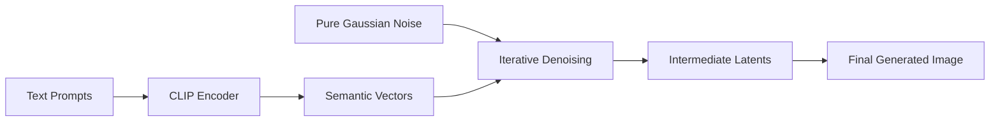
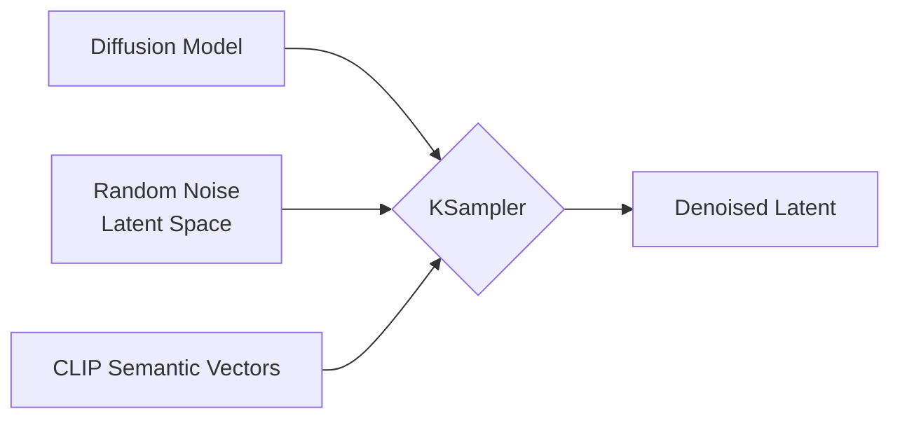

Esta guía tiene como objetivo presentarte el flujo de trabajo de texto a imagen de ComfyUI y ayudarte a comprender la funcionalidad y el uso de los distintos nodos de ComfyUI.

En este documento, vamos a:
- Completar un flujo de trabajo de texto a imagen
- Obtener una comprensión básica de los principios de los modelos de diffusion
- Conocer las funciones y los roles de los nodos del flujo de trabajo
- Obtener una comprensión inicial del modelo SD1.5

Comenzaremos ejecutando un flujo de trabajo de texto a imagen y, a continuación, explicaremos los conceptos relacionados. Elige las secciones relevantes según tus necesidades.

## ¿Qué es texto a imagen en ComfyUI? {#about-text-to-image}

**Texto a imagen** es un proceso fundamental en la generación de arte con IA que crea imágenes a partir de descripciones de texto, con los **modelos de difusión** como núcleo.

El proceso de texto a imagen requiere los siguientes elementos:
- **Artista:** el modelo de generación de imágenes
- **Lienzo:** el espacio latente
- **Requisitos de la imagen (prompts):** incluye los prompts positivos (elementos que quieres en la imagen) y los prompts negativos (elementos que no quieres)

Puedes entender este proceso de generación de texto a imagen simplemente como decirle tus requisitos (prompts positivos y negativos) a un **artista (el modelo de imagen)**, que luego crea lo que quieres a partir de esos requisitos.

## ComfyUI Text to Image Workflow Example Guide

### 1. Preparation

Ensure you have at least one SD1.5 model file in your `ComfyUI/models/checkpoints` folder, such as [v1-5-pruned-emaonly-fp16.safetensors](https://huggingface.co/Comfy-Org/stable-diffusion-v1-5-archive/blob/main/v1-5-pruned-emaonly-fp16.safetensors)

If you haven't installed it yet, please refer to the model installation section in [Getting Started with ComfyUI AI Art Generation](/es/get_started/first_generation).

### 2. Loading the Text to Image Workflow

Download the image below and **drag it into ComfyUI** to load the workflow:


<Tip>
Images containing workflow JSON in their metadata can be directly dragged into ComfyUI or loaded using the menu `Workflows` -> `Open (ctrl+o)`.
</Tip>

### 3. Loading the Model and Generating Your First Image

After installing the image model, follow the steps in the image below to load the model and generate your first image


Follow these steps according to the image numbers:
1. In the **Load Checkpoint** node, use the arrows or click the text area to ensure **v1-5-pruned-emaonly-fp16.safetensors** is selected, and the left/right arrows don't show **null** text
2. Click the `Queue` button or use the shortcut `Ctrl + Enter` to execute image generation

After the process completes, you should see the resulting image in the **Save Image** node interface, which you can right-click to save locally


<Tip>If you're not satisfied with the result, try running the generation multiple times. Each time you run it, **KSampler** will use a different random seed based on the `seed` parameter, so each generation will produce different results</Tip>

### 4. Start Experimenting

Try modifying the text in the **CLIP Text Encoder**


The `Positive` connection to the KSampler node represents positive prompts, while the `Negative` connection represents negative prompts

Here are some basic prompting principles for the SD1.5 model:
- Use English whenever possible
- Separate prompts with English commas `,`
- Use phrases rather than long sentences
- Use specific descriptions
- Use expressions like `(golden hour:1.2)` to increase the weight of specific keywords, making them more likely to appear in the image. `1.2` is the weight, `golden hour` is the keyword
- Use keywords like `masterpiece, best quality, 4k` to improve generation quality

Here are several prompt examples you can try, or use your own prompts for generation:

**1. Anime Style**

Positive prompts:
```
anime style, 1girl with long pink hair, cherry blossom background, studio ghibli aesthetic, soft lighting, intricate details

masterpiece, best quality, 4k
```

Negative prompts:
```
low quality, blurry, deformed hands, extra fingers
```

**2. Realistic Style**

Positive prompts:
```
(ultra realistic portrait:1.3), (elegant woman in crimson silk dress:1.2), 
full body, soft cinematic lighting, (golden hour:1.2), 
(fujifilm XT4:1.1), shallow depth of field, 
(skin texture details:1.3), (film grain:1.1), 
gentle wind flow, warm color grading, (perfect facial symmetry:1.3)
```

Negative prompts:
```
(deformed, cartoon, anime, doll, plastic skin, overexposed, blurry, extra fingers)
```

**3. Specific Artist Style**

Positive prompts:
```
fantasy elf, detailed character, glowing magic, vibrant colors, long flowing hair, elegant armor, ethereal beauty, mystical forest, magical aura, high detail, soft lighting, fantasy portrait, Artgerm style
```

Negative prompts:
```
blurry, low detail, cartoonish, unrealistic anatomy, out of focus, cluttered, flat lighting
```

## ¿Cómo funciona el texto a imagen? {#text-to-image-working-principles}

Todo el proceso de texto a imagen puede entenderse como un **proceso de difusión inversa**. El [v1-5-pruned-emaonly-fp16.safetensors](https://huggingface.co/Comfy-Org/stable-diffusion-v1-5-archive/blob/main/v1-5-pruned-emaonly-fp16.safetensors) que descargamos es un modelo preentrenado que puede **generar imágenes objetivo a partir de ruido gaussiano puro**. Solo hace falta introducir nuestros prompts y puede generar imágenes objetivo mediante la eliminación de ruido aleatorio.



Necesitamos entender dos conceptos:
1. **Espacio latente:** el espacio latente es un método abstracto de representación de datos en los modelos de difusión. Convertir las imágenes del espacio de píxeles al espacio latente reduce el espacio de almacenamiento, facilita el entrenamiento de los modelos de difusión y reduce la complejidad de la eliminación de ruido. Es como los arquitectos que usan planos (espacio latente) para diseñar en lugar de diseñar directamente sobre el edificio (espacio de píxeles): mantienen las características estructurales y a la vez reducen de forma significativa los costos de modificación.
2. **Espacio de píxeles:** el espacio de píxeles es el espacio de almacenamiento de las imágenes, es decir, la imagen final que vemos, y se usa para almacenar los valores de píxeles.

Si quieres aprender más sobre los modelos de difusión, puedes leer estos artículos:
- [Denoising Diffusion Probabilistic Models (DDPM)](https://arxiv.org/pdf/2006.11239)
- [Denoising Diffusion Implicit Models (DDIM)](https://arxiv.org/pdf/2010.02502)
- [High-Resolution Image Synthesis with Latent Diffusion Models](https://arxiv.org/pdf/2112.10752)

## Explicación de los nodos del flujo de trabajo Texto a imagen de ComfyUI


### A. Nodo Load Checkpoint


Este nodo se usa normalmente para cargar el modelo de generación de imágenes. Un `checkpoint` suele contener tres componentes: `MODEL (UNet)`, `CLIP` y `VAE`

- `MODEL (UNet)`: el modelo UNet encargado de predecir el ruido y generar la imagen durante el proceso de difusión
- `CLIP`: el codificador de texto que convierte tus prompts en vectores que el modelo puede entender, ya que el modelo no comprende directamente los prompts de texto
- `VAE`: el AutoEncoder Variacional que convierte las imágenes entre el espacio de píxeles y el espacio latente, ya que los modelos de difusión trabajan en el espacio latente mientras que las imágenes están en el espacio de píxeles

### B. Nodo Empty Latent Image


Define un espacio latente que se envía al nodo KSampler. El nodo Empty Latent Image construye una **imagen latente de ruido puro**

Puedes pensar en su función como la de definir el tamaño del lienzo, que determina las dimensiones de la imagen final generada

### C. Nodo CLIP Text Encoder


Sirve para codificar los prompts, es decir, tus requisitos para la imagen
- La entrada de acondicionamiento `Positive` conectada al nodo KSampler representa los prompts positivos (los elementos que quieres en la imagen)
- La entrada de acondicionamiento `Negative` conectada al nodo KSampler representa los prompts negativos (los elementos que no quieres en la imagen)

El componente `CLIP` del nodo `Load Checkpoint` codifica los prompts en vectores semánticos y los envía como acondicionamientos al nodo KSampler

### D. Nodo KSampler


El **KSampler** es el núcleo de todo el flujo de trabajo: en él ocurre todo el proceso de eliminación de ruido y, al final, entrega una imagen en el espacio latente



Aquí tienes una explicación de los parámetros del nodo KSampler:

| Nombre del parámetro       | Descripción                                  | Función                                                                                                              |
|----------------------------|----------------------------------------------|----------------------------------------------------------------------------------------------------------------------|
| **model**                  | Modelo de difusión usado para eliminar ruido | Determina el estilo y la calidad de las imágenes generadas                                                            |
| **positive**               | Codificación del acondicionamiento positivo  | Orienta la generación para incluir los elementos especificados                                                       |
| **negative**               | Codificación del acondicionamiento negativo  | Suprime el contenido no deseado                                                                                      |
| **latent_image**           | Imagen en espacio latente a la que se quita el ruido | Actúa como soporte de entrada para inicializar el ruido                                                       |
| **seed**                   | Semilla aleatoria para generar el ruido      | Controla la aleatoriedad de la generación                                                                            |
| **control_after_generate** | Modo de control de la semilla tras generar   | Determina el patrón de variación de la semilla en la generación por lotes                                            |
| **steps**                  | Número de iteraciones de eliminación de ruido| Más pasos significan más detalles, pero también más tiempo de procesamiento                                          |
| **cfg**                    | Escala de orientación sin clasificador       | Controla la fuerza de la restricción del prompt (un valor demasiado alto provoca sobreajuste)                         |
| **sampler_name**           | Nombre del algoritmo de muestreo             | Determina el método matemático de la trayectoria de eliminación de ruido                                             |
| **scheduler**              | Tipo de scheduler                            | Controla la tasa de decaimiento del ruido y la asignación del tamaño del paso                                        |
| **denoise**                | Coeficiente de fuerza de eliminación de ruido| Controla la fuerza del ruido añadido al espacio latente: 0.0 conserva las características originales de la entrada y 1.0 es ruido completo |

En el nodo KSampler, el espacio latente usa `seed` como parámetro de inicialización para construir el ruido aleatorio, y los vectores semánticos `Positive` y `Negative` se envían como acondicionamientos al modelo de difusión

Después, según el número de pasos de eliminación de ruido indicado por el parámetro `steps`, se ejecuta la eliminación de ruido. Cada paso usa el coeficiente de fuerza de eliminación de ruido indicado por el parámetro `denoise` para quitar ruido al espacio latente y generar una nueva imagen en el espacio latente

### E. Nodo VAE Decode


Convierte la imagen en espacio latente que entrega el **KSampler** en una imagen en el espacio de píxeles

### F. Nodo Save Image


Previsualiza y guarda en la carpeta local `ComfyUI/output` la imagen decodificada desde el espacio latente

## Introducción al modelo SD1.5

**SD1.5 (Stable Diffusion 1.5)** es un modelo de generación de imágenes con IA desarrollado por [Stability AI](https://stability.ai/). Es la versión fundacional de la serie Stable Diffusion, entrenada con imágenes de resolución **512×512**, lo que la hace especialmente buena generando imágenes a esa resolución. Con un tamaño de unos 4 GB, funciona sin problemas en **GPUs de consumo (por ejemplo, 6 GB de VRAM)**. Actualmente, SD1.5 cuenta con un ecosistema muy rico, con soporte para diversos plugins (como ControlNet, LoRA) y herramientas de optimización.
Como modelo emblemático en la generación de arte con IA, SD1.5 sigue siendo la mejor opción para empezar gracias a su naturaleza de código abierto, su arquitectura ligera y su rico ecosistema. Aunque se han publicado versiones más recientes como SDXL/SD3, su valor para hardware de consumo sigue siendo inigualable.

### Información básica
- **Fecha de lanzamiento**: octubre de 2022
- **Arquitectura principal**: basada en Latent Diffusion Model (LDM)
- **Datos de entrenamiento**: conjunto de datos LAION-Aesthetics v2.5 (aproximadamente 590M pasos de entrenamiento)
- **Características de código abierto**: modelo, código y datos de entrenamiento totalmente abiertos

### Ventajas y limitaciones
Ventajas del modelo:
- Ligero: tamaño pequeño, solo unos 4 GB, funciona sin problemas en GPUs de consumo
- Barrera de entrada baja: admite una amplia gama de plugins y herramientas de optimización
- Ecosistema maduro: amplio soporte de plugins y herramientas
- Generación rápida: funcionamiento fluido en GPUs de consumo

Limitaciones del modelo:
- Manejo de detalles: las manos y la iluminación compleja tienden a distorsionarse
- Límites de resolución: la calidad se degrada al generar directamente a 1024x1024
- Dependencia del prompt: requiere descripciones precisas en inglés para mantener el control
