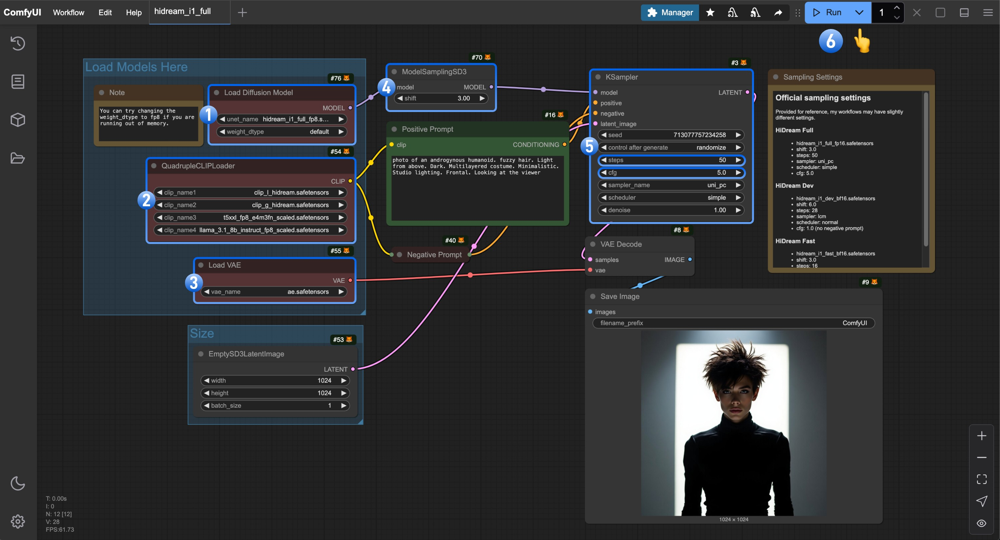
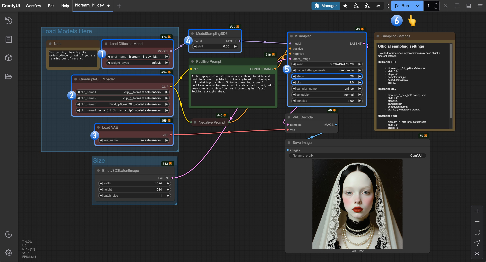
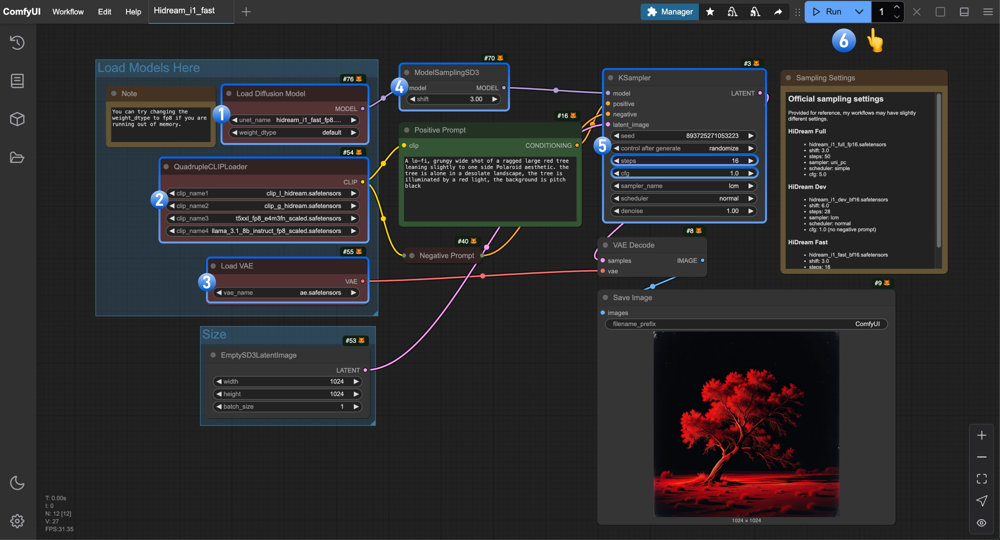

HiDream-I1 es un modelo de texto a imagen que HiDream-ai publicó oficialmente como código abierto el 7 de abril de 2025. El modelo tiene 17B parámetros y se distribuye bajo la [licencia MIT](https://github.com/HiDream-ai/HiDream-I1/blob/main/LICENSE), lo que permite su uso en proyectos personales, investigación científica y uso comercial.
Actualmente ofrece un rendimiento excelente en múltiples pruebas de referencia.

## Características del modelo

**Diseño de arquitectura híbrida**
Una combinación de la arquitectura Diffusion Transformer (DiT) y Mixture of Experts (MoE):
- Basada en Diffusion Transformer (DiT), con módulos MMDiT de doble flujo que procesan información multimodal y módulos DiT de flujo único que optimizan la consistencia global.
- El mecanismo de enrutamiento dinámico asigna recursos de cómputo de forma flexible, lo que mejora la capacidad de procesar escenas complejas y ofrece un rendimiento excelente en la restauración de color, el procesamiento de bordes y otros detalles.

**Integración de codificadores de texto multimodales**
Integra cuatro codificadores de texto:
- OpenCLIP ViT-bigG, OpenAI CLIP ViT-L (alineación semántica visual)
- T5-XXL (análisis de texto largo)
- Llama-3.1-8B-Instruct (comprensión de instrucciones)
Esta combinación alcanza un rendimiento SOTA en el análisis semántico complejo de colores, cantidades, relaciones espaciales, etc., y su soporte para prompts en chino supera de forma notable a modelos de código abierto similares.

**Versiones originales del modelo**

HiDream-ai ofrece tres versiones del modelo HiDream-I1 para cubrir distintas necesidades. A continuación se muestran los enlaces a los repositorios originales del modelo:

| Nombre del modelo | Descripción      | Pasos de inferencia | Enlace al repositorio                                                      |
|-----------------|----------------|-----------------|------------------------------------------------------------------------|
| HiDream-I1-Full | Versión completa   | 50              | [🤗 HiDream-I1-Full](https://huggingface.co/HiDream-ai/HiDream-I1-Full)|
| HiDream-I1-Dev  | Dev destilada  | 28              | [🤗 HiDream-I1-Dev](https://huggingface.co/HiDream-ai/HiDream-I1-Dev)  |
| HiDream-I1-Fast | Fast destilada | 16              | [🤗 HiDream-I1-Fast](https://huggingface.co/HiDream-ai/HiDream-I1-Fast)|

## Acerca de este ejemplo de flujo de trabajo

En este ejemplo, usaremos la versión reempaquetada de ComfyOrg. Puedes encontrar todos los archivos de modelo que usaremos en este ejemplo en el repositorio [HiDream-I1_ComfyUI](https://huggingface.co/Comfy-Org/HiDream-I1_ComfyUI/).

<Tip>
Antes de comenzar, actualiza tu versión de ComfyUI y asegúrate de que sea al menos posterior a este [commit](https://github.com/Comfy-Org/ComfyUI/commit/9ad792f92706e2179c58b2e5348164acafa69288) para que tu ComfyUI tenga soporte nativo para HiDream.
</Tip>

## HiDream-I1 Workflow

The model requirements for different ComfyUI native HiDream-I1 workflows are basically the same, with only the [diffusion models](https://huggingface.co/Comfy-Org/HiDream-I1_ComfyUI/tree/main/split_files/diffusion_models) files being different.

If you don't know which version to choose, please refer to the following suggestions:

- **HiDream-I1-Full** can generate the highest quality images
- **HiDream-I1-Dev** balances high-quality image generation with speed
- **HiDream-I1-Fast** can generate images in just 16 steps, suitable for scenarios requiring real-time iteration

For the **dev** and **fast** versions, negative prompts are not needed, so please set the `cfg` parameter to `1.0` during sampling. We have noted the corresponding parameter settings in the relevant workflows.

<Tip>
The full versions of all three versions require a lot of VRAM - you may need more than 27GB of VRAM to run them smoothly. In the corresponding workflow tutorials,
we will use the **fp8** version as a demonstration example to ensure that most users can run it smoothly.
However, we will still provide download links for different versions of the model in the corresponding examples, and you can choose the appropriate file based on your VRAM situation.
</Tip>

### Model Installation 

The following model files are common files that we will use.
Please click on the corresponding links to download and save them according to the model file save location.
We will guide you to download the corresponding **diffusion models** in the corresponding workflows.

**text_encoders**：

- [clip_l_hidream.safetensors](https://huggingface.co/Comfy-Org/HiDream-I1_ComfyUI/blob/main/split_files/text_encoders/clip_l_hidream.safetensors)
- [clip_g_hidream.safetensors](https://huggingface.co/Comfy-Org/HiDream-I1_ComfyUI/blob/main/split_files/text_encoders/clip_g_hidream.safetensors)
- [t5xxl_fp8_e4m3fn_scaled.safetensors](https://huggingface.co/Comfy-Org/HiDream-I1_ComfyUI/blob/main/split_files/text_encoders/t5xxl_fp8_e4m3fn_scaled.safetensors) This model has been used in many workflows, you may have already downloaded this file.
- [llama_3.1_8b_instruct_fp8_scaled.safetensors](https://huggingface.co/Comfy-Org/HiDream-I1_ComfyUI/blob/main/split_files/text_encoders/llama_3.1_8b_instruct_fp8_scaled.safetensors)

**VAE**
-  [ae.safetensors](https://huggingface.co/Comfy-Org/HiDream-I1_ComfyUI/blob/main/split_files/vae/ae.safetensors) This is Flux's VAE model, if you have used Flux's workflow before, you may have already downloaded this file.

**diffusion models**
We will guide you to download the corresponding model files in the corresponding workflows.

Model file save location
```
📂 ComfyUI/
├── 📂 models/
│   ├── 📂 text_encoders/
│   │   ├─── clip_l_hidream.safetensors
│   │   ├─── clip_g_hidream.safetensors
│   │   ├─── t5xxl_fp8_e4m3fn_scaled.safetensors
│   │   └─── llama_3.1_8b_instruct_fp8_scaled.safetensors
│   └── 📂 vae/
│   │   └── ae.safetensors
│   └── 📂 diffusion_models/
│       └── ...               # We will guide you to install in the corresponding version workflow       
```
### HiDream I1 Full Version Workflow

### HiDream I1 Full {#hidream_i1_full}

Generate images with HiDream I1 Full. Complete version with 50 inference steps for highest quality output.


<CardGroup cols={2}>
  <Card title="Run on Comfy Cloud" icon="cloud" href="https://cloud.comfy.org/?template=hidream_i1_full&utm_source=docs&utm_medium=referral&utm_campaign=hidream-i1">
    Run this workflow on Comfy Cloud with zero setup
  </Card>
  <Card title="Download Workflow" icon="download" href="https://github.com/Comfy-Org/workflow_templates/blob/main/templates/hidream_i1_full.json">
    Download the workflow JSON file
  </Card>
</CardGroup>

**Example output**


#### 1. Model File Download

Please select the appropriate version based on your hardware. Click the link and download the corresponding model file to save it to the `ComfyUI/models/diffusion_models/` folder.

- FP8 version: [hidream_i1_full_fp8.safetensors](https://huggingface.co/Comfy-Org/HiDream-I1_ComfyUI/blob/main/split_files/diffusion_models/hidream_i1_full_fp8.safetensors?download=true) requires more than 16GB of VRAM
- Full version: [hidream_i1_full_f16.safetensors](https://huggingface.co/Comfy-Org/HiDream-I1_ComfyUI/blob/main/split_files/diffusion_models/hidream_i1_full_fp16.safetensors?download=true) requires more than 27GB of VRAM

#### 2. Workflow File Download

Please download the image below and drag it into ComfyUI to load the corresponding workflow


#### 3. Complete the Workflow Step by Step



Complete the workflow execution step by step
1. Make sure the `Load Diffusion Model` node is using the `hidream_i1_full_fp8.safetensors` file
2. Make sure the four corresponding text encoders in `QuadrupleCLIPLoader` are loaded correctly
    - clip_l_hidream.safetensors
    - clip_g_hidream.safetensors
    - t5xxl_fp8_e4m3fn_scaled.safetensors
    - llama_3.1_8b_instruct_fp8_scaled.safetensors
3. Make sure the `Load VAE` node is using the `ae.safetensors` file
4. For the **full** version, you need to set the `shift` parameter in `ModelSamplingSD3` to `3.0`
5. For the `Ksampler` node, you need to make the following settings
    - Set `steps` to `50`
    - Set `cfg` to `5.0`
    - (Optional) Set `sampler` to `lcm`
    - (Optional) Set `scheduler` to `normal`
6. Click the `Run` button, or use the shortcut `Ctrl(cmd) + Enter` to execute the image generation

### HiDream-I1 Dev Version Workflow

### HiDream I1 Dev {#hidream_i1_dev}

Generate images with HiDream I1 Dev. Balanced version with 28 inference steps, suitable for medium-range hardware.


<CardGroup cols={2}>
  <Card title="Run on Comfy Cloud" icon="cloud" href="https://cloud.comfy.org/?template=hidream_i1_dev&utm_source=docs&utm_medium=referral&utm_campaign=hidream-i1">
    Run this workflow on Comfy Cloud with zero setup
  </Card>
  <Card title="Download Workflow" icon="download" href="https://github.com/Comfy-Org/workflow_templates/blob/main/templates/hidream_i1_dev.json">
    Download the workflow JSON file
  </Card>
</CardGroup>

**Example output**


#### 1. Model File Download
Please select the appropriate version based on your hardware, click the link and download the corresponding model file to save to the `ComfyUI/models/diffusion_models/` folder.

- FP8 version: [hidream_i1_dev_fp8.safetensors](https://huggingface.co/Comfy-Org/HiDream-I1_ComfyUI/blob/main/split_files/diffusion_models/hidream_i1_dev_fp8.safetensors?download=true) requires more than 16GB of VRAM
- Full version: [hidream_i1_dev_bf16.safetensors](https://huggingface.co/Comfy-Org/HiDream-I1_ComfyUI/blob/main/split_files/diffusion_models/hidream_i1_dev_bf16.safetensors?download=true) requires more than 27GB of VRAM

#### 2. Workflow File Download
Please download the image below and drag it into ComfyUI to load the corresponding workflow


#### 3. Complete the Workflow Step by Step


Complete the workflow execution step by step
1. Make sure the `Load Diffusion Model` node is using the `hidream_i1_dev_fp8.safetensors` file
2. Make sure the four corresponding text encoders in `QuadrupleCLIPLoader` are loaded correctly
    - clip_l_hidream.safetensors
    - clip_g_hidream.safetensors
    - t5xxl_fp8_e4m3fn_scaled.safetensors
    - llama_3.1_8b_instruct_fp8_scaled.safetensors
3. Make sure the `Load VAE` node is using the `ae.safetensors` file
4. For the **dev** version, you need to set the `shift` parameter in `ModelSamplingSD3` to `6.0`
5. For the `Ksampler` node, you need to make the following settings
    - Set `steps` to `28`
    - (Important) Set `cfg` to `1.0`
    - (Optional) Set `sampler` to `lcm`
    - (Optional) Set `scheduler` to `normal`
6. Click the `Run` button, or use the shortcut `Ctrl(cmd) + Enter` to execute the image generation

### HiDream-I1 Fast Version Workflow

### HiDream I1 Fast {#hidream_i1_fast}

Generate images quickly with HiDream I1 Fast. Lightweight version with 16 inference steps, ideal for rapid previews on lower-end hardware.


<CardGroup cols={2}>
  <Card title="Run on Comfy Cloud" icon="cloud" href="https://cloud.comfy.org/?template=hidream_i1_fast&utm_source=docs&utm_medium=referral&utm_campaign=hidream-i1">
    Run this workflow on Comfy Cloud with zero setup
  </Card>
  <Card title="Download Workflow" icon="download" href="https://github.com/Comfy-Org/workflow_templates/blob/main/templates/hidream_i1_fast.json">
    Download the workflow JSON file
  </Card>
</CardGroup>

**Example output**


#### 1. Model File Download
Please select the appropriate version based on your hardware, click the link and download the corresponding model file to save to the `ComfyUI/models/diffusion_models/` folder.

- FP8 version: [hidream_i1_fast_fp8.safetensors](https://huggingface.co/Comfy-Org/HiDream-I1_ComfyUI/blob/main/split_files/diffusion_models/hidream_i1_fast_fp8.safetensors?download=true) requires more than 16GB of VRAM
- Full version: [hidream_i1_fast_bf16.safetensors](https://huggingface.co/Comfy-Org/HiDream-I1_ComfyUI/blob/main/split_files/diffusion_models/hidream_i1_fast_bf16.safetensors?download=true) requires more than 27GB of VRAM

#### 2. Workflow File Download
Please download the image below and drag it into ComfyUI to load the corresponding workflow


#### 3. Complete the Workflow Step by Step



Complete the workflow execution step by step
1. Make sure the `Load Diffusion Model` node is using the `hidream_i1_fast_fp8.safetensors` file
2. Make sure the four corresponding text encoders in `QuadrupleCLIPLoader` are loaded correctly
    - clip_l_hidream.safetensors
    - clip_g_hidream.safetensors
    - t5xxl_fp8_e4m3fn_scaled.safetensors
    - llama_3.1_8b_instruct_fp8_scaled.safetensors
3. Make sure the `Load VAE` node is using the `ae.safetensors` file
4. For the **fast** version, you need to set the `shift` parameter in `ModelSamplingSD3` to `3.0`
5. For the `Ksampler` node, you need to make the following settings
    - Set `steps` to `16`
    - (Important) Set `cfg` to `1.0`
    - (Optional) Set `sampler` to `lcm`
    - (Optional) Set `scheduler` to `normal`
6. Click the `Run` button, or use the shortcut `Ctrl(cmd) + Enter` to execute the image generation

## Flujo de trabajo de HiDream-I1

Los requisitos de modelo de los distintos flujos de trabajo nativos de HiDream-I1 en ComfyUI son básicamente los mismos; solo cambian los archivos de [modelos de difusión](https://huggingface.co/Comfy-Org/HiDream-I1_ComfyUI/tree/main/split_files/diffusion_models).

Si no sabes qué versión elegir, consulta las siguientes recomendaciones:

- **HiDream-I1-Full** puede generar las imágenes de mayor calidad
- **HiDream-I1-Dev** equilibra la generación de imágenes de alta calidad con la velocidad
- **HiDream-I1-Fast** puede generar imágenes en solo 16 pasos, ideal para casos que requieren iteración en tiempo real

En las versiones **dev** y **fast** no hacen falta prompts negativos, así que establece el parámetro `cfg` en `1.0` durante el muestreo. Hemos anotado los ajustes de parámetros correspondientes en los flujos de trabajo relevantes.

<Tip>
Las versiones completas de las tres variantes requieren mucha VRAM: puede que necesites más de 27 GB para ejecutarlas con fluidez. En los tutoriales de los flujos de trabajo correspondientes,
usaremos la versión **fp8** como ejemplo de demostración para asegurarnos de que la mayoría de los usuarios puedan ejecutarla sin problemas.
Aun así, seguiremos incluyendo enlaces de descarga de las distintas versiones del modelo en los ejemplos correspondientes, y puedes elegir el archivo adecuado según tu VRAM.
</Tip>

### Instalación de los modelos

Los siguientes archivos de modelo son los archivos comunes que vamos a usar.
Haz clic en los enlaces correspondientes para descargarlos y guárdalos según la ubicación de guardado de los archivos de modelo.
Te guiaremos para descargar los **modelos de difusión** correspondientes en cada flujo de trabajo.

**text_encoders**：

- [clip_l_hidream.safetensors](https://huggingface.co/Comfy-Org/HiDream-I1_ComfyUI/blob/main/split_files/text_encoders/clip_l_hidream.safetensors)
- [clip_g_hidream.safetensors](https://huggingface.co/Comfy-Org/HiDream-I1_ComfyUI/blob/main/split_files/text_encoders/clip_g_hidream.safetensors)
- [t5xxl_fp8_e4m3fn_scaled.safetensors](https://huggingface.co/Comfy-Org/HiDream-I1_ComfyUI/blob/main/split_files/text_encoders/t5xxl_fp8_e4m3fn_scaled.safetensors) Este modelo se ha usado en muchos flujos de trabajo, así que es posible que ya hayas descargado este archivo.
- [llama_3.1_8b_instruct_fp8_scaled.safetensors](https://huggingface.co/Comfy-Org/HiDream-I1_ComfyUI/blob/main/split_files/text_encoders/llama_3.1_8b_instruct_fp8_scaled.safetensors)

**VAE**
-  [ae.safetensors](https://huggingface.co/Comfy-Org/HiDream-I1_ComfyUI/blob/main/split_files/vae/ae.safetensors) Este es el modelo VAE de Flux; si has usado antes un flujo de trabajo de Flux, es posible que ya hayas descargado este archivo.

**Modelos de difusión**
Te guiaremos para descargar los archivos de modelo correspondientes en cada flujo de trabajo.

Ubicación de guardado de los archivos de modelo
```
📂 ComfyUI/
├── 📂 models/
│   ├── 📂 text_encoders/
│   │   ├─── clip_l_hidream.safetensors
│   │   ├─── clip_g_hidream.safetensors
│   │   ├─── t5xxl_fp8_e4m3fn_scaled.safetensors
│   │   └─── llama_3.1_8b_instruct_fp8_scaled.safetensors
│   └── 📂 vae/
│   │   └── ae.safetensors
│   └── 📂 diffusion_models/
│       └── ...               # We will guide you to install in the corresponding version workflow       
```
### Flujo de trabajo de la versión Full de HiDream I1

### HiDream I1 Full {#hidream_i1_full}

Genera imágenes con HiDream I1 Full. Versión completa con 50 pasos de inferencia para obtener la máxima calidad.


<CardGroup cols={2}>
  <Card title="Ejecutar en Comfy Cloud" icon="cloud" href="https://cloud.comfy.org/?template=hidream_i1_full&utm_source=docs&utm_medium=referral&utm_campaign=hidream-i1">
    Ejecuta este flujo de trabajo en Comfy Cloud sin configurar nada
  </Card>
  <Card title="Descargar flujo de trabajo" icon="download" href="https://github.com/Comfy-Org/workflow_templates/blob/main/templates/hidream_i1_full.json">
    Descarga el archivo JSON del flujo de trabajo
  </Card>
</CardGroup>

**Salida de ejemplo**


#### 1. Descarga del archivo de modelo

Elige la versión adecuada según tu hardware. Haz clic en el enlace y descarga el archivo de modelo correspondiente para guardarlo en la carpeta `ComfyUI/models/diffusion_models/`.

- Versión FP8: [hidream_i1_full_fp8.safetensors](https://huggingface.co/Comfy-Org/HiDream-I1_ComfyUI/blob/main/split_files/diffusion_models/hidream_i1_full_fp8.safetensors?download=true) requiere más de 16 GB de VRAM
- Versión completa: [hidream_i1_full_f16.safetensors](https://huggingface.co/Comfy-Org/HiDream-I1_ComfyUI/blob/main/split_files/diffusion_models/hidream_i1_full_fp16.safetensors?download=true) requiere más de 27 GB de VRAM

#### 2. Descarga del archivo de flujo de trabajo

Descarga la imagen de abajo y arrástrala a ComfyUI para cargar el flujo de trabajo correspondiente


#### 3. Completa el flujo de trabajo paso a paso


Completa la ejecución del flujo de trabajo paso a paso
1. Asegúrate de que el nodo `Load Diffusion Model` esté usando el archivo `hidream_i1_full_fp8.safetensors`
2. Asegúrate de que los cuatro codificadores de texto correspondientes de `QuadrupleCLIPLoader` estén cargados correctamente
    - clip_l_hidream.safetensors
    - clip_g_hidream.safetensors
    - t5xxl_fp8_e4m3fn_scaled.safetensors
    - llama_3.1_8b_instruct_fp8_scaled.safetensors
3. Asegúrate de que el nodo `Load VAE` esté usando el archivo `ae.safetensors`
4. Para la versión **full**, debes establecer el parámetro `shift` de `ModelSamplingSD3` en `3.0`
5. Para el nodo `Ksampler`, debes hacer los siguientes ajustes
    - Establece `steps` en `50`
    - Establece `cfg` en `5.0`
    - (Opcional) Establece `sampler` en `lcm`
    - (Opcional) Establece `scheduler` en `normal`
6. Haz clic en el botón `Run` o usa el atajo `Ctrl(cmd) + Enter` para ejecutar la generación de imágenes

### Flujo de trabajo de la versión Dev de HiDream-I1

### HiDream I1 Dev {#hidream_i1_dev}

Genera imágenes con HiDream I1 Dev. Versión equilibrada con 28 pasos de inferencia, adecuada para hardware de gama media.


<CardGroup cols={2}>
  <Card title="Ejecutar en Comfy Cloud" icon="cloud" href="https://cloud.comfy.org/?template=hidream_i1_dev&utm_source=docs&utm_medium=referral&utm_campaign=hidream-i1">
    Ejecuta este flujo de trabajo en Comfy Cloud sin configurar nada
  </Card>
  <Card title="Descargar flujo de trabajo" icon="download" href="https://github.com/Comfy-Org/workflow_templates/blob/main/templates/hidream_i1_dev.json">
    Descarga el archivo JSON del flujo de trabajo
  </Card>
</CardGroup>

**Salida de ejemplo**


#### 1. Descarga del archivo de modelo
Elige la versión adecuada según tu hardware, haz clic en el enlace y descarga el archivo de modelo correspondiente para guardarlo en la carpeta `ComfyUI/models/diffusion_models/`.

- Versión FP8: [hidream_i1_dev_fp8.safetensors](https://huggingface.co/Comfy-Org/HiDream-I1_ComfyUI/blob/main/split_files/diffusion_models/hidream_i1_dev_fp8.safetensors?download=true) requiere más de 16 GB de VRAM
- Versión completa: [hidream_i1_dev_bf16.safetensors](https://huggingface.co/Comfy-Org/HiDream-I1_ComfyUI/blob/main/split_files/diffusion_models/hidream_i1_dev_bf16.safetensors?download=true) requiere más de 27 GB de VRAM

#### 2. Descarga del archivo de flujo de trabajo
Descarga la imagen de abajo y arrástrala a ComfyUI para cargar el flujo de trabajo correspondiente


#### 3. Completa el flujo de trabajo paso a paso


Completa la ejecución del flujo de trabajo paso a paso
1. Asegúrate de que el nodo `Load Diffusion Model` esté usando el archivo `hidream_i1_dev_fp8.safetensors`
2. Asegúrate de que los cuatro codificadores de texto correspondientes de `QuadrupleCLIPLoader` estén cargados correctamente
    - clip_l_hidream.safetensors
    - clip_g_hidream.safetensors
    - t5xxl_fp8_e4m3fn_scaled.safetensors
    - llama_3.1_8b_instruct_fp8_scaled.safetensors
3. Asegúrate de que el nodo `Load VAE` esté usando el archivo `ae.safetensors`
4. Para la versión **dev**, debes establecer el parámetro `shift` de `ModelSamplingSD3` en `6.0`
5. Para el nodo `Ksampler`, debes hacer los siguientes ajustes
    - Establece `steps` en `28`
    - (Importante) Establece `cfg` en `1.0`
    - (Opcional) Establece `sampler` en `lcm`
    - (Opcional) Establece `scheduler` en `normal`
6. Haz clic en el botón `Run` o usa el atajo `Ctrl(cmd) + Enter` para ejecutar la generación de imágenes

### Flujo de trabajo de la versión Fast de HiDream-I1

### HiDream I1 Fast {#hidream_i1_fast}

Genera imágenes rápidamente con HiDream I1 Fast. Versión ligera con 16 pasos de inferencia, ideal para previsualizaciones rápidas en hardware modesto.


<CardGroup cols={2}>
  <Card title="Ejecutar en Comfy Cloud" icon="cloud" href="https://cloud.comfy.org/?template=hidream_i1_fast&utm_source=docs&utm_medium=referral&utm_campaign=hidream-i1">
    Ejecuta este flujo de trabajo en Comfy Cloud sin configurar nada
  </Card>
  <Card title="Descargar flujo de trabajo" icon="download" href="https://github.com/Comfy-Org/workflow_templates/blob/main/templates/hidream_i1_fast.json">
    Descarga el archivo JSON del flujo de trabajo
  </Card>
</CardGroup>

**Salida de ejemplo**


#### 1. Descarga del archivo de modelo
Elige la versión adecuada según tu hardware, haz clic en el enlace y descarga el archivo de modelo correspondiente para guardarlo en la carpeta `ComfyUI/models/diffusion_models/`.

- Versión FP8: [hidream_i1_fast_fp8.safetensors](https://huggingface.co/Comfy-Org/HiDream-I1_ComfyUI/blob/main/split_files/diffusion_models/hidream_i1_fast_fp8.safetensors?download=true) requiere más de 16 GB de VRAM
- Versión completa: [hidream_i1_fast_bf16.safetensors](https://huggingface.co/Comfy-Org/HiDream-I1_ComfyUI/blob/main/split_files/diffusion_models/hidream_i1_fast_bf16.safetensors?download=true) requiere más de 27 GB de VRAM

#### 2. Descarga del archivo de flujo de trabajo
Descarga la imagen de abajo y arrástrala a ComfyUI para cargar el flujo de trabajo correspondiente


#### 3. Completa el flujo de trabajo paso a paso


Completa la ejecución del flujo de trabajo paso a paso
1. Asegúrate de que el nodo `Load Diffusion Model` esté usando el archivo `hidream_i1_fast_fp8.safetensors`
2. Asegúrate de que los cuatro codificadores de texto correspondientes de `QuadrupleCLIPLoader` estén cargados correctamente
    - clip_l_hidream.safetensors
    - clip_g_hidream.safetensors
    - t5xxl_fp8_e4m3fn_scaled.safetensors
    - llama_3.1_8b_instruct_fp8_scaled.safetensors
3. Asegúrate de que el nodo `Load VAE` esté usando el archivo `ae.safetensors`
4. Para la versión **fast**, debes establecer el parámetro `shift` de `ModelSamplingSD3` en `3.0`
5. Para el nodo `Ksampler`, debes hacer los siguientes ajustes
    - Establece `steps` en `16`
    - (Importante) Establece `cfg` en `1.0`
    - (Opcional) Establece `sampler` en `lcm`
    - (Opcional) Establece `scheduler` en `normal`
6. Haz clic en el botón `Run` o usa el atajo `Ctrl(cmd) + Enter` para ejecutar la generación de imágenes
