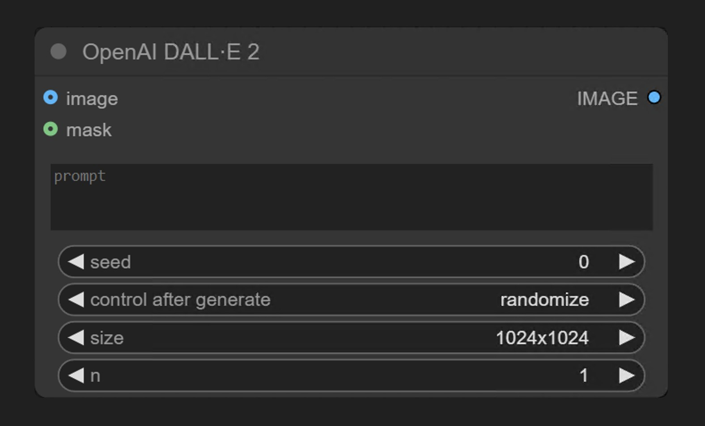
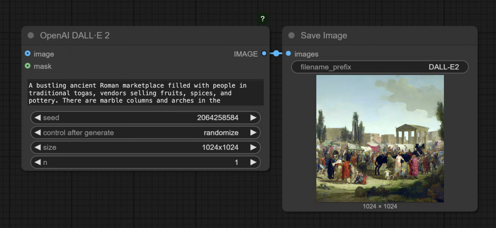
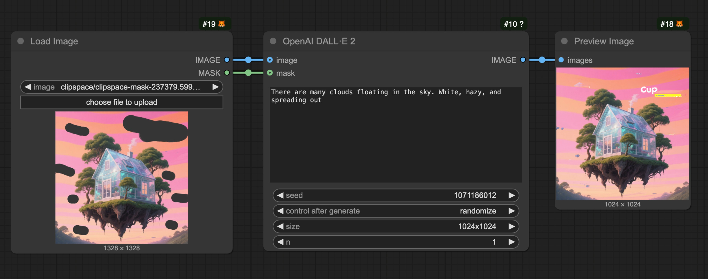

import Faq from "/snippets/es/tutorials/partner-nodes/faq.mdx";
import ReqHint from "/snippets/es/tutorials/partner-nodes/req-hint.mdx";
import UpdateReminder from "/snippets/es/tutorials/update-reminder.mdx";

<Warning>
  **Obsoleto**: OpenAI ha descontinuado el modelo DALL·E 2. El nodo **OpenAI DALL·E 2** se ha retirado y eliminado de ComfyUI. Usa el nodo **GPT Image** en su lugar. Esta página se conserva solo como referencia.
</Warning>

OpenAI DALL·E 2 forma parte de la serie de Nodos asociados de ComfyUI, que permite a los usuarios generar imágenes mediante el modelo **DALL·E 2** de OpenAI.

El nodo **OpenAI DALL·E 2** genera imágenes de forma síncrona a través de la API de generación de imágenes de OpenAI. Recibe prompts de texto y devuelve imágenes que coinciden con la descripción.

## Para qué es bueno DALL·E 2

- Generación de texto a imagen
- Funcionalidad de edición de imágenes (Relleno inteligente mediante máscaras)

## Ejemplos de salida

Generación de texto a imagen a partir de un solo prompt de texto:

Relleno inteligente: reemplaza un área enmascarada de una imagen de entrada según un prompt de texto:

<ReqHint/>
<UpdateReminder/>

## Descripción de parámetros

### Parámetros requeridos

| Parámetro | Descripción                                                   |
|-----------|---------------------------------------------------------------|
| `prompt`  | Texto de prompt que describe el contenido de la imagen que quieres generar |

### Parámetros de widget

| Parámetro | Descripción                                                                | Opciones/Rango                     | Valor predeterminado |
|-----------|----------------------------------------------------------------------------|-----------------------------------|---------------|
| `seed`    | Valor de semilla para la generación de imágenes (actualmente no implementado en el backend) | 0 a 2^31-1                       | 0             |
| `size`    | Dimensiones de la imagen de salida                                                    | "256x256", "512x512", "1024x1024" | "1024x1024"   |
| `n`       | Número de imágenes a generar                                               | 1 a 8                            | 1             |

### Parámetros opcionales

| Parámetro | Descripción                                                                | Opciones/Rango                     | Valor predeterminado |
|-----------|----------------------------------------------------------------------------|-----------------------------------|---------------|
| `image`   | Imagen de referencia opcional para la edición de imágenes                                 | Cualquier entrada de imagen                   | Ninguno          |
| `mask`    | Máscara opcional para relleno inteligente local                                         | Entrada de máscara                        | Ninguno          |

## Ejemplos de flujos de trabajo

Este nodo Socio actualmente admite dos flujos de trabajo:

- Texto a imagen
- Relleno inteligente

<Note>
El flujo de trabajo Imagen a imagen no es compatible
</Note>

### Ejemplo de texto a imagen

La imagen a continuación contiene un flujo de trabajo simple de texto a imagen. Descarga la imagen correspondiente y arrástrala a ComfyUI para cargar el flujo de trabajo.

El ejemplo correspondiente es muy simple

Solo necesitas cargar el nodo `OpenAI DALL·E 2`, ingresar en el nodo `prompt` la descripción de la imagen que quieres generar, conectar un nodo `Save Image` y luego ejecutar el flujo de trabajo.

### Flujo de trabajo de relleno inteligente

DALL·E 2 admite la funcionalidad de edición de imágenes, lo que te permite usar una máscara para especificar el área que se va a reemplazar. A continuación tienes un ejemplo simple de flujo de trabajo de relleno inteligente:

#### 1. Descargar el archivo del flujo de trabajo

Descarga la imagen a continuación y arrástrala a ComfyUI para cargar el flujo de trabajo correspondiente.

Usaremos la siguiente imagen como entrada:

#### 2. Instrucciones de uso del archivo del flujo de trabajo

Como este flujo de trabajo es relativamente simple, si quieres implementar manualmente el flujo de trabajo correspondiente, puedes seguir estos pasos:

1. Usa el nodo `Load Image` para cargar la imagen
2. Haz clic derecho en el nodo Load Image y selecciona `MaskEditor`
3. En el editor de máscara, usa el pincel para dibujar el área que quieres volver a dibujar
4. Conecta la imagen cargada a la entrada `image` del nodo **OpenAI DALL·E 2**
5. Conecta la máscara a la entrada `mask` del nodo **OpenAI DALL·E 2**
6. Edita el prompt en el nodo `prompt`
7. Ejecuta el flujo de trabajo

**Notas**

- Si quieres usar la funcionalidad de edición de imágenes, debes proporcionar tanto una imagen como una máscara (ambas son obligatorias)
- La máscara y la imagen deben ser del mismo tamaño
- Al ingresar imágenes grandes, el nodo redimensiona automáticamente la imagen a un tamaño adecuado
- Las URL que devuelve la API son válidas por un período corto, así que guarda los resultados lo antes posible
- Cada generación consume créditos, que se cobran según el tamaño y la cantidad de imágenes

## Preguntas frecuentes

<Faq/>
