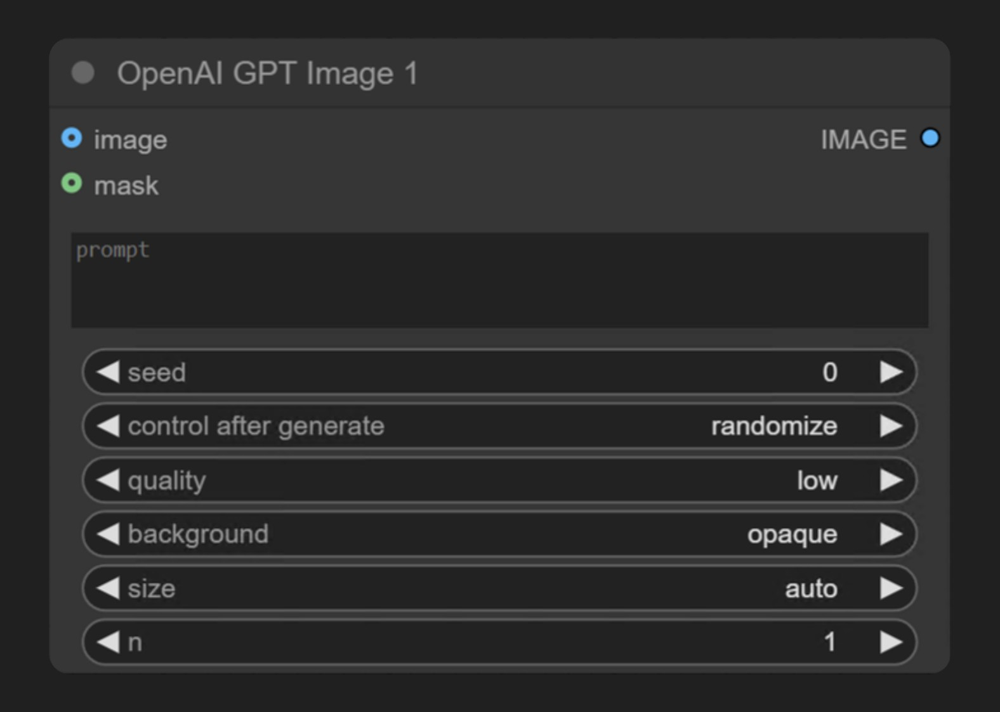
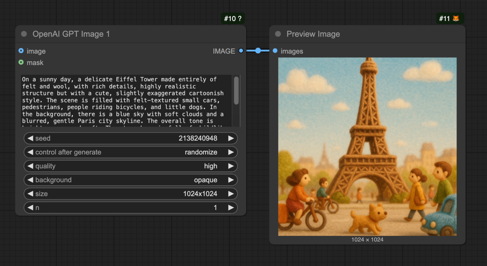
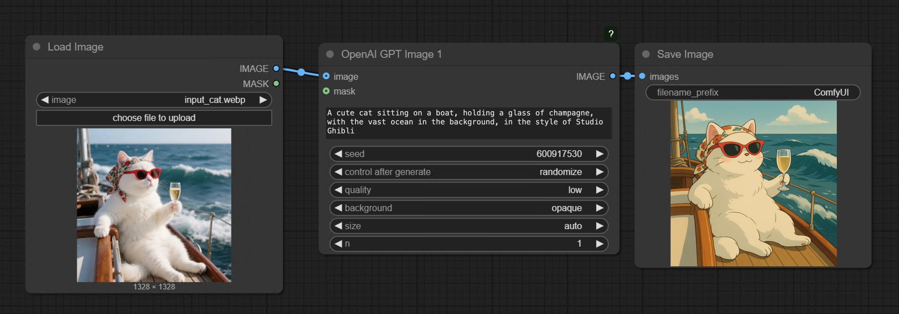
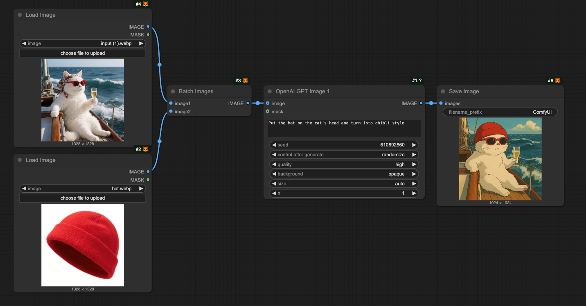
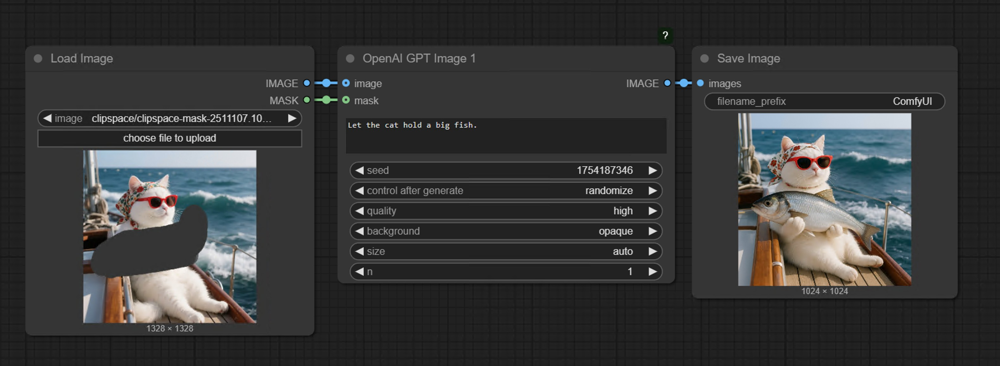

import Faq from "/snippets/es/tutorials/partner-nodes/faq.mdx";
import ReqHint from "/snippets/es/tutorials/partner-nodes/req-hint.mdx";
import UpdateReminder from "/snippets/es/tutorials/update-reminder.mdx";

<Note>
El nodo de imágenes de OpenAI ya no ofrece `gpt-image-1`. Selecciona `gpt-image-1.5` o un modelo más reciente en el campo `model` del nodo; los pasos y parámetros de esta página siguen aplicándose.
</Note>

Esta página cubre el nodo OpenAI GPT Image de ComfyUI: texto a imagen, una imagen de referencia, varias referencias y relleno con máscara, con los modelos GPT Image que ofrece el nodo.

El nodo **OpenAI GPT-Image-1** genera imágenes de forma síncrona a través de la API de generación de imágenes de OpenAI. Recibe prompts de texto y devuelve imágenes que coinciden con la descripción. El campo `model` del nodo elige el modelo GPT Image: `gpt-image-1.5` o uno más reciente.

## En qué destaca GPT-Image-1

- Generación de texto a imagen
- Funcionalidad de edición de imágenes (Relleno inteligente mediante máscaras)
- Generación de imagen a imagen a partir de una imagen de referencia
- Entrada de varias imágenes: combina varias imágenes de referencia en una sola generación

## Salidas de ejemplo

Generación de texto a imagen a partir de un solo prompt de texto:

Generación de imagen a imagen a partir de una imagen de referencia:

Entrada de varias imágenes, combinando varias imágenes de referencia en una sola generación:

Relleno inteligente, reemplazando un área enmascarada de una imagen de entrada:

<ReqHint/>
<UpdateReminder/>

## Descripción de parámetros

### Parámetros requeridos

| Parámetro | Tipo | Descripción |
|-----------|------|-------------|
| `prompt` | Texto | Prompt de texto que describe el contenido de la imagen que quieres generar |

### Parámetros de widget

| Parámetro | Tipo | Opciones | Predeterminado | Descripción |
|-----------|------|----------|----------------|-------------|
| `seed` | Entero | 0-2147483647 | 0 | Semilla aleatoria utilizada para controlar los resultados de generación |
| `quality` | Opción | low, medium, high | low | Ajuste de calidad de imagen; afecta el costo y el tiempo de generación |
| `background` | Opción | opaque, transparent | opaque | Indica si la imagen devuelta tiene fondo |
| `size` | Opción | auto, 1024x1024, 1024x1536, 1536x1024 | auto | Tamaño de la imagen generada |
| `n` | Entero | 1-8 | 1 | Número de imágenes a generar |

### Parámetros opcionales

| Parámetro | Tipo | Opciones | Predeterminado | Descripción |
|-----------|------|----------|----------------|-------------|
| `image` | Imagen | Cualquier entrada de imagen | None | Imagen de referencia opcional para la edición de imágenes |
| `mask` | Máscara | Entrada de máscara | None | Máscara opcional para relleno inteligente (las áreas blancas se reemplazarán) |

## Ejemplos de uso

### Ejemplo de texto a imagen

La imagen siguiente contiene un flujo de trabajo sencillo de texto a imagen. Descarga la imagen y arrástrala a ComfyUI para cargar el flujo de trabajo correspondiente.

El flujo de trabajo correspondiente es muy sencillo:

Solo tienes que cargar el nodo `OpenAI GPT-Image-1`, escribir en el nodo `prompt` la descripción de la imagen que quieres generar, conectar un nodo `Save Image` y luego ejecutar el flujo de trabajo.

### Ejemplo de imagen a imagen

La imagen siguiente contiene un flujo de trabajo sencillo de imagen a imagen. Descarga la imagen y arrástrala a ComfyUI para cargar el flujo de trabajo correspondiente.

Usaremos la siguiente imagen como entrada:

En este flujo de trabajo usamos el nodo `OpenAI GPT-Image-1` para generar imágenes y el nodo `Load Image` para cargar la imagen de entrada, que luego se conecta a la entrada `image` del nodo `OpenAI GPT-Image-1`.

### Ejemplo de entrada con varias imágenes
Descarga la imagen siguiente y arrástrala a ComfyUI para cargar el flujo de trabajo correspondiente.

Usa la imagen del sombrero que aparece a continuación como imagen de entrada adicional.

El flujo de trabajo correspondiente se muestra en la siguiente imagen:

El nodo `Batch Images` se usa para cargar varias imágenes en el nodo `OpenAI GPT-Image-1`.

### Flujo de trabajo de relleno inteligente

GPT-Image-1 también admite la función de edición de imágenes, que te permite especificar las zonas que quieres reemplazar mediante una máscara. A continuación se muestra un ejemplo sencillo de flujo de trabajo de relleno inteligente:

Descarga la imagen siguiente y arrástrala a ComfyUI para cargar el flujo de trabajo correspondiente. Seguiremos usando la imagen de entrada de la sección del flujo de trabajo de imagen a imagen.

El flujo de trabajo correspondiente se muestra en la imagen

En comparación con el flujo de trabajo de imagen a imagen, aquí usamos el MaskEditor del nodo `Load Image` desde el menú del clic derecho para dibujar una máscara y luego la conectamos a la entrada `mask` del nodo `OpenAI GPT-Image-1` para completar el flujo de trabajo.

**Notas**

- La máscara y la imagen deben tener el mismo tamaño
- Al introducir imágenes grandes, el nodo redimensiona automáticamente la imagen a un tamaño adecuado

## Preguntas frecuentes

<Faq/>
