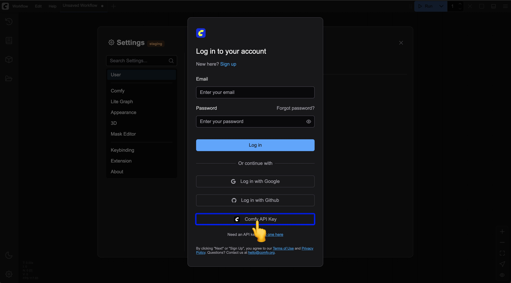

import Requirements from "/snippets/es/tutorials/partner-nodes/requirements.mdx";
import Faq from "/snippets/es/tutorials/partner-nodes/faq.mdx";

Los Nodos asociados son la nueva forma de ComfyUI de llamar a modelos de código cerrado mediante solicitudes a la API, y ofrecen a los usuarios de ComfyUI acceso a modelos de IA externos de última generación sin necesidad de una configuración compleja de claves API.

## ¿Qué son los Nodos asociados?

Los Nodos asociados son un conjunto de nodos especiales que se conectan a servicios de API externos y te permiten usar modelos de IA de código cerrado o alojados por terceros directamente en tus flujos de trabajo de ComfyUI. Estos nodos están diseñados para integrar las capacidades de los modelos externos de forma transparente y, al mismo tiempo, conservar la naturaleza de código abierto del núcleo de ComfyUI.

<Requirements/>

## Iniciar sesión con la Clave API de la cuenta de ComfyUI en sitios web que no están en la lista blanca

Actualmente, contamos con una lista blanca que restringe los sitios web donde puedes iniciar sesión en tu cuenta de ComfyUI.
Si necesitas iniciar sesión en tu cuenta de ComfyUI en sitios web que no están en la lista blanca, consulta la sección de administración de cuentas para obtener información sobre cómo iniciar sesión con una Clave API.
En este caso, el sitio web correspondiente no necesita estar en nuestra lista blanca.

<Card title="Administración de cuentas" icon="book" href="/es/interface/user#iniciar-sesión-con-una-clave-api">
Aprende a iniciar sesión con la Clave API de la cuenta de ComfyUI
</Card>



## Usar la integración de la clave API de la cuenta de ComfyUI para llamar a nodos asociados de modelos de pago

Actualmente, contamos con soporte para acceder a nuestros servicios mediante la integración de la clave API de ComfyUI y así llamar a nodos asociados de modelos de pago. Consulta la sección Integración de la clave API para aprender a usar la integración de la clave API para llamar a nodos asociados de modelos de pago.

<Note>
  **Importante:** La clave API que tratamos aquí es tu **Clave API de la cuenta de ComfyUI** (se usa para acceder a los nodos asociados de pago en los flujos de trabajo). **NO** es la misma que la **Clave API de publicación en el registro** que usan los desarrolladores para publicar nodos personalizados en el registro. Si deseas publicar nodos personalizados, consulta [Publicar nodos](/es/registry/publishing).
</Note>

<Card title="Integración de la clave API" icon="link" href="/es/development/comfyui-server/api-key-integration">
Consulta la sección Integración de la clave API para aprender a usar la integración de la clave API para llamar a nodos asociados de modelos de pago
</Card>

## Ventajas de los nodos asociados

Los Nodos asociados ofrecen varias ventajas importantes para los usuarios de ComfyUI:

- **Acceso a modelos de código cerrado**: Usa modelos de IA de última generación sin tener que desplegarlos tú mismo
- **Integración perfecta**: Los nodos asociados son totalmente compatibles con otros nodos de ComfyUI y puedes combinarlos para crear flujos de trabajo complejos
- **Experiencia simplificada**: No necesitas administrar claves de API ni gestionar solicitudes de API complejas
- **Costos controlados**: El sistema de prepago te garantiza un control total sobre tu gasto, sin cargos inesperados

## Precios

<Card title="Precios de los nodos de socios" icon="coin" href="/es/tutorials/partner-nodes/pricing">
Consulta la página de precios para ver los precios correspondientes de cada socio
</Card>

## Proveedores de modelos

<Card title="Proveedores de modelos" icon="badge-check" href="/es/tutorials/partner-nodes/model-providers">
Consulta el estado de verificación, las licencias comerciales y la residencia de datos de los proveedores de modelos que respaldan los Nodos asociados
</Card>

## Acerca del código abierto y la participación opcional

Es importante tener en cuenta que **los nodos asociados son completamente opcionales**. ComfyUI siempre seguirá siendo totalmente de código abierto y gratis para los usuarios locales. Los nodos asociados están pensados como una función opcional que ofrece comodidad a quienes quieren acceder a modelos externos SOTA (de última generación).

## How to disable partner nodes completely

You can add the `--disable-partner-nodes` launch argument to disable all Partner Nodes in ComfyUI. Use `--offline` instead if you also want to prevent the frontend from communicating with the internet.

**For manual install:**

```bash
python main.py --disable-partner-nodes
```

**For portable users (Windows):**

Update your `run_xxx.bat` file:

```batch
.\python_embeded\python.exe -s ComfyUI\main.py --listen --windows-standalone-build --disable-partner-nodes
pause
```

## Casos de uso

Una aplicación muy potente de los Nodos asociados es combinar la salida de modelos externos con nodos locales. Por ejemplo:

- Usar GPT-Image-1 para generar una imagen base y luego convertirla en video con un nodo `wan` local
- Combinar imágenes generadas externamente con nodos locales de ampliación o transferencia de estilo
- Crear flujos de trabajo híbridos que aprovechan las ventajas de los modelos de código cerrado y de código abierto

Esta flexibilidad convierte a ComfyUI en una interfaz verdaderamente universal de IA generativa, que integra diversas capacidades de IA en un flujo de trabajo unificado y abre aún más posibilidades.

## Preguntas frecuentes

<Faq/>
