In this tutorial, you build a text-to-image Workflow on an empty **Canvas** and run it. You type a description of a picture, and ComfyUI generates a 512 × 512 image from it with the Stable Diffusion 1.5 model. You add and connect every Node yourself. Each step says what the Node does and how to tell the step worked.

This tutorial uses ComfyUI on your own computer: Comfy Desktop, ComfyUI Portable, or a manual install. Install ComfyUI and open it before you start.

<Tip>
  To use ComfyUI in your browser with nothing to install, [open the Z-Image-Turbo text-to-image template in Comfy Cloud](https://cloud.comfy.org/?template=image_z_image_turbo&utm_source=docs&utm_medium=referral&utm_campaign=first_generation).
</Tip>

## Learn the parts of a Workflow

A Workflow is a set of Nodes joined by links. Each Node does one job:

- **Inputs** are the dots on the left side of a Node. They receive data from other Nodes.
- **Outputs** are the dots on the right side of a Node. They send data to other Nodes.
- **Widgets** are the settings inside a Node, such as a text box, a number, or a list.
- **Links** are the lines that carry data from an output to an input of the same type, such as from the `CLIP` output to a `clip` input.

The Workflow in this tutorial has seven Nodes of six types. The last column is where each Node sits in the **Add Node** menu, which [Add a Node](#add-a-node) explains.

| Node | What it does | **Add Node** path |
| --- | --- | --- |
| `Load Checkpoint` | Loads the model file. Its outputs are the model (`MODEL`), the text encoder (`CLIP`), and the image decoder (`VAE`). | **model** > **loaders** |
| `CLIP Text Encode (Prompt)` | Turns your text prompt into data that guides the model. You add two: one for what you want, one for what you don't want. | **model** > **conditioning** |
| `Empty Latent Image` | Creates the blank starting image and sets its width and height. | **model** > **latent** |
| `KSampler` | Uses the model and both prompts to turn the blank starting image into your picture, one step at a time. | **model** > **sampling** |
| `VAE Decode` | Converts the result from `KSampler` into a regular image. | **model** > **latent** |
| `Save Image` | Shows the image and saves it to the output folder. | **image** |

## Download the model

The `Load Checkpoint` Node needs a model file. This tutorial uses `v1-5-pruned-emaonly-fp16.safetensors`.

- Download [`v1-5-pruned-emaonly-fp16.safetensors`](https://huggingface.co/Comfy-Org/stable-diffusion-v1-5-archive/blob/main/v1-5-pruned-emaonly-fp16.safetensors) from Hugging Face.

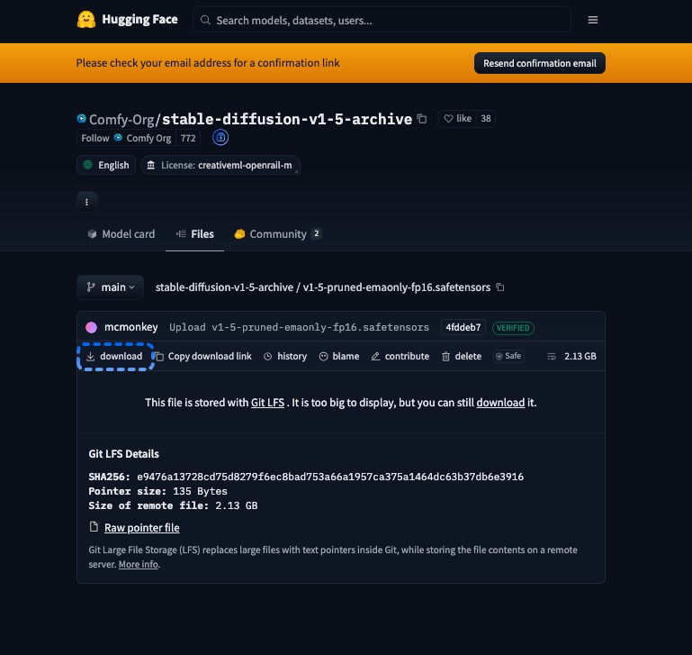

## Put the model in the `checkpoints` folder

ComfyUI lists a checkpoint only when the file is in a `checkpoints` folder that ComfyUI reads. Move the file you downloaded into the folder for your install.

<Tabs>
  <Tab title="Comfy Desktop">
    By default, every Comfy Desktop instance reads the shared models folders. Comfy Desktop saves model downloads in the shared models folder marked **Downloads**.

    1. In the Comfy Desktop **title bar**, click **Menu**, and then select **Desktop Settings**.
    2. Select the **Storage** tab.
    3. Under **Shared Models**, click the folder path marked **Downloads**. The folder opens in your file manager.
    4. Move `v1-5-pruned-emaonly-fp16.safetensors` into the `checkpoints` folder inside it. If there's no `checkpoints` folder, create one.
  </Tab>
  <Tab title="ComfyUI Portable">
    - Move `v1-5-pruned-emaonly-fp16.safetensors` into `ComfyUI_windows_portable\ComfyUI\models\checkpoints`.

    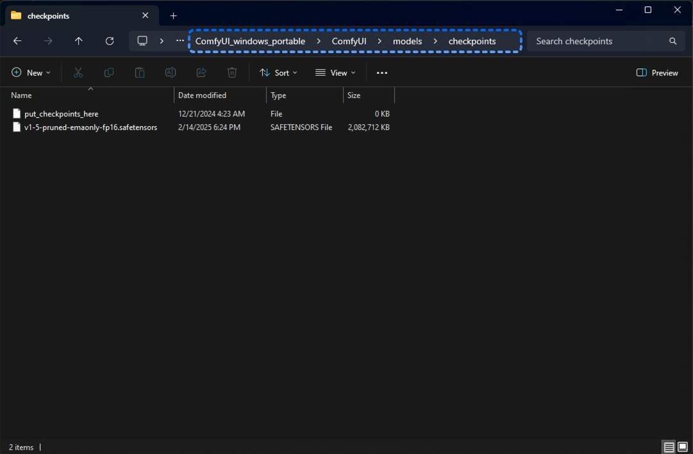
  </Tab>
  <Tab title="Manual install">
    1. Open the folder where you installed ComfyUI, the one that contains `main.py`.
    2. Move `v1-5-pruned-emaonly-fp16.safetensors` into its `models/checkpoints` folder.
  </Tab>
</Tabs>

If ComfyUI is already open, press `R` so it reads the model folders again.

## Open a blank Workflow

The **Canvas** is the large area where you place Nodes. If it already shows a Workflow, open an empty one:

1. At the top of the **Left sidebar**, click the ComfyUI logo (**Menu**).
2. Select **New**.

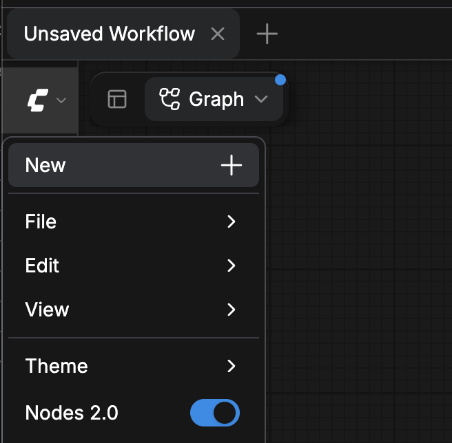

The **Canvas** is now empty.

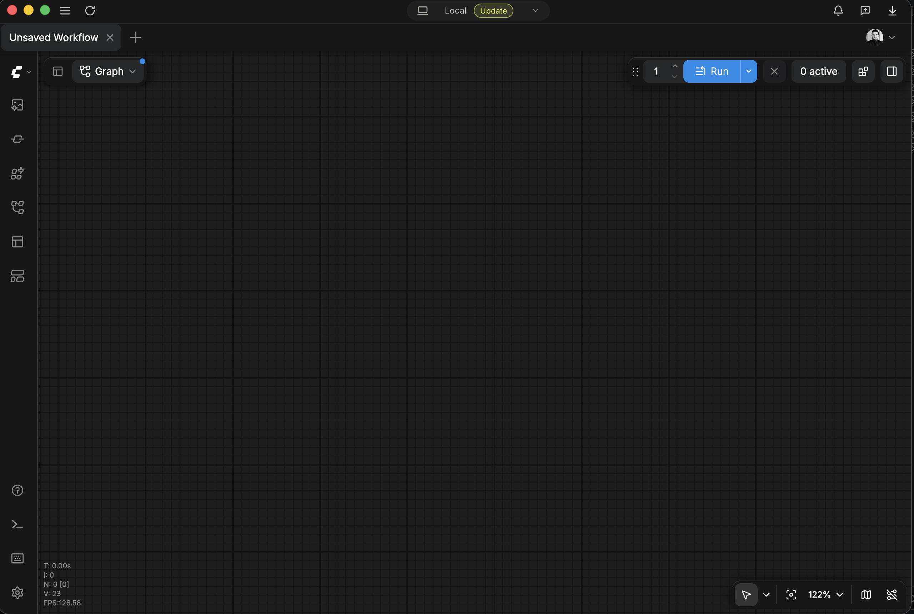

<Tip>
  In the **Top bar**, the plus (**+**) button next to your open Workflow tabs also opens a new blank Workflow.

  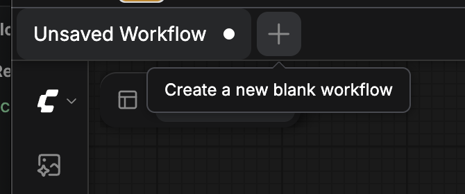
</Tip>

## Add a Node

There are three ways to add a Node. Later steps name the way to use.

### Use the Add Node menu

1. Right-click an empty spot on the **Canvas**. A menu opens.
2. Select **Add Node**, and then select each category in the Node's **Add Node** path. The [Node table](#learn-the-parts-of-a-workflow) lists the path for each Node in this tutorial.
3. Select the Node. It appears where you right-clicked.

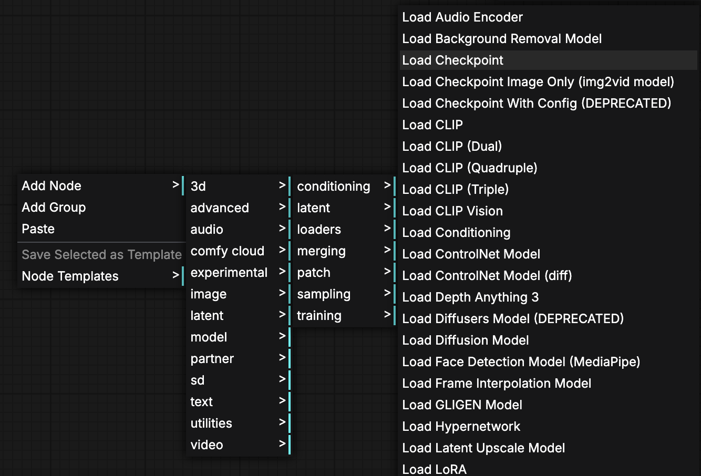

### Search the Node Library

1. Press `N`, or click **Nodes** in the **Left sidebar**. The **Node Library** opens.
2. If the **Node Library** shows more than one tab, select **All nodes**.
3. Type the Node name in the **Search Nodes...** box.
4. Click the Node in the results, and then click the **Canvas** where you want it. The Node appears there.

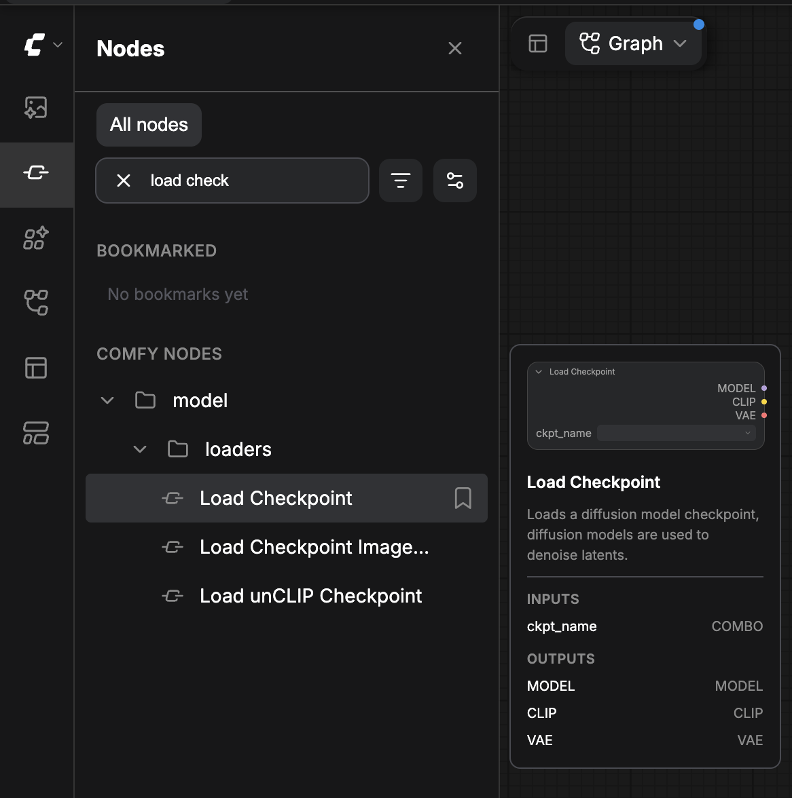

### Drag a link to empty Canvas

Dragging a link to empty Canvas adds a Node and connects it in one move.

1. Drag from an output dot on a Node you already placed.
2. Release over an empty spot on the **Canvas**. The Node search box opens there by default.
3. Type the Node name, and then select the Node. ComfyUI adds the Node and connects it to the output you dragged from.

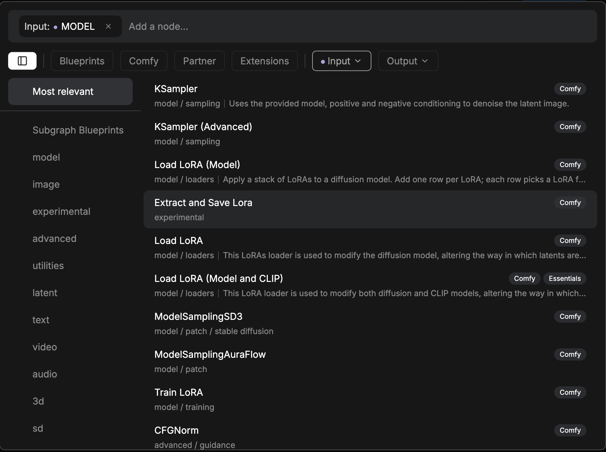

To open a menu instead of the search box, hold `Shift` as you release.

## Connect two Nodes

A link carries data from an output on one Node to an input on another Node.

1. Drag from an output dot on one Node.
2. Release over an input dot on another Node. A link appears between the two dots.

These rules apply to every link:

- One output can feed several inputs.
- An input takes one link. A new link to an input replaces its old link.
- A link joins an output and an input of the same type. ComfyUI doesn't draw a link between different types.

## Add the `Load Checkpoint` Node

The `Load Checkpoint` Node loads the model file.

1. Add a `Load Checkpoint` Node with the [**Add Node** menu](#use-the-add-node-menu): **model** > **loaders** > `Load Checkpoint`.
2. In the Node, click the `ckpt_name` widget, and then select `v1-5-pruned-emaonly-fp16.safetensors`.

The Node shows three outputs on its right side: `MODEL`, `CLIP`, and `VAE`.

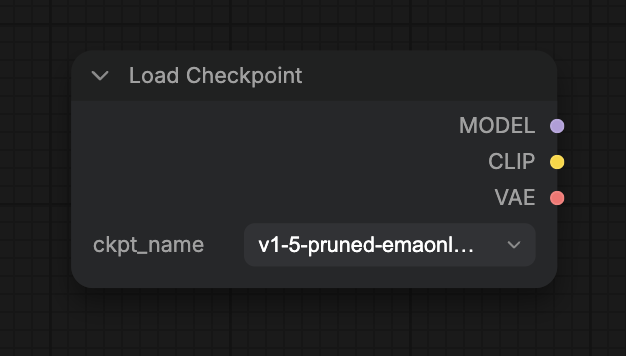

If the `ckpt_name` list doesn't show the file, see [The model isn't in the checkpoint list](#the-model-isnt-in-the-checkpoint-list).

## Add the `KSampler` Node

The `KSampler` Node does the generation. It needs four links: the model, both prompts, and the blank starting image.

1. Add a `KSampler` Node with the [**Node Library**](#search-the-node-library): search for `KSampler`.
2. [Connect](#connect-two-nodes) the `MODEL` output on `Load Checkpoint` to the `model` input on `KSampler`.

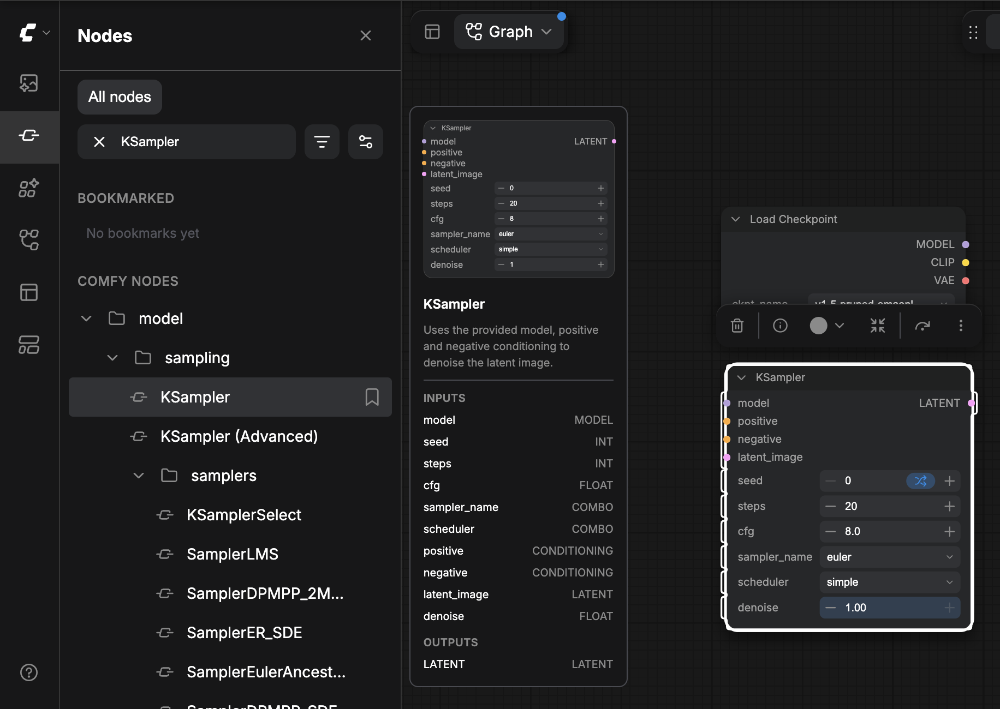

You draw the other three links in the next two sections.

Leave the `KSampler` widgets at their default values. For example, `steps` is `20` and `cfg` is `8.0`.

## Add the prompt Nodes

Prompts describe the image. The positive prompt says what you want to see. The negative prompt says what you don't want.

1. Add a `CLIP Text Encode (Prompt)` Node with the [**Add Node** menu](#use-the-add-node-menu) (**model** > **conditioning**) or the [**Node Library**](#search-the-node-library).
2. Click its text box and type your positive prompt, for example `beautiful scenery nature glass bottle landscape, purple galaxy bottle`.
3. Right-click the Node, and then select **Duplicate**. A second `CLIP Text Encode (Prompt)` Node appears.
4. Click the second Node's text box and type your negative prompt, for example `text, watermark`.

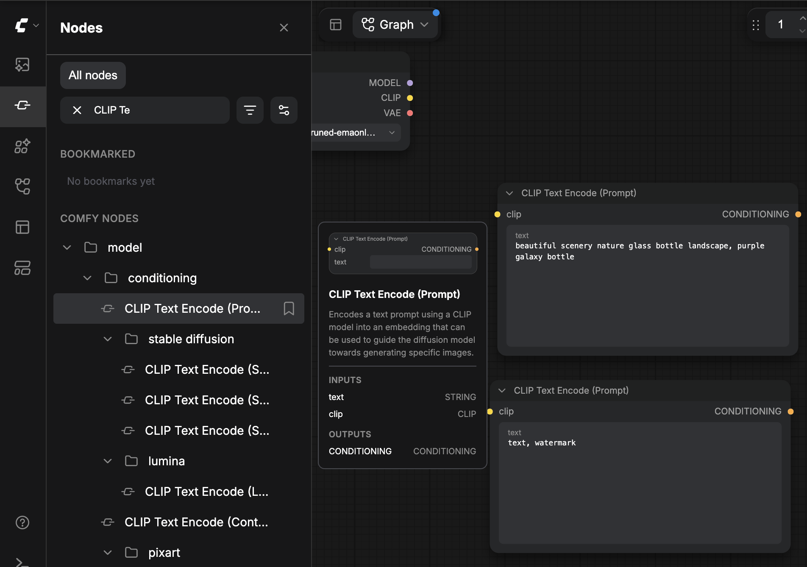

[Connect](#connect-two-nodes) the prompts:

1. Connect the `CLIP` output on `Load Checkpoint` to the `clip` input on each `CLIP Text Encode (Prompt)` Node. Both prompt Nodes share the one `CLIP` output.
2. Connect the `CONDITIONING` output on the positive prompt Node to the `positive` input on `KSampler`.
3. Connect the `CONDITIONING` output on the negative prompt Node to the `negative` input on `KSampler`.

## Set the image size

The `Empty Latent Image` Node sets the image size. Its `width` and `height` start at `1024`. This Workflow uses `512`, the size in the example Workflow in [Load a Workflow from an image](#load-a-workflow-from-an-image).

1. Add an `Empty Latent Image` Node with the [**Add Node** menu](#use-the-add-node-menu): **model** > **latent** > `Empty Latent Image`.
2. Set `width` to `512`.
3. Set `height` to `512`.
4. Leave `batch_size` at `1`.
5. [Connect](#connect-two-nodes) its `LATENT` output to the `latent_image` input on `KSampler`.

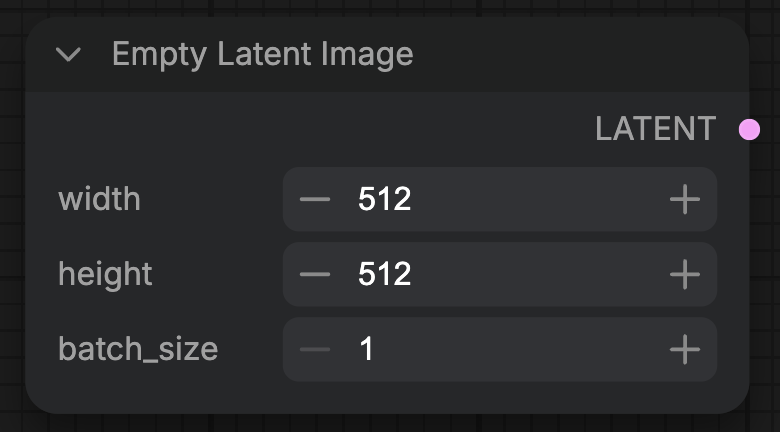

All four `KSampler` inputs now have links.

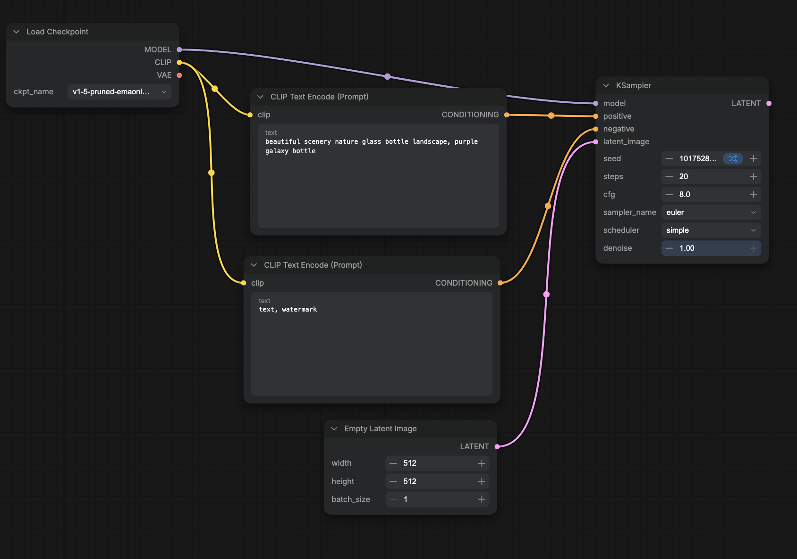

## Decode and save the image

`KSampler` outputs a latent, not an image. `VAE Decode` converts it to an image, and `Save Image` stores it.

1. Add a `VAE Decode` Node with the [**Node Library**](#search-the-node-library): search for `VAE Decode`.
2. [Connect](#connect-two-nodes) the `LATENT` output on `KSampler` to the `samples` input on `VAE Decode`.
3. Connect the `VAE` output on `Load Checkpoint` to the `vae` input on `VAE Decode`.
4. Add a `Save Image` Node by [dragging a link to empty Canvas](#drag-a-link-to-empty-canvas): drag from the `IMAGE` output on `VAE Decode`, release over empty **Canvas**, and select `Save Image`. Its `images` input is linked to `IMAGE`.

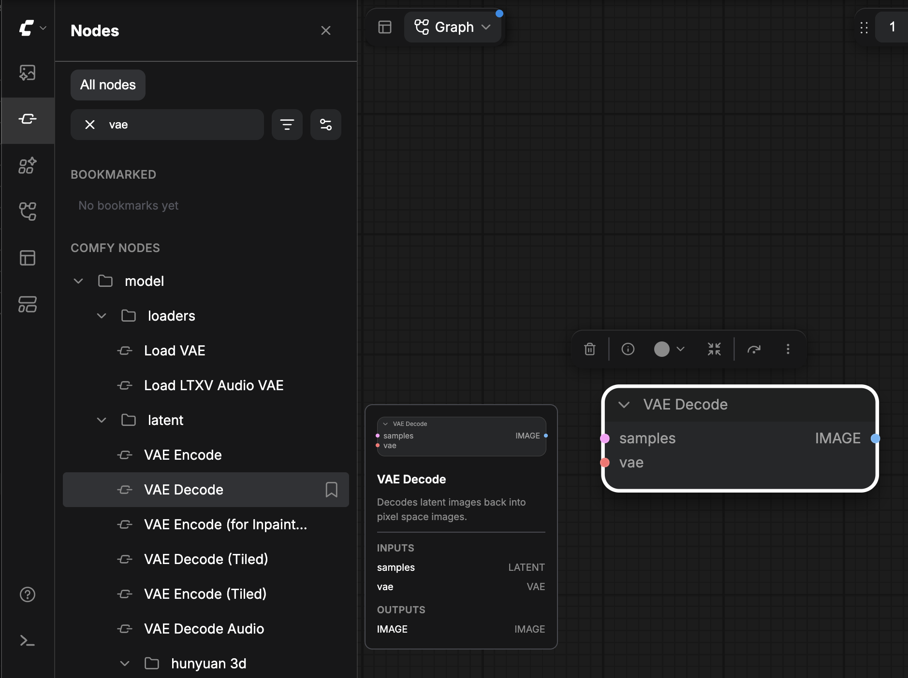

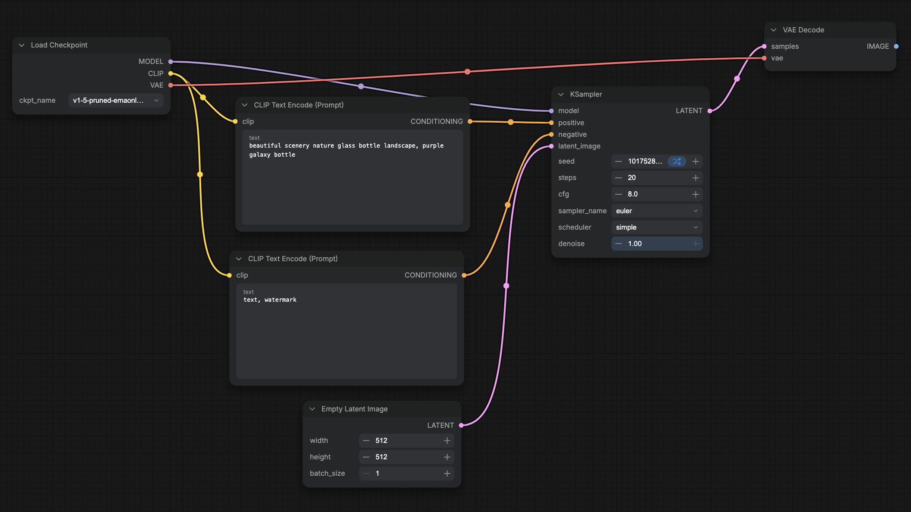

Your Workflow has seven Nodes and nine links.

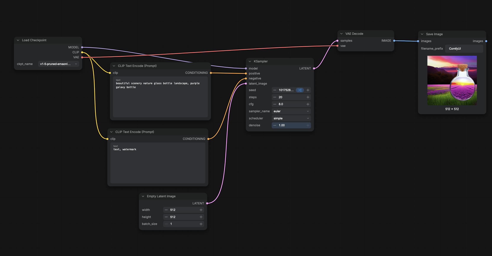

<Tip>
  With no Node selected, press `.` to fit the whole Workflow on screen.
</Tip>

## Run the Workflow

Running the Workflow queues it, and ComfyUI generates the image.

- Click **Run**, or press `Ctrl+Enter` (`Cmd+Enter` on macOS).

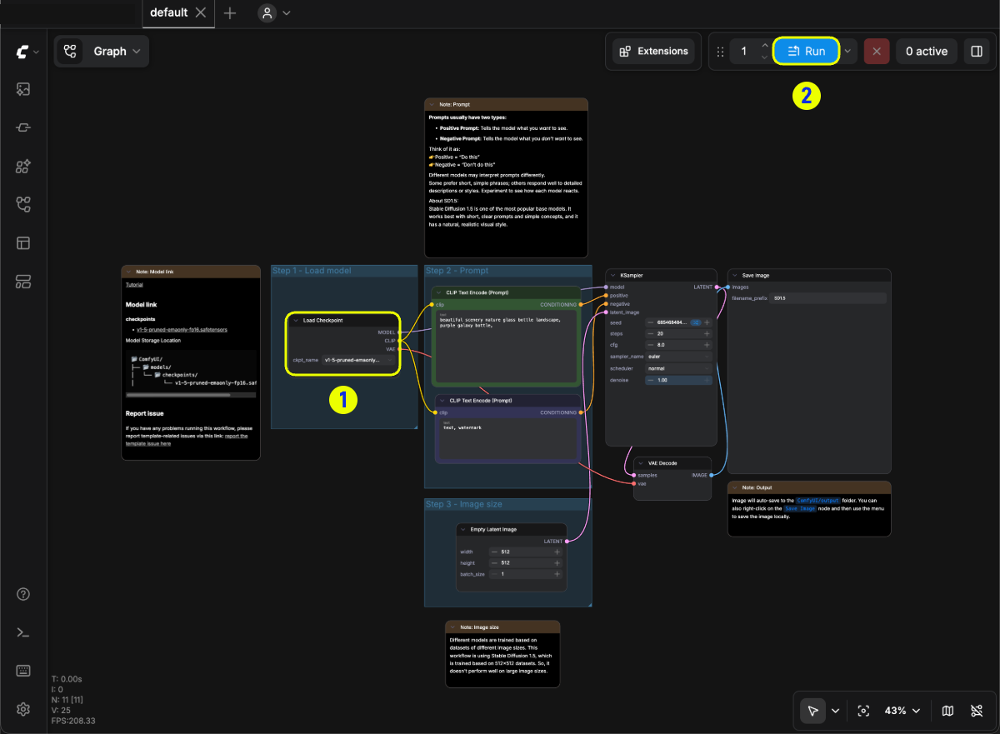

If ComfyUI shows **Required input missing**, see [Required input missing](#required-input-missing).

## Find the generated image

When the run finishes, the image appears in the `Save Image` Node. To open it from the **Left sidebar**:

- Click **Assets**, and then select the **Generated** tab.

`Save Image` also writes the image to the output folder as a PNG file named `ComfyUI_00001_.png`. The number goes up for each new image. In ComfyUI Portable and manual installs, the output folder is `ComfyUI/output`.

## Load a Workflow from an image

By default, every PNG file that `Save Image` writes contains the Workflow that made it. Load the example image below to compare its Workflow with the one you built.

1. Save this image to your computer:

   

2. Drag the PNG file onto the **Canvas**. You can also click the ComfyUI logo (**Menu**) in the **Left sidebar**, select **File** > **Open**, and select the file.

The Workflow from the image opens. If a `Load Image` Node appears instead, the file you dropped has no Workflow saved in it.

## Fix a missing model

When you load a Workflow whose model file isn't in your model folders, ComfyUI shows a notice that names the missing model, such as `v1-5-pruned-emaonly-fp16.safetensors is missing`.

1. Click **View details**. The **Right side panel** opens on the **Issues** tab and lists the file under **Missing Models**. The folder the file belongs in, such as `checkpoints`, appears under the file name.
2. If the row has a **Download** button, click it.
   - **Comfy Desktop**: Comfy Desktop downloads the file into the `checkpoints` folder of your **Downloads** models folder.
   - **ComfyUI Portable and manual installs**: Your browser downloads the file. Move it into the `checkpoints` folder, as in [Put the model in the checkpoints folder](#put-the-model-in-the-checkpoints-folder).
3. If the row has no **Download** button, get the file yourself:
   1. Click the link icon next to the file name. The link icon copies the download link (**Copy URL**), or the file name when the Workflow has no link (**Copy model name**).
   2. Download the file. For this tutorial's model, follow [Download the model](#download-the-model).
   3. Move the file into the folder named under the file name, such as `checkpoints`.
4. Click **Refresh** (the circular arrow) in the **Missing Models** header, or press `R`, so ComfyUI checks the model folders again.

A missing model row has no **Download** button when any of these is true:

- The Workflow has no download link for the model. The example image in [Load a Workflow from an image](#load-a-workflow-from-an-image) is one of these Workflows.
- The download link isn't a Hugging Face or Civitai link.
- The file name doesn't end in `.safetensors`, `.sft`, `.ckpt`, `.pth`, or `.pt`.
- The Workflow doesn't say which model folder the file belongs in.

<Note>
  Comfy Cloud never shows **Download** for a missing model. It shows **Import** instead, so you can import the model into Comfy Cloud. Models used by Nodes that don't support imported models are listed under **Import Not Supported**.
</Note>

## Troubleshoot

Use these entries when a run fails or the model file doesn't load.

### Required input missing

An input has no link. The message names the Node and the input, such as `KSampler is missing a required input: latent_image`. [Connect](#connect-two-nodes) the input named in the message, and run the Workflow again.

### The model isn't in the checkpoint list

The file isn't in a `checkpoints` folder that ComfyUI reads. Move it there, as in [Put the model in the checkpoints folder](#put-the-model-in-the-checkpoints-folder), and then press `R`.
