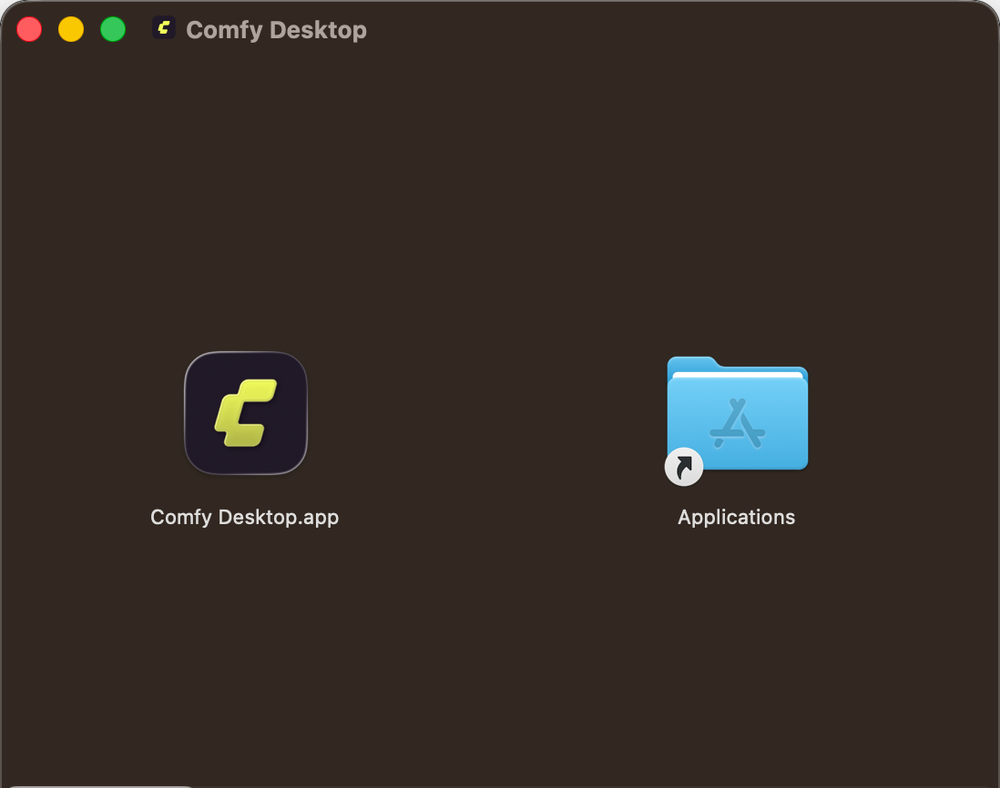
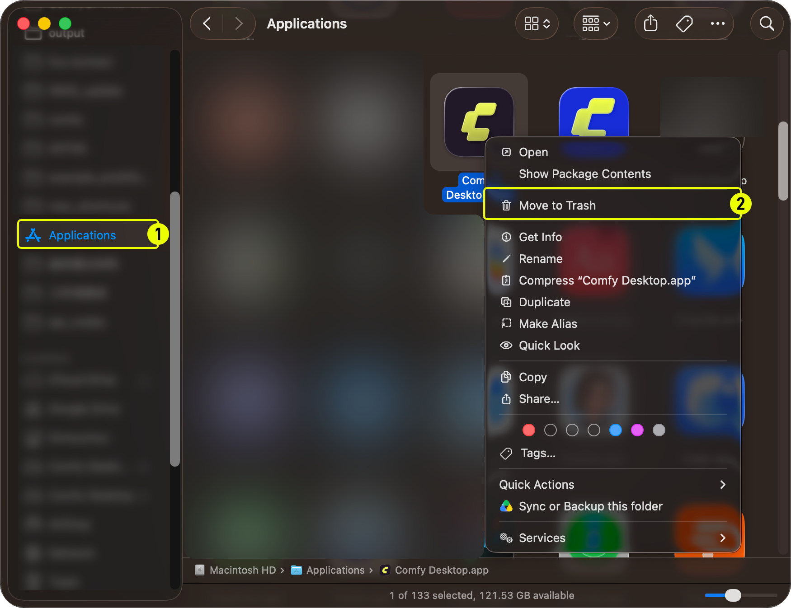

import MigrateTip from '/snippets/desktop/migrate.mdx'
import UpdateGuide from '/snippets/desktop/update.mdx'

**Comfy Desktop** is a multi-installation manager that lets you run multiple ComfyUI instances from a single launcher. This guide covers how to install and uninstall Comfy Desktop on macOS.

## System Requirements

- **OS:** macOS 13 (Ventura) or later
- **Hardware:** Apple Silicon (M1 or later)
- **Disk Space:** At least 4.85 GB recommended per installation

<Card title="Download Comfy Desktop" icon="download" href="https://comfy.org/download">
    Download the latest installer for macOS. The page will automatically detect your platform.
</Card>

## Installation

1. Open the downloaded `.dmg` file
2. Drag **Comfy Desktop** into the **Applications** folder
3. Launch it from Launchpad or Spotlight


The first time you launch, macOS may show a security warning. Go to **System Settings → Privacy & Security** and click **Open Anyway** to allow it.

<MigrateTip />

<Card title="Next Step: Using Comfy Desktop" icon="book-open" href="/installation/desktop/usage/overview">
  Once installed, learn how to create instances, manage installations, and configure settings.
</Card>

## Updating Comfy Desktop

<UpdateGuide />

## Uninstalling

### Remove Comfy Desktop

1. Open **Applications** folder in Finder
2. Right-click **Comfy Desktop** and select **Move to Trash**



### What Uninstalling the App Does NOT Remove

Uninstalling Comfy Desktop only removes the launcher app itself. The following data is **not** removed and must be deleted manually if you want a complete cleanup:

| Data | Default Location | Description |
|------|-----------------|-------------|
| Installations | `~/ComfyUI-Installs` | Each ComfyUI installation you created (can also be deleted from within the app). Custom install paths are also not removed. |
| Shared models & outputs | `~/ComfyUI-Shared` | Shared model library, input/output directories |
| App settings & registry | `~/Library/Application Support/Comfy Desktop` | Settings and installation records |
| Logs | `~/Library/Logs/Comfy Desktop` | Desktop app logs (`app.log`) |

<Warning>The directories listed above contain your **personal ComfyUI data** (models, outputs, settings, and installations). They are **not** Comfy Desktop application files. Deleting them will permanently remove your data.</Warning>

To fully remove everything:

1. **Delete the app data folder**: `~/Library/Application Support/Comfy Desktop`
2. **Delete the logs folder**: `~/Library/Logs/Comfy Desktop`
3. **Delete individual installations** from within the app, or manually delete `~/ComfyUI-Installs` plus any custom installation directories you configured
4. **Delete the shared model library** at `~/ComfyUI-Shared` (only if you no longer need these files)

## If Comfy Desktop Starts Up Broken

A manual update can leave Comfy Desktop launching with no styling, missing translations, or buttons and dropdowns that do nothing. The usual cause is a Chromium profile or a cached pending update left behind by the previous version.

Quit Comfy Desktop first, then run the reset script from the [Comfy-Desktop repository](https://github.com/Comfy-Org/Comfy-Desktop/blob/main/scripts/reset-mac.sh):

```bash
curl -fsSLO https://raw.githubusercontent.com/Comfy-Org/Comfy-Desktop/main/scripts/reset-mac.sh && bash reset-mac.sh
```

The script lists every path it is about to delete and asks before deleting anything. It clears the app's settings, caches, and Chromium profile for the current version and for the earlier app names, so a profile left by an older build cannot come back. It refuses to run while Comfy Desktop is open. Because the log folder is one of the paths it deletes, copy the log out first if you may need to report the problem, see [Where the App Log Is](#where-the-app-log-is).

Your ComfyUI installations in `~/ComfyUI-Installs` and your shared models in `~/ComfyUI-Shared` stay on disk, but the file that lists the installations is deleted with the rest of the app data, so you may have to add them back with **Add Existing Instance** on the next launch. The script also reports any extra copies of the app it finds on the Mac without deleting them, because a second copy in the Dock is a common reason a reset seems to change nothing.

### Where the App Log Is

If the reset does not fix the problem and you want to report it on the [Comfy-Desktop issue tracker](https://github.com/Comfy-Org/Comfy-Desktop/issues), the file to attach is `app.log` in `~/Library/Logs/Comfy Desktop`. That folder is one of the paths the reset deletes, so copy it somewhere else before you run the script. Comfy Desktop writes a new `app.log` at each launch and keeps the 50 most recent earlier files beside it as `app.log_<timestamp>.log`, so pick the file from the session that failed. Each file rotates once it reaches 5 MB, so a long session can span more than one file.
