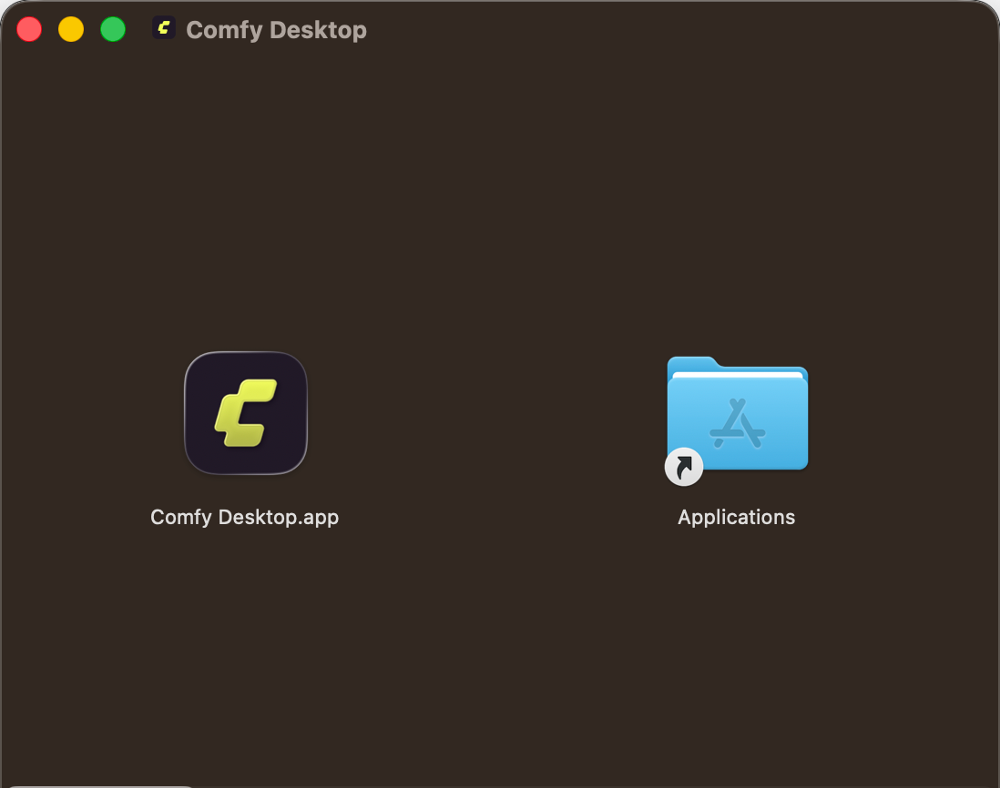

Comfy Desktop is the app you use to run ComfyUI, either as a copy installed on this computer (a local build) or on Comfy Cloud, which runs on GPUs in the cloud and works on any computer. It downloads and sets up everything ComfyUI needs, so Comfy Desktop is the only app you install. On this page, you download Comfy Desktop, confirm the setup screen it opens on first launch, and open ComfyUI.


<Note>
  Comfy Desktop calls each copy of ComfyUI a build. If you used an earlier version of Comfy Desktop, your instances appear as builds, with the same models and settings.
</Note>

## Choose where ComfyUI runs

Comfy Desktop runs ComfyUI in two places: on this computer as a local build, or on [Comfy Cloud](https://comfy.org/cloud). Pick the one you want before you start, because the setup screen on first launch installs a local build.

| | Local build | Comfy Cloud |
| --- | --- | --- |
| Runs on | This computer | GPUs in the cloud, so it works on any computer |
| Setup | The setup screen installs it on first launch | None. **Home** shows a **Comfy Cloud** card |
| Cost | Free | Comfy Credits, spent only while the GPU runs |
| Needs | Free disk space for the install (the setup screen shows the amount) | A Comfy account |

To use only Comfy Cloud, skip the install when the setup screen opens. [Open Comfy Cloud in Comfy Desktop](#open-comfy-cloud-in-comfy-desktop) shows how.

## Download Comfy Desktop

The download page offers an installer for Windows, macOS, and Linux.

1. Go to [comfy.org/download](https://comfy.org/download).
2. Click **DOWNLOAD DESKTOP**. The button downloads the installer for the operating system the page detects. The installer's name appears under the button text.
3. To pick another installer, click the arrow (**All installers**) next to the button, and then select an installer. The list offers **Windows x64**, **Windows ARM64 (NVIDIA only)**, **macOS (Apple Silicon)**, and **Linux x64 (AppImage)**.

   

## Install Comfy Desktop for your OS

Pick your operating system's tab, check its requirements, and install the file you downloaded.

<Tabs>
  <Tab title="Windows">
    **System requirements**

    - Windows 10 or later, on x64 or ARM64.
    - A dedicated NVIDIA or AMD GPU is recommended, but not required. On ARM64, local builds need an NVIDIA GPU.
    - At least 4.85 GB of free disk space for each build.

    **Install**

    1. Run the `.exe` installer you downloaded, and follow its prompts.
    2. Open Comfy Desktop from the **Start** menu or the desktop shortcut.

    
  </Tab>
  <Tab title="macOS">
    **System requirements**

    - macOS 13 (Ventura) or later.
    - A Mac with Apple silicon (M1 or later).
    - At least 4.85 GB of free disk space for each build.

    **Install**

    1. Open the `.dmg` file you downloaded.
    2. Drag **Comfy Desktop** into the **Applications** folder.
    3. Open Comfy Desktop from Launchpad or Spotlight.

    

    If macOS shows a security warning the first time you open it, go to **System Settings** > **Privacy & Security**, and click **Open Anyway**.
  </Tab>
  <Tab title="Linux">
    **System requirements**

    - Linux on x64. Ubuntu 22.04 or later is recommended.
    - A dedicated NVIDIA or AMD GPU is recommended, but not required.
    - At least 4.85 GB of free disk space for each build.

    The download page offers the AppImage. A `.deb` package for Debian and Ubuntu is also available from the [universal download link](https://dl.todesktop.com/241130tqe9q3y), which detects your platform.

    **Install the .deb package**

    ```bash
    sudo apt install ./*.deb
    ```

    The package installs Comfy Desktop in `/opt/Comfy Desktop` and adds an APT source, so new releases arrive with your normal system updates (`sudo apt update` and `sudo apt upgrade`). On Ubuntu 24.04 and later, it also installs an AppArmor profile so Electron's sandbox works. If you installed the package on Ubuntu 22.04 and then upgraded to 24.04, run `sudo apt reinstall comfyui-desktop-2` to add the profile.

    **Run the AppImage**

    1. Install FUSE 2, which the AppImage needs. On Ubuntu 24.04 and later, run `sudo apt install libfuse2t64`. On Ubuntu 22.04, run `sudo apt install libfuse2`.
    2. Make the file executable and run it:

       ```bash
       chmod +x ./*.AppImage
       ./*.AppImage
       ```

    The AppImage updates itself by replacing the file you launched, so keep it in a folder your user account can write to. If it fails to start because your distribution blocks Electron's sandbox, run it with `--no-sandbox`. That flag turns off the sandbox for every process, so use it only when the normal launch fails.

    <Accordion title="Build and run from source">
      For development, run Comfy Desktop from its [repository](https://github.com/Comfy-Org/Comfy-Desktop#development). You need Node.js 24, pnpm 10 through Corepack, `build-essential`, and `git`.

      ```bash
      sudo apt install build-essential git
      nvm install 24 && nvm use 24
      corepack enable
      git clone https://github.com/Comfy-Org/Comfy-Desktop.git
      cd Comfy-Desktop
      pnpm run init
      ./linux-dev.sh
      ```

      A source checkout doesn't update itself. To update, run `git pull` and `pnpm run init`, and then start `./linux-dev.sh` again.
    </Accordion>
  </Tab>
</Tabs>

Then open Comfy Desktop. On first launch, it opens the setup screen.

<Tip>
  The Chinese download page, [comfy.org/zh-CN/download](https://comfy.org/zh-CN/download), offers the same installers. Its button reads **下载桌面版**. To download ComfyUI's files from mirrors in China, see [Confirm the setup screen](#confirm-the-setup-screen).
</Tip>

## Confirm the setup screen

On first launch, Comfy Desktop opens the setup screen. Its title is **Install ComfyUI on this Mac** on macOS, **Install ComfyUI on this PC** on Windows, and **Install ComfyUI on this computer** on Linux. Nothing downloads until you click **Install**.


Comfy Desktop picks the settings for your computer. Check them before you install:

- **Detected**: the panel at the top shows the GPU or processor Comfy Desktop found, and its memory.
- **Hardware**: the hardware the build is made for. **No GPU acceleration** means ComfyUI runs on your processor.
- **Version**: the ComfyUI version and its release channel, such as **Stable**.
- **Location**: the folder the build installs into, and the free space on that drive.

Next to **Install**, the setup screen shows the download size. Point to the info icon next to it to see how much disk space the install needs.

To pick other settings, click **Change**, edit them on the **Change setup** screen, and click **Save changes**.

<Tip>
  For your first install, keep the settings Comfy Desktop picked. [Builds](/installation/desktop/usage/instance-management) explains every setting you can change.
</Tip>

To install:

1. Tick **I agree to the EULA and Terms of Service.** Click **EULA** or **Terms of Service** to read either one.
2. Click **Install**.

The other two checkboxes are optional:

- **Help improve Comfy by sharing anonymous usage data**: sends anonymous usage data. **Learn more** opens the privacy policy.
- **Opt in to beta features and help test what ships next**: lets Comfy Desktop turn on early ComfyUI features in the builds on this computer. It can only be turned on while data sharing is on.

If you click **Install** before you tick the terms box, **Agree to install.** appears next to it.

<Note>
  If Comfy Desktop runs in Chinese, it asks **Enable Chinese mirrors?** after you click **Install**. **Enable mirrors** downloads from `gitcode.com`, `mirrors.aliyun.com`, and `mirrors.cloud.tencent.com`. **Not now** keeps `github.com` and `pypi.org`.
</Note>

### Keep existing builds or migrate

- **Use my builds**: appears next to **Install** when this computer already has a local build other than Legacy Desktop. Tick the terms box and click it to skip the install. **Home** opens with your builds.
- **Migrate**: replaces **Install** when Comfy Desktop finds a Legacy Desktop install. [Migrate from Legacy Desktop](/installation/desktop/usage/migrate) lists what moves.

## Watch the install on Home

The setup screen closes and **Home** opens. Your build's card in the Builds row shows the progress, such as **Installing ComfyUI · 60%**, then **Starting ComfyUI**.


While the install runs, the card can show an older ComfyUI version. The last install step updates the build to the version the setup screen showed.

By default, ComfyUI opens in its own window when it's ready, and the card shows **Running**.

If the install or the start fails, see [Troubleshoot](#troubleshoot).

## Open Comfy Cloud in Comfy Desktop

**Home** shows a **Comfy Cloud** card in the Builds row, next to any local build.


### Skip local install and go to Home

The setup screen has no skip button unless you already have builds. To reach **Home** and use only Comfy Cloud:

1. On the setup screen, tick the terms box.
2. In the **Detected** panel, click **Change**.
3. In the **title bar**, click **Menu**, and then select **Skip onboarding**.

**Home** opens with the **Comfy Cloud** card in the Builds row.

### Log in and open Comfy Cloud

Until you log in, the **Comfy Cloud** card shows **Log in to use**.

<Warning>
  Comfy Cloud spends Comfy Credits while its GPU runs. Check your **Credits** balance before you open it.
</Warning>

1. In the **sidebar**, on the **Log in to Comfy** card, click **Log in**. The card shows **Continue in your browser**.

   

2. Finish logging in in your browser. The **sidebar** shows your **Credits** balance, which confirms that your account works.
3. On **Home**, click the **Comfy Cloud** card.

Comfy Cloud opens in its own window.

<Tip>
  To use Comfy Cloud in your browser instead, open [cloud.comfy.org](https://cloud.comfy.org/).
</Tip>

## Open ComfyUI

After the first install, you start a build and open ComfyUI from **Home**:

- Click **Open ComfyUI** at the top right. It opens your most recent build. To open another build, click the arrow on the right side of the button (**Choose the build to open**), and then select the build.
- Or click a build's card in the Builds row.

You can also click a build's tile on the **Builds** page, or **Start** on the build's page. Clicking a build in the **sidebar** opens its page and doesn't start it.

While ComfyUI starts, the build reads **Starting…**. When it's ready, ComfyUI opens in its own window, the build reads **Running**, and it has a green dot in the **sidebar**. To bring the window back later, click the running build again.

If ComfyUI doesn't start, see [Fix a build that fails](/installation/desktop/usage/instance-management#fix-a-build-that-fails). To learn the rest of **Home** and the **sidebar**, see [Get around Comfy Desktop](/installation/desktop/usage/overview). To generate your first image, follow [Your first image in ComfyUI](/get_started/first_generation).

## Uninstall Comfy Desktop

Uninstalling Comfy Desktop removes the app only. Your builds, shared models and outputs, settings, and logs stay on your computer until you delete them. To remove one build instead, see [Remove a build](/installation/desktop/usage/instance-management#remove-a-build).

<Warning>
  The folders below hold your own data: builds, models, outputs, and settings. Deleting them can't be undone.
</Warning>

On macOS and Linux, you can first clear the app's logs, caches, and temporary files with **Remove Comfy Desktop data** in [Desktop settings](/installation/desktop/usage/settings#storage).

<Tabs>
  <Tab title="Windows">
    1. Go to **Settings** > **Apps** > **Installed apps**.
    2. Find **Comfy Desktop**, and click **Uninstall**.

    

    | Data | Default location |
    | --- | --- |
    | Builds | `%LOCALAPPDATA%\Comfy-Desktop\ComfyUI-Installs` (older builds: `%USERPROFILE%\ComfyUI-Installs`), plus any folder you chose |
    | Shared models, inputs, and outputs | `%LOCALAPPDATA%\Comfy-Desktop\ComfyUI-Shared` (older: `%USERPROFILE%\ComfyUI-Shared`) |
    | Settings and the list of builds | `%APPDATA%\Comfy Desktop` |
    | Logs | `%APPDATA%\Comfy Desktop\logs` |

    To remove everything, delete those folders. Delete the shared folder only if you no longer need its models and outputs.
  </Tab>
  <Tab title="macOS">
    1. Open the **Applications** folder in Finder.
    2. Right-click **Comfy Desktop**, and select **Move to Trash**.

    

    | Data | Default location |
    | --- | --- |
    | Builds | `~/ComfyUI-Installs`, plus any folder you chose |
    | Shared models, inputs, and outputs | `~/ComfyUI-Shared` |
    | Settings and the list of builds | `~/Library/Application Support/Comfy Desktop` |
    | Logs | `~/Library/Logs/Comfy Desktop` |

    To remove everything, delete those folders. Delete the shared folder only if you no longer need its models and outputs.
  </Tab>
  <Tab title="Linux">
    - **.deb**: run `sudo apt remove comfyui-desktop-2`. It also removes the AppArmor profile. Use `sudo apt purge comfyui-desktop-2` to remove the APT source too.
    - **AppImage**: delete the `.AppImage` file.

    | Data | Default location |
    | --- | --- |
    | Builds | `~/ComfyUI-Installs`, plus any folder you chose |
    | Shared models, inputs, and outputs | `~/ComfyUI-Shared` |
    | Settings | `~/.config/comfyui-desktop-2` |
    | App data, including the list of builds | `~/.local/share/comfyui-desktop-2` |
    | Cache | `~/.cache/comfyui-desktop-2` |
    | State | `~/.local/state/comfyui-desktop-2` |
    | Logs | `~/.config/Comfy Desktop/logs` |

    To remove everything, delete those folders, or run the repository's [reset-linux.sh](https://github.com/Comfy-Org/Comfy-Desktop/blob/main/scripts/reset-linux.sh) script, which clears the app's folders and leaves `~/ComfyUI-Installs` and `~/ComfyUI-Shared` alone. Delete the shared folder only if you no longer need its models and outputs.
  </Tab>
</Tabs>

## Troubleshoot

Use these entries when the setup screen or the install doesn't go as expected.

<AccordionGroup>
  <Accordion title="Fix an Install button that does nothing">
    - **Not supported** in the **Hardware** row: use Comfy Cloud. [Skip local install and go to Home](#skip-local-install-and-go-to-home), and then [log in and open Comfy Cloud](#log-in-and-open-comfy-cloud).
    - **Couldn't reach the ComfyUI download server**: check your internet connection, and then click **Try again**.
    - **Agree to install.** next to the terms box: see [Confirm the setup screen](#confirm-the-setup-screen).
  </Accordion>
  <Accordion title="Free up disk space">
    The **Location** row shows **Only … free, about … needed to install** when the drive is too full. [Change the location](#confirm-the-setup-screen) to a drive with more space, or free space on this one.
  </Accordion>
  <Accordion title="Fix a build that didn't install">
    When an install doesn't finish, the build card on **Home** shows **Install failed**.

    <Warning>
      Uninstalling permanently removes the build and all its files. Other builds aren't affected. Copy anything you want to keep out of the build's folder first.
    </Warning>

    1. Click the build card. The build's page opens.
    2. Click **More**, and then select **Uninstall**. Confirm with **Uninstall**.
    3. On **Home**, click **New build** to install a new build.
  </Accordion>
  <Accordion title="Recover after closing setup">
    If you close Comfy Desktop during setup, it asks **Quit setup?**. Click **Quit setup** and Comfy Desktop doesn't save your choices. The setup screen opens again the next time you launch Comfy Desktop.
  </Accordion>
  <Accordion title="Fix a build that didn't start">
    When ComfyUI doesn't start, the build card on **Home** shows **Didn't start**.

    1. Click the build card. A dialog titled **ComfyUI didn't start** opens.
    2. Click **View logs** to read what went wrong.
    3. Click **Try again**.
  </Accordion>
  <Accordion title="Comfy Desktop starts up broken on macOS">
    After a manual update, Comfy Desktop can open with no styling, missing text, or buttons that do nothing. A profile or cached update from the previous version usually causes it.

    1. Copy `app.log` out of `~/Library/Logs/Comfy Desktop` if you may report the problem, because the reset deletes that folder.
    2. Quit Comfy Desktop.
    3. Run the [reset script](https://github.com/Comfy-Org/Comfy-Desktop/blob/main/scripts/reset-mac.sh). It lists every path it will delete and asks before deleting anything:

       ```bash
       curl -fsSLO https://raw.githubusercontent.com/Comfy-Org/Comfy-Desktop/main/scripts/reset-mac.sh && bash reset-mac.sh
       ```

    Your builds in `~/ComfyUI-Installs` and models in `~/ComfyUI-Shared` stay, but the list of builds is deleted. Add them back with [Add existing build](/installation/desktop/usage/instance-management#add-a-comfyui-you-already-have). To report the problem, attach `app.log` on the [Comfy Desktop issue tracker](https://github.com/Comfy-Org/Comfy-Desktop/issues).
  </Accordion>
</AccordionGroup>

## View the source code

Comfy Desktop source code is on [GitHub](https://github.com/Comfy-Org/Comfy-Desktop). It's dual-licensed: AGPL-3.0-or-later, or a commercial license from Comfy Org.
