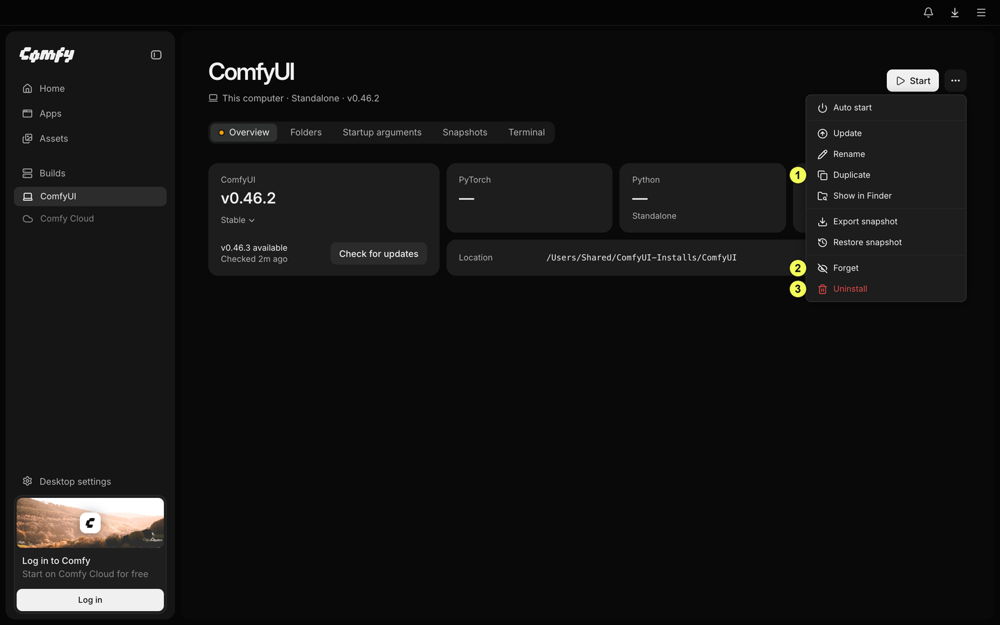

This page covers copying a build, forgetting it, and uninstalling it. To install, add, or connect the build, see [Builds](/installation/desktop/usage/instance-management).

**More** on the build page holds the three actions on this page.

1. **Duplicate**: copies the build under a new name.
2. **Forget**: removes the build from Comfy Desktop and keeps its folder.
3. **Uninstall**: removes the build and deletes its files.

## Duplicate a build

A duplicate is a copy of a build that you can change without touching the original. You can duplicate a **Standalone** build or a Developer Platform Build from your team's workspace.

1. In the [quick actions menu](/installation/desktop/usage/instance-management#quick-actions-from-the-build-list) or the **More** menu, select **Duplicate**.
2. In **Duplicate build**, type a name for the copy.
3. Click **Duplicate**.

Comfy Desktop creates the copy next to the original. When the copy is ready, Comfy Desktop opens the copy's build page. To copy a build and change it in one step, use **Copy & update** in [Update ComfyUI](/installation/desktop/usage/build-management#update-comfyui) or **Copy & change PyTorch** in [Change PyTorch](/installation/desktop/usage/build-management#change-pytorch).

## Remove a build

Two actions remove a build. **Forget** keeps its files on disk. **Uninstall** deletes them.

**Forget** removes the build from Comfy Desktop. Its folder stays on your computer, and you can add it again with [**Add existing build**](/installation/desktop/usage/instance-management#add-a-comfyui-you-already-have).

1. Open the [build page](/installation/desktop/usage/build-management), and then click **More**.
2. Select **Forget**, and then confirm in **Forget build**.

For a remote build, **Forget** removes the connection. The server isn't changed. A **Standalone** build that Comfy Desktop created from Legacy Desktop has no **Forget**.

**Uninstall** removes a build from this computer. For a remote build, it removes the build from Comfy Desktop and doesn't change the server.

<Warning>
  **Uninstall** permanently deletes the build and all its files, and you can't undo it. Other builds aren't affected. If you cancel an uninstall, you can't restore files that Comfy Desktop already removed.
</Warning>

1. Stop the build if it's running.
2. In the [quick actions menu](/installation/desktop/usage/instance-management#quick-actions-from-the-build-list) or the **More** menu, select **Uninstall**.
3. Check the folder the dialog shows, and then click **Uninstall**.

The build shows **Uninstalling** and the percent. When it finishes, the build leaves the **sidebar** and the **Builds** page.

To stop the uninstall:

1. In the quick actions menu, select **Cancel**.
2. Click **Stop uninstalling**.

The build stays in your builds. You can't restore files that Comfy Desktop already removed, so uninstall the build again to finish. If the uninstall fails, see [Fix a build that fails](/installation/desktop/usage/build-troubleshooting#fix-a-build-that-fails).
