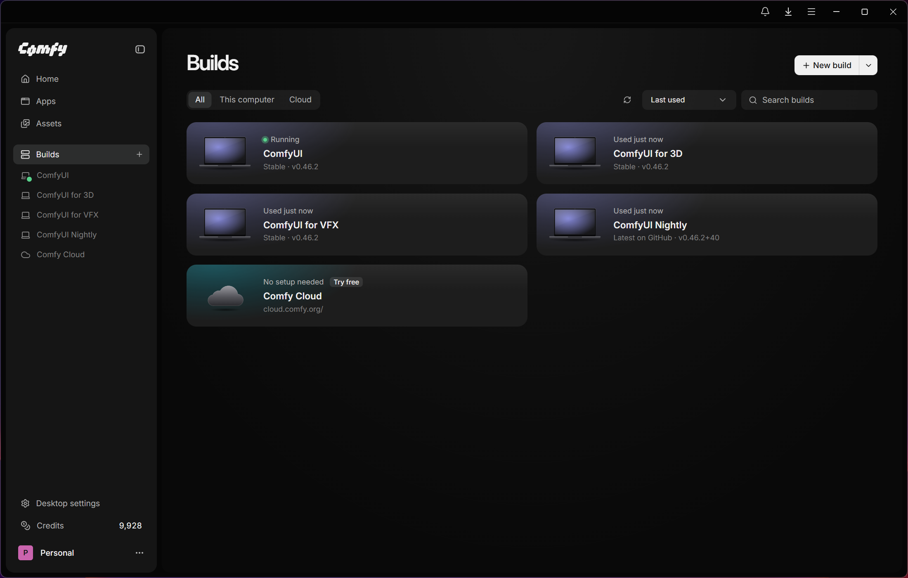
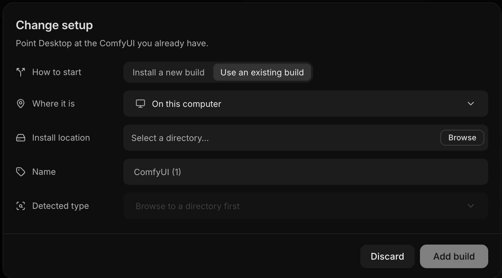

In Comfy Desktop, you can run ComfyUI on this computer, on Comfy Cloud, or on a ComfyUI server on another machine. Each of these is a build. Comfy Desktop lists Comfy Cloud for you, and you install, add, or connect any other build before you open it. This page covers the **Builds** page: the kinds of builds, how to find them, the quick actions menu, how to install, add, or connect a build, and how to start, stop, restart, and auto start one. Each part of managing a build has its own page, listed under [Manage builds](#manage-builds).

## Types of Comfy builds

Where a build runs decides what you can do with it. The **Builds** page groups builds by where they run:

| Where it runs | What it is | How you get one |
| --- | --- | --- |
| **This computer** | ComfyUI installed on this computer. Its type is **Standalone**, **Git clone**, **Portable**, **Legacy Desktop**, or **Build** (a Developer Platform Build from your team's workspace). | [Install a new build](#install-a-new-build), or [add a ComfyUI you already have](#add-a-comfyui-you-already-have). |
| **Cloud** | Comfy Cloud. It runs on GPUs in the cloud and needs a Comfy account. | Comfy Desktop lists it for you as **Comfy Cloud**. |
| **Remote** | A ComfyUI server running on another machine, reached by its URL. | [Connect to a ComfyUI server](#connect-to-a-comfyui-server). |

<Note>
  Comfy Cloud shows **Log in to use** until you [log in](/installation/desktop/overview#log-in-and-open-comfy-cloud). Its quick actions menu has no **Stop**, **Auto start**, or **Uninstall**, and it keeps the name **Comfy Cloud**.
</Note>

## Find your builds

The **Builds** page lists every build in your workspace. To open it, click **Builds** in the **sidebar**.

At the top of the page:

- **New build**: starts a new build. Click the arrow next to it (**More build options**) for **Add existing build** and **Load snapshot**.
- **Where it runs**: filters the list. **All** and **This computer** are always there. **Cloud** and **Remote** appear when you have a build of that kind.
- **Sort**: orders builds by **Last used** or **Name**. Builds that are installing stay at the top.
- **Search builds**: finds a build by its name. If nothing matches, click **Clear filters**.

Each build is a tile. A tile shows the build's status, such as **Running**, **Starting…**, **Auto start**, or **Error**. Hold the pointer over a tile to see what a click does: **Click to start**, **Click to open**, or **Click to view logs**.

When you have no builds, the page reads **No builds yet** and **Install ComfyUI on this computer, or run it on Comfy Cloud.**

The **sidebar** also lists each build below **Builds**:

- A spinner and a percent mean the build is installing.
- A green dot means the build is running.
- A red dot means the build crashed or didn't start. Hold the pointer over the build to read why.
- Click a build to open its [build page](/installation/desktop/usage/build-management).
- Right-click a build for its [quick actions menu](#quick-actions-from-the-build-list).

For **Home** and the rest of the **sidebar**, see [Get around Comfy Desktop](/installation/desktop/usage/overview).

### Quick actions from the build list

Right-click a build in the **sidebar**, or right-click its tile on the **Builds** page or its card on **Home**, for a short menu of actions. On a tile or card, you can also hold the pointer over it until the **⋯** button appears on its right, and then click it.

The menu shows only the actions that apply to the build right now. The numbers in the screenshot follow the menu on that build: 1 Start, 2 Auto start, 3 Manage, 4 Duplicate, 5 Show in Finder, 6 Export snapshot, 7 Restore snapshot, 8 Uninstall.

- **Start**, or **View logs**, **Restart**, and **Stop** while the build runs. While it installs or starts, **View logs** and **Cancel**. After a crash, **View error**.
- **Auto start** or **Turn off auto start**. See [Start a build when Comfy Desktop opens](#start-a-build-when-comfy-desktop-opens).
- **Manage**, which opens the [build's page](/installation/desktop/usage/build-management).
- **Update**, when an update is available, and **Migrate to Standalone**, when the build can move to a Standalone build. See [Migrate later](/installation/desktop/usage/migrate#migrate-later).
- **Duplicate**, and **Show in Finder**, **Show in Explorer**, or **Show in folder**.
- **Export snapshot** and **Restore snapshot**. See [Snapshots](/installation/desktop/usage/build-snapshots#save-and-restore-snapshots).
- **Upload build**, when you're logged in to a workspace. See [Team builds](/installation/desktop/usage/workspaces-and-builds).
- **Uninstall**. See [Remove a build](/installation/desktop/usage/build-duplicate-and-remove#remove-a-build).

**Auto start**, **Restart**, **View logs**, and **Upload build** are only in this menu. Everything else is also on the build's page. When an item is grayed out, hold the pointer over it to read why, such as **Stop the running build first.**

## Install a new build

A new build is ComfyUI that Comfy Desktop installs for you: an official release as a **Standalone** build, or a Developer Platform Build from your team's workspace. The **New build** dialog picks settings for this computer. The install downloads ComfyUI and sets up its Python environment, so check the summary before you click **Install**.

<Steps>
  <Step title="Open the New build dialog">
    Open the dialog in one of these ways:

    - In the **sidebar**, hold the pointer over **Builds**, and then click the plus (**+**) button (**New build**).
    - On the **Builds** page, click **New build**.
    - On **Home**, click the **New build** tile, when **Home** shows it.

    The **New build** dialog opens with the lead **Set up a fresh ComfyUI install.**
  </Step>
  <Step title="Check the summary">
    When you're logged in and your workspace has builds, the dialog opens on **Your team's builds**. Its **Release** row lists them, with the placeholder **Select a build**. To install an official release instead, set **Source** to **Official release** in the next step.

    For an official release, the dialog shows what it installs:

    

    - **Name**: the name the build gets in the **sidebar** and on the **Builds** page. The box shows a suggested name. Leave it empty to use that name, or type your own.
    - **Detected**: the computer or GPU that Comfy Desktop found, with its memory in GB. Click **Change** next to it to change the setup.
    - **Release**: **Stable** for tested releases, or **Latest on GitHub**.
    - **Hardware**: the GPU type the build is made for, such as **NVIDIA**, **AMD**, **Intel Arc (XPU)**, **Apple Silicon (MPS)**, or **CPU**. Its note reads:
      - **Detected**: the GPU type matches the GPU Comfy Desktop found.
      - **No GPU acceleration**: the build is for **CPU**.
      - **Not supported**: this computer doesn't support the selected GPU type.
    - **Version**: the ComfyUI version that installs, with its release, such as **Stable**.
    - **Location**: the folder the build installs into, with the free space on that drive and the space the install needs. Click **Browse** to choose another folder.

    When the **Hardware** note reads **Detected** and **Location** shows free space with no warning under it, the setup fits this computer.

  </Step>
  <Step title="Change the setup (optional)">
    Click **Change** to open **Change setup**. It reads **Everything here is already set to what fits this computer.**

    

    - **How to start**: keep **Install a new build**.
    - **Source**: **Official release** installs ComfyUI. **Your team's builds** installs a Developer Platform Build from your workspace. See [Team builds](/installation/desktop/usage/workspaces-and-builds).
    - **Release**: **Stable** installs tested releases. Pick the version in the list next to **Stable**. **Latest on GitHub** installs the newest commits from the master branch.
    - **Location**: the install folder. Choose a folder that isn't inside the Comfy Desktop folder, OneDrive, a shared models, input, or output folder, or another build. Click **Browse** to choose another folder.
    - **Hardware**: the GPU type the build is made for. Each option lists its ComfyUI version, Python version, and download size.

    Click **Save changes** to go back to the summary, or **Discard** to drop your changes.

  </Step>
  <Step title="Click Install">
    Click **Install**. Before the install starts, Comfy Desktop can stop you:

    - **Location** shows a problem under it and **Install** stays grayed out when the folder can't hold a build. Click **Browse** and choose another folder.
    - **Low disk space** opens when the drive has less free space than the install needs, or less than 1 GB. Click **Continue anyway** to install, or close the dialog and choose another folder.
    - **Update NVIDIA driver** opens for an **NVIDIA** build when your driver is older than version 580. It shows your driver version and the recommended minimum. Click **Continue anyway** to install with your current driver, or update the driver first.
  </Step>
  <Step title="Follow the install">
    Comfy Desktop goes back to **Home**, and the install runs in the background. The build shows **Installing ComfyUI** and the percent on **Home** and on the **Builds** page, and a spinner and the percent in the **sidebar**.

    To see each step, click the build's tile, or select **View logs** in the [quick actions menu](#quick-actions-from-the-build-list). The **Installing ComfyUI** dialog lists the steps:

    1. **Download**
    2. **Extract**
    3. **Set up environment**
    4. **Get the latest ComfyUI**, or **Get ComfyUI** and the version you picked

    Click **View logs** in the dialog to see the install output.

    To stop the install:

    1. In the quick actions menu, select **Cancel**.
    2. Click **Cancel install**.

    The install stops, and Comfy Desktop deletes the files it downloaded.
  </Step>
</Steps>

When the install finishes, the spinner in the **sidebar** goes away and the build shows its laptop icon. For **Auto start**, see [Start a build when Comfy Desktop opens](#start-a-build-when-comfy-desktop-opens). If the install fails, see [Fix a build that fails](/installation/desktop/usage/build-troubleshooting#fix-a-build-that-fails).

## Add a ComfyUI you already have

If you set up ComfyUI yourself, from a Git clone or a portable download, you can add it to Comfy Desktop. Comfy Desktop runs it from its folder and doesn't move or copy its files.

1. On the **Builds** page, click the arrow next to **New build** (**More build options**), and then select **Add existing build**. You can also open **New build**, click **Change**, set **How to start** to **Use an existing build**, and set **Where it is** to **On this computer**. The sheet reads **Point Desktop at the ComfyUI you already have.**

   

2. Next to **Install location**, click **Browse**, and then select the ComfyUI folder.
3. Check **Detected type**. It reads **Standalone**, **Portable**, **Git clone**, or **Legacy Desktop**. If it reads **Legacy Desktop**, stop and close the dialog: adding it here keeps Comfy Desktop from migrating it. Follow [Migrate from Legacy Desktop](/installation/desktop/usage/migrate) instead. If it reads **No known install detected**, select the folder that holds ComfyUI itself, not a folder above it.
4. In **Name**, keep the suggested name, or type your own.
5. For a **Git clone**, check **Version**, **Repository**, and **Branch**. **Virtual environment** shows the `.venv`, `venv`, `.env`, or `env` folder Comfy Desktop found. Click **Browse** next to it to choose another one.
6. Click **Add build**.

The build appears in the **sidebar** and on the **Builds** page. If another build has the name you typed, **Name** reads **A build named "…" already exists. Please choose a different name.**

To create a build from a snapshot file, select **Load snapshot** in **More build options**. See [Create a build from a snapshot file](/installation/desktop/usage/build-snapshots#create-a-build-from-a-snapshot-file).

## Connect to a ComfyUI server

A remote build opens a ComfyUI server that runs on another machine, such as a GPU server on your network. You need the server's URL.

1. Open the **New build** dialog, as in [Install a new build](#install-a-new-build), and then click **Change**.
2. Set **How to start** to **Use an existing build**.
3. Set **Where it is** to **On a server**.

   

4. In **Name**, keep the suggested name, or type your own.
5. In **ComfyUI URL**, type the server's address. The box shows `http://localhost:8188` as an example.
6. Click **Connect**.

The build appears in the **sidebar** and on the **Builds** page, and the **Where it runs** filter gains **Remote**. If the address isn't a URL, the dialog reads **Enter a valid URL (e.g. `http://localhost:8188`).** To change the address later, see [Change a remote build's URL](/installation/desktop/usage/build-management#change-a-remote-builds-url).

## Start, stop, and restart a build

To start a build and open ComfyUI, see [Open ComfyUI](/installation/desktop/overview#open-comfyui). A Comfy Cloud build opens with **Open Cloud** on its page, and a remote build with **Open remote**.

### Run more than one build

When you start a build on this computer while another one is running or starting, Comfy Desktop opens **A build is already running**. Under **Will be stopped**, it lists the builds it would stop.

<Warning>
  **Close and start** stops the listed builds and loses any unsaved work in them. Save your Workflows first.
</Warning>

- **Close and start**: stops the listed builds, then starts the one you picked.
- **Run all**: starts the build and keeps the others running.

Close the dialog to cancel the start. To stop seeing this dialog, open **Desktop settings** from the **sidebar**, and under **Preferences**, turn off **Warn before running multiple builds**.

### Stop or restart

Stop a build before you uninstall it. Restart it to apply changes to its startup arguments.

<Warning>
  Stopping or restarting a build loses any unsaved work in ComfyUI. Save your Workflow first.
</Warning>

To stop a running build:

1. On the [build page](/installation/desktop/usage/build-management), click **More** (**⋯**), and then select **Stop**. You can also select **Stop** in the [quick actions](#quick-actions-from-the-build-list).
2. In **Stop ComfyUI**, click **Stop**.

ComfyUI stops, and its window closes.

To restart a running build:

1. In the [quick actions](#quick-actions-from-the-build-list), select **Restart**.
2. In **Restart ComfyUI**, click **Restart**.

The tile reads **Starting…** and then **Running**. Restarting never opens **A build is already running**.

## Start a build when Comfy Desktop opens

**Auto start** starts one build each time Comfy Desktop opens. One build at a time has **Auto start**.

- In the [quick actions menu](#quick-actions-from-the-build-list) of a build on this computer or a remote build, select **Auto start**.

The build's tile reads **Auto start**. If another build had **Auto start**, that build loses it. To turn it off, select **Turn off auto start** in the same menu.

When you install your first build on this computer, and no other build has **Auto start**, the new build gets it. If that build doesn't start the first time, Comfy Desktop turns its **Auto start** off.

## Manage builds

A build's own page holds a tab for each kind of setting. Pick the part you need:

<CardGroup cols={2}>
  <Card title="Manage a build" icon="sliders" href="/installation/desktop/usage/build-management">
    Open the build page, use the More menu, and update ComfyUI, PyTorch, or a remote build's URL.
  </Card>
  <Card title="Folders" icon="folder-tree" href="/installation/desktop/usage/build-folders">
    Choose the model, input, and output folders a build uses.
  </Card>
  <Card title="Startup arguments" icon="terminal" href="/installation/desktop/usage/build-startup-arguments">
    Set flags, ComfyUI Manager policy, the window, the port, and environment variables.
  </Card>
  <Card title="Snapshots" icon="clock-rotate-left" href="/installation/desktop/usage/build-snapshots">
    Save, restore, export, and import a build's ComfyUI version, Custom Nodes, and packages.
  </Card>
  <Card title="Terminal" icon="code" href="/installation/desktop/usage/build-terminal">
    Run commands in the build's Python environment.
  </Card>
  <Card title="Duplicate or remove" icon="copy" href="/installation/desktop/usage/build-duplicate-and-remove">
    Copy a build, forget it, or uninstall it and its files.
  </Card>
  <Card title="Fix a build" icon="triangle-exclamation" href="/installation/desktop/usage/build-troubleshooting">
    Work through an install that didn't finish, a crash, a folder problem, or a port conflict.
  </Card>
</CardGroup>
