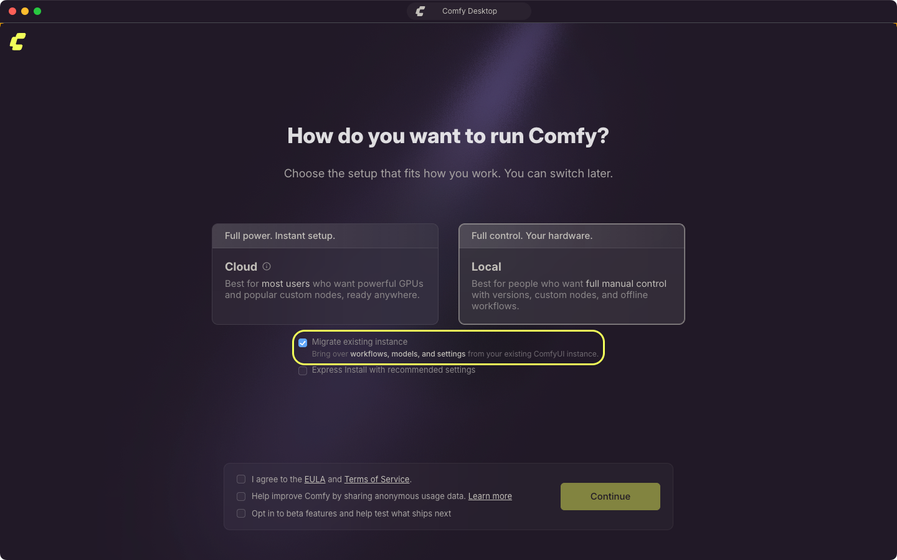
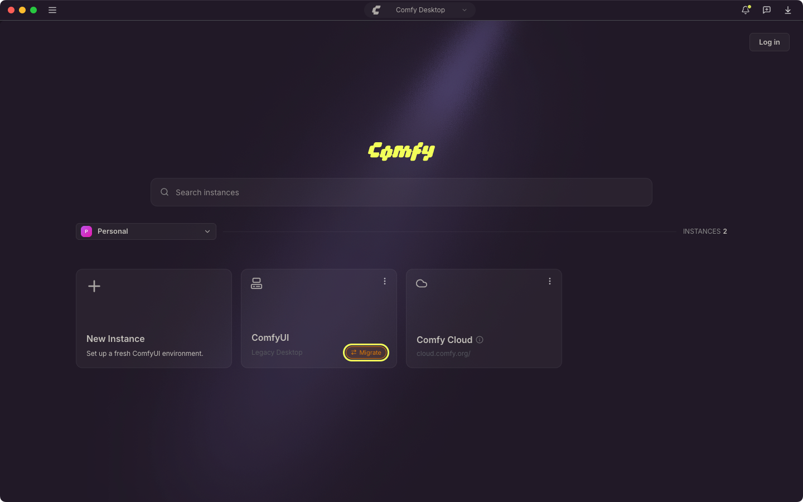
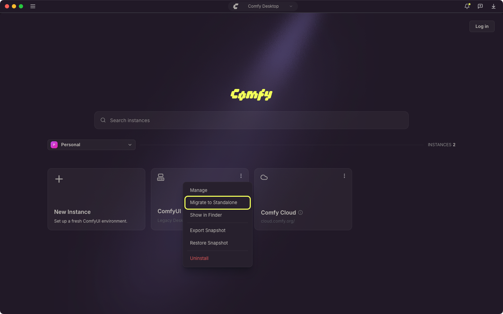
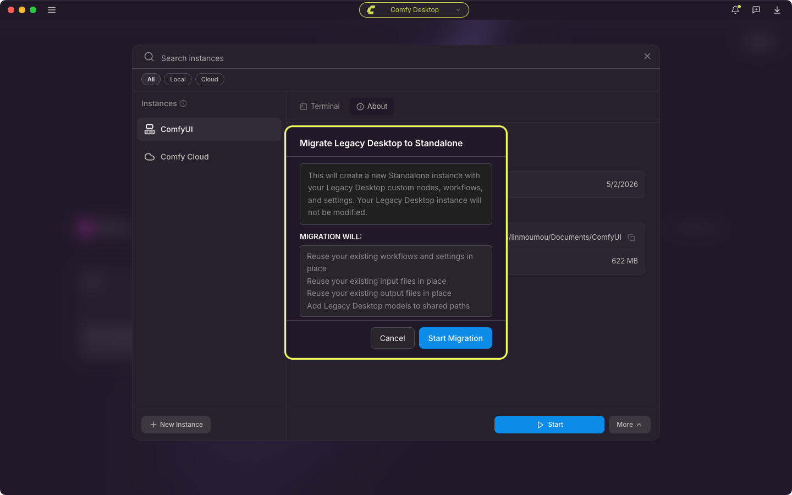

<Info>
This page covers migration from **Legacy Desktop** (the previous single-install desktop app). If you're a first-time user, you can skip this.
</Info>

<CardGroup cols={1}>
  <Card title="Looking for a different installation?" icon="compass" href="/installation/desktop/usage/instance-management#tracking-an-existing-installation">
    If you already have a ComfyUI installation (portable, manual git clone, etc.) and want to add it to Comfy Desktop, see **Tracking an existing installation** in Instance Management.
  </Card>
</CardGroup>

If you already have Legacy Desktop installed, Comfy Desktop can detect and migrate it, creating a new Standalone installation in the Chooser view.

## What Gets Migrated

Legacy Desktop was a single-install app. Comfy Desktop is a multi-installation manager. When you migrate:

- **Workflows and settings**: reused in place, so the new instance keeps the same user data.
- **Custom nodes**: kept in your existing `custom_nodes` folder. The migrated instance uses your Legacy Desktop data folder as its base directory, so it loads the same nodes, and their packages stay in the Python environment that is reused.
- **Models**: your existing model folder is added to the shared model directories, so every instance can read those files where they already are.
- **Input files and outputs**: reused in place from the existing folders.
- **Python environment**: your existing environment is checked and then reused. Comfy Desktop verifies that it can import torch, then installs ComfyUI's requirements into it.
- **ComfyUI version**: the ComfyUI source is staged into a new managed directory, so Comfy Desktop manages updates from then on.

The Legacy Desktop app itself stays installed. The migration reuses that setup in place rather than copying it, so the shared data folder and Python environment are not an untouched copy. If you need a pristine copy of your Legacy Desktop setup, back it up yourself before migrating.

## What Migration Backs Up

Before it changes anything, Comfy Desktop copies the Legacy Desktop settings files into a dated folder inside the legacy config folder:

- macOS: `~/Library/Application Support/ComfyUI/legacy-backup/<timestamp>/`
- Windows: `%APPDATA%\ComfyUI\legacy-backup\<timestamp>\`

Each file is copied only if it exists:

- `config.json`: the Legacy Desktop app settings, including the data folder it used.
- `comfy.settings.json`: the ComfyUI frontend settings stored in your legacy user folder.
- `extra_models_config.yaml`: any extra model paths you configured in Legacy Desktop.
- `window.json`: the saved window size and position.

The backup holds settings only. Models, workflows, custom nodes, input files, and outputs are not copied into it, because the migrated instance keeps using them where they are. The migration also writes a snapshot of the legacy environment, with its custom nodes and installed packages, to `.snapshots/` inside your legacy data folder.

If a file cannot be copied, the migration notes it in the log and continues, so a failed backup does not stop the migration.

## What Happens While Migration Runs

The migration shows its own progress screen and moves through these steps:

1. **Back up legacy state**
2. **Check folder access** (macOS only)
3. **Validate Python environment**
4. **Capture snapshot**
5. **Allocate install folder**
6. **Stage ComfyUI source code**
7. **Install requirements**
8. **Carry over settings**
9. **Register installation**

A step can stop and wait for an answer:

- **Folder access needed** (macOS): macOS blocked access to the Legacy Desktop folder. Grant Comfy Desktop Full Disk Access in System Settings → Privacy & Security, then start the migration again.
- **Python environment looks broken**: the legacy environment could not import torch. Select **Adopt anyway** to keep that environment, or **Cancel** to stop.
- **ComfyUI source code unavailable**: the ComfyUI source for the new instance could not be obtained. Select **Retry**, or **Cancel** and create a new instance from the dashboard instead.

The screen keeps the output of every step in a **View logs** panel that opens by itself when a step fails. Copy the text with the copy button there, or read the same output in the Desktop app log. A failed requirements install is reported as a warning and does not stop the migration.

## What Changes After Migration

Once migration completes, your new Standalone installation works like any other Comfy Desktop installation:

- **Startup** — click the play button on the new installation card in the Chooser view to launch ComfyUI.
- **Port** — Legacy Desktop used port `8000` by default. The new installation carries over this port setting (and any other custom startup arguments you had).
- **Manage** — use the Manage panel to update, snapshot, and configure the installation.
- **Updates** — Standalone installations can be updated independently via the Manage panel. Unlike Legacy Desktop, you no longer need to download a new build for each update.
- **Multiple instances** — you can have multiple Standalone installations side by side, each with its own ComfyUI version and configuration.
- **Shared storage** — models are shared across all Standalone installations by default. Input and output directories are pinned to the adopted legacy workspace so your existing files stay where they are.

A migrated instance is never updated on its own. Use the Manage panel's [Update tab](/installation/desktop/usage/manage#update-tab) when you want a newer ComfyUI version.

## Does My Old Link Still Work?

Legacy Desktop ran on port `8000` by default. The new installation **carries over the port** from your legacy config, so `http://localhost:8000` should still work. If you had custom CLI arguments configured (e.g. `--port 8188`), those are carried over too.

If you use a URL shortener, bookmark, or external integration that references the Legacy Desktop app by a different address, you may need to check the new installation's Startup Args tab and update accordingly.

## Step-by-Step Migration

<Steps>
<Step title="Install Comfy Desktop">
Download and install Comfy Desktop from the [official download page](https://comfy.org/download).
</Step>

<Step title="Start Comfy Desktop">
When you first open Comfy Desktop, the first-run setup detects any Legacy Desktop installation on your system. Choose **Local**, and the setup shows **Migrate existing instance**, already selected, so your existing setup is brought over when you continue.

</Step>

<Step title="Confirm Migration">
Select **Continue**, then confirm **Migrate to Standalone** with **Start Migration**. Comfy Desktop will:

1. Scan your existing installation (custom nodes, models, workflows)
2. Reuse your existing data folder and Python environment in place, and stage the ComfyUI source into a new managed directory so updates work normally
3. Reuse your workflows, settings, and other user data in place
4. Reuse your input files and outputs in place
5. Add your model folder as a shared directory
6. Keep your existing custom nodes in place and install ComfyUI's requirements into the reused environment

After completion, the new Standalone installation card appears in the Chooser view.
</Step>

<Step title="Verify">
Launch your new installation and confirm:
- Your workflows are available
- Custom nodes are installed
- Models are accessible
- Your server is running on the carried-over URL (default `http://localhost:8000`)
</Step>
</Steps>

## Migrate from the Chooser

If you have already finished the first-run setup, or the Legacy Desktop installation is already listed in the Chooser, start the migration from the instance card:

1. Find the Legacy Desktop instance card. It carries a **Migrate** pill.

   

2. Click the pill, or open the card's **⋮** menu and select **Migrate to Standalone**.

   

3. Review the confirmation, then select **Start Migration**.

   

A Legacy Desktop install is adopted in place, so the instance that appears is your existing setup under Comfy Desktop management. Migrating a tracked Git or portable install instead creates a new Standalone instance and leaves the tracked install in place. In both cases the model files are not copied, they are read from where they already are.

A pending update takes priority on those cards: they show the update pill instead of **Migrate**.

## Troubleshooting

### Legacy Desktop not detected automatically

The Legacy Desktop source is migration-only and is not listed in the New Instance picker, so it cannot be added by hand. If Comfy Desktop did not detect your Legacy Desktop installation:

1. Add the installation as a tracked instance. See [**Tracking an existing installation**](/installation/desktop/usage/instance-management#tracking-an-existing-installation).
2. Once it appears in the Chooser, migrate it with its **Migrate** pill, or with **Migrate to Standalone** in the **⋮** menu.

### Migration fails

- **Read the log**: select **View logs** in the migration window, or open the Desktop app log (`app.log`) in `~/Library/Logs/Comfy Desktop` on macOS or `%APPDATA%\Comfy Desktop\logs` on Windows.
- **Check the Legacy installation**: the migration reads models, workflows, and custom nodes from the existing folder, so a folder that was moved or deleted stops it.
- **Try again**: a network problem can stop the source staging step, and a second run often gets through.

### The migration stopped before it finished

Selecting **Cancel** in one of the prompts stops the run, and so does a step that fails outright. A requirements warning does not stop it. A stopped run does not add an instance to the Chooser, so start the migration again from the card's **Migrate** pill. Your Legacy Desktop folder is not deleted.

### Models missing after migration

Models are added to the shared model directories, not copied. If models do not show:

1. Open [Desktop Settings → Storage](/installation/desktop/usage/settings#storage)
2. Check that your legacy models folder and any extra model paths listed in your Legacy Desktop `extra_models_config.yaml` are in the shared directories. If one is missing, select **+ Add Shared Directory** and pick it.
3. In the migrated instance's Manage panel, open the **Storage** tab and make sure **Include Shared Directories** is on.
