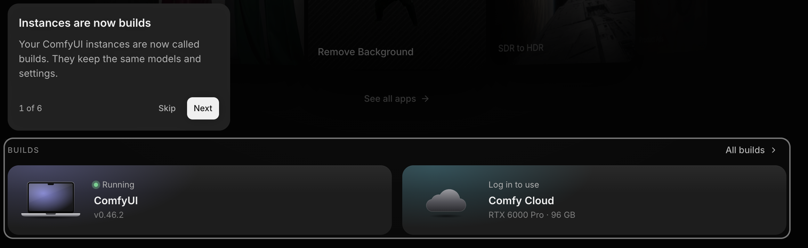

This page shows the screens you use in Comfy Desktop after first launch: **Home**, the guided tour, the **sidebar**, the **title bar**, your workspace, and **Credits**. To install Comfy Desktop and your first build, see [Comfy Desktop](/installation/desktop/overview).

## Start from Home

**Home** is the page Comfy Desktop opens on. From **Home**, you open ComfyUI in one click. **Home** shows, from top to bottom:

- **Open ComfyUI**: the button in the top-right corner. It opens ComfyUI in the build named in its tooltip. When you have more than one build, click the arrow next to it to choose the build to open.
- **[Apps](/installation/desktop/usage/apps)**: a row of ready-made tools, when **Apps** are turned on. Click **See all apps** to open the **Apps** page.
- **Example workflows**: when **Apps** aren't turned on, the row shows example Workflows instead. Click the card in the middle to open its page on comfy.org in your browser.
- **[Builds](/installation/desktop/usage/instance-management)**: up to three of your builds, each as a card. Click a card to start the build, or to open the build when it's running. Click **All builds** to see all your builds. If you don't have a local build yet, the row ends with a **New build** tile. Click it to start one.

A Comfy Cloud card shows **Log in to use** until you [log in](/installation/desktop/overview#log-in-and-open-comfy-cloud).

You're on **Home** when the page title reads **Welcome. Let's create!**

## Take the guided tour

The first time **Home** opens, a short tour points at the parts of the page and the **sidebar**. It explains what a build is, the Comfy Cloud and local build cards, where to see all your builds and start a new one, and **Assets**. If you used Comfy Desktop before, the tour opens with **Instances are now builds**.

- Click **Next** to go to the next step, **Back** to go to the previous one, or **Skip** to close the tour. Press `Esc` to skip it too.

The tour shows its position, such as **1 of 6**, and skips any part that isn't on screen. The last step has only **Back** and **Done**. Click **Done** to close the tour.

### Replay the tour

To see the tour again:

1. In the **title bar**, click the bell (**What's new**).
2. Select **Take the tour**.

**Home** opens, and the tour starts again.

## Find your way around the sidebar

The **sidebar** on the left of the **Home** window is how you move between pages.

Each entry opens a page:

| Entry | Opens |
| --- | --- |
| **Home** | **Home**. When the **sidebar** is expanded, clicking the Comfy logo at the top opens it too. |
| **Apps** | The [**Apps**](/installation/desktop/usage/apps) page, where you search for an app with **Search apps** and open it. This entry appears only when **Apps** are turned on. |
| **Assets** | [**Assets**](/installation/desktop/usage/assets), where you browse what your builds and Comfy Cloud generated. |
| **Builds** | All your builds. |

Below **Builds**, the **sidebar** lists each build:

- Click a build to open its build page.
- Right-click a build for a menu of actions.
- To start a new build, hold the pointer over **Builds** and click the plus (**+**) button (**New build**).

A green dot on a build means it's running. A red dot means it crashed or didn't start. Hover over the build to see why.

At the bottom of the **sidebar**:

- **Desktop update**: appears when an update to Comfy Desktop is available. Click it, and then click **Download**. When it reads **Desktop update ready**, click it, and then click **Restart & update**.
- **Desktop settings**: opens the settings for Comfy Desktop. See [Comfy Desktop settings](/installation/desktop/usage/settings).
- **Credits**: your balance, once you log in. See [Check your Credits](#check-your-credits).
- **Log in to Comfy**: the card you use to log in. Once you log in, your workspace takes its place. See [Log in and open Comfy Cloud](/installation/desktop/overview#log-in-and-open-comfy-cloud).

To make room, click **Collapse sidebar** at the top of the sidebar. The entries keep only their icons, and the **Log in to Comfy** card becomes a **Log in** icon. To open a page in a window of its own, right-click its entry and select **Open in new window**.

## Use the title bar

The **title bar** runs along the top of every Comfy Desktop window.

Its buttons on the right are, numbered as in the screenshot:

- **1** **What's new** (the bell): opens a menu with **Take the tour**. See [Replay the tour](#replay-the-tour).
- **2** **Downloads**: opens the downloads tray. A badge counts downloads in progress, failed downloads, and finished downloads you haven't seen.
- **3** **Menu**: opens the title bar menu.

On **Home**, **Menu** holds **Performance tests** and **Benchmarks**. In a window that runs ComfyUI, **Menu** also holds:

- **Desktop settings**: opens the settings for Comfy Desktop.
- **Reset zoom (N%)**: appears when you zoom in or out of ComfyUI. Select it to return to 100%.
- **Close window**: closes this window.
- **Quit Desktop**: quits Comfy Desktop.

A window that runs ComfyUI also has a **Home** button on the left of the **title bar**. Click it to go back to **Home**.

During the setup on first launch, **Menu** holds only **Skip onboarding**.

## Use your workspace menu

Logging in lets you use Comfy Cloud and shows your Credits. To log in, follow [Log in and open Comfy Cloud](/installation/desktop/overview#log-in-and-open-comfy-cloud).

Once you're logged in, your workspace replaces the **Log in to Comfy** card at the bottom of the **sidebar**. Click it for a menu:

- Click the workspace name at the top to switch to another workspace. **Home** and the **sidebar** then list that workspace's builds.
- **Workspace settings** and **Manage plan & credits** open in your browser.
- The menu also shows your email and **Log out**.

## Check your Credits

**Credits** at the bottom of the **sidebar**, above your workspace, shows your balance. Hold the pointer over **Credits** to refresh the balance.

- To add Credits or change your plan, click **Credits**. The **Manage plan & credits** page for your workspace opens in your browser.

## Go further

These pages cover builds, apps, assets, and settings.

<CardGroup cols={2}>
  <Card title="Builds" icon="layer-group" href="/installation/desktop/usage/instance-management">
    Install, start, update, and configure builds, and save snapshots.
  </Card>
  <Card title="Apps" icon="shapes" href="/installation/desktop/usage/apps">
    Run ready-made tools on Comfy Cloud or your own GPU.
  </Card>
  <Card title="Assets" icon="images" href="/installation/desktop/usage/assets">
    Browse what your builds and Comfy Cloud generated.
  </Card>
  <Card title="Settings" icon="cog" href="/installation/desktop/usage/settings">
    Change updates, storage, and other settings for Comfy Desktop.
  </Card>
</CardGroup>

## Troubleshoot

Use these entries when a part of **Home** or the **sidebar** doesn't load.

<AccordionGroup>
  <Accordion title="Example Workflows don't load">
    **Home** shows **Example workflows couldn't be loaded. Check your connection and try again.** Check your internet connection, and then click **Try again**.
  </Accordion>
  <Accordion title="Apps don't load">
    **Home** shows **Apps couldn't be loaded. Check your connection and try again.** Check your internet connection, and then click **Try again**.
  </Accordion>
  <Accordion title="Credits shows Unable to load balance">
    Comfy Desktop can't read your balance. Hold the pointer over **Credits** to load it again.
  </Accordion>
</AccordionGroup>

Report a problem with Comfy Desktop on [GitHub](https://github.com/Comfy-Org/Comfy-Desktop/issues). Report a problem with this documentation in the [docs repository](https://github.com/Comfy-Org/docs/issues).
