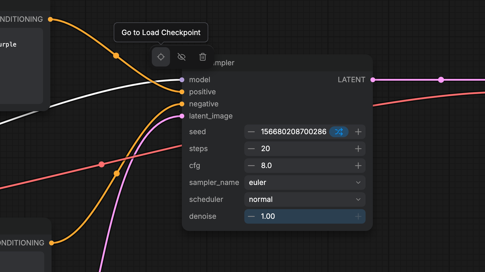
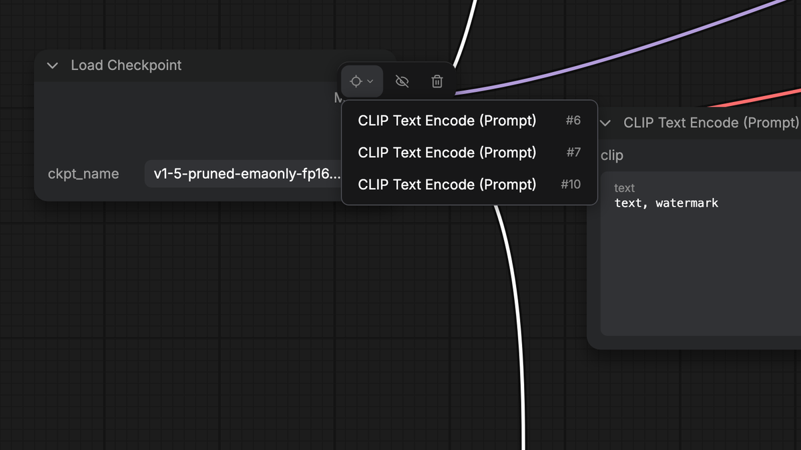
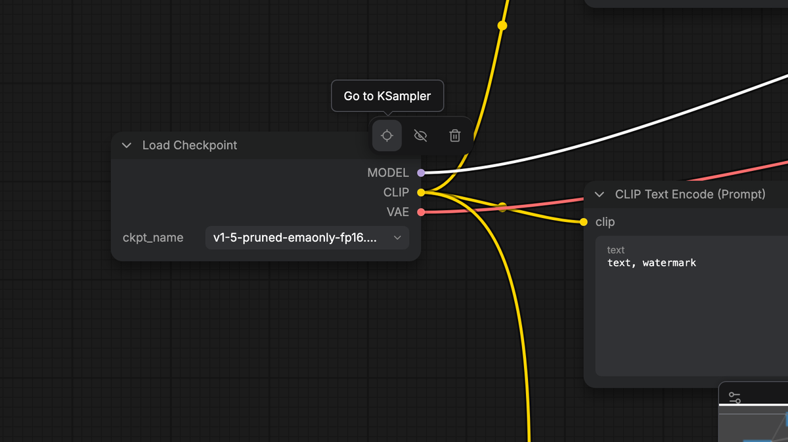

The bottom-right canvas toolbar and the **View** menu control how you move around the graph. Core View commands include toggle bottom panel, browse templates, **Focus Mode**, canvas performance info, minimap, link visibility, zoom in/out, and fit view.

## Canvas toolbar

When **Show graph canvas menu** (`Comfy.Graph.CanvasMenu`) is on (default), a floating toolbar sits at the bottom-right of the canvas:

<Frame caption="The canvas toolbar in the bottom right corner, with the minimap panel open above it.">
  
</Frame>

| Control | What it does |
| --- | --- |
| **Canvas mode** | Menu to switch between **Select** (edit nodes) and **Hand** (pan-only / read-only canvas). Defaults: `v` unlocks Select, `h` locks Hand. |
| **Fit view** | Frames the graph in the viewport (`Comfy.Canvas.FitView`, default `.`). |
| **Zoom** | Opens a popover with Zoom in, Zoom out, Zoom to fit, and a percentage field (1-1000%). Default shortcuts include `Alt` + `=` / `Alt` + `-` for zoom in/out. |
| **Minimap** | Toggles the overview map (`Comfy.Canvas.ToggleMinimap`, default `Alt` + `Shift` + `M`). Persisted as `Comfy.Minimap.Visible`. |
| **Link visibility** | Hides or shows connection wires by toggling hidden link render mode (`Comfy.Canvas.ToggleLinkVisibility`). |

You can hide the whole toolbar with **Show graph canvas menu** in Lite Graph / Canvas settings.

## View menu

The **View** menu registers the same navigation commands so you can run them from the menu bar or the command palette:

- Bottom Panel
- Browse Templates
- Focus Mode
- Canvas Performance (`Comfy.ToggleCanvasInfo`, toggles `Comfy.Graph.CanvasInfo`)
- Minimap
- Node Links (`Comfy.Canvas.ToggleLinkVisibility`)
- Zoom In / Zoom Out / Zoom to fit

## Focus Mode

**Focus Mode** (`Workspace.ToggleFocusMode`) hides workspace chrome so you can concentrate on the graph. While it is on:

- The top menu section is hidden (new menu).
- Left/right sidebar panels and the bottom panel are not rendered in the splitter layout.
- A hamburger control appears so you can exit Focus Mode (**Show menu**).

Toggle Focus Mode again, or use the hamburger control, to restore the full workspace.

## Minimap options

Beyond show/hide, Settings under Minimap control what the map draws (node colors, links, groups, bypass state, error state). See [Lite Graph settings](/interface/settings/lite-graph) and related Appearance entries when present.

## Links and canvas globals

Link shape and whether connected links are shown are also available as quick toggles in the [Right Side Panel](/interface/right-side-panel) **Global Settings** when nothing is selected, and in full under Lite Graph settings (`Comfy.LinkRenderMode` and related options). Grid spacing and snap-to-grid live in the same Global Settings / Lite Graph areas.

### Link visibility

**Link visibility** hides every wire on the canvas at once. Use the crossed-out link button at the right end of the [canvas toolbar](#canvas-toolbar), or **View** > **Node Links**. No link is removed and the graph still runs: the sockets keep their dots and only the wires stop drawing, which helps on a graph too dense to read.

The command (`Comfy.Canvas.ToggleLinkVisibility`) sets `Comfy.LinkRenderMode` to **Hidden** and puts the previous mode back (Straight, Linear or Spline) the next time you use it.

<Frame caption="Link visibility on (top) and off (bottom). Only the wires change; the sockets keep their dots.">
  
</Frame>

The rest of this section covers hiding individual links instead. That keeps a badge on the socket so you can label the connection and bring it back on its own.

### Selecting links

Requires ComfyUI frontend 1.59.0 or later. Selecting links with a frame is default canvas behavior in Select mode (not a settings toggle).

Drag a frame across the connection wires you want to act on. A frame that captures no nodes, groups, or reroutes selects every visible link it crosses, and the selection toolbox replaces its node buttons with two link actions: **Hide**, which keeps the connection and hides the wire, and **Delete**, which removes the link from the graph. Each action is one undo step, and `Delete` or `Backspace` also removes a link selection.

`Shift` and `Alt` frames select nodes and groups only, and the Hand canvas mode never selects links.

### Clicking a node input or output to act on its links

Requires ComfyUI frontend 1.59.1 or later. Click a node's input or output point instead of dragging from it. The canvas selects every link attached to that point, which is one link on an input and every link on an output, and the selection toolbox offers **Hide** and **Delete**, the same actions a frame selection uses.

- If every selected link is already hidden, the toolbox shows **Show** instead of **Hide**.
- **Hide** acts on visible links only and **Show** on hidden links only, so neither adds an empty undo step.
- **Delete** removes every link on that point, hidden ones included.
- Hold `Shift`, `Ctrl`, `Cmd`, or `Alt` while clicking to keep the current selection.
- `Ctrl` + `Alt` click breaks the link instead, as it does elsewhere on the canvas.
- A point with no links ignores the click, and so does a canvas with link visibility off, because every wire is hidden there. Dragging from a point still starts a new link.

### Hiding a link and labeling its badge

A link can be hidden in two ways:

- Select the links first, then click the crossed-out eye (**Hide**) in the selection toolbox.
- Right-click the middle of a wire and choose **Hide Link**.

Either way the wire stops drawing and each socket shows a badge with the link's data type or its label. Right-click the badge to **Rename** it. Frontend 1.59.1 and later stack the labels from one socket into a single badge such as `IMAGE ×3`; earlier versions draw one badge per link. To draw a hidden wire again, right-click its badge and choose **Show Link**. A stacked badge offers **Show Links** and restores every link it stands for.

The recording below hides the three links that feed the preview nodes, renames their badges, then shows the links again:

<video controls className="w-full">
  <source src="/images/interface/canvas-controls/hide-link.mp4" type="video/mp4" />
</video>

### Going to the other end of a link

Requires ComfyUI frontend 1.61.8 or later. With a node input or output selected, the selection toolbox adds a button that moves the view to the node at the other end of those links.

- On an input the button names the source node, for example **Go to Load Checkpoint**. On an output wired to several distinct nodes it reads **Go to a linked node** and opens a menu, one row per node, each row showing the node title and its id in canvas order. Several links into one node count as one destination, so that output keeps the direct button.
- After the jump the selection moves to the socket you landed on, so the button takes you back. At an output, the menu lists every connected node again.
- Reroutes are followed to the node itself, and hidden links jump the same way.
- A frame selection has no clicked end, so it shows no go-to button.
- At a subgraph boundary the jump lands on the **Subgraph Inputs** or **Subgraph Outputs** node.

On an output wired to three nodes the button opens a menu, and after the jump the button on the landed socket takes you back:

## Related pages

- [Interface Overview](/interface/overview)
- [Shortcuts](/interface/shortcuts)
- [Lite Graph settings](/interface/settings/lite-graph)
- [Right Side Panel](/interface/right-side-panel) (Global Settings quick toggles)
- [Bottom Panel](/interface/bottom-panel)
