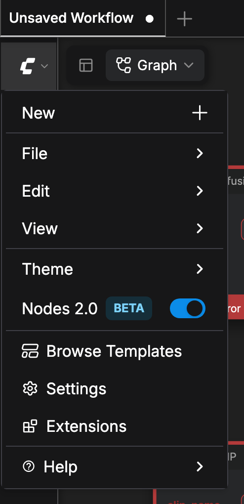
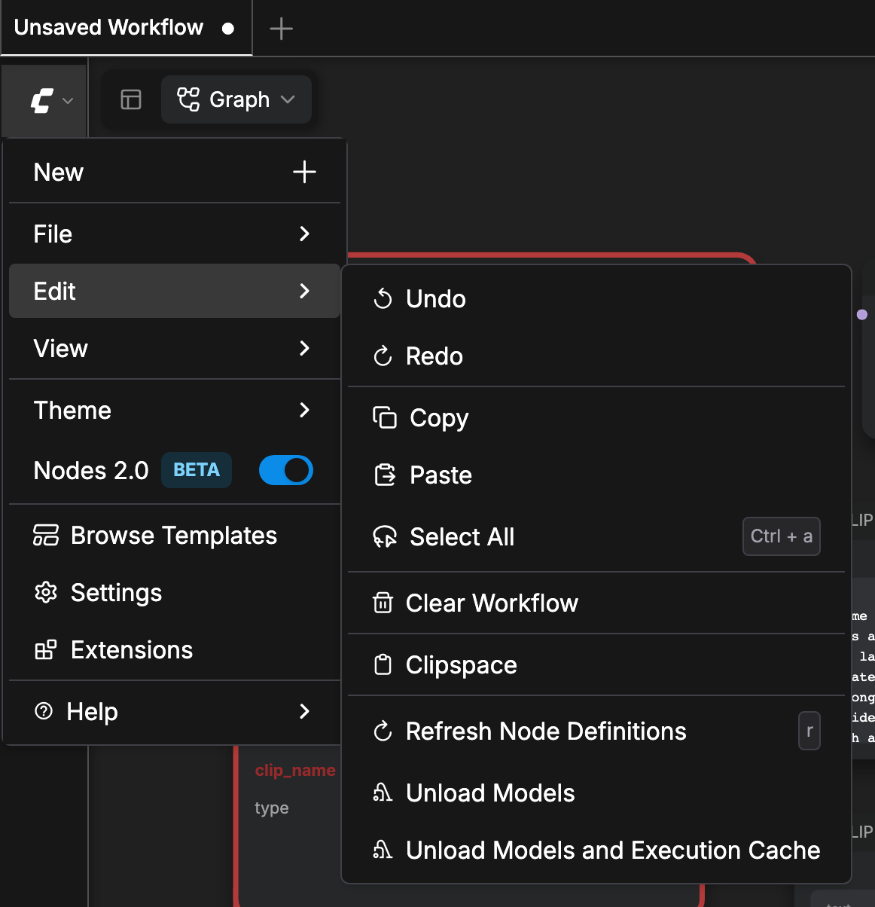

The Comfy menu opens from the Comfy logo at the top of the left sidebar. It holds the commands that have no canvas control: starting and saving workflows, clipboard edits, view toggles, GPU memory cleanup, and links to help.

Click the logo or the chevron beside it to open the menu. An entry with a chevron on its right has a submenu: hover it to open.

## Entries

| Entry | What it does |
| --- | --- |
| **New** | Starts a blank workflow |
| **File** | Open, save, and export the workflow |
| **Edit** | Undo and redo, clipboard, Clipspace, node definitions, GPU memory |
| **View** | Bottom panel, focus mode, minimap, node links, zoom |
| **Theme** | Submenu of built-in and custom themes, with the active one checked |
| **Nodes 2.0** | Switch for the Nodes 2.0 renderer, see [Nodes 2.0](/interface/nodes-2) |
| **Browse Templates** | Opens the template browser, see [Templates](/interface/features/template) |
| **Settings** | Opens the settings dialog, the same as `Ctrl + ,` |
| **Extensions** | Opens the manager for custom nodes and frontend extensions |
| **Help** | Issue tracker, docs, Discord, forum, About, and support |

### File

| Entry | Shortcut | What it does |
| --- | --- | --- |
| **Open** | `Ctrl + O` | Opens a workflow from disk |
| **Save** | `Ctrl + S` | Saves the current workflow |
| **Save As** | | Saves under a new name |
| **Export** | | Downloads the workflow as JSON |
| **Export (API)** | | Downloads the API-format prompt, see [Workflow API format](/development/api-development/workflow-api-format) |
| **Export (Workflow Image)** | | Downloads a PNG of the canvas with the workflow embedded. Requires frontend 1.61.4 or later, see [Workflows](/basic-concepts/workflow) |

### Edit

| Entry | Shortcut | What it does |
| --- | --- | --- |
| **Undo** / **Redo** | | Steps through canvas changes |
| **Copy** / **Paste** | | Duplicates the selected nodes |
| **Select All** | `Ctrl + A` | Selects every node on the canvas |
| **Clear Workflow** | | Empties the canvas. Saved workflows stay saved |
| **Clipspace** | | Opens the clipboard space for images and copied nodes |
| **Refresh Node Definitions** | `R` | Reloads node definitions without restarting ComfyUI |
| **Unload Models** | | Frees GPU memory held by loaded models |
| **Unload Models and Execution Cache** | | Also drops cached results, so the next run recomputes them |

### View

| Entry | Shortcut | What it does |
| --- | --- | --- |
| **Bottom Panel** | | Shows or hides the [bottom panel](/interface/bottom-panel) |
| **Browse Templates** | | Opens the template browser |
| **Focus Mode** | | Hides everything but the canvas, see [Canvas controls](/interface/canvas-controls) |
| **Canvas Performance** | | Shows or hides the canvas performance readout |
| **Minimap** | `Alt + Shift + M` | Shows or hides the minimap |
| **Node Links** | | Shows or hides link rendering |
| **Zoom In** / **Zoom Out** | `Alt + =` / `Alt + -` | Zooms the canvas |
| **Zoom to fit** | `.` | Fits the selected nodes, or the whole workflow when nothing is selected |

### Help

| Entry | Opens |
| --- | --- |
| **ComfyUI Issues** | The ComfyUI issue tracker on GitHub |
| **ComfyUI Docs** | docs.comfy.org |
| **Comfy-Org Discord** | The community Discord server |
| **ComfyUI Forum** | The ComfyUI forum |
| **About ComfyUI** | Version and system information, see [About](/interface/settings/about) |
| **Contact Support** | The support form |

## Free memory without restarting

Two Edit entries release memory during a session:

- **Unload Models** drops every loaded checkpoint, LoRA, and VAE from GPU memory.
- **Unload Models and Execution Cache** also clears cached execution results, so the next run computes them again instead of reusing them.

Use the first when you want to load a different model, and the second after changing a model file on disk. Both are local-only: Comfy Cloud hides them because the server manages model memory.

## Where the menu differs

- **Comfy Cloud** hides the two unload entries. Every other entry behaves as described here.
- **Comfy Desktop** adds entries to the **Help** submenu: Desktop User Guide, Open DevTools, an Open Folder submenu, Check for Updates, and Reinstall.

## Related pages

- [Interface overview](/interface/overview)
- [Keyboard shortcuts](/interface/shortcuts)
- [Comfy settings](/interface/settings/comfy)
