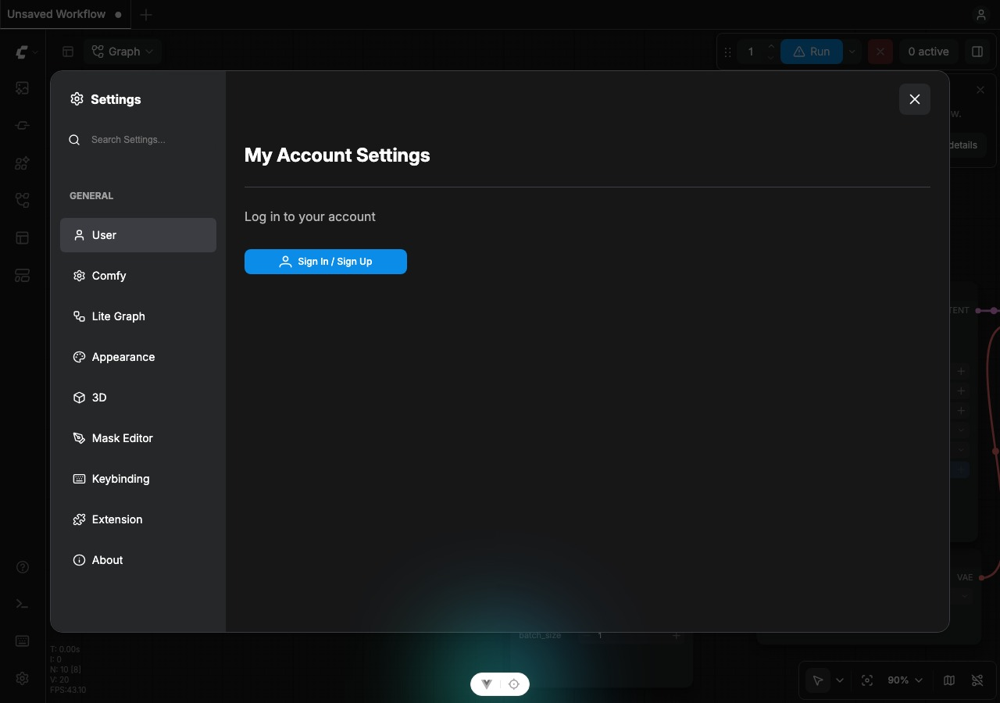
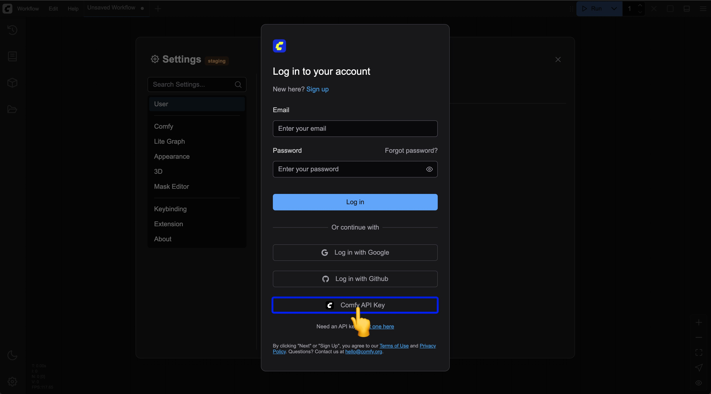
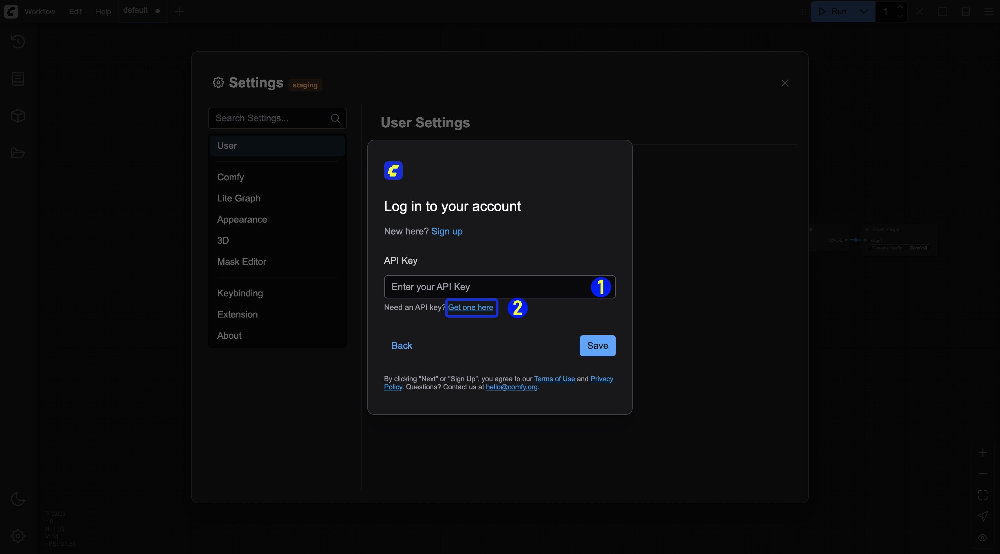
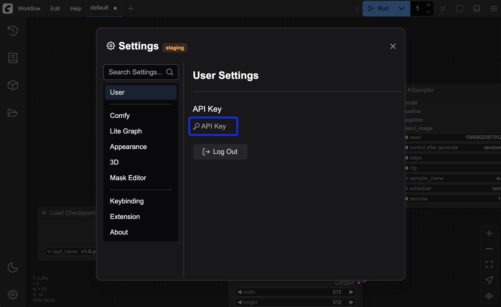
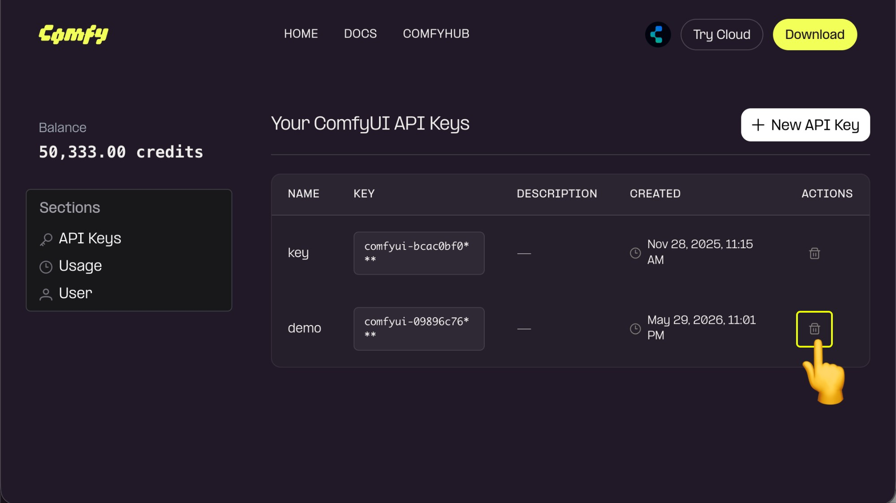
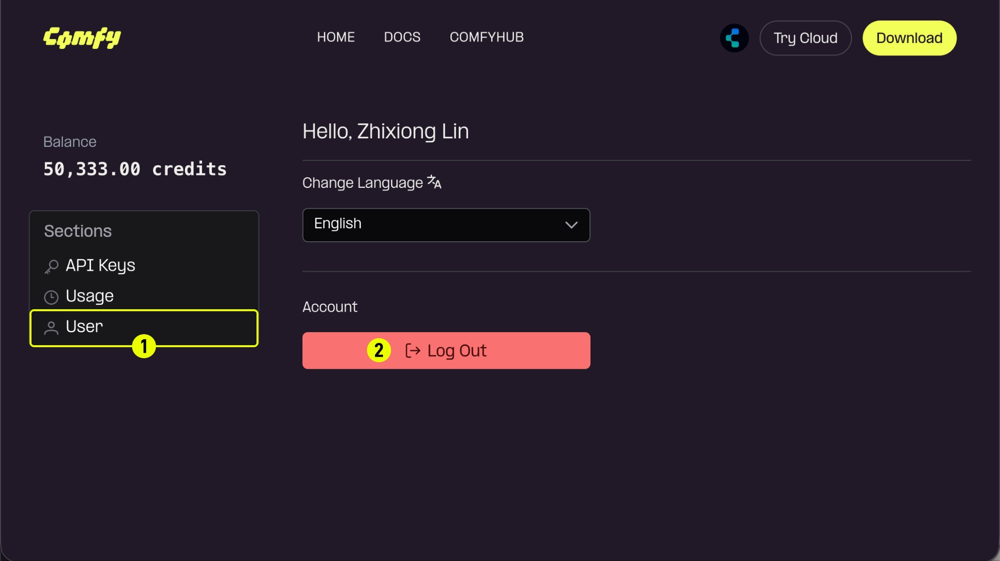

import GetApiKey from '/snippets/ja/get-api-key.mdx'

Comfy アカウントを利用すると、[パートナーノード（Partner Node）](/ja/tutorials/partner-nodes/overview)および[クラウドサブスクリプション](https://www.comfy.org/cloud)にアクセスでき、ComfyUI プラットフォーム全体でプレミアム機能やサービスをご利用いただけます。

## サポートされるログイン方法

ComfyUI では、以下のログイン方法がサポートされています：
- **メールアドレス**：登録済みのメールアドレスとパスワードでログイン
- **Google**：Google アカウントでログイン
- **GitHub**：GitHub アカウントでログイン
- **シングルサインオン (SSO)**：組織の ID プロバイダーでログイン

## シングルサインオン (SSO) でのログイン

組織が ID プロバイダーで Comfy アカウントを管理している場合、メールアドレスとパスワード、Google、GitHub の代わりに、**SSOで続行**をクリックしてログインします。

1. ログインページでメールアドレスを入力します。
2. 組織のシングルサインオンでサインインする旨が表示されたら、**SSOで続行**をクリックします。
3. ID プロバイダーのページでログインを完了します。ログイン済みの状態で Comfy Cloud に戻ります。

シングルサインオンが未設定の場合、または組織の管理者が無効にしている場合は、組織の管理者に確認してください。

<Note>
SSO アカウントは現在 ComfyUI デスクトップアプリにログインできません。ブラウザをご利用ください。また、SSO アカウントではワークスペースの招待リンクをまだ受け付けられません。ワークスペースの管理者に直接追加を依頼してください。
</Note>

## Comfy Cloud でのログイン

Comfy Cloud 上で ComfyUI を使用するための Comfy アカウントにアクセスするには：

1. [Comfy Cloud](https://www.comfy.org) へ移動します
2. **ログイン**をクリックします
3. ログイン方法を選択します：
   - **メールアドレス**：メールアドレスとパスワードを入力し、「ログイン」をクリックします
   - **Google**：Google ログインボタンをクリックして認証を行います
   - **GitHub**：GitHub ログインボタンをクリックして認証を行います

## ローカル環境でのログイン

ローカルに ComfyUI をインストール済みの場合：

1. ローカルマシン上で ComfyUI を起動します
2. インターフェース内の **設定** へ移動します
3. **ユーザー** セクションへ進みます（詳細は [ユーザー設定](/ja/interface/user) をご参照ください）
4. ログイン方法を選択します：
   - **メールアドレス**：メールアドレスとパスワードを入力します
   - **Google**：Google ログインボタンをクリックして認証を行います
   - **GitHub**：GitHub ログインボタンをクリックして認証を行います
   - **API キー**：ホワイトリスト未登録のデプロイメント向けに API キーによるログイン（以下参照）

### API キーによるログイン

現在、すべての ComfyUI デプロイメントが当社のドメイン認証ホワイトリストに登録されているわけではないため、ホワイトリスト未登録サイトからのログインを可能とするために、最新のアップデート（2025-05-10）で API キーによるログイン機能を追加しました。以下に、API キーを用いたログイン手順を示します：

<video
  controls
  className="w-full aspect-video"
  src="/images/interface/setting/user/api_login.mp4"
></video>

<Tabs>

  <Tab title="すでに API キーをお持ちの方">

  <Steps>
  <Step title="ログイン画面で「Comfy API キー」ログインを選択">
    ログインポップアップ内で `Comfy API Key` を選択します  
    
  </Step>

  <Step title="API キーを入力">
    
    1. API キーを入力し、保存します  
    2. API キーをお持ちでない場合は、「ここで取得」リンクをクリックして https://platform.comfy.org/login へ移動し、ログインして取得してください。
  </Step>
  <Step title="ログイン成功">
    成功すると、設定メニューに該当する API キーによるログイン情報が表示されます  
    
  </Step>
</Steps>

  </Tab>
  <Tab title="API キーをお持ちでない場合：まず API キーを申請してください">
API キーの申請および取得手順については、以下のステップをご参照ください：

<GetApiKey />

<Steps>
  <Step title="API キーの管理">
    
    使用していない API キー、または漏洩リスクのある API キーについては、「Delete」をクリックして削除することで、不要な損失を防ぐことができます。
  </Step>
  <Step title="（任意）ログアウト">
    
    API キーを取得済みで、パブリックな端末でログインしている場合は、速やかにログアウトすることを推奨します。
  </Step>
</Steps>

  </Tab>
</Tabs>

## パスワードを忘れてしまった場合

メールアドレスによるログインでパスワードを忘れた場合：

1. ログインページの **パスワードを忘れた場合？** リンクをクリックします
2. 登録済みのメールアドレスを入力します
3. パスワード再設定手順が記載されたメールを受信したことを確認します
4. メール内の再設定リンクをクリックします
5. 新しいパスワードを作成します
6. 新しいパスワードでログインします

## ログインに関するトラブルシューティング

ログイン時に問題が発生した場合：

- メールアドレスが正しいか確認してください
- パスワード入力時に Caps Lock が有効になっていないか確認してください
- ブラウザの Cookie およびキャッシュをクリアしてください
- 別のブラウザ、またはシークレットモードで試してみてください
- アカウントのメールアドレスが検証済みであることを確認してください
- 問題が解決しない場合は、[サポート](/support/contact-support) までお問い合わせください

## セキュリティに関するヒント

アカウントの安全性を保つために：
- 強固で一意のパスワードを使用してください
- ログイン情報を他の人と共有しないでください
- 共有デバイスを使用する際は、必ずログアウトしてください
- 定期的にパスワードを更新してください
