## 概要

**Comfy MCP** は、[Model Context Protocol](https://modelcontextprotocol.io) を介して AI エージェントを ComfyUI に接続します。接続すると、画像、動画、音声、3D の生成、モデル、ノード、テンプレートの検索、さらにエージェントとのチャットから実際の ComfyUI ワークフローを実行できます。

2 つの接続方法が用意されています。**Comfy Cloud** 接続と**ローカル ComfyUI** 接続で、ローカル接続は完全にオープンソースです。

<Tip>
  **以下の内容でお困りですか？ 一番良い方法は、このページをエージェントに渡して助けを求めることです。**
</Tip>

### どの接続を選ぶべきか

**新規ユーザーには、クラウド接続から始めることをお勧めします。** 最も簡単なセットアップです。claude.ai、ChatGPT、または Claude Desktop チャットアプリを使用する場合も、クラウド接続の方が互換性が高い選択肢です。

**すでに ComfyUI をローカルまたは独自にデプロイした環境で実行している場合や、Claude Code、Cursor、Codex などのコーディングエージェントを主に使用する場合は、ローカル接続から始めてください。**

<Info>
  **Mac ユーザーの場合、オープンソースモデルを実行する予定なら、クラウド接続をお勧めします。** 現在のオープンウェイトモデル（MiniMax H3 や LTX-2.3 などのローカル版）は大きく、Apple GPU では実用的な速度で動作しません。
</Info>

両方を同時に実行するのは普通のことで、ほとんどのクライアントは 2 つの MCP サーバーを問題なくホストします。同じ Comfy アカウントにログインしますが、**別々に**行う必要があります。一方のログインで両方の接続が有効になるわけではありません。

## Comfy Cloud MCP 接続

ホスト型の接続方法で、エージェントを **Comfy Cloud** アカウントにリンクします。インストールは不要で、ワークフローは Comfy Cloud の GPU 上で実行されます。Comfy Cloud の詳細については、[Comfy Cloud](/ja/get_started/cloud) を参照してください。

### クラウド接続のセットアップ

<Info>
  接続する前に [Comfy Cloud](https://cloud.comfy.org) アカウントが必要です。まだお持ちでない場合は[サインアップ](https://cloud.comfy.org)してください。新規ユーザーは**5回の無料実行**で試すことができます。セットアップ中の OAuth サインインには、お使いの Comfy アカウントが使用されます。
</Info>

Comfy Cloud MCP は次の URL で動作します:

```
https://cloud.comfy.org/mcp
```

クライアントを選択してください:

<Tabs><Tab title="Claude Desktop">
    Claude Desktop は UI から Comfy Cloud を**カスタムコネクタ**として追加し、続いて OAuth サインインを実行します。

    <video
      controls
      className="w-full aspect-video rounded-xl"
      src="/images/agent_tools/Claude_desktop.mp4"
    ></video>

    <Steps>
      <Step title="カスタマイズを開く">
        サイドバーで**カスタマイズ**（**1**）をクリックします。

        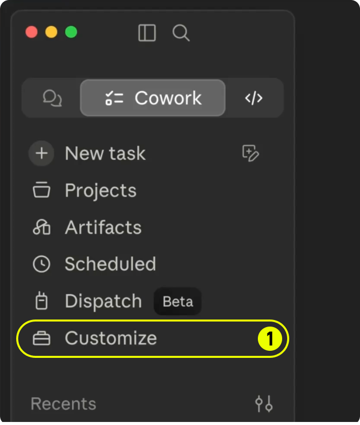
      </Step>
      <Step title="コネクタを開く">
        **コネクタ**（**2**）をクリックします。

        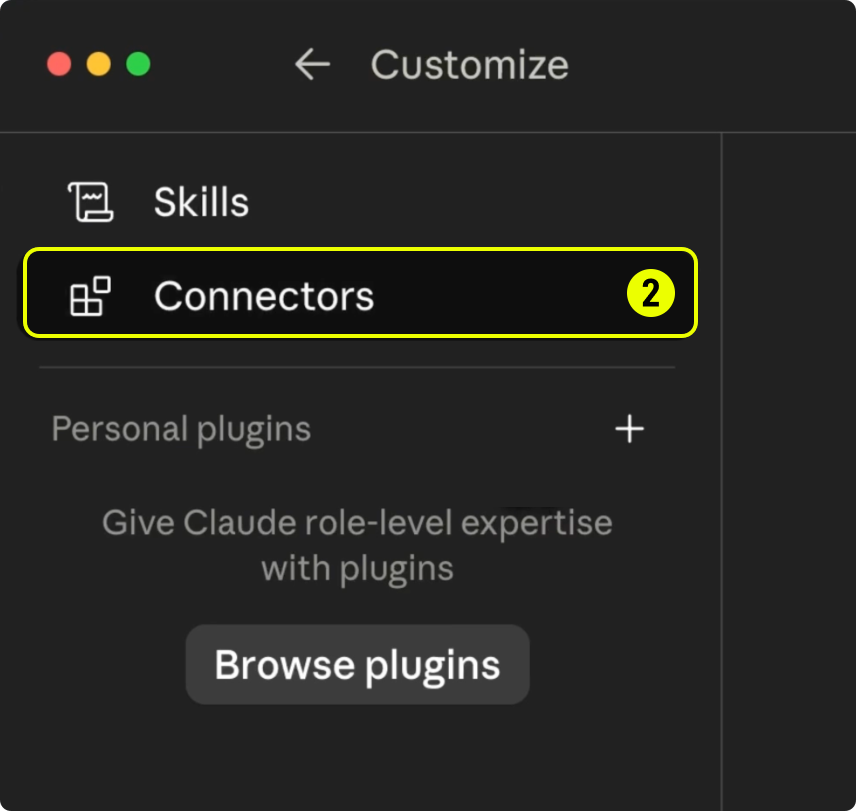
      </Step>
      <Step title="カスタムコネクタを追加する">
        1. コネクタのヘッダーにある **+** ボタン（**3**）をクリックします。
        2. **カスタムコネクタを追加**（**4**）を選択します。

        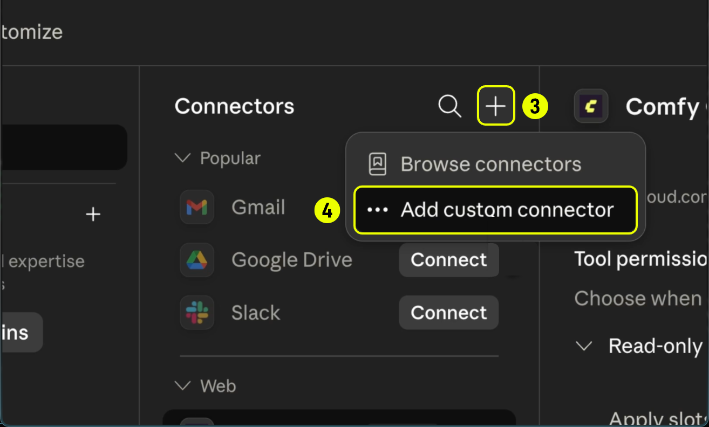
      </Step>
      <Step title="サーバーの詳細を入力する">
        1. **名前**フィールドに **Comfy Cloud MCP** などの名前を入力します（**5**）。
        2. **リモートMCPサーバーURL** を `https://cloud.comfy.org/mcp` に設定します（**6**）。
        3. **追加**（**7**）をクリックします。

        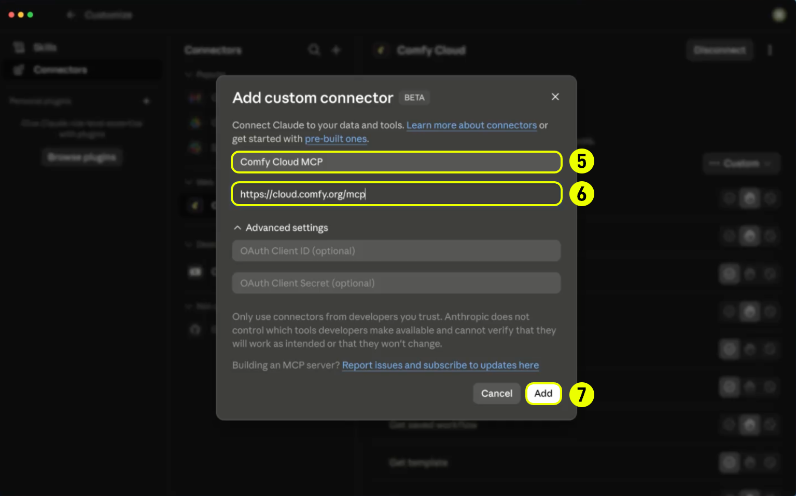
      </Step>
      <Step title="ログインする">
        1. ブラウザが開いたら、ワークスペース（例: **個人ワークスペース**）を選択します。
        2. **続ける**をクリックしてコネクタを承認します。これで接続が完了します。

        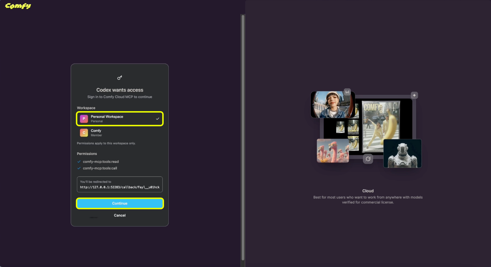
      </Step>
    </Steps>

  </Tab>

  <Tab title="Claude Code">
    **comfy-cloud** プラグインをインストールします。MCP接続とスラッシュコマンドが一度に追加されます。このプラグインは [Comfy Skills](https://github.com/Comfy-Org/comfy-skills/) リポジトリを通じて公開されており、Comfy 向けの Claude Code プラグインとコミュニティのエージェントスキルをホストしています。

    <Steps>
      <Step title="マーケットプレイスを追加">
        Comfy Skills マーケットプレイスを登録します（初回のみ）:

        ```
        /plugin marketplace add Comfy-Org/comfy-skills
        ```
      </Step>
      <Step title="プラグインをインストール">
        ```
        /plugin install comfy-cloud@comfy-skills
        ```
      </Step>
      <Step title="ログイン">
        `/mcp` を実行し、**comfy-cloud** → **Authenticate** を選択します。ブラウザが開いてログインでき、トークンは自動的に更新されます。
      </Step>
    </Steps>

    このプラグインは次のスラッシュコマンドを追加します:

    | コマンド | 動作 |
    | --- | --- |
    | `/comfy-cloud:generate-image` | 画像を生成、編集、または変更する |
    | `/comfy-cloud:generate-video` | ビデオを生成、編集、または延長する |
    | `/comfy-cloud:generate-audio` | オーディオ、音楽、またはサウンドエフェクトを生成する |
    | `/comfy-cloud:generate-3d` | テキストまたは画像から3Dモデルを生成する |
    | `/comfy-cloud:remove-background` | 画像から背景を削除する |
    | `/comfy-cloud:upscale-image` | 画像をより高い解像度にアップスケールする |
    | `/comfy-cloud:search-templates` | [comfy.org](https://comfy.org) 上の構築済みワークフローテンプレートを探す |
    | `/comfy-cloud:search-models` | 利用可能なモデルを検索する |
    | `/comfy-cloud:search-nodes` | ノードを検索し、配線の提案を得る |
    | `/comfy-cloud:help` | ComfyUI Cloud でできることを確認する |

    <Accordion title="プラグインを使わず、接続だけを利用したい場合">
      サーバーを直接追加します:

      ```bash
      claude mcp add --transport http comfy-cloud https://cloud.comfy.org/mcp
      ```

      その後 `/mcp` を実行し、**comfy-cloud** → **Authenticate** を選択します。すべてのプロジェクトで利用できるようにするには `-s user` を追加します。

      この方法でも同じワークフローが MCP プロンプトとして公開されます: `/mcp__comfy-cloud__generate-image`、`/mcp__comfy-cloud__search-models` など（`/mcp__<name>__` のプレフィックスには `claude mcp add` に渡した名前が使われます）。上記のプラグインは、これらをより使いやすい `/comfy-cloud:*` コマンドとしてラップするため推奨です。
    </Accordion>
  </Tab>

  <Tab title="Cursor">
    Cursor は HTTP 経由でリモート MCP サーバーに接続します。Cursor は現在 MCP OAuth をサポートしてい**ません**。Comfy Cloud は MCP 設定で Comfy Cloud APIキーを使って追加します。

    <Steps>
      <Step title="Cursor の設定を開く">
        右上の **Settings** 歯車アイコンをクリックします（**1** と表示）。

        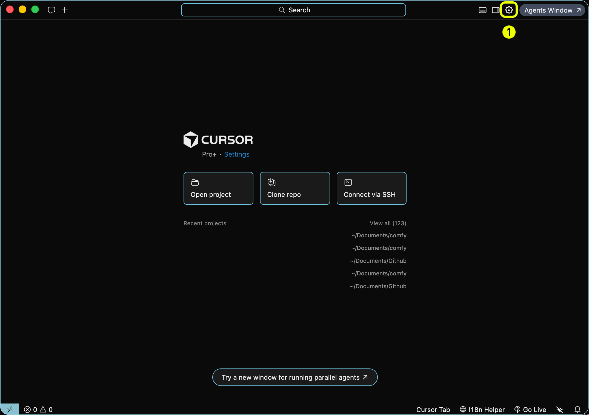
      </Step>
      <Step title="Tools & MCP を開く">
        1. サイドバーで **Tools & MCPs** をクリックします（**2** と表示）。
        2. **+ New MCP Server** をクリックし（**3** と表示）、**Add a Custom MCP Server** を選択します。

        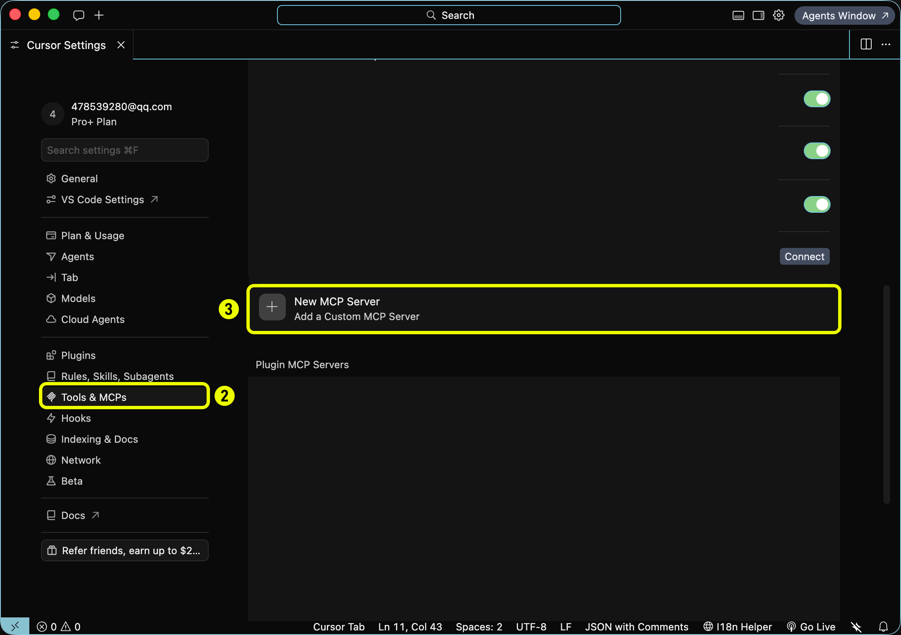
      </Step>
      <Step title="APIキーを追加する">
        `~/.cursor/mcp.json`（グローバル）または `.cursor/mcp.json`（プロジェクト）を編集します。サーバー URL を設定し、`X-API-Key` ヘッダーで Comfy Cloud APIキーを渡します。キーは [platform.comfy.org/profile/api-keys](https://platform.comfy.org/profile/api-keys) で作成します（`comfyui-` で始まります）。

        ```json
        {
          "mcpServers": {
            "comfy-cloud": {
              "url": "https://cloud.comfy.org/mcp",
              "headers": {
                "X-API-Key": "${env:COMFY_API_KEY}"
              }
            }
          }
        }
        ```

        `COMFY_API_KEY` はシェルまたはシステムの環境変数に設定します。Git にコミットする可能性のあるファイルにキーをハードコードするより、`${env:COMFY_API_KEY}` の使用を推奨します。

        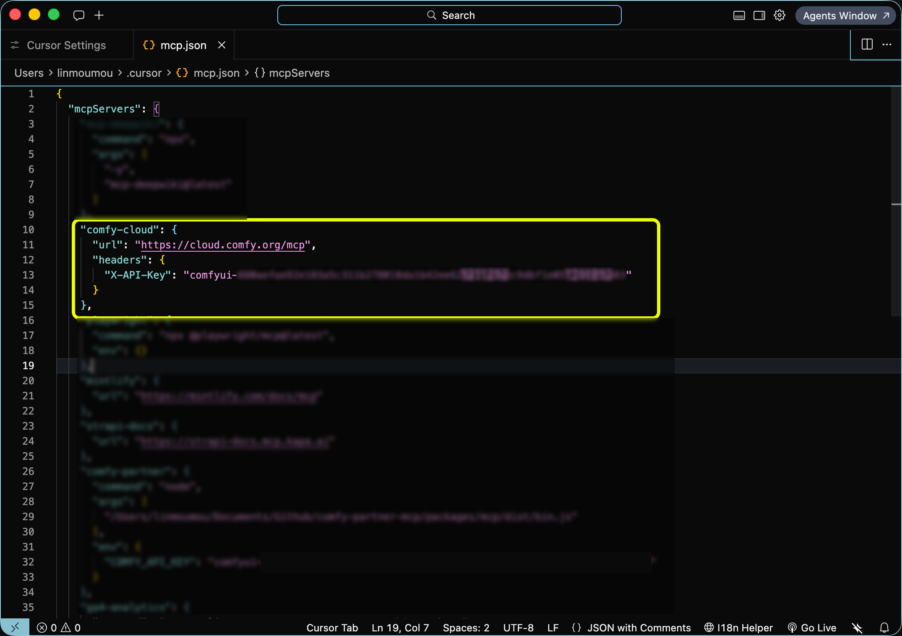
      </Step>
      <Step title="生成を開始する">
        自然な言葉で依頼します（「猫の宇宙飛行士の画像を生成して」「Wan 2.2 のビデオテンプレートを探して」など）。Cursor がユーザーに代わって MCP ツールを呼び出します。
      </Step>
    </Steps>
  </Tab>

  <Tab title="Codex">
    [Codex](https://developers.openai.com/codex/cli) は Streamable HTTP 経由で Comfy Cloud に接続します。設定でサーバーを追加し、OAuth でログインします。

    <video
      controls
      className="w-full aspect-video rounded-xl"
      src="/images/agent_tools/CodeX_Oauth_mcp.mp4"
    ></video>

    <Steps>
      <Step title="設定パネルを開く">
        1. *Logged in with API key* の下にある **Settings**（**1** と表示）をクリックします。
        2. **Settings**（**2** と表示）をクリックして、設定パネル全体を開きます。

        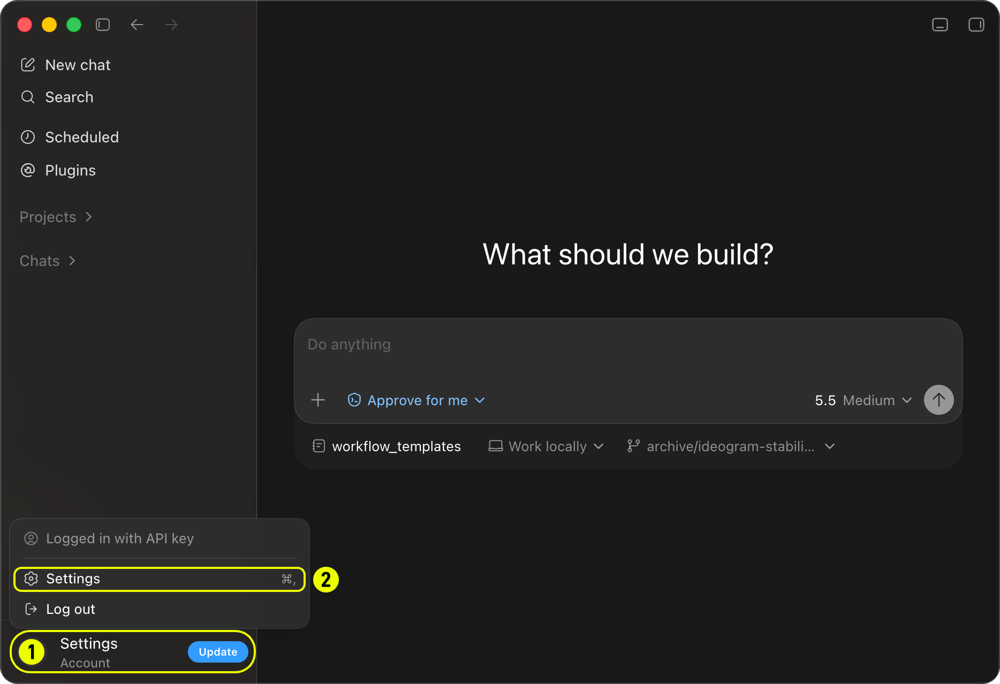
      </Step>
      <Step title="MCP サーバー設定を開く">
        1. 設定一覧で **MCP servers**（**3** と表示）をクリックします。
        2. **+ Add server**（**4** と表示）をクリックして、新しい MCP サーバーを追加します。

        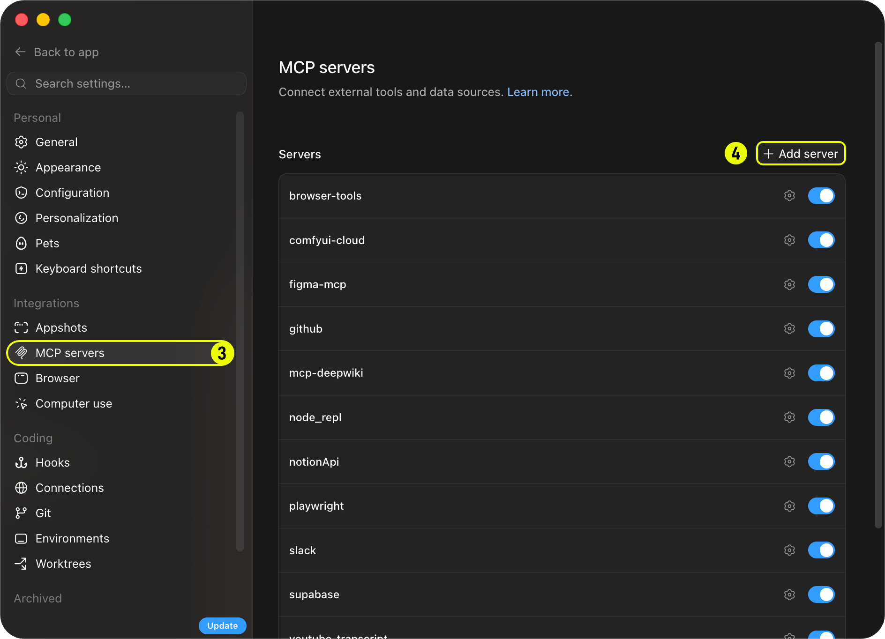
      </Step>
      <Step title="Comfy Cloud に接続する">
        1. 接続タイプとして **Streamable HTTP** を選択します。
        2. **Name** フィールド（**5** と表示）に **Comfy Cloud MCP** などの名前を入力します。
        3. **URL** フィールド（**6** と表示）に URL `https://cloud.comfy.org/mcp` を入力します。
        4. **Save**（**7** と表示）をクリックします。

        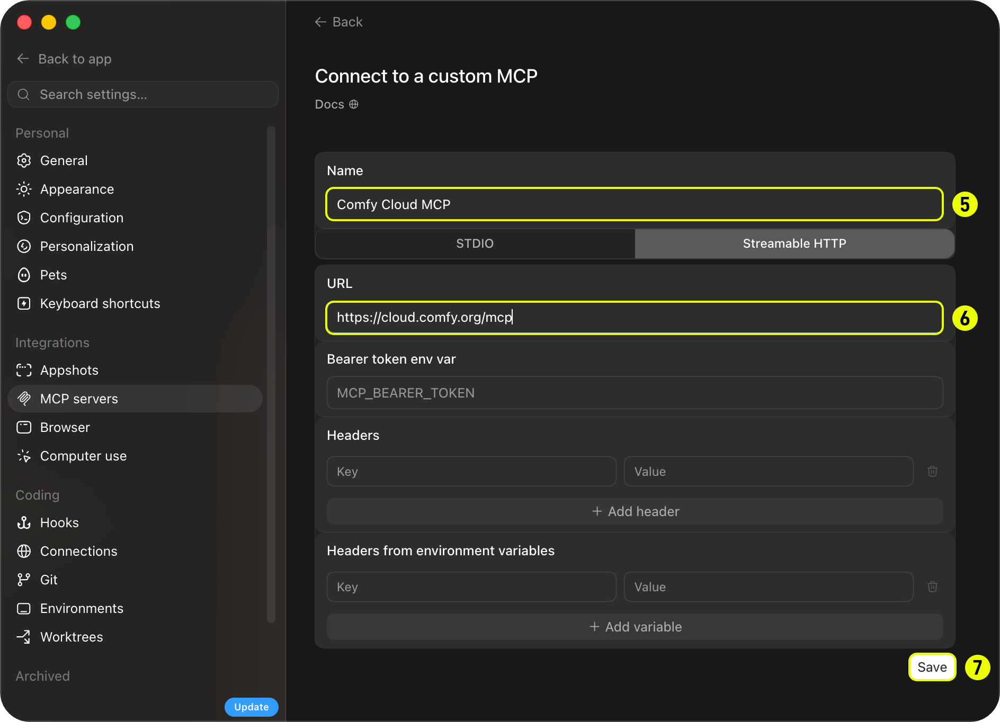
      </Step>
      <Step title="認証する">
        1. 保存済みのサーバーエントリで **Authenticate**（**8** と表示）をクリックします。

        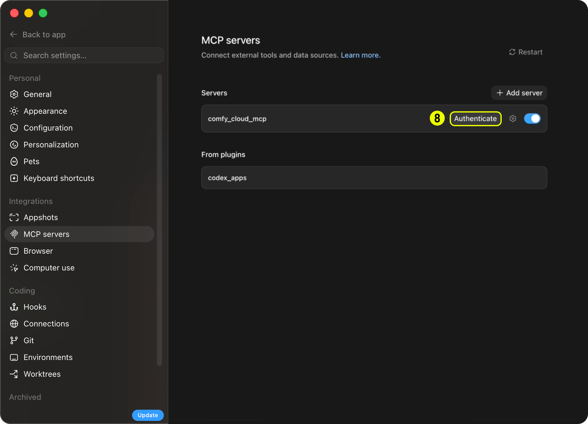

        2. ブラウザのポップアップでワークスペースを選択し、**Continue** をクリックしてログインを完了します。これで接続完了です。

        
      </Step>
    </Steps>

    自然な言葉で依頼できます（「猫の宇宙飛行士の画像を生成して」「Wan 2.2 のビデオテンプレートを探して」）。Codex がユーザーに代わって MCP ツールを呼び出します。

    <Accordion title="CLI を使いたい場合">
      ターミナルから登録してログインします:

      ```bash
      codex mcp add comfy-cloud --url https://cloud.comfy.org/mcp
      codex mcp login comfy-cloud
      ```

      これにより `~/.codex/config.toml`（信頼済みプロジェクトでは `.codex/config.toml`）にエントリが書き込まれます。
    </Accordion>

    <Accordion title="OAuth の代わりに APIキーを使う（ヘッドレスまたは CI）">
      ブラウザが利用できない場合は、環境変数から取得したヘッダーを使ってサーバーを追加します。[platform.comfy.org/profile/api-keys](https://platform.comfy.org/profile/api-keys) でキーを作成し（`comfyui-` で始まります）、`~/.codex/config.toml` に追加します:

      ```toml
      [mcp_servers.comfy-cloud]
      url = "https://cloud.comfy.org/mcp"
      env_http_headers = { "X-API-Key" = "COMFY_API_KEY" }
      ```

      `COMFY_API_KEY` をシェルまたはシステムの環境変数に設定します。キーをバージョン管理にコミットしないでください。
    </Accordion>

    <Accordion title="Codex から何度も再度サインインを求められる（invalid_grant またはリフレッシュトークンの再利用）">
      **症状:** Codex が Comfy Cloud からログアウトさせ、何度も再認証を求めてきます。数分おきに起こることもあります。Codex の警告やログに `invalid_grant`、すでに使用済みまたは失効したリフレッシュトークン、OAuth トークンの更新失敗などが記録される場合があります。

      **原因:** これは Codex が MCP の OAuth 認証情報を保存・更新する方法に起因するもので、Comfy Cloud の問題ではありません。複数の Codex プロセス（TUI セッション、アプリサーバー、`codex mcp` コマンド）が 1 つの OAuth サーバーを共有していると、あるプロセスが、別のプロセスによってすでにローテーションされたトークンで更新を行うことがあります。認可サーバーはそれをトークンの再利用とみなし、セッションを終了します。他の OAuth MCP サーバーのユーザーも同じ動作を報告しています。これらの問題は Codex のリポジトリでオープンになっているため、現在の状況を確認できます:

      - [openai/codex#46028](https://github.com/openai/codex/issues/46028): 長時間稼働するクライアントがローテーション済みのリフレッシュトークンを再利用する
      - [openai/codex#48507](https://github.com/openai/codex/issues/48507): 並行するプロセスがリフレッシュトークンのローテーションを競合し、次回起動時に `invalid_grant` が発生する
      - [openai/codex#41133](https://github.com/openai/codex/issues/41133): シャットダウン時にローテーション済みのリフレッシュトークンが失われることがある
      - [openai/codex#17265](https://github.com/openai/codex/issues/17265): Codex が保存済みの MCP OAuth トークンを更新しない

      **回避策 1: Codex のリフレッシュ調整フラグを有効にする。** Codex には、Codex プロセス間で OAuth トークンの更新を調整する機能フラグ `mcp_oauth_refresh_coordination` があります。これは Comfy 側ではなく Codex 側の設定です。Codex はこれを開発中かつデフォルトでオフとしており、Codex も Comfy も公式な修正としてサポートしていません。openai/codex#46028 では、これを有効にすることで報告者のテストで古いトークンの再利用が止まりました。お使いの Codex のバージョンでまだオフの場合は、`~/.codex/config.toml` に追加します:

      ```toml
      [features]
      mcp_oauth_refresh_coordination = true
      ```

      実行中のすべての Codex セッションを閉じて再起動し、すべてのセッションがこのフラグを読み込むようにします。Codex で **comfy-cloud** がすでにサインアウト状態と表示されている場合は、もう一度ログインします（`codex mcp login comfy-cloud`、または設定の **Authenticate**）。今後の Codex リリースでこれがデフォルトで有効になるか、フラグが削除された場合は、この手順を省略できます。

      **回避策 2: 各サーバーの更新を 1 つの Codex プロセスだけが行うようにする。** フラグが利用できない、または効果がない場合は、`[mcp_servers.comfy-cloud]` エントリをグローバルの `~/.codex/config.toml` から、信頼済みプロジェクト内の `.codex/config.toml` に移動して、そのプロジェクトのセッションだけがこのエントリを読み込んで更新するようにします。同時に多数の Codex セッションを Comfy Cloud に対して実行することは避け、コンピューターを再起動する前に Codex セッションを閉じてください。これは openai/codex#48507 で報告されている回避策です。

      エントリを移動しても、すでにグローバル設定を読み込んだ Codex プロセスは停止せず、それらは古いサーバー定義を更新し続けます。移動後、実行中のすべての Codex セッションを閉じ、Codex アプリサーバーを停止してから、そのエントリを持つプロジェクトでのみ Codex を起動します。
      OAuth が不要な場合、上記の API キー設定ではリフレッシュトークンを使用しません。

      これらの手順はサインアウトを減らしますが、完全には防げない可能性があります。Comfy Cloud 側でも、この問題の発生頻度を下げるための変更を進めています。
    </Accordion>
  </Tab>

  <Tab title="OpenClaw">
    [ClawHub](https://clawhub.ai/comfy-org/skills/comfy) から **Comfy Cloud** スキルをインストールします。このスキルは OpenClaw をホスト型 MCP サーバー (`cloud.comfy.org/mcp`) に接続します。クラウド専用です。ローカルの ComfyUI インストールを操作することはありません。

    <Steps>
      <Step title="スキルをインストール">
        ```bash
        openclaw skills install @comfy-org/comfy
        ```

        スキルページ: [clawhub.ai/comfy-org/skills/comfy](https://clawhub.ai/comfy-org/skills/comfy)。
      </Step>
      <Step title="OAuth で接続（推奨）">
        MCP サーバーを登録し、Comfy アカウントでログインします:

        ```bash
        openclaw mcp set comfy '{"url":"https://cloud.comfy.org/mcp","transport":"streamable-http","auth":"oauth"}'
        openclaw mcp login comfy
        openclaw gateway restart
        ```

        `openclaw mcp login` は認可 URL を出力します。それを開いてログインし、CLI の指示に従ってフローを完了します（`--code` の値を付けて再実行するよう求められる場合があります）。`openclaw mcp status --verbose` で確認できます。

        <Note>
          `auth: "oauth"` が設定されている場合、OpenClaw はそのサーバーエントリの静的な `headers` を無視します。OAuth とハードコードされた APIキーヘッダーを併用しないでください。
        </Note>
      </Step>
      <Step title="生成を開始">
        自然な言葉で依頼します（「猫の宇宙飛行士の画像を生成して」「Wan 2.2 のビデオテンプレートを探して」など）。OpenClaw がユーザーに代わって MCP ツールを呼び出します。
      </Step>
    </Steps>

    <Accordion title="OAuth の代わりに APIキーを使用（ヘッドレスまたは CI）">
      [platform.comfy.org/profile/api-keys](https://platform.comfy.org/profile/api-keys) でキーを作成し（`comfyui-` で始まります）、エクスポートしてからサーバーを登録します:

      ```bash
      export COMFY_API_KEY="comfyui-..."
      openclaw mcp set comfy '{"url":"https://cloud.comfy.org/mcp","transport":"streamable-http","headers":{"Authorization":"Bearer ${COMFY_API_KEY}"}}'
      openclaw gateway restart
      ```

      OpenClaw ではカスタムの `X-API-Key` ヘッダーよりも `Authorization: Bearer` を推奨します。一部の OpenClaw ビルドでは streamable-http トランスポートでカスタムヘッダーが破棄されますが、Bearer はプロキシをより確実に通過します。`COMFY_API_KEY` はシェルのプロフィールまたは OpenClaw の env に設定してください。キーをコミットしないでください。
    </Accordion>
  </Tab>

  <Tab title="その他のクライアント">
    **リモート HTTP** トランスポートをサポートする MCP クライアントであれば、Comfy Cloud に接続できます。サーバー URL は常に `https://cloud.comfy.org/mcp` です。

    <Steps>
      <Step title="サーバー URL を追加">
        `https://cloud.comfy.org/mcp` を指すリモート MCP エントリを追加します。ほとんどのクライアントは `url` フィールドを含む JSON 設定を使用します：

        ```json
        {
          "mcpServers": {
            "comfy-cloud": {
              "url": "https://cloud.comfy.org/mcp"
            }
          }
        }
        ```

        **Windsurf** は `url` の代わりに `serverUrl` を使用します。**Amp** は **設定 → MCP サーバー** または `~/.config/amp/settings.json` で同じ `mcpServers` 形式を使用します。
      </Step>
      <Step title="認証">
        クライアントが MCP OAuth をサポートしている場合は、プロンプトが表示されたらブラウザ経由でログインします。そうでない場合は、APIキーヘッダーを追加します（以下を参照）。
      </Step>
      <Step title="再起動して確認">
        クライアントを再起動します。**comfy-cloud** サーバーの下に Comfy Cloud ツール（`search_templates`、`submit_workflow`、`get_output` など）が登録されているはずです。
      </Step>
    </Steps>

    **ヘッドレス / CI（APIキー）：** OAuth が利用不可の場合は、[platform.comfy.org/profile/api-keys](https://platform.comfy.org/profile/api-keys) でキーを作成し、`X-API-Key` ヘッダーとして渡します：

    ```json
    {
      "mcpServers": {
        "comfy-cloud": {
          "url": "https://cloud.comfy.org/mcp",
          "headers": {
            "X-API-Key": "comfyui-…"
          }
        }
      }
    }
    ```

    ターミナルから Claude Code を使用する場合：

    ```bash
    claude mcp add --transport http comfy-cloud https://cloud.comfy.org/mcp -H "X-API-Key: comfyui-…"
    ```

    Git にコミットする設定ファイルにキーをハードコードする代わりに、`${env:COMFY_API_KEY}` またはクライアントのシークレット補間を使用することをおすすめします。
  </Tab>
</Tabs>

### エージェントができること

自分で MCP ツールを呼び出す必要はありません。エージェントが、あなたの依頼内容に基づいて適切なツールを選択します。スラッシュコマンドとプロンプト（以下）は、エージェントを一般的なタスクへ導くショートカットですが、自然な言葉でも問題なく動作します（「猫の宇宙飛行士の画像を生成して」「この写真を upscale して」「Wan 2.2 のビデオテンプレートを探して」）。

一般的な流れ：

1. **発見**：利用可能なものを確認します（`search_templates`、`search_models`、`search_nodes`、またはグラフ形式の質問には `cql`）。
2. **実行**：生成を実行します。一致する事前構築済みテンプレートには `run_template`、カスタムワークフローには `submit_workflow`（入力画像が必要な場合は `upload_file` を使用）、Flux、Grok、Gemini、OpenAI、Ideogram、Seedance などのパートナーモデルには `partner_generate` を使用します。
3. **待機と取得**：出力を待って取得します（`wait_for_job` の後、`get_output` がダウンロードコマンドを返し、エージェントがそれをあなたのシェルで実行します）。

サーバーは、ワークフローをゼロから構築する前に、一致する[事前構築済みテンプレート](https://comfy.org/workflows)を優先します。これにより、より良い結果をより速く得られる傾向があります。

### クラウド MCP ツール

接続後にエージェントが利用できるツールです。名前は MCP クライアントのログやデバッグ出力に表示されるものと一致します。

**検索**

| ツール | 説明 |
| --- | --- |
| `search_templates` | [comfy.org](https://comfy.org/workflows) の構築済みワークフローテンプレートを、テキスト、タグ、メディアタイプ、モデルで検索 |
| `get_template` | テンプレートの完全なワークフロー JSON を取得して確認または手動編集 |
| `get_template_schema` | テンプレートのパラメータのうち、実行時に上書きできるものを確認 |
| `search_models` | モデルカタログをテキスト、タイプ、ベースモデル、ソースで検索 |
| `search_nodes` | 利用可能なノードをテキスト、カテゴリ、入出力タイプで検索。**サブグラフブループリント**（Text to Image や背景を除去などの配線済みノードグループ）も表示 |
| `get_node` | 特定ノードの完全な入力仕様を取得。すべてのオプション一覧を含む |
| `cql` | 構造に関する疑問（例: どのノードが画像を生成するか、ノードタイプ間のパス）に対して [CQL](https://github.com/Comfy-Org/cql) グラフクエリを実行。特定ノードの完全な入力仕様が必要な場合は `search_nodes` を使用 |
| `get_prompting_guide` | モデルファミリーごとのプロンプトスタイルと推奨設定（steps、cfg、サンプラー、解像度） |
| `get_catalog_overview` | カタログの概要マップ。利用可能なモデル、テンプレート、ノードのファセットと、ソース別のモデル数。最初の方向づけに便利な呼び出し |
| `get_creative_technique` | 目標が達成不可能だと結論づける前に、名前付きのクリエイティブ手法のレシピ（推奨ノードと設定）を取得 |
| `estimate_credits` | ワークフローまたはテンプレートの実行前コストをオフラインで見積もり。有料の **APIノード**（Flux や Grok などのパートナーモデル）のみを価格計算し、GPU、キュー、ストレージ時間は除外するため、見積もりが `0` の場合は「無料」ではなく「価格未設定」を意味します。[クレジットと支出](#credits-and-spending) を参照 |

**生成**

| ツール | 説明 |
| --- | --- |
| `run_template` | 構築済みテンプレートを名前で実行。任意のパラメータ上書きが可能。テンプレートが一致する場合に推奨される方法 |
| `submit_workflow` | ComfyUI API 形式のワークフローを Comfy Cloud で実行するために送信 |
| `partner_generate` | パートナー API のモデル（Flux/BFL、Grok、Gemini、OpenAI、Ideogram、Seedream/Seedance など）で生成 |
| `upload_file` | ワークフローで使用する入力画像やファイルをアップロード（例: LoadImage で使用） |
| `apply_slots` | ワークフロー内部の値にパラメータ上書きを適用し、変更後のワークフローを返す |

**ジョブとバッチ**

| ツール | 説明 |
| --- | --- |
| `get_job_status` | 送信したワークフローの実行ステータスをポーリング |
| `wait_for_job` | 繰り返しポーリングする代わりに、ジョブが終了するまで待機 |
| `get_output` | 完了したワークフローから出力画像、動画、音声を取得 |
| `use_previous_output` | ある実行の出力を別の実行の入力として再利用し、ワークフローを連鎖 |
| `cancel_job` | 保留中または実行中のジョブをキャンセル |
| `get_queue` | 実行中および保留中のジョブ数を確認 |
| `submit_batch`、`get_batch_status`、`get_batch_output`、`wait_for_batch` | 多数の生成を 1 回の呼び出しで送信し、後でまとめて収集。バッチ ID はセッションをまたいで有効 |

**保存済みワークフロー**

| ツール | 説明 |
| --- | --- |
| `list_saved_workflows` | Comfy Cloud に保存したワークフローをブラウズ |
| `get_saved_workflow` | 保存済みワークフローのノード、入力、カスタマイズ可能な設定を確認 |
| `save_workflow` | ワークフローを Comfy Cloud アカウントに保存 |
| `update_workflow` | 既存のワークフローを新しいバージョンとしてインプレースで更新（以前のバージョンは復元可能なまま保持） |
| `run_saved_workflow` | 保存済みワークフローをファイル名で実行。サーバーがエディタ形式から実行可能形式へ自動的に変換 |
| `get_workflow_upload_url` | ワークフローファイル用の 1 回限りのアップロード URL を取得。アップロードが完了するとワークフローが Comfy Cloud アカウントに保存されるため、インラインで渡すには大きすぎるワークフローに便利 |

**ワークフローの共有**

| ツール | 説明 |
| --- | --- |
| `share_workflow` | 保存済みワークフローを公開し、誰でも開ける `?share=<id>` URL を返す |
| `import_shared_workflow` | 共有 URL または共有 ID のみをワークフロー JSON に解決。任意でアカウントに保存可能 |

**Hub URL の共有 ID:** `comfy.org/workflows/<slug>-<hex>` 形式の Hub URL において、末尾のハイフン区切りの 16 進トークンが共有 ID です。例えば `comfy.org/workflows/topaz-starlight-upscale-1c77e82713b7` の共有 ID は `1c77e82713b7` です。このトークンを `share_id` として `import_shared_workflow` に渡します。`share_url` パラメータは `https://cloud.comfy.org/?share=...` のような `?share=<id>` クエリ URL のみを受け付け、Hub ページの URL は受け付けません。

**アプリとリンク**

| ツール | 説明 |
| --- | --- |
| `create_app` | 保存済みワークフローをアプリモードのアプリに変換。選択した入力と出力を備えた簡略化された「このワークフローを実行」ビュー |
| `get_app_mode_url` | ワークフローを実行可能なアプリとして開く安定したリンクを取得 |
| `get_workflow_canvas_url` | ワークフローを Comfy Cloud のキャンバス上で直接開くリンクを取得。表示、編集、実行が可能 |

**請求と使用量**

| ツール | 説明 |
| --- | --- |
| `get_usage_report` | 請求書に基づく事後の使用量と支出。リアルタイムのクレジット残高は含まれません |
| `get_billing_activity` | ジョブごとの使用量とアカウントイベントのフィード。新しい順。ジョブごとのコストを示す最も近いシグナルです。クラウド GPU ジョブは GPU 秒を報告し、APIノードのジョブは使用クレジットを報告します |
| `get_billing_status` | クレジット残高、サブスクリプション階層、請求リンク。**一般提供前:** デフォルトで無効かつ非表示で、請求の照合がリリースされるまで利用できません。そのためほとんどの接続では公開されません。支出については `get_usage_report` または `get_billing_activity` を使用してください |

**アカウントとセッション**

| ツール | 説明 |
| --- | --- |
| `get_server_info` | エージェントが接続したサーバーを確認: 環境、ホスト、バージョン、認証状態 |
| `submit_feedback` | フィードバックアンケートのリンクを取得 |
| `report_session_summary` | 匿名化されたセッションサマリーを Comfy チームと共有します。**明示的な同意がある場合のみ**実行され、エージェントが最初に確認を行う必要があります。プロンプト、ファイルパス、個人情報は含まれません |

**プロンプト（Claude Desktop）**

Claude Desktop は Claude Code のスラッシュコマンドをサポートしていません。代わりに、同じワークフローを実行できる**プロンプトピッカー**を開いてください：

| プロンプト | 説明 |
| --- | --- |
| `generate-image` | テキストの説明から画像を生成 |
| `generate-video` | テキストまたは画像からビデオを生成 |
| `generate-audio` | オーディオ、音楽、サウンドエフェクトを生成 |
| `generate-3d` | テキストまたは画像から3Dモデルを生成 |
| `upscale-image` | 画像を高解像度にアップスケール |
| `remove-background` | 画像から背景を削除 |
| `search-templates` | あらかじめ用意されたワークフローテンプレートを検索 |
| `search-models` | モデル（チェックポイント、LoRA、VAE）を検索 |
| `search-nodes` | ノードを検索し、接続の提案を取得 |
| `help` | ComfyUI Cloud でできることを確認 |

プロンプトを使わずに、自然言語で質問することもできます。MCP ツールも同じように動作します。

### クレジットと利用料金 {#credits-and-spending}

検出は無料です。`search_templates`、`search_models`、`search_nodes` は [Comfy アカウント](https://cloud.comfy.org)だけで利用できます。生成を実行するには、有効な Comfy Cloud サブスクリプションが必要です。クレジットやチャージ残高だけではアクセスできません。未使用のクレジットがあっても、生成を実行するには有効なサブスクリプションが必要です。

**スタンダードモデルの実行にもクレジットがかかります。** スタンダードモデル（パートナーノードなし）でのクラウド実行は、アクティブな GPU 秒単位で課金されます。`estimate_credits` はその時間を計算しません。対象は有料の **APIノードのみ**（Flux や Grok などのパートナーモデル）です。したがって推定値が `0` であっても、その実行に料金対象の APIノードがないという意味であり、実行が無料という意味ではありません。実行で実際に消費した内容については、`get_usage_report`、またはジョブごとの GPU 秒を報告する `get_billing_activity` を使用してください。

### アップロードとダウンロード {#uploads-and-downloads}

MCPサーバーはクラウド上で動作し、MCP自体がお使いのマシンにファイルを書き込むことはありません。生成が完了すると、エージェントは `get_output` を呼び出し、次のものを返します。

1. **一時的な署名付きダウンロードURL**（短時間のみ有効）。
2. すぐに実行できる**シェルコマンド**（macOSとLinuxでは `curl`、Windowsでは `curl.exe`）。

エージェントはこのコマンドをシェルで実行する必要があります。コマンドには保存先のパスとファイル名が含まれています。

<Warning>
  返されたコマンドは**そのまま**実行してください。署名付きURLを再エンコードしたり編集したりしないでください。署名はクエリ文字列に含まれており、URLを変更すると壊れます。
</Warning>

MCPクライアントがシェルコマンドを実行できない場合（GUIのみの構成もあります）、コマンドをコピーしてご自身でターミナルから実行してください。

アセットのアップロードとダウンロードはクライアントのファイルアクセスに依存します。Claude Desktop やその他のエージェントクライアントでアセットのアップロードやダウンロードの処理に問題が発生する場合は、エージェントのローカルファイルディレクトリへのアクセスが関係している可能性があります。Claudeユーザーには、より多くの機能を備えた**Claude Code**（デスクトップアプリまたはターミナル）をおすすめします。同様に、他のエージェントファミリーでも、通常はWebチャット版よりもコーディングエージェントのほうが適しています。

### 既知の制限

Comfy Cloud MCP は早期リリースです。これらの制限は既知であり、対応中です：

**ワークフロー**

- **`submit_workflow` を介して生成されたアセットは、ワークフローのメタデータを埋め込まない場合があります。** ComfyUI で開いたときに、元のワークフローが再び開かれない場合があります。
- **ワークフローの構築はエージェントの精度に依存します。** 複雑なマルチノードワークフローは、再試行や改善が必要になる場合があります。

**ファイル処理**

- **出力にはシェルでのダウンロード手順が必要です。** [アップロードとダウンロード](#uploads-and-downloads)を参照してください。
- **アップロードサイズの制限**は、MCP クライアントによっては適用される場合があります。一部のクライアントは、ファイルのアップロードに独自の制限を設けています。

**認証**

- **OAuth または APIキー。** Claude Code と Claude Desktop は、1回限りのブラウザ OAuth フローを使用します。**Cursor** は、MCP 設定に Comfy Cloud APIキーが必要です（OAuth なし）。他のヘッドレスクライアントは、代わりに `X-API-Key` ヘッダーを介して Comfy Cloud APIキーを渡すことができます。ブラウザを開けないクライアント向けのデバイスコード OAuth フローが計画されています。

## ローカル Comfy MCP 接続

オープンソースの接続です。クライアントがあなたのマシン上でサーバーを起動し、そこにインストールされている ComfyUI を操作します。

[**comfy-mcp**](https://github.com/Comfy-Org/comfy-mcp) は Comfy の**ファーストパーティローカル MCP サーバー**です。AI エージェント（Claude Code、Claude Desktop、Cursor、その他の MCP クライアント）から**ローカル** ComfyUI インストールを操作する公式の方法です。

クラウドやパートナーサーバーとは異なり、**自分のマシン**上で動作する ComfyUI と通信するため、あなたのワークフローを実行したり、インストールに実際に含まれるノード、カスタムノード、モデルを検査したりできます。

<Tip>
  **最速のセットアップ: エージェントに任せましょう。** AI クライアントに `https://docs.comfy.org/agent-tools/mcp#installation` を貼り付けて、ローカル接続のセットアップを依頼してください。
</Tip>

### 要件

- **Python 3.10+**
- **[comfy-cli](https://github.com/Comfy-Org/comfy-cli)** を `PATH` 上にインストール（`pip install comfy-cli`）。すべてのツールがラップするエンジンです
- **ComfyUI ワークスペース**。ない場合は `comfy install` で作成します（既存のチェックアウトは `comfy set-default <path>` で動作します）
- **稼働中の ComfyUI**。ツールを使用する前に `comfy launch` で起動してください。ここで暗黙的に ComfyUI が起動することはありません

---

### インストール

[リポジトリ](https://github.com/Comfy-Org/comfy-mcp) をチェックアウトした状態で:

```bash
pip install comfy-mcp
```

これにより `comfy-mcp` コンソールスクリプトが `PATH` 上に追加されます。そのコマンドが MCP サーバーです（stdio 経由で MCP を扱います）。下記で AI クライアントをそれに接続します。

<Note>
  **`COMFY_BIN`（オプション）。** MCP クライアントはサーバーを独自の環境で起動しますが、その環境には通常、シェルの `PATH` が**含まれていません**。`comfy` が virtualenv や標準的でない場所にある場合は、`COMFY_BIN` にその絶対パスを設定してください（例：`/path/to/venv/bin/comfy`）。以下のすべてのクライアント例で設定場所を示しています。クライアントがサーバーを起動する環境で `comfy` が既に利用可能なら、この設定は不要です。
</Note>

---

### 手動設定

すべてのクライアントは同一の MCP stdio 契約を使用します: `comfy-mcp` コマンドをサーバーとして実行します。クライアントを選択してください:

<Tabs>
  <Tab title="Claude Desktop">
    `claude_desktop_config.json` を編集します（Settings → Developer → Edit Config。macOS では `~/Library/Application Support/Claude/claude_desktop_config.json` にあります）。サーバーを追加してから Claude Desktop を再起動します:

    ```json
    {
      "mcpServers": {
        "comfy-mcp": {
          "command": "comfy-mcp",
          "env": { "COMFY_BIN": "/path/to/venv/bin/comfy" }
        }
      }
    }
    ```
  </Tab>

  <Tab title="Claude Code">
    1 つのコマンドでサーバーを登録します:

    ```bash
    claude mcp add comfy-mcp -e COMFY_BIN=/path/to/venv/bin/comfy -- comfy-mcp
    ```

    または、リポジトリルートに `.mcp.json` を置いてプロジェクトにチェックインします:

    ```json
    {
      "mcpServers": {
        "comfy-mcp": {
          "command": "comfy-mcp",
          "env": { "COMFY_BIN": "/path/to/venv/bin/comfy" }
        }
      }
    }
    ```
  </Tab>

  <Tab title="Cursor">
    `~/.cursor/mcp.json`（グローバル）または `.cursor/mcp.json`（プロジェクトごと）にサーバーを追加します:

    ```json
    {
      "mcpServers": {
        "comfy-mcp": {
          "command": "comfy-mcp",
          "env": { "COMFY_BIN": "/path/to/venv/bin/comfy" }
        }
      }
    }
    ```
  </Tab>
</Tabs>

---

### クイックスタート

ゼロから生成済み画像まで:

<Steps>
  <Step title="必要なものをインストール">
    ```bash
    pip install "comfy-cli>=1.14.0"  # エンジン
    comfy install                    # ComfyUI ワークスペースを作成（既にある場合はスキップ）
    pip install comfy-mcp            # この MCP サーバー → `comfy-mcp` コマンド
    ```
  </Step>
  <Step title="ComfyUI を起動してそのまま実行">
    ```bash
    comfy launch
    ```
  </Step>
  <Step title="クライアントにサーバーを追加">
    上記のクライアント用スニペットを使用し、ツールが表示されるようにクライアントを再起動 / リロードします。
  </Step>
  <Step title="エージェントにワークフローを実行するよう依頼">
    例えば:

    > "Confirm my local ComfyUI is running, then run the workflow at `~/workflows/txt2img.json` and show me the image."

    内部的に、エージェントは `server_info` を呼び出して ComfyUI の稼働を確認し、`run_workflow` でワークフロー JSON を実行し、`fetch_outputs` で結果を取得します。
  </Step>
</Steps>

---

### ツール

各ツールは `comfy-cli` コマンドに対応しており、`--where local` を指定して実行します。主なツール:

| ツール | 目的 |
|---|---|
| `server_info()` | ローカル ComfyUI が稼働中か、場所、使用しているワークスペースを返します。**最初に呼び出してください。** |
| `run_workflow(workflow_path, wait=True)` | ワークフロー JSON を実行します。`wait=False` にすると非同期で送信され、`prompt_id` を返します。 |
| `job_status` / `wait_for_job` / `watch_job` | 送信されたジョブをポーリング、待機、またはストリームします。 |
| `fetch_outputs(prompt_id, out_dir)` | 完了したジョブの出力を `out_dir` にコピーします。 |
| `launch_comfyui` / `stop_comfyui` | ローカル ComfyUI を起動または停止します。 |
| `search_templates` / `fetch_template` | 組み込みテンプレートを検索し、実行可能なワークフロー JSON を書き出します。 |
| `search_nodes` / `get_node` / `list_nodes` | **稼働中のローカル** インストール（カスタムノードを含む）のノードクラスを検査します。 |
| `search_models` | ディスク上のモデルファイルを一覧表示します。 |
| `validate_workflow` | 低速な実行の前に、稼働中の `object_info` に対してワークフローを事前検証します。 |

ノードのイントロスペクションとモデル検索は、**稼働中のインストール**（カスタムノードを含む）を参照します。これがクラウド接続とのローカルの違いです。ツールの完全な一覧とリファレンスについては [リポジトリ](https://github.com/Comfy-Org/comfy-mcp) を参照してください。

---

## 関連リソース

| リソース | 用途 |
| --- | --- |
| [Comfy Skills](https://github.com/Comfy-Org/comfy-skills/) | Claude Code プラグインマーケットプレイスとコミュニティスキルライブラリ。上で使用している **comfy-cloud** プラグインはここで配布されています。Comfy ワークフロー用のスキルを参照したり、追加したりできます。 |
| [Comfy Cloud on ClawHub](https://clawhub.ai/comfy-org/skills/comfy) | ホストされた Comfy Cloud MCP サーバー向け OpenClaw スキル（`openclaw skills install @comfy-org/comfy`）。 |
| [Comfy CLI](/ja/agent-tools/cli) | ローカル ComfyUI のインストール / 起動や、スクリプトや CI からホストされたパートナーノードを呼び出すためのコマンドラインツール（`comfy generate`、ベータ版）。ターミナルや自動化のワークフローが必要な場合に MCP を補完します。 |
| [Share a workflow on Comfy Cloud](/ja/cloud/share-workflow) | Comfy Cloud UI からワークフローを共有します（MCP の `share_workflow` ツールはエージェントセッションから同様の操作を行います）。 |

## 関連: Comfy Agent

エージェント体験を外部の MCP クライアントではなく、ComfyUI の**内部**で使いたいですか？

<Card title="Comfy Agent" icon="comments" href="/ja/agent-tools/in-app-agent">
  ComfyUI に組み込まれたアシスタントで、ワークフローの構築、編集、実行ができます。**Cloud で一般提供中。** ローカル（Comfy Desktop）版は近日公開予定です。
</Card>

## フィードバック

Comfy MCP をぜひ試してみて、うまくいっている点や改善すべき点をお知らせください:

- **[Feedback survey](https://links.comfy.org/cloudmcpbeta)**: バグの報告、機能のリクエスト、一般的なご感想の共有。
- **Discord**: ご質問やディスカッションは Comfy Discord の [#comfy-mcp-and-cli](https://discord.gg/xWJn6nhE3R) チャンネルで。

## よくある質問

### はじめに

<AccordionGroup>
  <Accordion title="サポートされているクライアントは？">
    MCP互換のクライアントならどれでも利用できます。

    **クラウド接続**にはリモートHTTPサポートが必要です。**Claude Code**、**Claude Desktop**、**Cursor**、**Codex**、**OpenClaw**は上記でファーストクラスのセットアップが提供されています。**Windsurf**、**Amp**などは同じURLをOAuthまたはAPIキーで使用します。

    **ローカル接続**には、ローカルのstdioサーバーをサブプロセスとして起動できるクライアントが必要です。ブラウザベースのクライアントは対象外です。[claude.ai](https://claude.ai)とChatGPTはリモートコネクタのみを受け付けます。
  </Accordion>
  <Accordion title="サーバーURLは？">
    クラウド接続は`https://cloud.comfy.org/mcp`で動作します。

    ローカル接続にはURLがありません。クライアントが`comfy-mcp`コマンドを直接起動し、stdioを介して通信します。
  </Accordion>
  <Accordion title="ローカルのComfyUIで使用できますか？">
    はい。[Local Comfy MCP Connection](#ローカル-comfy-mcp-接続)がそれです。お使いのマシンにインストール済みのComfyUIを操作するので、エージェントは実際に持っているモデル、LoRA、カスタムノードを認識し、GPU上で実行します。
  </Accordion>
  <Accordion title="クラウド接続とローカル接続の両方を同時に接続できますか？">
    はい、可能です。ComfyUIをローカルで実行している場合は、両方の接続をお勧めします。ほとんどのクライアントは2つのMCPサーバーを問題なくホストでき、エージェントがそれらを混同せずに管理します。各接続は独自のワークフローを実行し、独自の結果を返します。

    ただし、2つのサインインは**別々**です。同じComfyアカウントでも、一方でサインインしても他方にはサインインされません。
  </Accordion>
  <Accordion title="自分のマシンでローカル接続を実行できるかどうかはどうすれば分かりますか？">
    エージェントに聞いてください。エージェントは何か重い処理を始める前にハードウェアを読み取ります。

    **Mac**では、生成にはクラウド接続を使用してください。現在のオープンウェイトのモデルは大きく、Apple GPUでは実用的な速度で実行できません。**専用グラフィックカードを搭載したPC**では、VRAMが24 GB以上あればビデオを含むほとんどの処理を処理できます。8〜24 GBなら画像には問題ありませんが、ビデオは遅くなるかメモリに収まらない可能性があります。8 GB未満の場合はクラウドを使用してください。
  </Accordion>
  <Accordion title="一般提供されていますか？">
    はい。クラウド接続は一般提供されており、ローカル接続はローカルのComfyUIインストールで利用できます。問題の報告や提案の共有については[フィードバック](#フィードバック)を参照してください。
  </Accordion>
</AccordionGroup>

### コストとアクセス

<AccordionGroup>
  <Accordion title="費用はかかりますか？">
    ディスカバリーは両方の接続で無料です。テンプレート、モデル、ノードの検索に必要なのは、Comfyアカウントのみです。

    **クラウド接続**では、生成の実行には有効なComfy Cloudサブスクリプションが必要です。新規ユーザーは無料で5回実行できます。**ローカル接続**では、実行はお使いのハードウェア上で行われるため無料です。ただし、1つだけ例外があります。パートナーモデルはパートナーインフラストラクチャ上で実行され、クレジットを消費します。
  </Accordion>
  <Accordion title="APIキーは必要ですか？">
    OAuthをサポートするインタラクティブクライアント（Claude Code、Claude Desktop、Codex、OpenClawなど）では必要ありません。

    **Cursor**では、MCP設定にComfy CloudのAPIキーが必要です。CursorにはまだMCP OAuthがありません。ブラウザのないヘッドレス環境やCIセットアップでもAPIキーが必要です。詳しくは、[クラウド接続を設定する](#クラウド接続のセットアップ)の**Cursor**タブと**その他のクライアント**タブを参照してください。
  </Accordion>
</AccordionGroup>

### 使用方法

<AccordionGroup>
  <Accordion title="接続後、エージェントは何ができますか？">
    MCPツールを自分で呼び出す必要はありません。エージェントがあなたの依頼内容に基づいてツールを選択します。通常、エージェントは利用可能なものを**探索**し（`search_templates`、`search_models`、`search_nodes`）、生成を**実行**し、出力を**待機して取得**します。[エージェントができること](#エージェントができること)を参照してください。
  </Accordion>
  <Accordion title="出力はどこに保存されますか？">
    **クラウド接続**の場合、サーバーがあなたのマシンに書き込むことはありません。`get_output`は一時的な署名付きURLと、エージェントがシェルで実行できるダウンロードコマンドを返します。[アップロードとダウンロード](#アップロードとダウンロード)を参照してください。

    **ローカル接続**の場合、ComfyUIはワークスペースの`output/`ディレクトリに書き込み、`fetch_outputs(prompt_id, out_dir)`は完了したジョブのファイルを指定した場所にコピーします。
  </Accordion>
  <Accordion title="片方の接続で始めたけれど、今はもう片方も必要です。どうすればいいですか？">
    元に戻す必要はありません。最初の接続に加えて、2番目の接続を追加するだけです。

    **ローカル → クラウド**の場合（クラウドGPUやパートナーモデルが必要な場合）：エージェントにサインインを依頼し、`https://cloud.comfy.org/mcp`をクライアントに追加します。

    **クラウド → ローカル**の場合（自分のモデルやカスタムノードを使用したい場合）：ComfyUIとローカルサーバーをインストールし、クライアントをローカルサーバーに向けます。このほとんどはエージェントが代行できます。
  </Accordion>
  <Accordion title="ローカル接続とクラウド接続を切り替えるにはどうすればいいですか？">
    エージェントに依頼するだけです。両方の接続を追加したら、「これはComfy Cloudで実行して」「これはローカルで実行して」のように、ジョブを実行する場所を指定します。エージェントが正しい接続を使用します。切り替えるモードはなく、実行のたびに再設定するものもありません。

    ワークフローがお使いのマシンには重すぎることが判明した場合、エージェントがそのことを伝え、代わりにComfy Cloudで実行することを提案できます。また、接続が1つしか設定されていない場合は、もう片方を追加するように依頼してください。[クラウド接続のセットアップ](#クラウド接続のセットアップ)または[ローカルComfy MCP接続](#ローカル-comfy-mcp-接続)を参照してください。
  </Accordion>
  <Accordion title="Comfy MCPを更新するにはどうすればいいですか？">
    **クラウド接続**の場合、何もする必要はありません。ホストされているため、常に最新バージョンが使用されます。

    **ローカル接続**の場合、エージェントに処理を依頼してください。その後、**クライアントを再起動**するか、新しいセッションを開始してください。MCPサーバーはセッション開始時に読み込まれるため、再起動しない限り、実行中のサーバーは古いバージョンを提供し続けます。
  </Accordion>
</AccordionGroup>

### トラブルシューティング

<AccordionGroup>
  <Accordion title="Claude Desktop でスラッシュコマンドは動作しますか？">
    いいえ。スラッシュコマンドは Claude Code プラグインに同梱されています。Claude Desktop は同じ MCP サーバーに接続します。ツールは、自然な言葉で質問するか、プロンプトピッカーを使用すれば機能します。ただし、Claude Code プラグインやスラッシュコマンドはサポートしていません。
  </Accordion>
  <Accordion title="/comfy や /cloud と入力しても何も表示されません。">
    `/comfy` や `/cloud` というコマンドは存在しません。コマンドは、接続方法に応じて、次の2つのプレフィックスのいずれかで表示されます：

    - **プラグイン（推奨）：** `/comfy-cloud:generate-image`、`/comfy-cloud:generate-video`、… `/comfy-cloud:` と入力するとすべて表示されます。
    - **直接接続（プラグインなし）：** `/mcp__comfy-cloud__generate-image`、… `/mcp__` と入力すると表示されます。

    どちらの場合も、自然な言葉で質問するだけで構いません（「…の画像を生成して」など）。MCP ツールはモデルが呼び出すもので、スラッシュコマンドは必要ありません。
  </Accordion>
  <Accordion title="サインインしてもブラウザが開きませんでした。">
    Claude Code では、`/mcp` を実行して **comfy-cloud** を選択し、**認証** をクリックします。Claude Desktop では、**カスタマイズ → コネクタ** からコネクタを開き直し、サインインを開始します。
  </Accordion>
</AccordionGroup>
