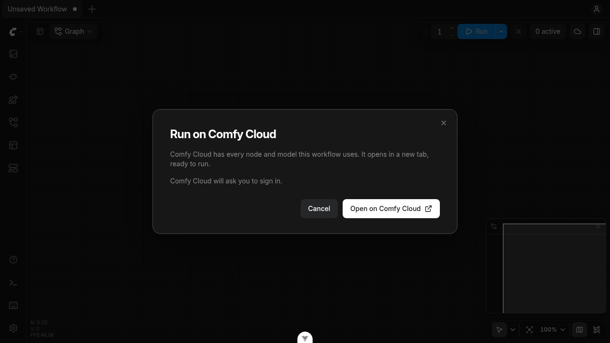
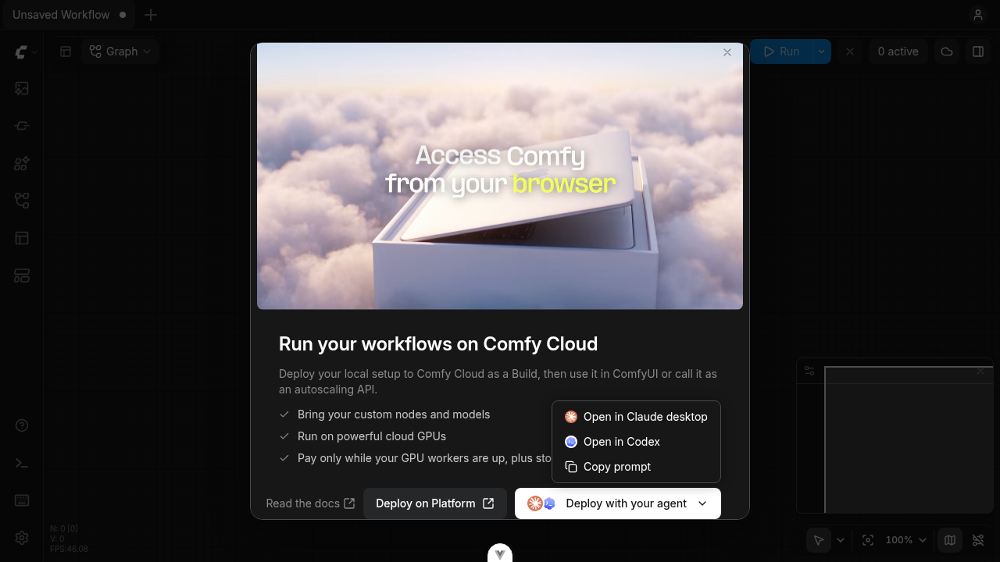

## 概要

実行バーのクラウドボタンは、開いているワークフローをComfy Cloudに送信します。ComfyUIはまずワークフローをCloudと照合し、その後、グラフが読み込まれた状態で新しいブラウザタブで開きます。

このボタンは、ComfyUIが自分のマシン（localhost、プライベートLANアドレス、またはデスクトップアプリ）で動作していて、かつアカウントでOpen on Cloudのロールアウトが有効になっている場合にのみ表示されます。Comfy Cloud自体には表示されません。表示されない場合は、ComfyUIを最新バージョンにアップデートしてページを再読み込みしてください。

## Comfy Cloudでワークフローを開く

1. Cloudで実行したいワークフローを開きます。
2. 実行バーのクラウドアイコンをクリックします。ComfyUIが、そのワークフローで使用されているノードパックとモデルを確認します。
3. Cloudにそれらがすべて揃っている場合は、**Comfy Cloud で実行** ダイアログが開きます。**Comfy Cloud で開く** をクリックします。
4. Comfy Cloudが新しいタブで開き、ワークフローがエディタに読み込まれます。求められた場合はそこでログインしてください。

ComfyUIは、ワークフローのノード名とモデル名をComfy Cloudに送信する前に確認を求めます。ダイアログで **Don't ask again** を選んでから確認を開始すると、以降は確認されません。確認を元に戻すには、**設定 → Comfy → Comfy Cloud** を開き、**Ask before sending node and model names to check Comfy Cloud compatibility** を有効にします。

ローカル側で確認できないモデル入力もあります。リンクされたモデル入力や、同じファイルが複数のローカルフォルダに一致するモデルなどです。ダイアログではこれらが未確認として表示されますが、ワークフローを開く妨げにはなりません。

ワークフローがCloudに表示されるまで、ローカルのタブは開いたままにしてください。Cloudのタブの読み込みが完了するとグラフが引き渡され、ComfyUIは10分で待機をやめます。まったく表示されない場合は、クラウドボタンをもう一度クリックしてください。

ブラウザが新しいタブをブロックする場合は、ComfyUIのアドレスに対してポップアップを許可して再試行してください。有効なノードがないワークフローはメッセージとともに拒否されるため、ノードを追加するかミュートを解除して保存し、もう一度ボタンをクリックしてください。

## Cloudにモデルファイルが不足している場合

不足しているのがモデルファイルだけの場合、ダイアログにはCloudが持っていないファイルが一覧表示され、開く操作は用意されません。そこでは自分のComfyUIからのアップロードも利用不可なので、ダイアログを閉じて、代わりにそれらのファイルをCloudにインポートしてください。[モデルのインポート](/ja/cloud/import-models)を参照してください。

## ワークフローにカスタムノードや特殊なモデルが必要な場合

ワークフローがCloudにないカスタムノードパックを使用している場合、またはCloudが単一のファイルに解決できないモデルを使用している場合、ダイアログでは代わりにセットアップのデプロイが提案されます。**Platform にデプロイ** は、カスタムノードとモデルをDeveloper Platform上のBuildにまとめます。**エージェントでデプロイ** は、同じセットアップをClaude desktopまたはCodexに渡すか、プロンプトをコピーします。この操作では、先にワークフローを保存するよう求められます。[カスタムビルド](/ja/development/deploy/cloud-custom-builds)を参照してください。

## デスクトップアプリの場合

デスクトップアプリは独自の中継機能を通じてワークフローをCloudに引き渡します。中継機能が利用できない場合、ComfyUIはワークフローをJSONファイルとしてダウンロードし、Comfy Cloudを開いて、そのファイルをCloudのエディタにドロップするよう求めます。
