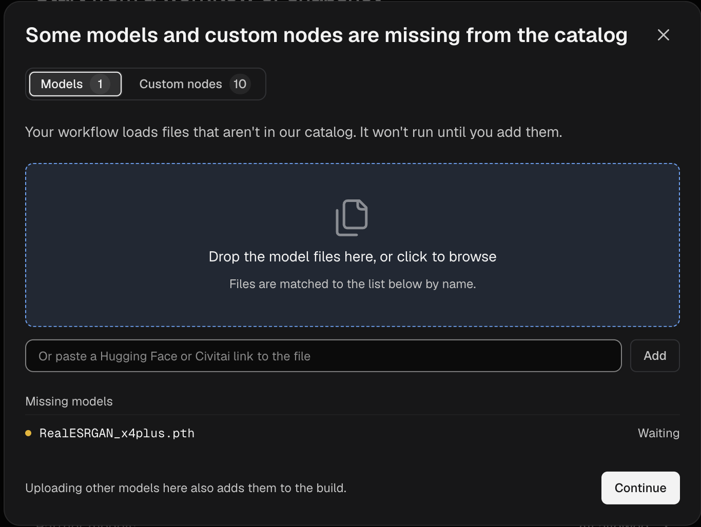

Build は、カスタムノード、プライベートカスタムノード、LoRA などのモデル、Python の依存関係をまとめてパッケージ化し、Comfy Cloud 上でワークフローを実行できるようにするものです。Build は Comfy Cloud エディタから開始し、Developer Platform で作成・デプロイしたうえで、エディタでその Build 上においてワークフローを実行します。

Build をデプロイすると、Comfy Cloud がそれらのノードをすべてすでにサポートしている場合でも、自分のワークフロー専用に提供される GPU ワーカーが得られます。

<Note>
  Comfy Cloud がすでにサポートしているノードで自分の LoRA やその他のモデルを使う場合、Build は必要ありません。代わりにモデルを**モデルライブラリ**にアップロードしてください。詳しくは[自分の LoRA やモデルを追加する](#自分の-lora-やモデルを追加する)を参照してください。
</Note>

### 前提条件

Build を作成する前に、以下を用意してください。

- **Comfy Cloud 上に保存済みのワークフロー**
- **有効なサブスクリプション、または残高がゼロより多い Comfy クレジット**

<Warning>
  Build の作成や保持には費用がかかりません。デプロイは、GPU が起動している間 GPU 時間の費用がかかります。また、デプロイが存在する限り、停止中や GPU が起動していない間もストレージの費用がかかります。デプロイダイアログには、確定する前に推定コストが表示されます。支払いを停止するには、デプロイを削除してください。詳しくは[デプロイを停止または削除する](#デプロイの停止または削除)を参照してください。
</Warning>

## ワークフローからビルドを作成する

ワークフローでComfy Cloudがサポートしていないカスタムノードを使用している場合、ワークフローを開くとComfy Cloudがダイアログを表示します。ダイアログには、不足しているカスタムノードパック（カスタムノードのグループ）と、LoRAなどのモデルが一覧表示されます。ワークフローを実行するには、それらを含むビルドを作成します。保存済みのワークフローを選択すると、Developer Platformがそのカスタムノードとモデルを検出して自動的に選択します。

<Steps>
  <Step title="Developer Platformを開く">
    ダイアログで**プラットフォームで作成**をクリックします。Developer Platformが新しいタブで開き、**デプロイ**ページが表示されます。

    

    

    <Tip>
      ダイアログを使わずにビルドを作成するには、**実行**の左にあるクラウドメニューをクリックします。デフォルトでは**Comfy Cloud**に設定されています。

      - ワークスペースにまだデプロイがない場合は、**カスタムデプロイを作成**を選択し、**プラットフォームで作成**をクリックします。
      - すでにデプロイがある場合は、**デプロイを管理**を選択します。
    </Tip>
  </Step>
  <Step title="新しいビルドを開始する">
    **デプロイ**ページで、**新規ビルド**をクリックします。まだビルドがない場合は、代わりに**ゼロから開始**をクリックします。
  </Step>
  <Step title="ワークフローを選択する">
    1. **Comfy Cloudから選択**をクリックします。
    2. ワークフローを選択し、**ワークフローを1件追加**をクリックします。

    ワークフローの`.json`ファイル、またはそれを使って作成した`.png`画像をドロップエリアにドラッグすることもできます。

    

    ワークフロー名がドロップエリアの下にチェックマーク付きで表示され、**推奨デフォルト**リストにビルドの**カスタムノード**が表示されると、このステップは成功です。
  </Step>
  <Step title="推奨デフォルトでビルドする">
    **デフォルトでビルド…**をクリックします。**ビルドターゲットを選択**ダイアログが開きます。

    **デフォルトでビルド…**が使用できない場合は、ボタンの下の行にその理由が表示されます。「_不足しているモデルとカスタムノードを先にそれぞれのステップで追加してください。_」と表示された場合は、不足しているものを追加します。

    1. **ビルドをカスタマイズ**をクリックします。
    2. 不足しているカスタムノードまたはモデルが一覧表示されるステップまで**次へ**をクリックします。
    3. それぞれで**提案を使用**または**アップロード**をクリックします。
  </Step>
</Steps>

ビルドに含める内容を変更するには、代わりに**ビルドをカスタマイズ**をクリックして各ステップを進めます。ビルドの内容を決めるステップは2つあります。

- **ビルドに必要なカスタムノードはどれですか？**: カスタムノードを選択します。
- **ビルドに同梱するモデルはどれですか？**: ビルドに含めるモデルを選択します。ビルドに含まれないモデルは、ジョブで初めて使用されるときにダウンロードされます。

### ビルドを公開する

公開すると、ビルドが`v1`などの番号付きバージョンになり、今すぐにも後でにもデプロイできます。公開は無料です。

1. **ビルドターゲットを選択**ダイアログで、**サーバーレスビルド**を選択したままにします。これはComfy Cloudで実行されるターゲットです。
2. **公開**をクリックします。

ビルドのページが新しいバージョンとともに開きます。**サーバーレスビルド**の行にビルドの進行状況が表示されます。ビルドには通常10～15分かかり、ページを離れて後で戻ってくることもできます。ビルドが完了すると、**サーバーレスビルド**の行に**デプロイ**ボタンが表示されます。

後でそのバージョンに戻るには：

1. **Developer Platformのサイドバー**で、**デプロイ**をクリックします。
2. **ビルド**セクションで、自分のビルドをクリックします。
3. **バージョン**の下で、最新バージョンをクリックします。

<AccordionGroup>
  <Accordion title="ビルドが失敗した場合は？">
    一部のカスタムノードはビルドに失敗することがあります。その場合、ビルドのページの**サーバーレスビルド**行に**ビルド失敗**と表示されます。

    1. その行の**ログ**を開いて、何が失敗したかを確認します。
    2. **ビルドを編集**をクリックし、失敗したカスタムノードを削除するなどしてビルドを変更します。
    3. ビルドを再度公開します。

    行の**エージェントでデバッグ**ボタンをクリックすると、失敗の内容を説明するプロンプトが開きます。それをコーディングエージェントにコピーしてビルドを修復できます。
  </Accordion>
</AccordionGroup>

### ワークフローをデプロイして実行する

デプロイとは、Comfy Cloud の GPU 上でビルドが動作している状態のことです。ビルドをデプロイし、その後 Comfy Cloud エディタをそのデプロイに切り替えてワークフローを実行します。

1. **サーバーレスビルド**の行で**デプロイ**をクリックします。**_ビルド名_ の v1 をデプロイ**ダイアログが開きます。
2. GPU を選択します。各 GPU には VRAM（GPU メモリ）と 1 時間あたりの料金が表示されます。
3. ダイアログに**Cloud エディタの準備完了**と表示されている場合は、選択したままにします。これはデフォルトでオンになっています。
4. その他の設定はデフォルトのままにします。**常時ウォームワーカー**を `0` にすると、ジョブが入ってこないときにデプロイの GPU はオフになります。デフォルトでは、**ジョブ後にワーカーを維持**により最後のジョブの後 3 分間 GPU がオンのままになり、そのアイドル時間は GPU の料金で課金されます。
5. **推定コスト**パネルを確認します。1 時間あたりの GPU 時間と 1 か月あたりのモデルストレージが表示されます。
6. **デプロイを作成**をクリックします。デプロイのページが開きます。デプロイ名の下のステータスが**準備完了**になるまで待ちます。
7. Comfy Cloud エディタで、**実行**の左にあるクラウドメニューをクリックします。**実行先**で、自分のデプロイを選択します。エディタが再読み込みされ、タブは開いたまま残ります。

    

8. ワークフローを開き、**実行**をクリックします。最初のジョブは、デプロイが GPU を起動する間待機することがあります。

このブラウザは、別のデプロイを選択するまで、そのデプロイ上でワークフローを実行し続けます。元に戻すには、同じメニューで **Comfy Cloud** を選択します。ワークフローに未保存の変更がある場合は、**切り替える前にワークフローを保存しますか？**ダイアログが開きます。**保存して切り替え**または**保存せずに切り替え**をクリックします。

## 自分の LoRA やモデルを追加する

**モデルライブラリ**には、ワークスペースがアップロードしたモデルが保存されます。アップロードしたモデルは Comfy Cloud とデプロイの両方で実行できます。

モデルをアップロードする前に、次の要件を満たしていることを確認してください。

- **有効な Pro、Creator、Team、または Enterprise プラン**: モデルをアップロードするには、ワークスペースにいずれかのプランが必要です。
- **2 GB 以下の `.safetensors` ファイル**: SDXL や Flux のような大きなベースモデルはビルドに入れてください。

<Warning>
  ライブラリモデルが利用可能になる前に作成されたデプロイでは、それらを読み込めない場合があります。ライブラリモデルを使用するには、新しいデプロイを作成してください。古いデプロイでは、ジョブが `Library model "<file name>" is unavailable on this deployment. Retry the job. If it still fails, contact support with the job ID.` で失敗することがあります。
</Warning>

### モデルをアップロードする

Comfy Cloud エディタまたは開発者プラットフォームからアップロードできます。作業している場所のタブを選択してください。

<Tabs>
  <Tab title="クラウドエディタ">
    1. **実行**の左にあるクラウドメニューで、**実行先**に **Comfy Cloud** が選択されていることを確認します。デプロイ上では、**モデルライブラリ**に**インポート**ボタンはありません。
    2. **左サイドバー**で**モデルライブラリ**をクリックし、**インポート**をクリックします。
    3. **ファイルを選択**をクリックするか、`.safetensors` ファイルをダイアログにドラッグします。
    4. **このモデルの種類は何ですか？**で、LoRA の場合は **LoRA** のままにし、ファイルに合う種類を選択します。
    5. **アップロード**をクリックします。ダイアログに _モデルのインポートに成功しました。_ と表示されたら、**完了**をクリックします。

    

    Civitai や Hugging Face のリンクからインポートする場合:

    1. **インポート**ダイアログで、**ここにリンクを貼り付け**にモデルのリンクを貼り付けます。
    2. **続行**をクリックします。
    3. **このモデルの種類は何ですか？**で、モデルの種類を選択します。
    4. **インポート**をクリックします。

    `.ckpt` など他の形式でのリンクインポートは**モデルライブラリ**に取り込まれますが、デプロイでは実行できません。
  </Tab>
  <Tab title="開発者プラットフォーム">
    1. ビルドの**どのモデルをビルドに含めますか？**ステップで、**モデルをアップロード**をクリックします。
    2. **ワークスペースライブラリ**を選択します。
    3. `.safetensors` ファイルをドロップ領域にドラッグするか、領域をクリックして参照します。
    4. **モデルの種類**で、LoRA の場合は **LoRA** のままにし、ファイルに合う種類を選択します。
    5. **アップロード**をクリックします。

    
  </Tab>
</Tabs>

### ワークフローでモデルを使用する

モデルをアップロードしたら、Comfy Cloud またはデプロイで使用できます。

1. **実行**の左にあるクラウドメニューで、実行する場所を選択します: **Comfy Cloud**、または自分のデプロイ。
2. `Load LoRA (Model and CLIP)` ノードを追加するか、そのノードを含むワークフローを開きます。
3. ノードの `lora_name` リストで、自分のファイルを選択します。
4. **実行**をクリックします。

<Tip>
  デプロイでは、最初の実行時にモデルをダウンロードし、キューのそのジョブの行に `Downloading <file name>` と表示されます。同じ GPU が稼働している間の後続のジョブはダウンロードをスキップします。デプロイが後から起動する GPU はモデルを再びダウンロードします。ダウンロードを省略するには、モデルをビルドに追加してください。
</Tip>

ジョブがモデルを見つけられるように、次のルールに従ってください。

- **一致する種類を選ぶ。** ローダーノードはその種類のモデルだけを一覧に表示します。`Load LoRA (Model and CLIP)` ノードには LoRA としてアップロードしたモデルが表示されます。
- **新しいファイル名を使う。** ビルドに同じ名前のモデルが既にある場合、デプロイ上のジョブはアップロードしたファイルではなくビルドのファイルを使用します。
- **ベースモデルを一致させる。** LoRA はワークフローが読み込むベースモデルと一致している必要があります。
- **Comfy Cloud にあるローダーノードを使う。** ローダーノードが Comfy Cloud にないカスタムノードのものである場合は、モデルをビルドに追加してください。

### ライブラリモデルを変更または削除する

**実行先**でデプロイが選択されている場合、**モデルライブラリ**にはビルドのモデルだけが一覧表示されます。アップロードしたモデルを変更または削除するには、まず [Comfy Cloud に切り替え](#ワークフローをデプロイして実行する) 、**左サイドバー**で**モデルライブラリ**をクリックします。

モデルの種類を変更する場合:

1. モデルのカードにカーソルを合わせ、**モデル情報**をクリックします。
2. 新しい**モデルの種類**を選択します。

<Warning>
  モデルを削除すると、**モデルライブラリ**から完全に削除されます。そのファイルをまだ使用しているジョブは、ローダーノードで `Value not in list` エラーで失敗します。
</Warning>

モデルを削除する場合:

1. モデルのカードにカーソルを合わせ、**その他**をクリックし、**削除**をクリックします。
2. **このモデルを削除しますか？**で、**削除**をクリックします。

## デプロイの停止または削除

デプロイは、停止中であっても削除するまでストレージのコストがかかります。後で使用するためにデプロイを残しておきたい場合は、ジョブを実行せずに停止してください。課金を止めたい場合は削除してください。

デプロイのページを開くには:

1. **Developer Platform サイドバー**で、**Deploy** をクリックします。
2. **Deployments** セクションで、デプロイ名をクリックします。

デプロイを停止するには:

1. **Stop** をクリックします。
2. **Stop deployment** ダイアログで、**Stop** をクリックします。

ステータスは **Stopping**、その後 **Stopped** と表示されます。

デプロイを再度実行するには:

- **Start** をクリックします。

<Warning>
  削除すると、デプロイとその履歴が完全に削除されます。Build とそのバージョンは残るため、後で再度デプロイできます。
</Warning>

デプロイを削除するには:

1. 停止中のデプロイでは、**Delete** をクリックします。実行中のデプロイでは、**More actions** メニューを開き、**Delete** を選択します。
2. **Delete deployment** ダイアログで、**Delete** をクリックします。

次回このブラウザでエディタを開くと、エディタは Comfy Cloud 上でワークフローを実行します。

## 次のステップ

<CardGroup cols={2}>
  <Card title="APIリクエストでライブラリのモデルを使用する" icon="code" href="/ja/development/serverless/overview#use-workspace-library-models-in-api-requests">
    ターミナルからモデルをアップロードし、リクエストごとに `lora_name` で指定します。
  </Card>
  <Card title="Comfy API クイックスタート" icon="cloud-arrow-up" href="/ja/development/serverless/quickstart">
    オートスケーリングエンドポイントとして、独自のコードからデプロイを呼び出します。
  </Card>
  <Card title="使用量と制限" icon="gauge" href="/ja/development/deploy/cloud-usage">
    Comfy Cloud のクレジットと同時実行ジョブ数の制限の仕組みを確認します。
  </Card>
  <Card title="ワークフロー API 形式" icon="file-code" href="/ja/development/api-development/workflow-api-format">
    APIリクエストで送信される形式でワークフローをエクスポートします。
  </Card>
</CardGroup>
