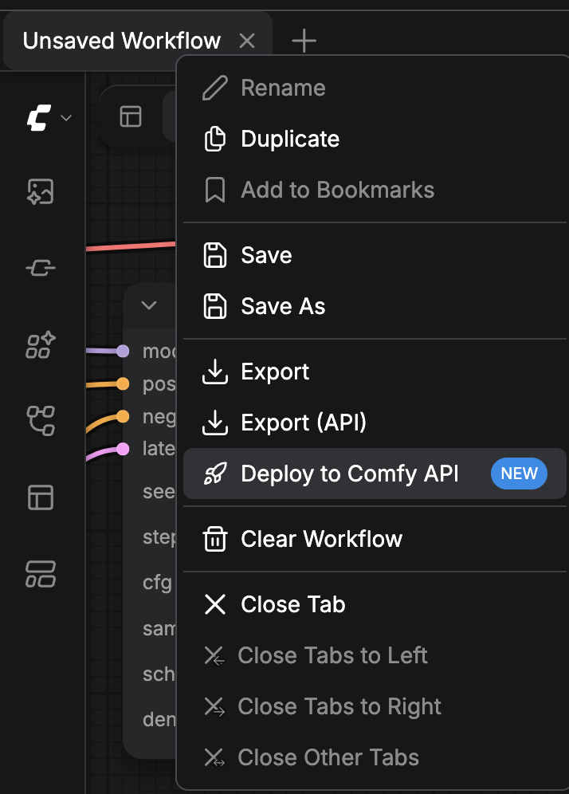
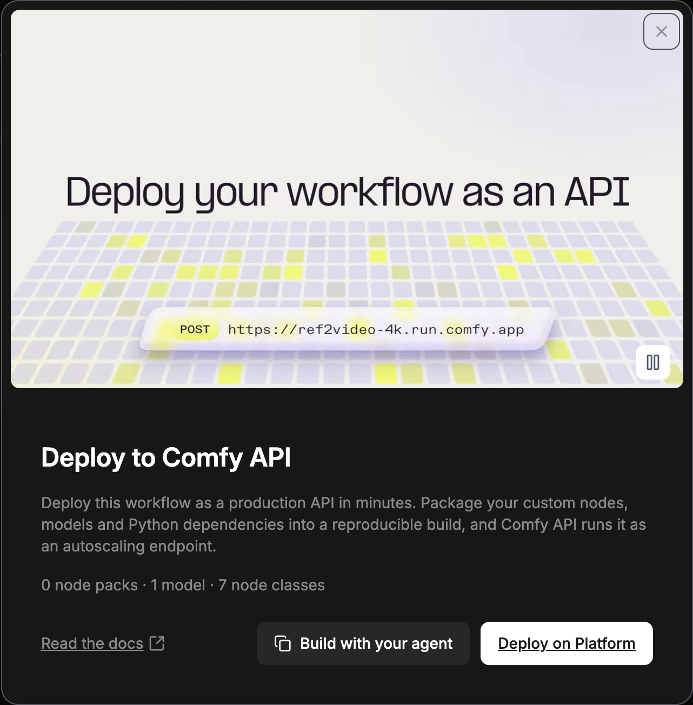
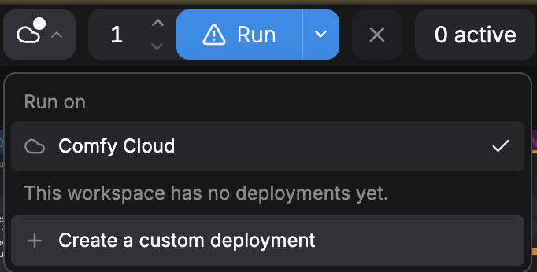
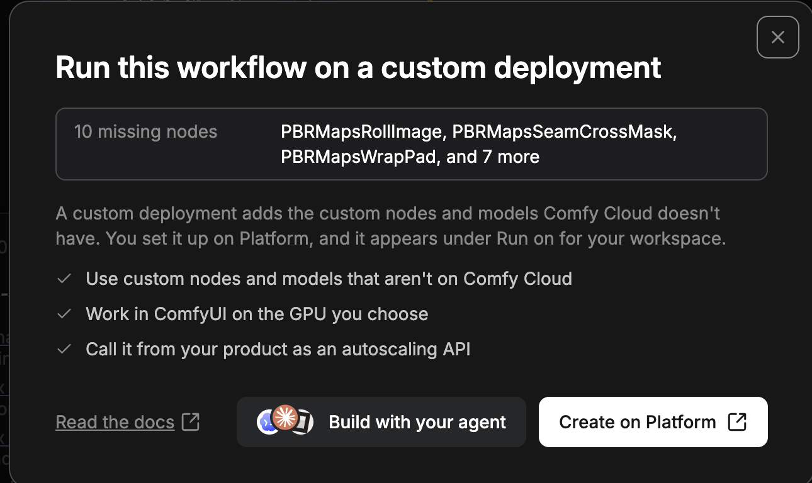
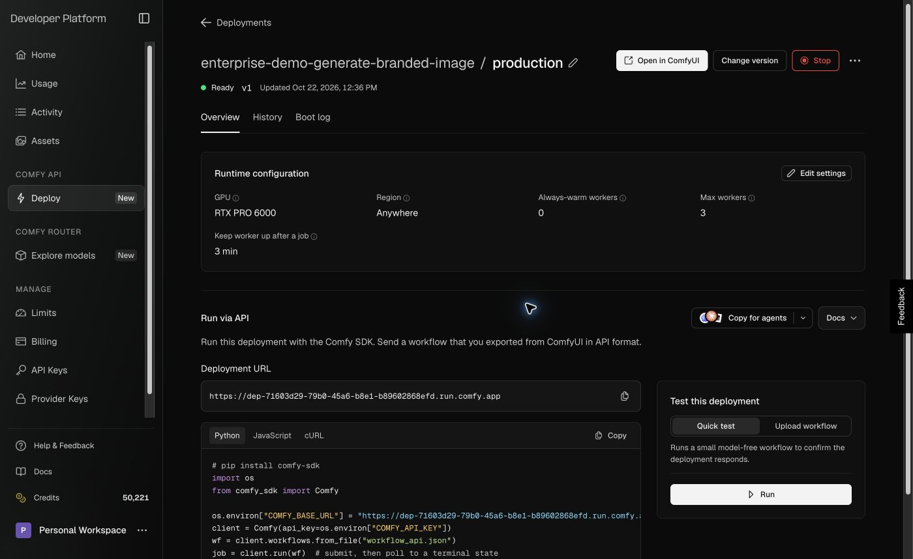
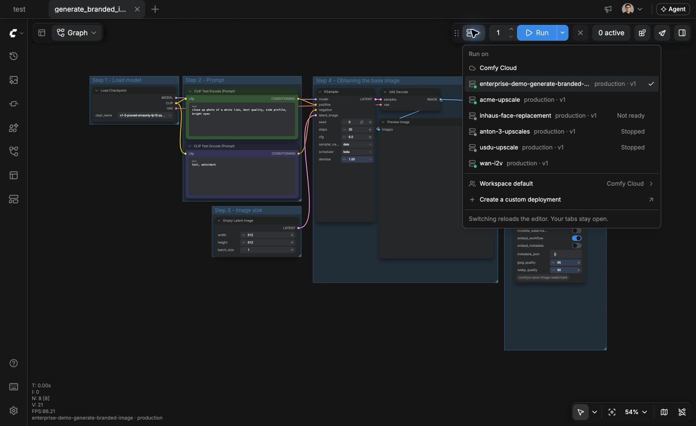
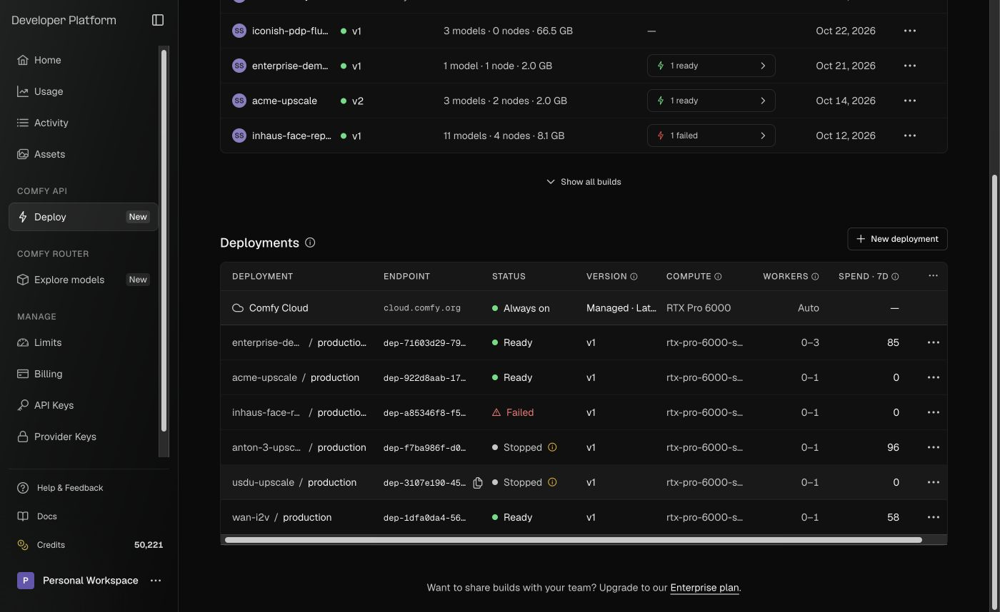

ComfyUI ワークフローは、Comfy Cloud、自身の Comfy API デプロイ、または自身で管理するサーバー上で実行できます。Comfy Cloud と Comfy API は Comfy GPU 上で動作するため、お使いのパソコンに GPU は不要です。ワークフローに合う選択肢を選び、そのカードから始めてください。

<CardGroup cols={2}>
  <Card title="Comfy Cloud" icon="cloud" href="/ja/development/deploy/cloud">
    Comfy Cloud にすでにあるカスタムノードとモデルのワークフローを、ビルドやデプロイなしで実行します。
  </Card>
  <Card title="Comfy Cloud のカスタムビルド" icon="puzzle-piece" href="/development/deploy/cloud-custom-builds">
    独自のカスタムノードとモデルが必要なワークフローを、ブラウザで作成する Build を使って Comfy Cloud エディターで実行します。
  </Card>
  <Card title="Comfy API" icon="cloud-arrow-up" href="/ja/development/serverless/quickstart">
    カスタムノード、モデル、Python 依存関係をビルドにパッケージ化し、自動スケーリングするエンドポイントとして実行します。
  </Card>
  <Card title="セルフホスト" icon="server" href="/ja/development/deploy/self-hosting">
    自身で管理するマシン上で ComfyUI を実行し、`--listen` でネットワークに公開します。
  </Card>
</CardGroup>

これらのいずれかを自身のコードから呼び出すには、[API フォーマット](/ja/development/api-development/workflow-api-format)のワークフローを送信します。

## ComfyUI アプリからのデプロイ

パソコン上の ComfyUI または Comfy Desktop では、**Deploy to Comfy API** カードが開いているワークフローから Comfy API ビルドを開始します。

<Warning>
  バージョンの公開は無料です。ビルドが完了すると、**Serverless build** 行に **Deploy** ボタンが表示されます。デプロイすると、デプロイした時点からストレージ料金が発生し、ワーカーが稼働している間は GPU 時間も課金されます。確認前に、デプロイダイアログに見積もり料金が表示されます。
</Warning>

<Steps>
  <Step title="Workflow actions メニューを開く">
    **Top bar** で、ワークフローのタブを右クリックします。**Canvas** 左上の **Workflow actions** ボタンをクリックしても構いません。

    
  </Step>
  <Step title="Deploy to Comfy API を選択する">
    **Deploy to Comfy API** を選択します。エントリには **NEW** と表示されます。**Deploy to Comfy API** カードが開き、ワークフローが使うノードパック、モデル、ノードクラスを集計します。

    
  </Step>
  <Step title="Developer Platform で続行する">
    **Deploy on Platform** をクリックします。Developer Platform（[platform.comfy.org](https://platform.comfy.org)）が新しいタブで開きます。
  </Step>
</Steps>

Developer Platform では、ワークフローからビルドを作成し、バージョンを公開してデプロイします。[ビルドソース](/ja/development/serverless/build-sources)ではワークフローファイルからビルドを開始する方法を、[Comfy API クイックスタート](/ja/development/serverless/quickstart)では comfy-cli による同じ流れを扱います。

## Cloud エディターからデプロイを実行する

Build の作成、デプロイ、停止や削除の手順は、[Adding Custom Builds to Comfy Cloud](/development/deploy/cloud-custom-builds) も参照してください。

デプロイは、そのビルドに含まれるカスタムノードとモデルを使い、Comfy Cloud 上の ComfyUI でワークフローを実行できます。

### Comfy Cloud からデプロイを作成する

Comfy Cloud では、**Workflow actions** メニューに **Deploy to Comfy API** エントリはありません。代わりに **Run** の横のメニューから始めます。

1. **Run** の横のメニューをクリックします。
2. **Create a custom deployment** を選択し、**Create on Platform** をクリックします。Developer Platform 上のビルドが新しいタブで開きます。

ワークスペースにすでにデプロイがある場合、メニューには代わりに **Manage deployments** が表示されます。同じ Developer Platform のビルドページが開きます。

Comfy Cloud にないカスタムノードを使うワークフローを開くと、**Run this workflow on a custom deployment** ダイアログが不足分を一覧表示します。**Create on Platform** をクリックしてビルドを開始します。

### Cloud エディターでデプロイを開く

1. デプロイダイアログで **Ready for the Cloud editor** が表示されている場合は、選択したままにします。このオプションはデフォルトでオンです。**Ready for the Cloud editor** をオフにすると、あとからエディターでデプロイを開くのに約 1 分かかります。
2. デプロイのページで、名前の下のステータスが **Ready** になるまで待ちます。それまで **Open in ComfyUI** は無効のままです。
3. **Open in ComfyUI** をクリックします。Comfy Cloud 上の ComfyUI が新しいタブで開き、デプロイに切り替わります。

ワークフローの実行先を確認するには:

1. **Run** の横のメニューをクリックします。
2. ワークフローが実行されているデプロイの横のチェックマークを確認します。
3. **Run** をクリックして、そのデプロイでワークフローを実行します。

- メニューにはワークスペース内のすべてのデプロイが一覧表示されます。**Ready** のデプロイを選択して切り替えます。
- それ以外の各行は現在のワークスペースのデプロイです。1 行目は Build 名で、Build がない場合はデプロイ自体の名前です。2 行目はデプロイ名または短い ID と、現在実行している Release です。準備ができていない行には **Stopped** または **Starting** が表示され、各行にはそのデプロイが開いているワークフローを実行できるか（**Runs this workflow**、**Missing N nodes**、**Not checked**）も表示されます。
- 切り替えるとエディターが再読み込みされます。ノードカタログとカスタムノードの JavaScript はエディタ起動時に固定されるためです。デフォルトではタブは開いたままです。未保存の変更があるワークフローがある場合は、切り替える前に保存するか確認されます。
- 停止中のデプロイは Developer Platform で起動するまで、起動中のデプロイは準備ができるまでジョブを実行しません。ボタンのツールチップにもその旨が表示されます。
- デプロイのアドレスは、所有者が新しい Release に更新しても変わりません。その場合メニューに **Reload** が表示され、エディタが新しいノードを読み込みます。選択したデプロイが存在しなくなった場合は Comfy Cloud に戻ります。
- このブラウザーは、別のデプロイを選択するまで、選択したデプロイでワークフローを実行し続けます。
- **Use the workspace default** は、ワークスペースに既定のデプロイがあり、このブラウザが自分でデプロイを選んでいるときだけ表示されます。選ぶと自分の選択を破棄し、ワークスペースの既定デプロイに再読み込みします。
- メニューはワークスペースのデプロイ一覧が読み込まれると表示されます。Comfy Cloud では、API キーではなくアカウントでサインインしている場合にのみ表示されます。表示されない場合、エディタは Comfy Cloud で動作し、デプロイのリンクも拒否されます。

リンクからデプロイ上でエディタを開くには、`https://cloud.comfy.org/?workspace=<workspace id>&deployment=<deployment id>` を使います。リンクは必要に応じて先にそのワークスペースへ切り替え、エディタをデプロイ上で読み込みます。開けないワークスペースの場合、またはデプロイが存在しない・別のワークスペースのものである場合、リンクは拒否され、エディタは以前の環境のまま動きます。

### ワークスペースの既定デプロイを設定する

ワークスペースの所有者は、メンバーがどこから始めるかを決められます。

- **Set as workspace default** は、まだ既定になっていないデプロイを選んだあとに表示されます。そのデプロイを、自分で選んでいないすべてのメンバーの開始位置にします。
- **Clear workspace default** は既定のデプロイが設定されている間表示され、自分で選んでいないメンバーを Comfy Cloud に戻します。

### Comfy Cloud に戻す

1. **Run** の横のメニューをクリックします。
2. **Comfy Cloud** を選択します。

エディターが再読み込みされます。ワークフローに未保存の変更がある場合は、**Save your workflows before switching?** ダイアログが開きます。**Save and switch**、または **Switch without saving** をクリックします。

## デプロイの停止または削除

デプロイを停止するとジョブが止まり、削除するとデプロイが取り除かれストレージ課金が終了します。どちらの操作も Developer Platform 上のデプロイページにあります。

<Warning>
  停止したデプロイはジョブを実行しませんが、ストレージは引き続き課金されます。ストレージ課金を終了するにはデプロイを削除してください。
</Warning>

デプロイのページを開くには:

1. Developer Platform のサイドバーで **Deploy** をクリックします。
2. **Deployments** セクションでデプロイ名をクリックします。

デプロイを停止するには:

1. **Stop** をクリックします。
2. **Stop deployment** ダイアログで **Stop** をクリックします。

ステータスは **Stopping** になり、その後 **Stopped** になります。

デプロイを再度実行するには:

- **Start** をクリックします。

<Warning>
  削除するとデプロイとその履歴が完全に取り除かれます。ビルドは残ります。
</Warning>

デプロイを削除するには:

1. 停止したデプロイでは **Delete** をクリックします。実行中のデプロイでは **More actions** メニューを開き、**Delete** を選択します。
2. **Delete deployment** ダイアログで **Delete** をクリックします。

そのデプロイ上で Cloud エディターを実行していたブラウザーが次に ComfyUI を読み込むと、削除されたデプロイではなく Comfy Cloud 上で ComfyUI が実行されます。

## アプリケーションからワークフローを実行する

デプロイが **Ready** になったら、[ワークフローの実行](/ja/development/run-workflows/overview)を参照してアプリケーションから呼び出してください。[Comfy SDK](/ja/development/api-development/sdks) は Comfy Cloud と自身のデプロイで動作します。セルフホストの ComfyUI では、Comfy API v2 の提供に [API Proxy](/ja/development/comfyui-server/api-proxy) が必要です。
