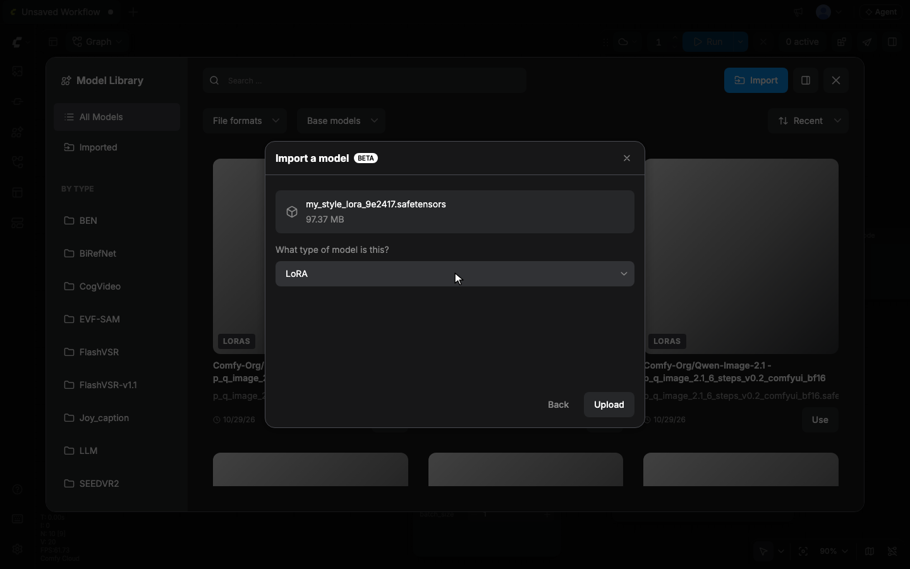
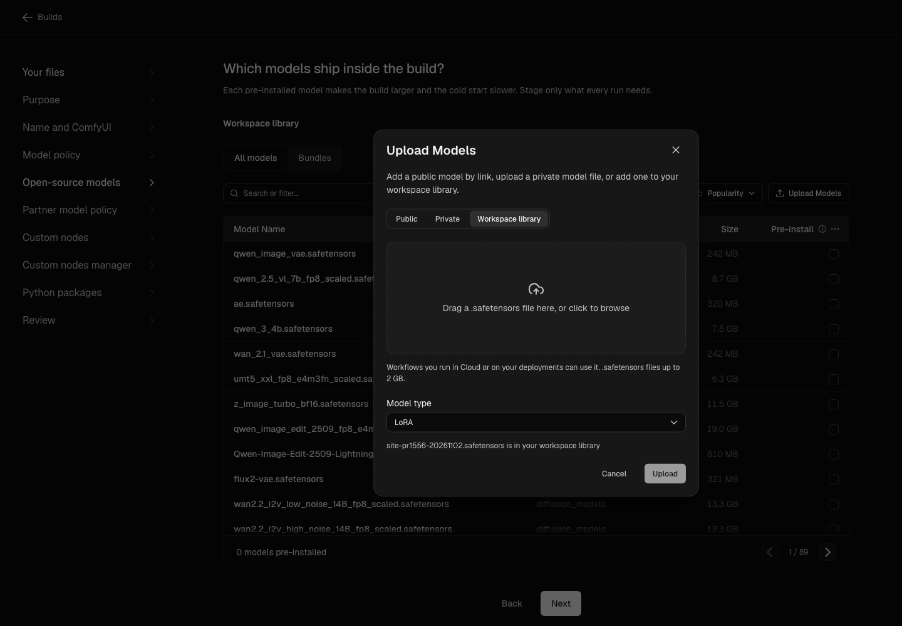
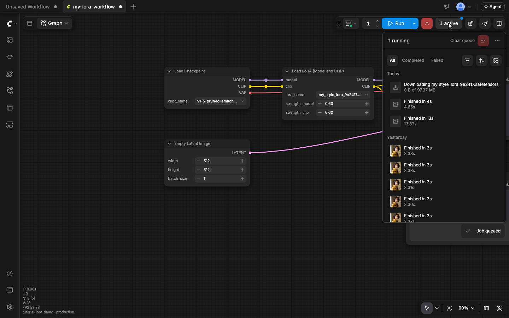

Comfy API は、デプロイメントのリリースに含まれていない場合でも、ワークスペースライブラリのモデルを実行します。LoRA または別の `.safetensors` モデルをライブラリにアップロードし、新しいビルド、リリース、再デプロイなしでデプロイメント上で実行します。

ワークスペースライブラリを使用して、デプロイメントでトレーニングした LoRA を試したり、ワークフロー内のファイル名を1つ変更して API リクエストごとに異なる LoRA を選択したりできます。

## 始める前に

モデルをワークスペースライブラリにアップロードする前に、次の要件を満たしていることを確認してください:

- **プラン**: ワークスペースには、有効なプロ、クリエイター、チーム、またはエンタープライズプランが必要です。
- **モデルファイル**: ファイルは 2 GB 以下の `.safetensors` ファイルである必要があります。SDXL や Flux などのより大きなベースモデルは、引き続き Build に配置します。
- **有効なデプロイメント**: デプロイメントはライブラリと同じワークスペースにある必要があります。

<Warning>
  ワークスペースライブラリモデルが利用可能になる前に作成された一部のデプロイメントでは、これらのモデルを読み込めません。ワークスペースライブラリモデルを使用するには、新しいデプロイメントを作成してください。古いデプロイメントでは、ジョブが `Library model "<file name>" is unavailable on this deployment. Retry the job. If it still fails, contact support with the job ID.` で失敗する可能性があります。
</Warning>

## ワークスペースライブラリへのモデルのアップロード

モデルは次の3つのツールのいずれかでアップロードできます。

- **クラウドエディタ**: ファイルをアップロードするか、Civitai または Hugging Face のリンクからインポートします。
- **comfy-cli**: ターミナルまたはスクリプトからアップロードします。
- **Developer Platform**: Build のモデルステップからアップロードします。

使用するツールのタブを選択してください。

<Tabs>
  <Tab title="クラウドエディタ">
    1. **Run** の左側にあるデプロイメントメニューで、**Run on** の下で **Comfy Cloud** が選択されていることを確認します。
    2. **左サイドバー**で **モデルライブラリ** をクリックし、**インポート** をクリックします。
    3. **ファイルを選択** をクリックするか、`.safetensors` ファイルをダイアログにドラッグします。
    4. **What type of model is this?** で、LoRA の場合は **LoRA** のままにし、それ以外はファイルに一致するタイプを選択します。
    5. **アップロード** をクリックします。アップロードが完了したら **完了** をクリックします。

    

    代わりに Civitai または Hugging Face のリンクからモデルをインポートするには:

    1. **インポート** ダイアログの **ここにリンクを貼り付けてください** にモデルのリンクを貼り付けます。
    2. **続ける** をクリックします。
    3. **What type of model is this?** でモデルタイプを選択します。
    4. **インポート** をクリックします。

    デプロイメントで実行できるのは `.safetensors` ファイルのみです。`.ckpt` など他の形式のリンクインポートはライブラリにはインポートされますが、デプロイメントでは実行されません。
  </Tab>
  <Tab title="comfy-cli">
    ファイルをアップロードし、`--type` でモデルタイプを設定します。

    ```bash
    comfy assets library upload my_style.safetensors --type loras
    ```

    ファイルがライブラリにあることを確認します。

    ```bash
    comfy assets library ls --tags models,loras
    ```
  </Tab>
  <Tab title="Developer Platform">
    1. Developer Platform で、Build のモデルステップを開き、**モデルをアップロード** をクリックします。
    2. **ワークスペースライブラリ** を選択します。
    3. `.safetensors` ファイルをドロップ領域にドラッグするか、領域をクリックしてブラウズします。
    4. **モデルタイプ** で、LoRA の場合は **LoRA** のままにし、それ以外はファイルに一致するタイプを選択します。
    5. **アップロード** をクリックします。

    
  </Tab>
</Tabs>

モデルがライブラリに入れば、ワークスペースのすべてのメンバーがそのモデルを使用できます。ライブラリは LoRA だけでなく、あらゆるモデルタイプを受け入れます。ローダーノードが読み取るフォルダーに一致するタイプを選択してください。たとえば LoRA なら `loras`、VAE なら `vae` です。

## デプロイでモデルを実行する

モデルがライブラリに入ると、CloudエディタまたはAPIからデプロイ上で実行できます。ジョブの送信方法に応じてタブを選択してください。

<Tabs>
  <Tab title="Cloudエディタ">
    1. **Run** の左にあるデプロイメントメニューをクリックします。**Run on** でデプロイメントを選択します。エディタが再読み込みされますが、タブは開いたままです。
    2. `Load LoRA (Model and CLIP)` ノードを追加するか、それが含まれるワークフローを開きます。
    3. ノードの `lora_name` リストでファイルを選択します。リストには、Releaseのモデルの隣にライブラリのモデルが表示されます。
    4. **Run** をクリックします。

    初回実行時は、ワーカーがファイルをダウンロードしている間、キューのジョブの行に `Downloading my_style.safetensors` と表示されます。ジョブが複数のモデルをダウンロードする場合、行には `Downloading <file name> (<n> of <total>)` と表示されます。

    
  </Tab>
  <Tab title="API">
    [API形式のワークフロー](/ja/development/api-development/workflow-api-format)で、`LoraLoader` ノードの `lora_name` 入力に、`.safetensors` を含むライブラリのファイル名を設定します:

    ```json
    "10": {
      "class_type": "LoraLoader",
      "inputs": {
        "lora_name": "my_style.safetensors",
        "strength_model": 1.0,
        "strength_clip": 1.0,
        "model": ["4", 0],
        "clip": ["4", 1]
      }
    }
    ```

    ワークフローは `comfy deploy run`、[Comfy SDK](/ja/development/api-development/sdks)、または [Comfy API v2](/ja/api-reference/v2/overview) で送信します:

    ```bash
    comfy deploy run --deployment <deployment-id> --workflow workflow_api.json
    ```

    別のLoRAを使用するには、次のリクエストで `lora_name` をライブラリ内の別のファイル名に変更します。新しいBuild、Release、再デプロイは必要ありません。
  </Tab>
</Tabs>

<Tip>
  ライブラリのモデルを使用するワーカーでは、最初のジョブに時間がかかります。ワーカーが最初にモデルをダウンロードするためです。同じワーカーでの後続のジョブは、キャッシュされたコピーを使用します。新しいワーカーはモデルを再度ダウンロードし、他のモデルのための容量を確保するためにキャッシュからモデルを削除したワーカーも同様です。ダウンロードを省略するには、モデルをBuildに追加してください。
</Tip>

## 制限と命名ルールに従う

[開始する前に](#始める前に) に記載されているファイルサイズと形式の制限に加えて、次の制限が適用されます。

| 制限 | 値 |
| --- | --- |
| ワークスペースのストレージ | ワークスペースあたり1 TBのモデル（リンクインポートを含む） |
| ワークフローあたりのライブラリモデル名 | 100 |

101個目のライブラリモデルを指定するローダーは、そのファイルがライブラリに存在しない場合と同じように失敗します。

ジョブが正しいファイルを見つけられるように、次のルールに従ってください。

- **ローダーが読み取るフォルダーを使用する。** ローダーは、自身のモデルタイプのライブラリファイルのみを見つけます。`Load LoRA` ノードは `loras` としてアップロードされたファイルを見つけますが、`checkpoints` としてアップロードされたファイルは見つけません。
- **ベアファイル名を使用する。** ローダーの入力には `my_style.safetensors` のようにファイル名だけを設定し、前にフォルダーを付けないでください。
- **リリースモデルの名前を再利用しない。** リリースに同じ名前のファイルが既にある場合、ワーカーはライブラリのファイルではなくリリースのファイルを使用します。
- **フォルダー間で名前を一意に保つ。** 1つのローダーが読み取る2つのフォルダーにライブラリが同じファイル名を持つ場合、API経由で送信されたジョブはどちらのファイルも読み込みません。
- **最新のファイルが優先されることを想定する。** 1つのフォルダー内に同じ名前のファイルが2つある場合、ジョブは最後に追加されたものを使用します。
- **ベースモデルを一致させる。** LoRAは、ワークフローが読み込むベースモデルと一致している必要があります。
- **デプロイに存在するローダーを使用する。** ローダーノードはデプロイ上で利用可能である必要があります。ライブラリモデルは、Comfy Cloud が持つローダーノードを通じてのみ読み込まれます。使用するローダーが Comfy Cloud にないカスタムノード由来の場合は、そのモデルをビルドに追加してください。

## ライブラリモデルの変更または削除

**実行先**でデプロイメントが選択されている場合、**モデルライブラリ**にはそのリリースのモデルのみが表示されます。ライブラリのモデルを変更または削除するには、まず Comfy Cloud に切り替え直してください。

1. **実行**の左にあるデプロイメントメニューをクリックします。**実行先**で **Comfy Cloud** を選択します。
2. **左サイドバー**で **モデルライブラリ**をクリックします。

モデルタイプを変更するには:

- モデルのカードにカーソルを合わせ、**モデル情報**をクリックして、新しい**モデルタイプ**を選択します。

<Warning>
  モデルを削除すると、メンバー全員のワークスペースライブラリからそのモデルが削除されます。ファイル名を指定したままのジョブまたは API リクエストは、ローダー入力で `Value not in list` エラーが発生して失敗します。
</Warning>

モデルを削除するには:

1. モデルのカードにカーソルを合わせ、**その他**をクリックしてから、**削除**をクリックします。
2. **このモデルを削除しますか？** で、**削除**をクリックします。
