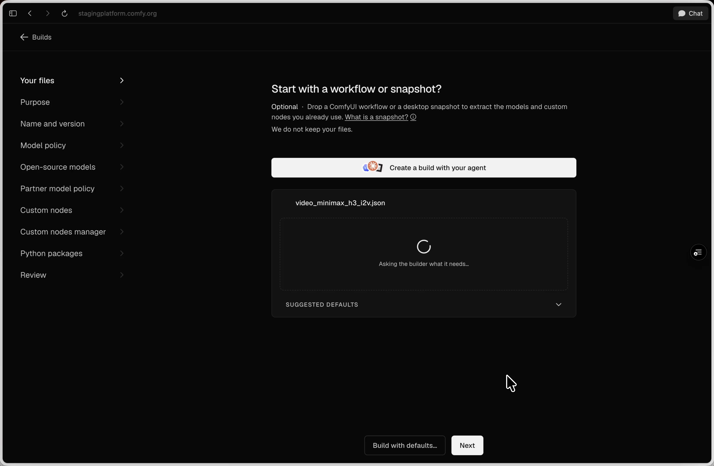
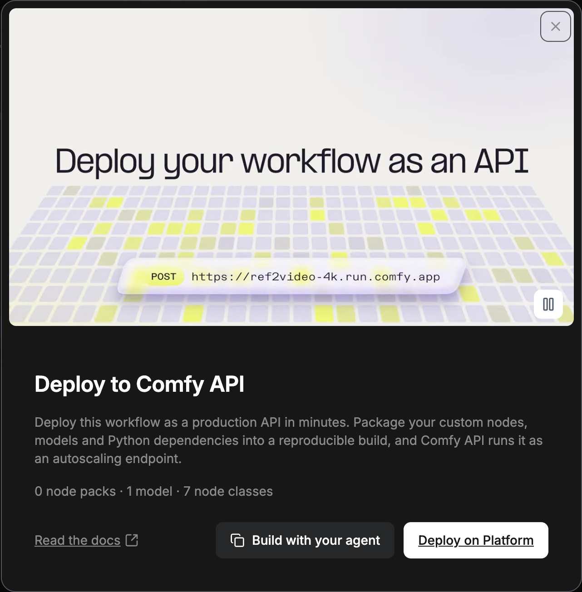

Comfy Cloud 上で Build をデプロイした後は、Build の新しいバージョンをリリースしたり、デプロイの GPU とワーカーを変更したり、アプリケーションからデプロイを固有の URL で呼び出したりできます。デプロイは、ワーカーが稼働している間は GPU 時間のコストがかかり、削除するまではストレージのコストがかかります。作成後も管理を続けられます。このページでは、他のソースから Build を開始する方法、バージョンをリリースする方法、GPU とワーカーを選択する方法、デプロイを呼び出す方法、監視する方法、停止または削除する方法を説明します。

最初の Build とデプロイを作成するには、[カスタム Build](/ja/development/deploy/cloud-custom-builds) を参照してください。

<Note>
  ワークフロー内のすべてのノードが Comfy Cloud で既にサポートされている場合は、Build やデプロイなしで Comfy Cloud 上でワークフローを実行できます。詳しくは [Comfy Cloud へのデプロイ](/ja/development/deploy/cloud) を参照してください。
</Note>

## 始める前に

このページの各タスクは、2つの場所で実行できます。1つはブラウザーで [platform.comfy.org](https://platform.comfy.org) の Developer Platform 上、もう1つはターミナルで comfy-cli を使う方法です。次のものを用意してください。

- **Comfy クレジットまたは有効なプランを持つワークスペース**：デプロイメントの作成または起動には、いずれかが必要です。
- **comfy-cli のタブを利用する場合、Comfy アカウントにサインインした comfy-cli**：`comfy cloud login` を実行します。

<Tip>
  ブラウザーの代わりに comfy-cli で Build とデプロイメントを作成するには、`ComfyUI` のインストールフォルダーで次のコマンドを実行します。

  ```bash
  comfy build init
  comfy build push --release --target linux/nvidia
  comfy deploy up
  ```

  `comfy build init` は Build ファイルである `comfy-build.yaml` をフォルダーに書き込みます。後で実行する `comfy build` コマンドはこれを読み込むため、同じフォルダーで実行してください。
</Tip>

## Comfy Desktop、ワークフローファイル、またはComfyUIからビルドを開始する

まだビルドがない場合は、すでにお持ちのものからビルドを開始できます。[Custom Builds](/ja/development/deploy/cloud-custom-builds)では、Comfy Cloudに保存されたワークフローから始める、ブラウザでの主な手順を紹介しています。開始元に合わせてタブを選択してください。

<Tabs>
  <Tab title="Comfy Desktopのスナップショット">
    Comfy Desktopのスナップショットは、インスタンスのComfyUIバージョン、カスタムノード、Pythonパッケージをビルドに引き継ぎます。モデルは含まれないため、ビルドの後続のステップで追加してください。

    1. Comfy Desktopで、インスタンスの**管理**をクリックし、次に**Snapshots**タブをクリックします。
    2. インスタンスの現在の状態が一覧にない場合は、**スナップショットを作成**をクリックします。
    3. 目的のスナップショットで、**エクスポート**をクリックします。

       

    4. Developer Platformで、**Developer Platform サイドバー**の**デプロイ**をクリックし、続いて**新規ビルド**をクリックします。まだビルドがない場合は、代わりに**最初から作成**をクリックします。
    5. **ワークフローまたはスナップショットから開始しますか？**のステップで、エクスポートした`.json`ファイルをドロップエリアにドロップするか、エリアをクリックして参照します。

    別のスナップショットをドロップすると、現在のスナップショットが置き換わります。Custom Buildsの[推奨されるデフォルト設定でビルドする](/ja/development/deploy/cloud-custom-builds#ワークフローからビルドを作成する)に進んでください。
  </Tab>
  <Tab title="ワークフローファイル">
    1. Developer Platformで、**Developer Platform サイドバー**の**デプロイ**をクリックし、続いて**新規ビルド**をクリックします。まだビルドがない場合は、代わりに**最初から作成**をクリックします。
    2. **ワークフローまたはスナップショットから開始しますか？**のステップで、ワークフローの`.json`ファイル、またはそのワークフローで作成した`.png`画像をドロップエリアにドロップします。エリアをクリックして参照することもできます。

    

    Developer Platformは、ワークフローが使用するモデルとカスタムノードを読み取ります。ドロップしたワークフローは、それ以前のワークフローに追加されます。Custom Buildsの[推奨されるデフォルト設定でビルドする](/ja/development/deploy/cloud-custom-builds#ワークフローからビルドを作成する)に進んでください。
  </Tab>
  <Tab title="ComfyUI">
    ComfyUIでは、**Deploy to Comfy API**エントリが開いているワークフローに必要なものをカウントし、その後Developer Platformを開きます。

    1. **トップバー**で、ワークフローのタブを右クリックします。**ワークフロー操作**ボタンをクリックすることもできます。

       

    2. **Deploy to Comfy API**を選択します。**Deploy to Comfy API**カードが開き、ワークフローが使用するノードパック、モデル、ノードクラスをカウントします。

       

    3. **Deploy on Platform**をクリックします。Developer Platformが新しいタブで開きます。

    このワークフローからビルドを開始するには、同じメニューで**エクスポート**を選択してワークフローを`.json`ファイルとして保存し、**ワークフローファイル**タブの手順に従ってください。
  </Tab>
</Tabs>

## デプロイメントを見つける

ここから先、このページでは少なくとも1つのデプロイメントを持つBuildがあることを前提としています。以降のすべてのタスクはデプロイメントから始まるため、まずそれを見つけてください。デプロイメントの閲覧には費用はかかりません。作業する場所のタブを選択してください。

<Tabs>
  <Tab title="Developer Platform">
    1. **Developer Platform サイドバー**で、**Deploy**をクリックします。
    2. **Deployments**セクションで、デプロイメントの名前をクリックします。

    デプロイメントのページが開きます。名前の下には、**Ready**や**Stopped**などのステータスと、実行中のバージョン（`v2`など）が表示されます。**Overview**タブには**Runtime configuration**が表示されます。
  </Tab>
  <Tab title="comfy-cli">
    ワークスペース内のすべてのデプロイメントを一覧表示します。

    ```bash
    comfy deploy ls --workspace
    ```

    各行には、デプロイメントの名前、ID、ステータス、実行中のバージョンが表示されます。以降のコマンドでは、`--deployment`に続けてIDを指定してデプロイメントを選択します。`production`のような名前だけの指定は、Buildのフォルダーでコマンドを実行する場合にのみ機能します。それ以外の場所では、IDまたは`<build>/<name>`を使用してください。
  </Tab>
</Tabs>

## Buildのバージョンをリリースする

公開済みのBuildバージョンは決して変更されません。カスタムノードやモデルを追加するには、バージョンを公開してから、デプロイをそのバージョンに移動します。Developer Platformでは、バージョンを`v1`、`v2`などと呼びます。comfy-cliでは、これをリリースと呼びます。

<Warning>
  デプロイを別のバージョンに移動したり、ロールバックしたりすると、古いバージョンと新しいバージョンの両方が実行されている間、GPU時間がかかります。Developer Platformでは、**Change version**ダイアログにその量が表示されます。
</Warning>

<Tabs>
  <Tab title="Developer Platform">
    バージョンを公開するには：

    1. **Developer Platformのサイドバー**で、**Deploy**をクリックします。
    2. **Builds**セクションで、対象のBuildをクリックします。
    3. **New version**をクリックし、手順に従って変更を加えます。
    4. 最後の手順で、**Save changes**をクリックします。Buildのページに**Changed since v**_N_が表示されます。ここで_N_は最新のバージョンです。
    5. **Publish**をクリックします。**Choose build targets**ダイアログで、**Serverless build**を選択済みのままにして、**Publish**をクリックします。

    ビルドには通常10～15分かかります。ビルドが失敗した場合は、[失敗したビルドまたはデプロイを修正する](#ビルドまたはデプロイの失敗を修正する)を参照してください。

    デプロイをそのバージョンに移動するには：

    1. デプロイのページを開きます。より新しいバージョンの準備ができると、ページのデプロイ名の下に**v**_N_ **available**と表示されます。
    2. **Change version**をクリックします。
    3. バージョンを選択し、**Update to v**_N_をクリックします。

    新しいバージョンの準備ができるまで、デプロイは実行中のバージョンを提供し続け、そのURLは同じままです。更新が完了すると、デプロイ名の下のバージョンが**v**_N_と表示されます。

    以前のバージョンに戻すには：

    1. デプロイのページで、**History**タブをクリックします。
    2. バージョンの行で、**Roll back to this version**をクリックします。
  </Tab>
  <Tab title="comfy-cli">
    Buildのフォルダーでこれらのコマンドを実行します。

    1. ComfyUIのインストールを変更した後、それをBuildファイルに再スキャンします：

       ```bash
       comfy build update --yes
       ```

    2. Buildファイルを、インストールおよびComfy Cloud上のBuildと比較します：

       ```bash
       comfy build status
       ```

    3. Buildファイルをプッシュし、`linux/nvidia`ターゲット（デプロイが実行するターゲット）のリリースを作成します：

       ```bash
       comfy build push --release --target linux/nvidia
       ```

    4. ビルドが完了するまで、リリースのビルドログをフォローします：

       ```bash
       comfy build release logs --target linux/nvidia --follow
       ```

    5. デプロイを最新のリリースに移動します：

       ```bash
       comfy deploy up --deployment <deployment>
       ```

    `comfy deploy up`は、移動が完了するまでデプロイをフォローします。それまでは、デプロイは現在のリリースを提供し続けます。

    以前のリリースに戻すには：

    - 現在のリリースの前のリリースに戻すには、次を実行します：

      ```bash
      comfy deploy rollback --deployment <deployment>
      ```

    - 特定のリリースに戻すには、`--to v5`のように`--to`を追加します。
  </Tab>
</Tabs>

すべてのBuildのすべてのバージョンは、ワークスペースのBuildバージョンの上限にカウントされます。上限に達したら、不要になったバージョンを削除してください。[クリーンアップ](#クリーンアップ)を参照してください。

## GPU またはリージョンを変更する

GPU はワークフローが利用できる VRAM の量と、ワーカー 1 台あたりの 1 時間のコストを決めます。リージョンはデプロイメントを実行する場所を決め、選択できる GPU はリージョンによって異なります。

<Warning>
  実行中のデプロイメントで GPU またはリージョンを変更すると、新しい GPU 上でデプロイメントのコピーが開始されます。Comfy Cloud がデプロイメントを新しいコピーへ移動するまで、古いコピーはサービスを提供し続け、GPU 時間を消費します。停止中のデプロイメントでは、変更は次回起動時に適用されます。
</Warning>

<Tabs>
  <Tab title="Developer Platform">
    デプロイメントを作成するときに **Location** を選択します: **Anywhere** または **United States**。Developer Platform では既存のデプロイメントのロケーションを変更できません。別のロケーションで実行するには、そのページから Build を再度デプロイします。

    GPU を変更するには:

    1. デプロイメントのページで **Edit settings** をクリックします。
    2. **Edit deployment** で GPU を選択します。各 GPU には VRAM と 1 時間あたりの価格が表示されます。
    3. **Save changes** をクリックします。
  </Tab>
  <Tab title="comfy-cli">
    1. リージョンと、各リージョンで利用できる GPU を一覧表示します:

       ```bash
       comfy deploy refs compute
       ```

       表には各リージョン、各 GPU クラス、その VRAM、および可用性が表示されます。1 つのリージョンだけを一覧表示するには、`--region <region>` を追加します。

    2. GPU クラス、リージョン、またはその両方を設定します:

       ```bash
       comfy deploy scale --deployment <deployment> --gpu <gpu-class> --region <region>
       ```

    デプロイメントが実行中であるためにコマンドが拒否された場合は、先に `comfy deploy stop --deployment <deployment>` を実行し、もう一度 `scale` を実行してから、`comfy deploy start --deployment <deployment>` を実行します。新しい GPU またはリージョンは、デプロイメントの起動時に適用されます。
  </Tab>
</Tabs>

## ワーカーをスケールする

各ワーカーは、ジョブを実行する1つのGPUです。設定する数値は2つあります。

- **常時起動ワーカー**: ジョブがGPUの起動を待たないように、起動したままにしておくワーカーです。`0` にすると、ジョブが入ってこないときにデプロイメントはGPUをオフにします。
- **最大ワーカー数**: ジョブが到着したときにデプロイメントが同時に実行するワーカーの最大数です。それを超えるリクエストは、ワーカーが空くまでデプロイメントのキューで待機します。

<Warning>
  **常時起動ワーカー**は、ジョブがない場合でも、実行中は常にGPU時間が課金されます。
</Warning>

<Tabs>
  <Tab title="Developer Platform">
    1. デプロイメントのページで、**Edit settings** をクリックします。
    2. **Always-warm workers** と **Max workers** を設定します。
    3. **Save changes** をクリックします。

    **Runtime configuration** に、保存した値が表示されます。
  </Tab>
  <Tab title="comfy-cli">
    下限と上限をまとめて設定します。`--min` は `0` から `20`、`--max` は `1` から `20` の値を取ります。

    ```bash
    comfy deploy scale --deployment <deployment> --min 0 --max 3
    ```

    このコマンドは `Scaled deployment <id> to min=0, max=3` を出力します。
  </Tab>
</Tabs>

1つのデプロイメントで実行できるワーカーの最大数はプランによって決まります。確認するには、Developer Platform で [**Limits**](https://platform.comfy.org/settings/limits) を開き、**Max workers per deployment** を確認してください。

## デプロイの停止と開始 {#stop-and-start-a-deployment}

デプロイを停止すると、URLとモデルを保持したまま、ジョブを実行せずに維持できます。必要になったときに再度開始してください。

<Warning>
  停止したデプロイにも引き続きストレージ料金がかかります。ストレージの課金は、そのリージョン内のビルドの最後のデプロイを削除すると終了します。詳しくは[クリーンアップ](#クリーンアップ)を参照してください。
</Warning>

<Tabs>
  <Tab title="開発者プラットフォーム">
    ブラウザでデプロイを停止および開始するには、[デプロイの停止または削除](/ja/development/deploy/cloud-custom-builds#デプロイの停止または削除)を参照してください。

    停止したデプロイを別のバージョンで開始するには:

    1. **Start** の横にある矢印をクリックし、**Start on v**_N_ を選択します。
    2. ダイアログで **Start on v**_N_ をクリックします。
  </Tab>
  <Tab title="comfy-cli">
    デプロイを停止するには:

    ```bash
    comfy deploy stop --deployment <deployment>
    ```

    再度開始するには:

    ```bash
    comfy deploy start --deployment <deployment>
    ```

    各コマンドは、サービスがそれを受け付けたことを出力します。デプロイが安定するまで追跡するには、[デプロイの監視](#monitor-a-deployment)を参照してください。
  </Tab>
</Tabs>

## アプリケーションからデプロイメントを呼び出す

アプリケーションは、ワークスペースのAPIキーを使用して、[Comfy API v2](/ja/api-reference/v2/overview) でAPI形式のワークフローをデプロイメントのURLに送信します。ジョブを送信する前に、デプロイメントのステータスが **Ready** になっていることを確認してください。常時ウォームのワーカーが `0` のデプロイメントでジョブを実行すると、GPUの起動を待つため数分かかることがあります。

<Tabs>
  <Tab title="Developer Platform">
    1. デプロイメントのページで、**Overview** タブの **Run via API** を探します。
    2. **Deployment URL** をコピーします。
    3. **Create API key** をクリックし、キーをコピーします。
    4. Python、JavaScript、または cURL のスニペットをコピーします。
    5. `COMFY_API_KEY` 環境変数にキーを設定して、スニペットを実行します。

    ページからデプロイメントをテストするには、**Quick test** を使用します。モデルを使用しない小さなワークフローをデプロイメント上で実行します。

    <Warning>
      **Quick test** はデプロイメントのGPU時間を消費します。
    </Warning>

    1. **Test this deployment** を開きます。
    2. **Quick test** を選択します。
    3. **Run** をクリックします。

    テストが完了すると、**Finished in** に続いて所要時間が表示されます。
  </Tab>
  <Tab title="comfy-cli">
    API形式のワークフローを送信し、その出力を待ちます。

    ```bash
    comfy deploy run --deployment <deployment> --workflow workflow_api.json
    ```

    このコマンドはジョブを待機し、その出力を `outputs` フォルダーにダウンロードします。別の場所に保存するには、`--output-dir <folder>` を追加します。
  </Tab>
</Tabs>

自分のコードからは、[Comfy SDK](/ja/development/api-development/sdks) を使用します。`COMFY_BASE_URL` に **Deployment URL** を設定してください。詳しくは [ベースURLの選択](/ja/development/api-development/sdks#ベースurlの選択) を参照してください。

## APIリクエストでワークスペースライブラリのモデルを使用する

デプロイでは、リリースに含まれていない場合でも、ワークスペースライブラリの `.safetensors` モデルが実行されます。リクエストごとに LoRA を選択するには、ライブラリに一度アップロードし、送信する各ワークフローでその名前を指定します。

<Steps>
  <Step title="LoRA をワークスペースライブラリにアップロードする">
    Comfy Cloud エディタまたは Developer Platform でモデルをアップロードするには、[独自の LoRA またはモデルの追加](/ja/development/deploy/cloud-custom-builds#自分の-lora-やモデルを追加する)を参照してください。このページには、アップロードに必要なプランとファイルサイズも記載されています。

    ターミナルからアップロードするには、`--type` でモデルタイプを設定します：

    ```bash
    comfy assets library upload my_style.safetensors --type loras
    ```

    アップロードが完了すると、コマンドは `Added my_style.safetensors to loras` を出力します。
  </Step>
  <Step title="ワークフローで lora_name を設定する">
    [API形式のワークフロー](/ja/development/api-development/workflow-api-format)で、ローダーの `lora_name` 入力に、`.safetensors` を含むライブラリのファイル名を設定します：

    ```json
    "10": {
      "class_type": "LoraLoader",
      "inputs": {
        "lora_name": "my_style.safetensors",
        "strength_model": 1.0,
        "strength_clip": 1.0,
        "model": ["4", 0],
        "clip": ["4", 1]
      }
    }
    ```
  </Step>
  <Step title="リクエストを送信する">
    [アプリケーションからデプロイを呼び出す](#アプリケーションからデプロイメントを呼び出す)で示すように、ワークフローを送信します。
  </Step>
</Steps>

別の LoRA を使用するには、次のリクエストで `lora_name` を別のライブラリのファイル名に変更します。新しいビルド、リリース、再デプロイは必要ありません。

- ワークフローは最大 100 個のライブラリモデルを指定できます。101 個目のライブラリモデルを指定したローダーは、ファイルがライブラリに存在しない場合と同様に失敗します。
- 1 つのローダーが読み取るフォルダ間でファイル名を一意に保ってください。ライブラリ内の 2 つのフォルダに同じファイル名が存在する場合、API 経由で送信されたジョブはどちらのファイルも読み込みません。

## デプロイメントの監視 {#monitor-a-deployment}

デプロイメントの起動時、変更後、ジョブが失敗したときに、その状態を確認します。

<Tabs>
  <Tab title="Developer Platform">
    デプロイメントのページで:

    - デプロイメントが起動している間、デプロイメント名の下のステータスは **キュー中**、**プロビジョニング中**、**起動中** のいずれかになり、ジョブを処理できるようになると **準備完了** になります。
    - デプロイメントの起動中、**Deployment progress** には **モデルのコピー** など各ステップが表示されます。デプロイメントの起動処理は Comfy 側で継続されるため、ページを閉じて後で戻ってきてもかまいません。
    - **ブートログ** タブには、デプロイメントの起動中に ComfyUI が出力した内容が表示されます。
    - **履歴** タブには、デプロイメントが実行したバージョンと、それを変更した内容が一覧表示されます。

    **Deploy** ページの **Deployments** セクションでは、**Spend · 7d** に各デプロイメントの過去 7 日間の GPU クレジットが表示されます。モデルのストレージは含まれません。
  </Tab>
  <Tab title="comfy-cli">
    Build のフォルダーで、デプロイメントが安定するまで追跡します:

    ```bash
    comfy deploy status --deployment <deployment> --watch
    ```

    このコマンドは、`Deployment <name>: ready` などのステータス、新しいリリースが待機しているかどうか、キュー中のジョブ数を報告します。さらに詳しく確認するには:

    ```bash
    comfy deploy logs --deployment <deployment>      # 起動中に ComfyUI が出力した内容
    comfy deploy events --deployment <deployment>    # ステータスの変化を順番に表示
    comfy deploy history --deployment <deployment>   # 実行したリリース
    ```
  </Tab>
</Tabs>

## クリーンアップ

リージョン内の Build の最後のデプロイを削除するとそのストレージコストが停止し、バージョンを削除すると Build バージョンの上限の枠が空きます。デプロイが使用している間は Build やバージョンを削除できないため、先にデプロイを削除してください。

<Warning>
  デプロイ、バージョン、または Build の削除は永続的です。デプロイを削除するとその URL が削除されるため、それを呼び出しているアプリは動作しなくなります。Build とそのバージョンは残るので、再度デプロイできます。後で作成するデプロイには新しい URL が付きます。URL はデプロイの ID から生成されるためです。URL を維持したい場合は、代わりに[デプロイを停止](#stop-and-start-a-deployment)してください。
</Warning>

<Tabs>
  <Tab title="Developer Platform">
    デプロイを削除するには、[デプロイの停止または削除](/ja/development/deploy/cloud-custom-builds#デプロイの停止または削除)を参照してください。

    バージョンを削除するには:

    1. Build のページを開きます。
    2. バージョンの行で **Version actions** を開き、**Delete version** を選択します。
    3. **Delete** をクリックします。

    Build を削除するには:

    1. Build のページで **Delete** をクリックします。
    2. **Delete build** ダイアログで **Delete** をクリックします。
  </Tab>
  <Tab title="comfy-cli">
    デプロイを削除するには:

    ```bash
    comfy deploy delete --deployment <deployment>
    ```

    バージョンを削除するには:

    ```bash
    comfy build release delete <release-id>
    ```

    Build を削除するには:

    ```bash
    comfy build delete --id <build-id>
    ```

    各コマンドは確認を求めます。Build のリリースとその ID を一覧表示するには、`comfy build release ls --id <build-id>` を実行します。Build を一覧表示するには、`comfy build ls` を実行します。
  </Tab>
</Tabs>

## ビルドまたはデプロイの失敗を修正する

ビルドまたはデプロイが失敗すると、そのログに原因が示されます。原因を修正してから、もう一度公開するか起動してください。

<AccordionGroup>
  <Accordion title="ビルドが失敗した">
    Developer Platform では、カスタムビルドの [ビルドが失敗した場合はどうなりますか?](/ja/development/deploy/cloud-custom-builds#ビルドを公開する) に従ってください。

    comfy-cli を使用する場合は、ビルドのフォルダーでリリースの状態とビルドログを確認します:

    ```bash
    comfy build release show
    comfy build release logs --target linux/nvidia
    ```

    ComfyUI のインストール内容を変更し(失敗したカスタムノードを削除するなど)、その後 [再度リリースします](#buildのバージョンをリリースする)。
  </Accordion>

  <Accordion title="デプロイのステータスが Failed と表示される">
    デプロイのページには、**このデプロイは開始されませんでした。エラーに示されている内容を修正してから、もう一度起動してください。** というエラーが表示されます。**Copy** をクリックするとエラーをコピーできます。**Boot log** タブには ComfyUI が出力した内容が表示されます。

    comfy-cli では、`comfy deploy status` が理由を出力します。ログとステータスの変化については、[デプロイを監視する](#monitor-a-deployment)を参照してください。

    エラーに示されている内容を修正してから、もう一度デプロイを起動してください。
  </Accordion>

  <Accordion title="デプロイの起動に時間がかかる">
    デプロイのページの **Deployment progress** に従って手順を実行するか、`comfy deploy status --deployment <deployment> --watch` を実行してください。**Copying models** のステップは、バージョンに含まれるモデルが多いほど時間がかかります。Developer Platform でデプロイを作成すると、デプロイダイアログの **Estimated time** に起動までの時間が表示されます。

    選択した GPU にキャパシティがない場合は、[GPU またはリージョンを変更](#gpu-またはリージョンを変更する)してください。comfy-cli では、`comfy deploy refs compute` に各 GPU の可用性が表示されます。
  </Accordion>

  <Accordion title="ステータスが Stopped: out of credits と表示される">
    ワークスペースのクレジットが不足すると、デプロイは停止します。クレジットを追加してから、もう一度デプロイを起動してください。
  </Accordion>

  <Accordion title="ステータスが Stop failed と表示される">
    停止リクエストに失敗したため、デプロイの課金が続いている可能性があります。もう一度 **Stop** をクリックするか、`comfy deploy stop --deployment <deployment>` をもう一度実行してください。
  </Accordion>

  <Accordion title="バージョンの更新に失敗した">
    デプロイページに **v**_N_ **への更新に失敗しました。** と表示され、デプロイは以前に実行していたバージョンを提供し続けます。**Retry** をクリックするか、バージョンを修正して再度リリースしてください。
  </Accordion>
</AccordionGroup>

## FAQ

デプロイメントの課金方法については、Usage and Limits の[デプロイメントの課金](/ja/development/deploy/cloud-usage#デプロイメントの課金)を参照してください。

<AccordionGroup>
  <Accordion title="1 つの Build を複数のワークフローから作成できますか？">
    はい。Developer Platform で Build を作成する際、1 つ以上のワークフローをアップロードして、そのモデルとカスタムノードをあらかじめ選択できます。実行する予定のすべてのワークフローが必要とする依存関係を含めてから、API フォーマットの各ワークフローをデプロイメントに送信します。

    各デプロイメントは 1 つの GPU クラスを使用します。異なる GPU クラスでワークフローを実行するには、同じ Build のデプロイメントを別々に作成します。
  </Accordion>
</AccordionGroup>

## 次のステップ

デプロイメントが稼働したら、以下のページを参照して、独自のコードからワークフローを送信してください。

<CardGroup cols={2}>
  <Card title="Comfy SDKs" icon="code" href="/ja/development/api-development/sdks">
    Python または TypeScript のアプリからワークフローを送信し、入力、進行状況、出力を処理します。
  </Card>
  <Card title="Comfy API v2" icon="cloud" href="/ja/api-reference/v2/overview">
    任意の言語から HTTP API を呼び出し、そのリクエストとレスポンスの形式を確認します。
  </Card>
  <Card title="ワークフロー API 形式" icon="file-code" href="/ja/development/api-development/workflow-api-format">
    API リクエスト用のワークフロー JSON を準備する、またはその入力と出力をトラブルシューティングします。
  </Card>
  <Card title="comfy-cli をはじめる" icon="terminal" href="/ja/comfy-cli/getting-started">
    comfy-cli をインストールし、`comfy cloud login` で Comfy Cloud にログインします。
  </Card>
</CardGroup>
