このチュートリアルでは、空の**キャンバス**上でテキストから画像へのワークフローを構築し、実行します。画像の説明を入力すると、ComfyUIがStable Diffusion 1.5モデルを使って512 × 512の画像を生成します。ノードはすべてご自身で追加して接続します。各ステップでは、そのノードが何をするのか、そしてステップがうまくいったかどうかをどう確認するのかを説明します。

このチュートリアルでは、ご自身のコンピューター上のComfyUI（Comfy Desktop、ComfyUI Portable、または手動インストール）を使用します。開始する前にComfyUIをインストールして起動してください。

<Tip>
  何もインストールせずにブラウザでComfyUIを使うには、[Comfy CloudでZ-Image-Turboのテキストから画像へのテンプレートを開いてください](https://cloud.comfy.org/?template=image_z_image_turbo&utm_source=docs&utm_medium=referral&utm_campaign=first_generation)。
</Tip>

## ワークフローの構成要素を学ぶ {#learn-the-parts-of-a-workflow}

ワークフローは、リンクで接続されたノードの集まりです。各ノードは1つのジョブを実行します。

- **入力**はノードの左側にある点です。他のノードからデータを受け取ります。
- **出力**はノードの右側にある点です。他のノードへデータを送ります。
- **ウィジェット**はノード内にある設定で、テキストボックス、数値、リストなどがあります。
- **リンク**は、同じ型の出力から入力へデータを運ぶ線です。たとえば `CLIP` 出力から `clip` 入力へといった具合です。

このチュートリアルのワークフローには、6種類・7個のノードがあります。最後の列は、各ノードが **Add Node** メニューのどこにあるかを示しており、その手順は[ノードを追加](#add-a-node)で説明します。

| ノード | 役割 | **Add Node** のパス |
| --- | --- | --- |
| `Load Checkpoint` | モデルファイルを読み込みます。出力はモデル（`MODEL`）、テキストエンコーダー（`CLIP`）、画像デコーダー（`VAE`）です。 | **モデル** > **ローダー** |
| `CLIP Text Encode (Prompt)` | テキストプロンプトを、モデルを導くデータに変換します。これは2つ追加します。1つは望む内容、もう1つは望まない内容のためです。 | **モデル** > **条件付け** |
| `Empty Latent Image` | 空の開始画像を作成し、その幅と高さを設定します。 | **モデル** > **潜在** |
| `KSampler` | モデルと2つのプロンプトを使い、空の開始画像から1ステップずつ画像を作り上げます。 | **モデル** > **サンプリング** |
| `VAE Decode` | `KSampler` の結果を通常の画像に変換します。 | **モデル** > **潜在** |
| `Save Image` | 画像を表示し、出力フォルダーに保存します。 | **画像** |

## モデルをダウンロード {#download-the-model}

`Load Checkpoint` ノードにはモデルファイルが必要です。このチュートリアルでは `v1-5-pruned-emaonly-fp16.safetensors` を使用します。

- Hugging Face から [`v1-5-pruned-emaonly-fp16.safetensors`](https://huggingface.co/Comfy-Org/stable-diffusion-v1-5-archive/blob/main/v1-5-pruned-emaonly-fp16.safetensors) をダウンロードします。

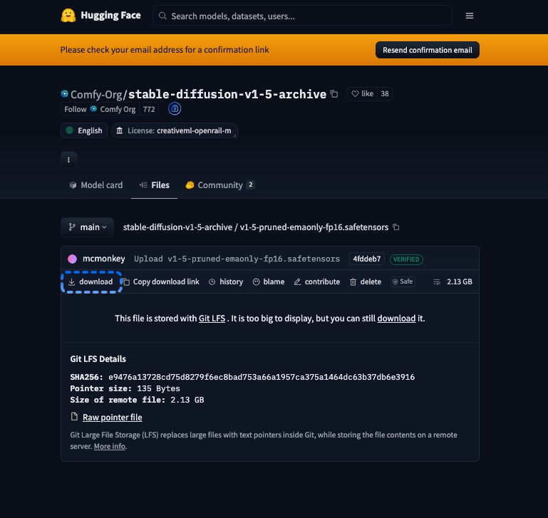

## モデルを `checkpoints` フォルダーに配置する {#put-the-model-in-the-checkpoints-folder}

ComfyUI は、ComfyUI が読み込む `checkpoints` フォルダーにファイルがある場合にのみ、そのチェックポイントを一覧に表示します。ダウンロードしたファイルを、お使いのインストール環境のフォルダーに移動してください。

<Tabs>
  <Tab title="Comfy Desktop">
    デフォルトでは、すべての Comfy Desktop インスタンスが共有モデルフォルダーを読み込みます。Comfy Desktop はモデルのダウンロードを **Downloads** とマークされた共有モデルフォルダーに保存します。

    1. Comfy Desktop の**タイトルバー**で、**メニュー**をクリックし、**デスクトップ設定**を選択します。
    2. **ストレージ**タブを選択します。
    3. **共有モデル**の下で、**Downloads** とマークされたフォルダーパスをクリックします。ファイルマネージャーでそのフォルダーが開きます。
    4. `v1-5-pruned-emaonly-fp16.safetensors` を、その中の `checkpoints` フォルダーに移動します。`checkpoints` フォルダーがない場合は作成してください。
  </Tab>
  <Tab title="ComfyUI Portable">
    - `v1-5-pruned-emaonly-fp16.safetensors` を `ComfyUI_windows_portable\ComfyUI\models\checkpoints` に移動します。

    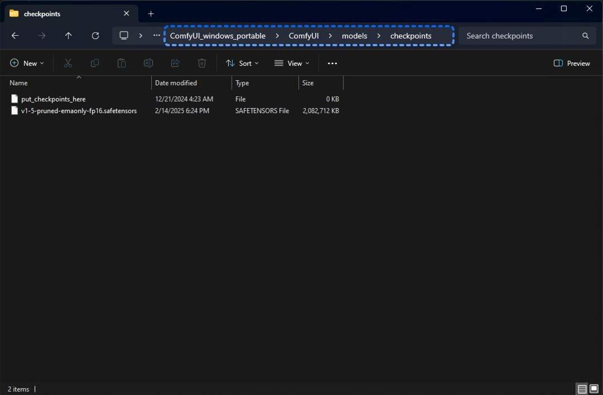
  </Tab>
  <Tab title="手動インストール">
    1. ComfyUI をインストールしたフォルダー（`main.py` が含まれているフォルダー）を開きます。
    2. `v1-5-pruned-emaonly-fp16.safetensors` をその `models/checkpoints` フォルダーに移動します。
  </Tab>
</Tabs>

ComfyUI がすでに開いている場合は、`R` キーを押してモデルフォルダーを再度読み込ませてください。

## 空のワークフローを開く

**キャンバス**は、ノードを配置する広い領域です。すでにワークフローが表示されている場合は、空のワークフローを開きます。

1. **左サイドバー**の上部で、ComfyUIロゴ（**メニュー**）をクリックします。
2. **新規**を選択します。

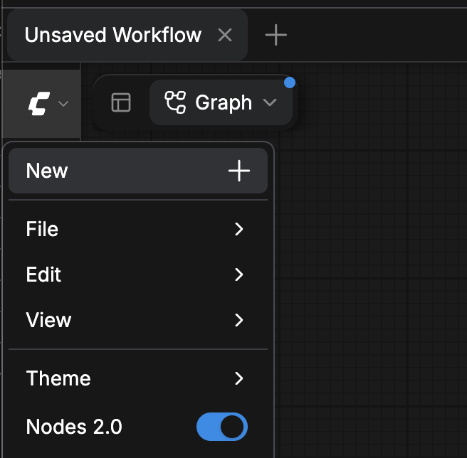

これで**キャンバス**は空になりました。

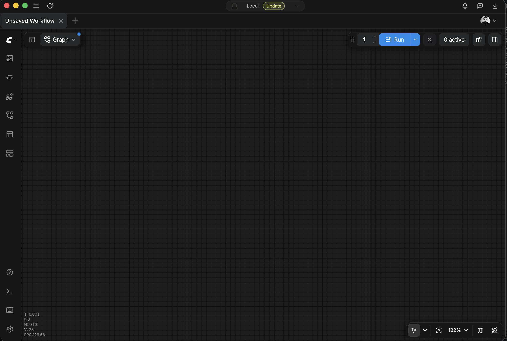

<Tip>
  **トップバー**では、開いているワークフロータブの隣にあるプラス（**+**）ボタンからも新しい空のワークフローを開けます。

  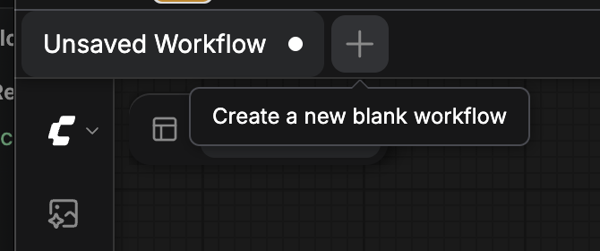
</Tip>

## ノードを追加 {#add-a-node}

ノードを追加する方法は 3 つあります。以降の手順では、どの方法を使うかを示します。

### 「ノードを追加」メニューを使用する {#use-the-add-node-menu}

1. **キャンバス**の空いている場所を右クリックします。メニューが開きます。
2. **ノードを追加**を選択し、続いてノードの**ノードを追加**パスにある各カテゴリを選択します。[ノード表](#learn-the-parts-of-a-workflow)には、このチュートリアルの各ノードのパスが記載されています。
3. ノードを選択します。右クリックした場所にノードが表示されます。

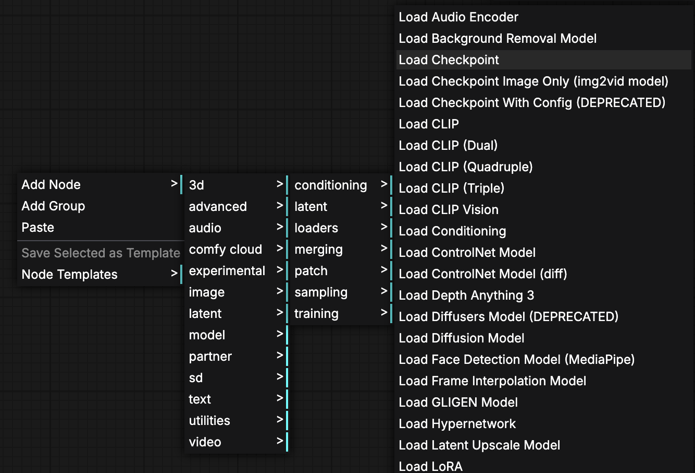

### ノードライブラリで検索する {#search-the-node-library}

1. `N` を押すか、**左サイドバー**の**ノード**をクリックします。**ノードライブラリ**が開きます。
2. **ノードライブラリ**に複数のタブが表示されている場合は、**すべてのノード**を選択します。
3. **ノードを検索...**ボックスにノード名を入力します。
4. 検索結果のノードをクリックし、次に配置したい**キャンバス**上の位置をクリックします。そこにノードが表示されます。

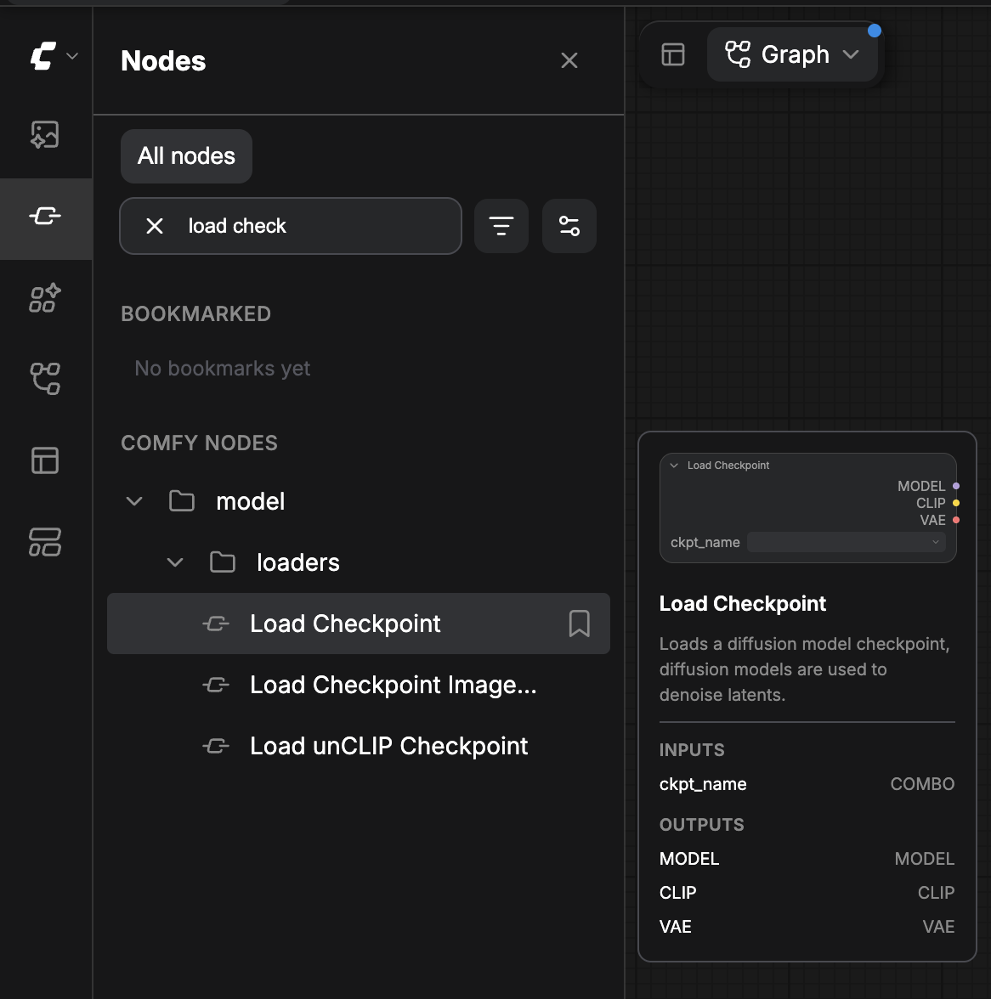

### リンクを空のキャンバスにドラッグする {#drag-a-link-to-empty-canvas}

リンクを空のキャンバスにドラッグすると、1 回の操作でノードの追加と接続が行われます。

1. すでに配置したノードの出力ドットからドラッグします。
2. **キャンバス**の空いている場所の上で離します。デフォルトでは、そこにノード検索ボックスが開きます。
3. ノード名を入力し、ノードを選択します。ComfyUI がノードを追加し、ドラッグ元の出力に接続します。

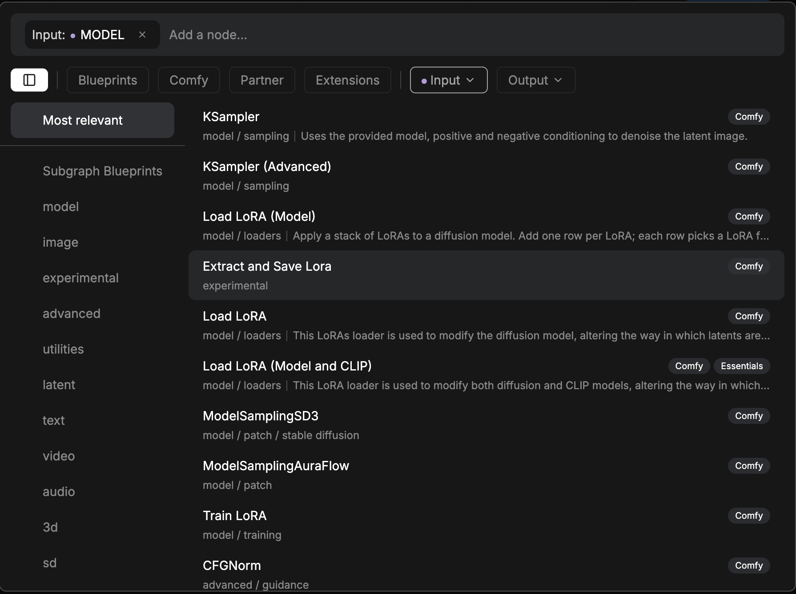

検索ボックスの代わりにメニューを開くには、離すときに `Shift` を押したままにします。

## 2つのノードを接続する {#connect-two-nodes}

リンクは、あるノードの出力から別のノードの入力へデータを運びます。

1. 一方のノードの出力ドットからドラッグします。
2. もう一方のノードの入力ドットの上で離します。2つのドットの間にリンクが表示されます。

これらのルールはすべてのリンクに適用されます：

- 1つの出力から複数の入力へデータを送ることができます。
- 1つの入力には1つのリンクだけを接続できます。入力への新しいリンクは、古いリンクを置き換えます。
- リンクは同じ型の出力と入力を接続します。ComfyUI は異なる型の間にはリンクを描画しません。

## `Load Checkpoint`ノードを追加する

`Load Checkpoint`ノードはモデルファイルを読み込みます。

1. [**ノードを追加**メニュー](#use-the-add-node-menu)から`Load Checkpoint`ノードを追加します：**モデル** > **ローダー** > `Load Checkpoint`（メニューでは「**チェックポイントを読み込む**」と表示されます）。
2. ノード内で`ckpt_name`ウィジェットをクリックし、`v1-5-pruned-emaonly-fp16.safetensors`を選択します。

ノードの右側には、`MODEL`、`CLIP`、`VAE`の3つの出力が表示されます。

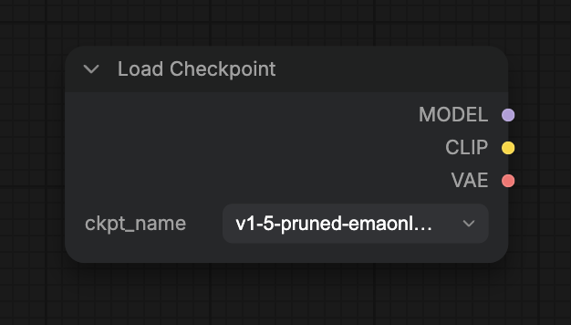

`ckpt_name`リストにファイルが表示されない場合は、[モデルがチェックポイント一覧にありません](#the-model-isnt-in-the-checkpoint-list)を参照してください。

## `KSampler` ノードを追加する

生成を担うのが `KSampler` ノードです。これには4つのリンクが必要です。モデル、2つのプロンプト、そして空の開始画像です。

1. [**ノードライブラリ**](#search-the-node-library)から `KSampler` ノードを追加します。`KSampler` を検索してください（メニューでは「**Kサンプラー**」と表示されます）。
2. `Load Checkpoint` の `MODEL` 出力を `KSampler` の `model` 入力に[接続](#connect-two-nodes)します。

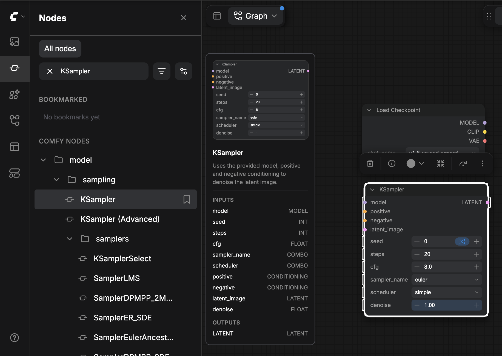

残り3つのリンクは、次の2つのセクションで描画します。

`KSampler` のウィジェットはデフォルト値のままにしてください。例えば、`steps` は `20`、`cfg` は `8.0` です。

## プロンプトノードを追加する

プロンプトは画像を記述するものです。ポジティブプロンプトは表示したい内容を指定します。ネガティブプロンプトは表示したくない内容を指定します。

1. [**ノードを追加**メニュー](#use-the-add-node-menu)（**モデル** > **条件付け**）または[**ノードライブラリ**](#search-the-node-library)から `CLIP Text Encode (Prompt)` ノードを追加します（メニューでは「**CLIPテキストエンコード（プロンプト）**」と表示されます）。
2. テキストボックスをクリックし、ポジティブプロンプトを入力します。例: `beautiful scenery nature glass bottle landscape, purple galaxy bottle`
3. ノードを右クリックし、**複製**を選択します。2つ目の `CLIP Text Encode (Prompt)` ノードが表示されます。
4. 2つ目のノードのテキストボックスをクリックし、ネガティブプロンプトを入力します。例: `text, watermark`

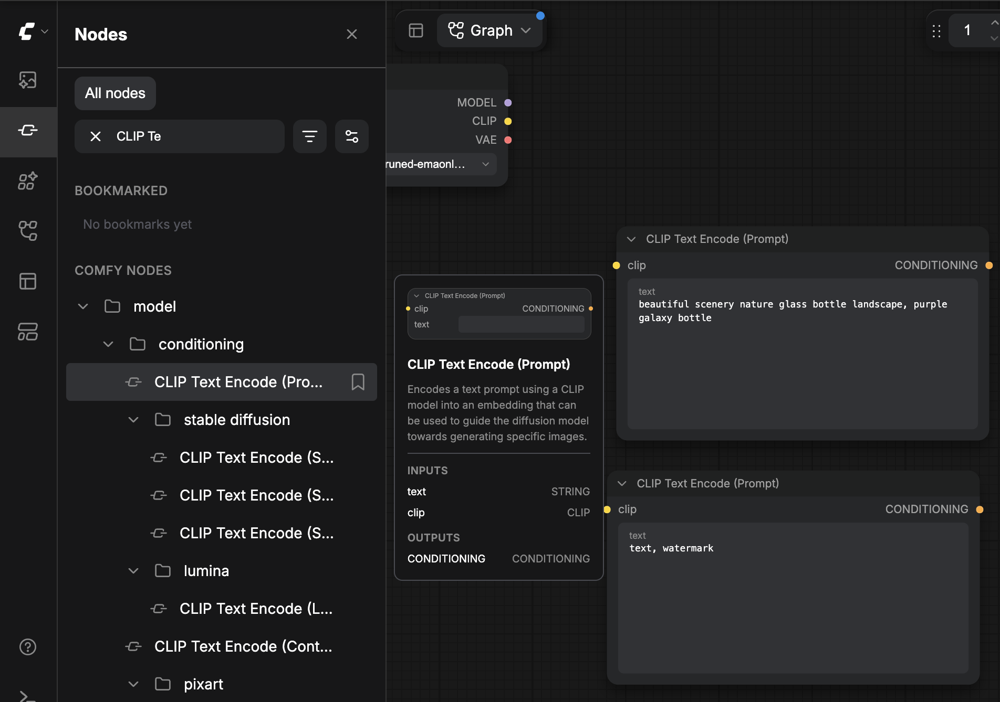

[プロンプトを接続](#connect-two-nodes)します:

1. `Load Checkpoint` の `CLIP` 出力を、各 `CLIP Text Encode (Prompt)` ノードの `clip` 入力に接続します。両方のプロンプトノードは1つの `CLIP` 出力を共有します。
2. ポジティブプロンプトノードの `CONDITIONING` 出力を `KSampler` の `positive` 入力に接続します。
3. ネガティブプロンプトノードの `CONDITIONING` 出力を `KSampler` の `negative` 入力に接続します。

## 画像サイズを設定する

`Empty Latent Image`ノードが画像サイズを設定します。`width`と`height`は`1024`から始まります。このワークフローでは、[画像からワークフローを読み込む](#load-a-workflow-from-an-image)の例のワークフローと同じサイズである`512`を使用します。

1. [**ノードを追加**メニュー](#use-the-add-node-menu)を使って`Empty Latent Image`ノードを追加します: **モデル** > **潜在** > `Empty Latent Image`（メニューでは「**空の潜在画像**」と表示されます）。
2. `width`を`512`に設定します。
3. `height`を`512`に設定します。
4. `batch_size`は`1`のままにします。
5. その`LATENT`出力を`KSampler`の`latent_image`入力に[接続](#connect-two-nodes)します。

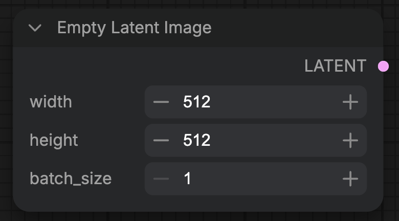

`KSampler`の4つの入力はすべてリンクで接続されました。

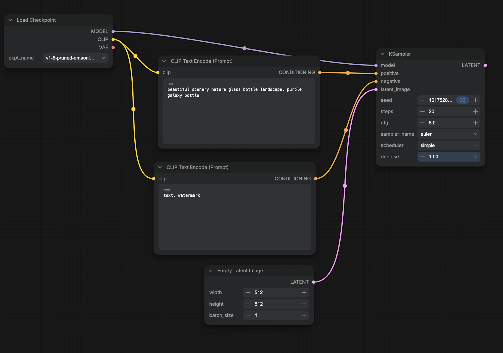

## 画像のデコードと保存

`KSampler` が出力するのは画像ではなく潜在（latent）です。`VAE Decode` がそれを画像に変換し、`Save Image` が保存します。

1. [**ノードライブラリ**](#search-the-node-library)から `VAE Decode` ノードを追加します。`VAE Decode` を検索してください（メニューでは「**VAEデコード**」と表示されます）。
2. `KSampler` の `LATENT` 出力を `VAE Decode` の `samples` 入力に[接続](#connect-two-nodes)します。
3. `Load Checkpoint` の `VAE` 出力を `VAE Decode` の `vae` 入力に接続します。
4. [空のキャンバスにリンクをドラッグ](#drag-a-link-to-empty-canvas)して `Save Image` ノードを追加します。`VAE Decode` の `IMAGE` 出力からドラッグし、何もない**キャンバス**上で離して、`Save Image` を選択してください（メニューでは「**画像を保存**」と表示されます）。その `images` 入力は `IMAGE` にリンクされます。

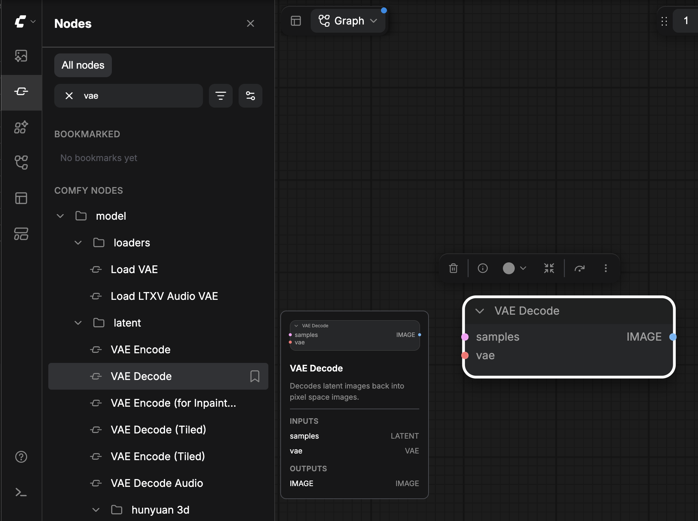

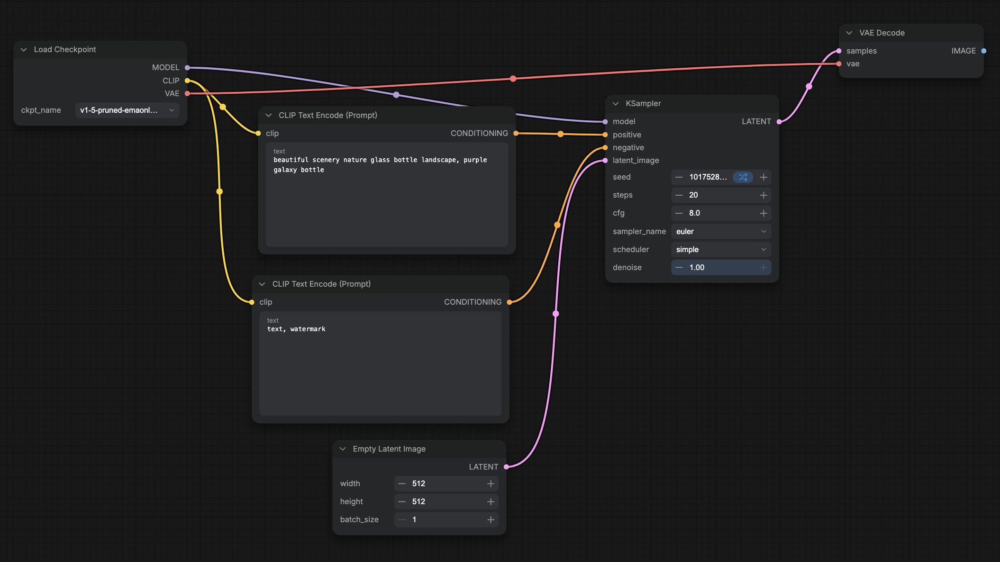

ワークフローには7つのノードと9つのリンクがあります。

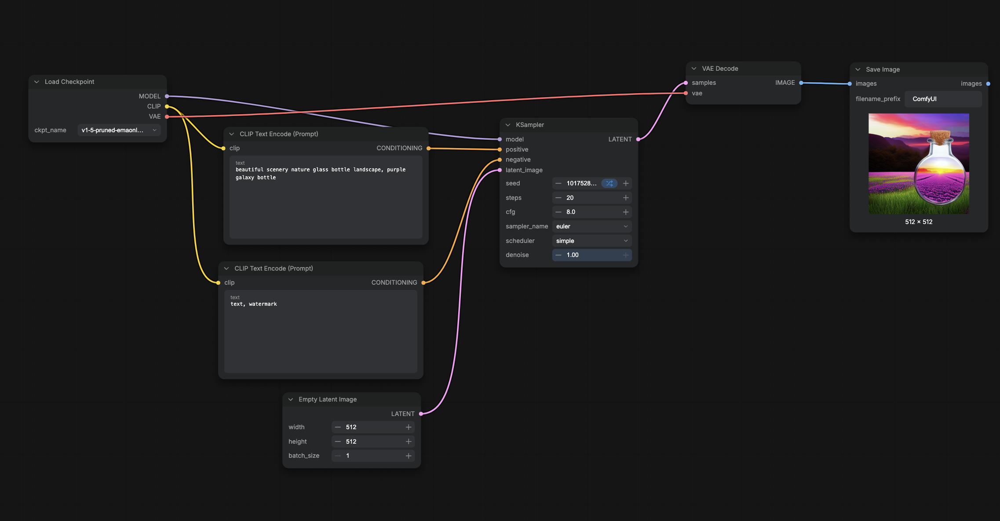

<Tip>
  ノードが選択されていない状態で `.` を押すと、ワークフロー全体が画面にフィットします。
</Tip>

## ワークフローを実行する {#run-the-workflow}

ワークフローを実行するとキューに登録され、ComfyUI が画像を生成します。

- **実行**をクリックするか、`Ctrl+Enter`（macOS では `Cmd+Enter`）を押します。

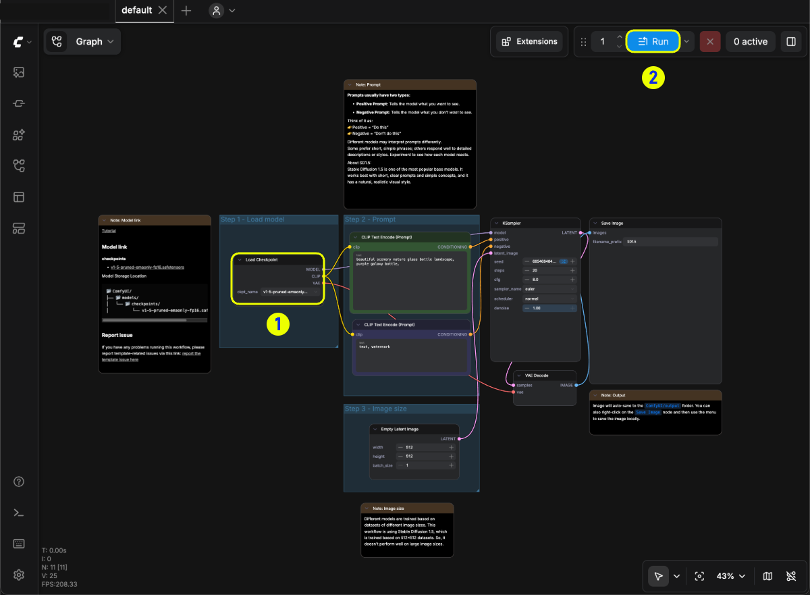

ComfyUI に**必須入力がありません**と表示された場合は、[必須入力がありません](#required-input-missing)を参照してください。

## 生成された画像を確認する

実行が完了すると、画像は `Save Image` ノードに表示されます。**左サイドバー**から開くには:

- **アセット**をクリックし、**生成済み**タブを選択します。

`Save Image` は、`ComfyUI_00001_.png` という名前の PNG ファイルとして画像を出力フォルダーにも書き込みます。新しい画像ごとに番号が増えていきます。ComfyUI Portable および手動インストールの場合、出力フォルダーは `ComfyUI/output` です。

## 画像からワークフローを読み込む {#load-a-workflow-from-an-image}

デフォルトでは、`Save Image` が書き出すすべてのPNGファイルに、その画像を作成したワークフローが含まれています。ご自身が作成したワークフローと比較するために、以下のサンプル画像を読み込んでください。

1. この画像をコンピューターに保存してください:

   

2. PNGファイルを**キャンバス**にドラッグします。**左サイドバー**にあるComfyUIロゴ（**メニュー**）をクリックし、**ファイル** > **開く**を選択してから、ファイルを選択することもできます。

画像に含まれるワークフローが開きます。代わりに`Load Image`ノードが表示された場合は、ドロップしたファイルにワークフローが保存されていません。

## 不足しているモデルを修正する

ワークフローを読み込んだときに、そのモデルファイルがモデルフォルダーにない場合、ComfyUI は不足しているモデル名を示す通知を表示します。たとえば、`v1-5-pruned-emaonly-fp16.safetensors is missing` のようになります。

1. **詳細を表示** をクリックします。**右側のパネル** が **問題** タブで開き、**不足しているモデル** の下にファイルが一覧表示されます。ファイルの配置先フォルダー（`checkpoints` など）がファイル名の下に表示されます。
2. 行に **ダウンロード** ボタンがある場合は、それをクリックします。
   - **Comfy Desktop**：Comfy Desktop は、**DOWNLOADS** モデルフォルダー内の `checkpoints` フォルダーにファイルをダウンロードします。
   - **ComfyUI Portable および手動インストール**：ブラウザーがファイルをダウンロードします。そのファイルを、[モデルをチェックポイントフォルダーに配置する](#put-the-model-in-the-checkpoints-folder) の説明に従って `checkpoints` フォルダーに移動します。
3. 行に **ダウンロード** ボタンがない場合は、ファイルを自分で入手します：
   1. ファイル名の横にあるリンクアイコンをクリックします。リンクアイコンはダウンロードリンク（**URLをコピー**）をコピーします。ワークフローにリンクがない場合は、ファイル名（**モデル名をコピー**）をコピーします。
   2. ファイルをダウンロードします。このチュートリアルのモデルについては、[モデルをダウンロードする](#download-the-model) に従ってください。
   3. ファイルを、ファイル名の下に表示されるフォルダー（`checkpoints` など）に移動します。
4. **不足しているモデル** ヘッダーの **更新**（円形の矢印）をクリックするか、`R` を押して、ComfyUI にモデルフォルダーを再確認させます。

次のいずれかに該当する場合、不足しているモデルの行には **ダウンロード** ボタンが表示されません：

- ワークフローにそのモデルのダウンロードリンクがない。[画像からワークフローを読み込む](#load-a-workflow-from-an-image) のサンプル画像は、このようなワークフローの 1 つです。
- ダウンロードリンクが Hugging Face または Civitai のリンクではない。
- ファイル名が `.safetensors`、`.sft`、`.ckpt`、`.pth`、`.pt` のいずれかで終わっていない。
- ワークフローに、ファイルがどのモデルフォルダーに属するかが示されていない。

<Note>
  Comfy Cloud では、不足しているモデルに対して **ダウンロード** が表示されることはありません。代わりに **インポート** が表示されるため、Comfy Cloud にモデルをインポートできます。インポートされたモデルをサポートしていないノードで使用されるモデルは、**インポートはサポートされていません** の下に一覧表示されます。
</Note>

## トラブルシューティング

実行が失敗したとき、またはモデルファイルが読み込まれないときに、これらの項目を参照してください。

### 必須入力がありません {#required-input-missing}

入力に接続がありません。メッセージには、`KSampler is missing a required input: latent_image` のように、ノードと入力の名前が表示されます。メッセージに示された入力を[接続](#connect-two-nodes)し、ワークフローを再度実行してください。

### モデルがチェックポイント一覧にありません {#the-model-isnt-in-the-checkpoint-list}

ファイルが、ComfyUI が読み取る `checkpoints` フォルダーにありません。そこに移動し、[モデルをチェックポイントフォルダーに配置する](#put-the-model-in-the-checkpoints-folder)の手順に従ってから、`R` を押してください。
